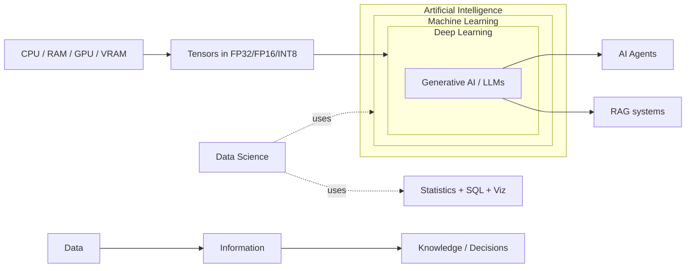
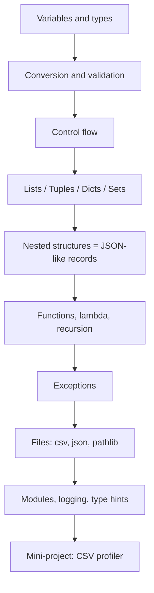
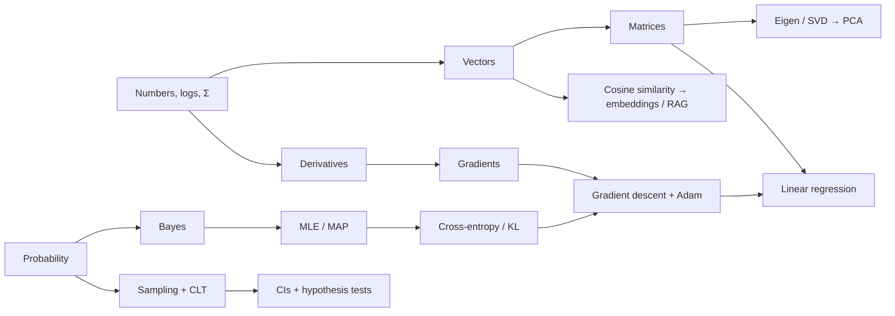
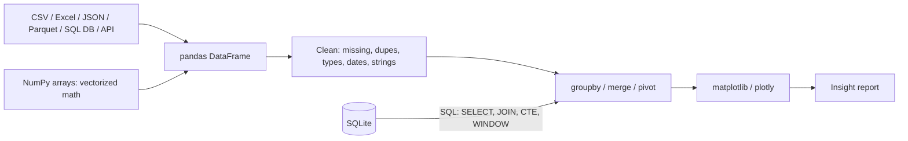
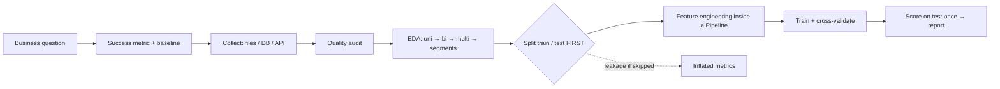
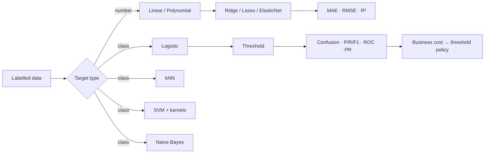
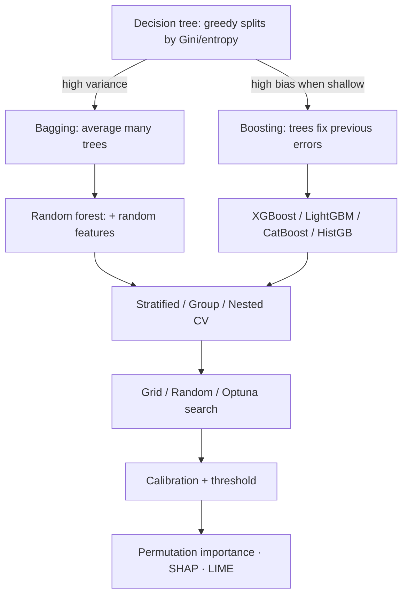
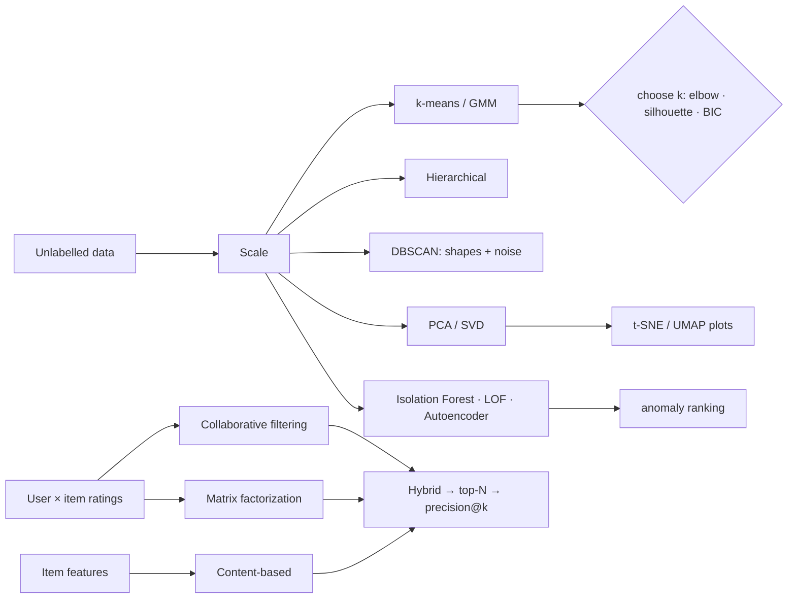

# Data Science & AI Bootcamp — Complete Bilingual Study Guide
### डेटा साइंस और AI — सम्पूर्ण द्विभाषी (English + हिन्दी) Study Guide

## Contents
- Module 1 — AI, Data Science and Your Development Environment
- Module 2 — Python Programming for AI
- Module 3 — Mathematics, Probability and Statistics for AI
- Module 4 — NumPy, pandas, SQL and Visualization
- Module 5 — The Data Science Workflow and Feature Engineering
- Module 6 — Supervised Machine Learning
- Module 7 — Trees, Ensembles, Evaluation and Explainability
- Module 8 — Unsupervised Learning, Anomaly Detection and Recommenders
- Modules 9–18 + Capstones — Compact Study Roadmap (outline)


---

# Module 1 — AI, Data Science and Your Development Environment
### मॉड्यूल 1 — AI, Data Science और आपका Development Environment

> **Phase 1 · Foundations** · Python 3.10+ · CPU is enough · GPU optional (free Colab works)
> Verified with: Python 3.13, NumPy 2.5, pandas 3.0, PyTorch 2.x CPU build (GPU code paths are guarded and marked).

---

## 0. Module map / मॉड्यूल का नक्शा

| # | Lesson | Outcome (you will be able to…) |
|---|--------|-------------------------------|
| 1.1 | Data vs information; AI vs ML vs DL vs Data Science | Place any AI product on the map and explain it to a non-technical manager |
| 1.2 | Traditional programming vs ML; training vs inference; datasets, features, labels; parameters vs hyperparameters | Read any ML problem and name its X, y, model, algorithm, parameters and hyperparameters |
| 1.3 | How computers run AI: CPU, RAM, GPU, VRAM, SSD, CUDA, tensors | Estimate whether a model fits on your machine |
| 1.4 | Number formats (FP32/FP16/BF16/INT8/INT4) and small-VRAM tactics | Calculate model memory and pick a tactic for a 4 GB GPU |
| 1.5 | Python, venv, pip, VS Code, Jupyter, Git, requirements.txt, Colab | Set up a clean, reproducible project in 10 minutes |
| 1.6 | Generative AI, LLMs, agents, and the AI career map | Explain the difference between an LLM, a RAG system and an agent |
| ★ | Mini-project: **AI Environment Diagnostic Tool** | Ship a script that reports your Python, packages, CPU/RAM/GPU and a matmul benchmark |

**Prerequisites:** basic computer use. No math or coding needed yet.
**ज़रूरी पहले से:** बस computer चलाना आना चाहिए। Math या coding अभी ज़रूरी नहीं।



### Setup cell (run first in every notebook)

```python
# Locate the bundled datasets folder no matter where you start Python from.
from pathlib import Path

def find_data() -> Path:
    for p in [Path.cwd(), *Path.cwd().parents]:
        for c in (p / "datasets", p / "tutorials" / "data-science-ai" / "datasets"):
            if (c / "titanic.csv").exists():
                return c
    raise FileNotFoundError("Run from inside tutorials/data-science-ai, or set DATA = Path('<path>/datasets').")

DATA = find_data()
print("Datasets:", sorted(f.name for f in DATA.glob("*.csv")))
```

*Hindi summary:* यह cell `datasets` folder ढूँढता है, ताकि आप कहीं से भी notebook चलाएँ, data मिल जाए। Colab पर पहले `!git clone https://github.com/Rockskp/Rockskp` चलाएँ और फिर `%cd Rockskp/tutorials/data-science-ai`।

---

## Lesson 1.1 — Data vs Information, and the AI map
### पाठ 1.1 — Data बनाम Information, और AI का नक्शा

**a. Concept (English).**
*Data* is raw recorded facts: `22, male, 3rd class, 7.25`. *Information* is data given context and structure so it answers a question: "third-class male passengers had a 13.5% survival rate". *Knowledge* is information you can act on: "allocate lifeboats by deck, not by ticket class".

- **AI** — any technique that makes machines do tasks we'd call intelligent (rules, search, ML…).
- **Machine Learning (ML)** — a subset of AI where behaviour is *learned from data* instead of hand-coded.
- **Deep Learning (DL)** — ML using multi-layer neural networks that learn their own features (images, text, audio).
- **Generative AI** — DL models that *produce* new content (text, images, code). LLMs are the text branch.
- **Data Science** — the discipline of turning data into decisions. It uses statistics, SQL, visualisation and ML, but also business framing and communication. It overlaps AI but is not inside it.

**a. Concept (हिन्दी).**
*Data* मतलब कच्चे तथ्य — जैसे `22, male, 3rd class`। जब इन्हें context मिलता है और ये किसी सवाल का जवाब देते हैं, तब ये *information* बनते हैं — "3rd class के पुरुषों में सिर्फ़ 13.5% बचे"। और जब उस information से कोई action लिया जाए, वो *knowledge* है।
AI सबसे बड़ा घेरा है, उसके अंदर ML (data से सीखना), उसके अंदर Deep Learning (neural networks), और उसके अंदर Generative AI/LLMs। Data Science अलग discipline है जो ML, statistics, SQL सब इस्तेमाल करती है ताकि business decision लिया जा सके।

**b. Intuition / analogy.** Think of a *kirana* store notebook. Each line "Ramesh, 2 kg atta, ₹90" is **data**. "Atta sales double before Diwali" is **information**. "Order 3× atta stock in October" is **knowledge**. An ML model is the experienced shopkeeper who has *learned* this pattern from years of notebooks rather than being told the rule.
*कि़राना दुकान की कॉपी = data, "दीवाली से पहले आटा दोगुना बिकता है" = information, "अक्टूबर में 3 गुना stock मँगाओ" = knowledge।*

**c. Math (just enough).** Survival rate of a group = (survivors in group) / (people in group). Worked on Titanic: 3rd-class males → 47 survived / 347 total = **0.135**. That single division turns 347 rows of data into one piece of information.

**d. Code.**

```python
import csv

with open(DATA / "titanic.csv", newline="") as f:
    rows = list(csv.DictReader(f))          # raw DATA: 891 dict rows

print("Raw data, first row:", rows[0])
group = [r for r in rows if r["pclass"] == "3" and r["sex"] == "male"]
survived = sum(int(r["survived"]) for r in group)
print(f"INFORMATION: 3rd-class males survival = {survived}/{len(group)} = {survived/len(group):.3f}")
```

*Hindi summary:* हमने 891 कच्ची rows (data) पढ़ीं और एक सवाल पूछकर उन्हें एक number (information) में बदल दिया।

**e. Common mistakes & interview traps.**
- "AI = ML" — wrong; rule-based expert systems and search (chess engines) are AI without learning.
- "Data Science is a subset of AI" — it overlaps; a dashboard + A/B test is data science with zero ML.
- Trap: *"Is ChatGPT deep learning?"* Yes — a Transformer neural network (DL) that is generative (GenAI), trained with ML methods, inside the AI umbrella.

**f. Memory aids.**
- Mnemonic: **"A-M-D-G" — Aam Mein Doodh Gira** → AI ⊃ ML ⊃ DL ⊃ GenAI.
- **याद रखो:** *"Data कच्चा आटा है, information रोटी है, knowledge भूख मिटाना है।"*

| # | Q (EN / HI) | A |
|---|---|---|
| 1 | Data vs information? / Data और information में फ़र्क? | Information = data + context that answers a question |
| 2 | Is every AI system ML? / क्या हर AI, ML है? | No — rules/search are AI without learning |
| 3 | What makes DL "deep"? / DL "deep" क्यों? | Many stacked neural-network layers that learn features |
| 4 | Where do LLMs sit? / LLM कहाँ आते हैं? | GenAI ⊂ DL ⊂ ML ⊂ AI |
| 5 | Data Science's end product? / Data Science का final output? | A decision or action, not a model |

**g. Practice.**
1. *(Easy)* Compute the survival rate of 1st-class females.
2. *(Medium)* Classify each as AI-not-ML / ML-not-DL / DL / GenAI: Excel IF-rules for loan approval, a spam filter using word counts, a face-unlock camera, an image generator.
3. *(Hard)* Write a function `rate(rows, **filters)` returning the survival rate for any combination of column filters.

<details><summary>Solutions / हल</summary>

```python
g = [r for r in rows if r["pclass"] == "1" and r["sex"] == "female"]
print("1st-class female survival:", round(sum(int(r["survived"]) for r in g) / len(g), 3))

# 2: IF-rules = AI-not-ML; word-count spam filter (naive Bayes) = ML-not-DL;
#    face unlock = DL (CNN); image generator = GenAI (diffusion model).

def rate(rows, **filters):
    g = [r for r in rows if all(r[k] == str(v) for k, v in filters.items())]
    return round(sum(int(r["survived"]) for r in g) / len(g), 3) if g else None

print(rate(rows, pclass=3, sex="male"), rate(rows, embarked="C"))
```
</details>

**h. Quiz.**
1. Which is *information*? (a) `7.25` (b) "Average 3rd-class fare was £13.7" (c) a CSV file
2. A chess engine using brute-force search is: (a) ML (b) AI but not ML (c) DL
3. Which statement is true? (a) DL ⊃ ML (b) ML ⊃ DL (c) they are disjoint
4. Data Science requires ML. (True/False)
5. An LLM is an example of: (a) GenAI (b) rule-based AI (c) a database

<details><summary>Answers</summary>

1-(b) context + aggregate answers a question. 2-(b) no learning from data. 3-(b) DL is a kind of ML. 4-False, many DS projects are SQL + stats + viz. 5-(a).
</details>

---

## Lesson 1.2 — How ML differs: training, inference, features, labels, parameters
### पाठ 1.2 — ML कैसे अलग है: training, inference, features, labels, parameters

**a. Concept (English).**
- **Traditional programming:** `rules + data → answers`. A human writes the rules.
- **Machine learning:** `data + answers → rules`. The algorithm *finds* the rules (the model).
- **Dataset** = table of examples. Each column used as input is a **feature** (X); the column we want to predict is the **label/target** (y). One row = one **sample**.
- **Algorithm** = the learning recipe (e.g. "gradient descent on logistic loss"). **Model** = the learned artifact the recipe produced (the specific weights). Same algorithm + different data → different model.
- **Training** = fitting the model on labelled data (expensive, done occasionally). **Inference** = using the trained model to predict new rows (cheap, done millions of times; this is what latency SLOs are about).
- **Parameters** = values *learned* during training (weights, biases, tree split thresholds). **Hyperparameters** = values *you choose before* training (learning rate, tree depth, number of layers, batch size).

**a. Concept (हिन्दी).**
Normal programming में इंसान rules लिखता है। ML में हम data और सही जवाब देते हैं, और algorithm खुद rules (model) ढूँढता है। Table का हर input column एक *feature* है, जिसे predict करना है वो *label*। *Algorithm* तरीका है, *model* उस तरीके से बना नतीजा। *Training* = सीखना (महँगा, कभी-कभी), *inference* = सीखे हुए model से नया जवाब देना (सस्ता, बार-बार)। *Parameters* model खुद सीखता है; *hyperparameters* हम पहले से तय करते हैं।

**b. Intuition.** Cooking: the **algorithm** is "taste, adjust salt, repeat"; the **model** is your mother's final dal recipe; **parameters** are the exact grams of salt she converged on; **hyperparameters** are choices made before cooking — which pot, how many tasting rounds; **training** is the years of practice; **inference** is cooking tonight's dal in 20 minutes.

**c. Math.** A one-feature linear model: ŷ = w·x + b. Parameters: *w, b*. Training finds *w, b* minimising mean squared error  MSE = (1/n) Σ (yᵢ − ŷᵢ)². Worked example (penguins): predict body mass (g) from flipper length (mm). Least squares gives **w ≈ 50.2 g/mm, b ≈ −5872 g** (on the 333 complete rows); so a 200 mm flipper → 50.2·200 − 5872 ≈ **4159 g**. (We verify these numbers in code.)

**d. Code.**

```python
import numpy as np, pandas as pd

peng = pd.read_csv(DATA / "penguins.csv").dropna()
X = peng["flipper_length_mm"].to_numpy(float)   # feature
y = peng["body_mass_g"].to_numpy(float)          # label

# TRAINING: the algorithm (closed-form least squares) learns the PARAMETERS w, b
w, b = np.polyfit(X, y, deg=1)
print(f"learned parameters: w={w:.1f} g/mm, b={b:.0f} g")

# INFERENCE: use the model on a new penguin
def predict(flipper_mm: float) -> float:
    return w * flipper_mm + b
print(f"200 mm flipper -> {predict(200):.0f} g")

# Traditional programming for contrast: a human-written rule
rule = lambda f: 5000 if f > 205 else 3700
print("rule-based guess:", rule(200), "| MSE model:", round(np.mean((y - predict(X))**2)),
      "| MSE rule:", round(np.mean((y - np.vectorize(rule)(X))**2)))
```

*Hindi summary:* `polyfit` (algorithm) ने data से `w, b` (parameters) सीखे = training। `predict()` नया penguin देखकर वज़न बताता है = inference। इंसानी rule का error (MSE) ज़्यादा आता है।

**e. Mistakes & traps.**
- Calling the learning rate a "parameter" — it is a **hyperparameter**.
- Using the label (or something derived from it) as a feature → *target leakage* (Module 5).
- Trap: *"Why is inference cost often bigger than training cost in production?"* Because inference runs on every request forever; a 10 ms model at 1 000 RPS = 86 M calls/day.

**f. Memory aids.**
- Mnemonic: **"Rules-in vs Rules-out"** — traditional code puts rules *in*, ML gets rules *out*.
- **याद रखो:** *"Parameter model सीखता है, hyperparameter हम चुनते हैं।"*

| # | Q | A |
|---|---|---|
| 1 | Features vs label? / features और label? | Inputs X vs target y |
| 2 | Model vs algorithm? | Learned artifact vs recipe that learns it |
| 3 | Is tree max_depth a parameter? | No — hyperparameter |
| 4 | Training vs inference? / सीखना बनाम उपयोग | Fit on labelled data vs predict new rows |
| 5 | ML's formula? | data + answers → rules |

**g. Practice.**
1. *(Easy)* In Titanic, name the label and three features.
2. *(Medium)* Fit `body_mass_g` from `bill_length_mm` and compare MSE with the flipper model. Which feature is more informative?
3. *(Hard)* List the parameters and hyperparameters of a neural network with 2 hidden layers of 64 units trained with Adam at lr=1e-3 for 20 epochs.

<details><summary>Solutions / हल</summary>

```python
# 1: label = survived; features e.g. pclass, sex, age, fare
Xb = peng["bill_length_mm"].to_numpy(float)
wb, bb = np.polyfit(Xb, y, 1)
mse_bill = np.mean((y - (wb * Xb + bb))**2)
mse_flip = np.mean((y - predict(X))**2)
print(f"MSE bill={mse_bill:.0f}  MSE flipper={mse_flip:.0f}  -> flipper is more informative")
# 3: parameters = all weight matrices and bias vectors of the 3 layers.
#    hyperparameters = #layers (2), width (64), optimizer (Adam), lr (1e-3), epochs (20), batch size, activation.
```
</details>

**h. Quiz.**
1. In ML, what does the human mainly supply? (a) rules (b) examples with answers (c) weights
2. Batch size is a: (a) parameter (b) hyperparameter (c) label
3. Which is usually done once per week, not per request? (a) training (b) inference
4. Same algorithm, two datasets → (a) same model (b) different models
5. A feature that is computed from the label is: (a) great (b) leakage

<details><summary>Answers</summary>1-b, 2-b, 3-a, 4-b, 5-b (it won't exist at prediction time).</details>

---

## Lesson 1.3 — How computers run AI: CPU, RAM, GPU, VRAM, CUDA, tensors
### पाठ 1.3 — Computer AI कैसे चलाता है

**a. Concept (English).**
- **CPU**: a few (4–32) powerful cores, great at branching, sequential logic. **GPU**: thousands of simple cores doing the *same* operation on many numbers at once (SIMT). Neural networks are mostly matrix multiplications → embarrassingly parallel → GPUs win 10–100×.
- **RAM** holds data for the CPU; **VRAM** is the GPU's own memory. A model must fit (weights + activations + optimizer state) in VRAM to train on GPU. **SSD** stores datasets/checkpoints; slow disks starve the GPU (data-loader bottleneck).
- **CUDA** is NVIDIA's platform for running general code on its GPUs; PyTorch calls CUDA libraries (cuBLAS, cuDNN). Driver version must support the CUDA version your PyTorch wheel was built with. Apple Silicon uses **MPS** instead.
- **Tensor** = n-dimensional array with a dtype and a device: scalar (0-D), vector (1-D), matrix (2-D), a batch of RGB images (4-D: N×C×H×W).

**a. Concept (हिन्दी).**
CPU में कुछ ही पर बहुत तेज़ cores होते हैं — जैसे कुछ expert chef। GPU में हज़ारों छोटे cores होते हैं जो एक साथ एक ही काम करते हैं — जैसे हज़ार लोग एक साथ प्याज़ काट रहे हों। Neural network ज़्यादातर matrix multiplication है, इसलिए GPU बहुत तेज़। Model को train करने के लिए weights + activations + optimizer state सब VRAM में आने चाहिए। CUDA NVIDIA का software है जिससे PyTorch GPU इस्तेमाल करता है। Tensor = कई dimension वाला array।

**b. Intuition.** CPU = 8 senior chefs who can cook any dish; GPU = 3 000 helpers who can only chop, but all at once. Making 10 000 rotis (matrix multiply) → hire the helpers. VRAM = the counter space next to the helpers; if ingredients (weights) don't fit on the counter, they must keep walking to the store (RAM/SSD) and everything slows down.

**c. Math.** Multiplying an (m×k) by a (k×n) matrix costs ≈ **2·m·k·n FLOPs**. For 1024×1024 @ 1024×1024: 2·1024³ ≈ **2.1 GFLOP**. A laptop CPU doing ~100 GFLOP/s needs ~20 ms; an RTX 3050 (~9 TFLOP/s FP32 peak) ~0.25 ms in theory. Memory of a tensor = elements × bytes per element: a 1024×1024 FP32 matrix = 1 048 576 × 4 B = **4 MiB**.

**d. Code.**

```python
import time, importlib.util
import numpy as np

a = np.random.default_rng(0).standard_normal((1024, 1024), dtype=np.float32)
t0 = time.perf_counter(); _ = a @ a; dt = time.perf_counter() - t0
flops = 2 * 1024**3
print(f"CPU matmul: {dt*1e3:.1f} ms  ->  {flops/dt/1e9:.1f} GFLOP/s")
print(f"Tensor memory: {a.nbytes/2**20:.1f} MiB, shape={a.shape}, dtype={a.dtype}")

if importlib.util.find_spec("torch"):
    import torch
    dev = "cuda" if torch.cuda.is_available() else ("mps" if torch.backends.mps.is_available() else "cpu")
    t = torch.from_numpy(a).to(dev)
    print("torch device:", dev, "| tensor dims:", t.ndim, "| batch of images shape example:", tuple(torch.zeros(8, 3, 32, 32).shape))
    if dev == "cuda":
        print("GPU:", torch.cuda.get_device_name(0),
              f"VRAM total {torch.cuda.get_device_properties(0).total_memory/2**30:.1f} GiB")
else:
    print("PyTorch not installed - fine for now (install in Lesson 1.5).")
```

*Hindi summary:* हमने CPU पर 1024×1024 matrix multiply करके speed (GFLOP/s) नापी और tensor की memory निकाली। अगर PyTorch है तो देखते हैं कि GPU (cuda/mps) मिला या नहीं।

**e. Mistakes & traps.**
- Installing the CPU-only PyTorch wheel and wondering why `cuda.is_available()` is False — pick the CUDA wheel from pytorch.org's selector.
- Thinking "more VRAM = faster". VRAM decides *what fits*; compute and memory bandwidth decide *speed*.
- Moving tensors CPU↔GPU inside the training loop every step (PCIe transfer kills throughput).
- Trap: *"Why does a GPU sit at 30% utilisation?"* Usually the input pipeline (disk, decoding, too few `num_workers`) — not the model.

**f. Memory aids.**
- Mnemonic: **"CPU = Captain, GPU = Ganga of workers."**
- **याद रखो:** *"VRAM तय करता है क्या फ़िट होगा, compute तय करता है कितना तेज़ चलेगा।"*

| # | Q | A |
|---|---|---|
| 1 | Why are GPUs fast for DL? | Thousands of cores run identical matmul ops in parallel |
| 2 | FLOPs for (m×k)@(k×n)? | ≈ 2mkn |
| 3 | What is CUDA? | NVIDIA's GPU computing platform used by PyTorch |
| 4 | Image batch tensor shape? | N×C×H×W |
| 5 | Low GPU utilisation usual cause? | Data loading bottleneck |

**g. Practice.**
1. *(Easy)* How many MiB is a 4096×4096 FP32 matrix?
2. *(Medium)* Time matmul for sizes 256, 512, 1024, 2048 and show time grows ≈ n³.
3. *(Hard)* Estimate the memory of a batch of 32 RGB images 224×224 in FP32 and in FP16.

<details><summary>Solutions / हल</summary>

```python
print("1:", 4096*4096*4/2**20, "MiB")
for n in (256, 512, 1024, 2048):
    m = np.ones((n, n), np.float32); t0 = time.perf_counter(); m @ m
    print(f"n={n:5d}  {1e3*(time.perf_counter()-t0):8.2f} ms")
elems = 32*3*224*224
print(f"3: FP32 {elems*4/2**20:.1f} MiB, FP16 {elems*2/2**20:.1f} MiB")
```
</details>

**h. Quiz.**
1. Main reason GPUs speed up neural nets? (a) bigger cache (b) massive parallelism (c) higher clock
2. A 1000×1000 FP32 matrix is about: (a) 4 MB (b) 40 MB (c) 0.4 MB
3. Apple-Silicon equivalent of CUDA in PyTorch: (a) ROCm (b) MPS (c) TPU
4. A 4-D tensor of images is ordered in PyTorch as: (a) N,H,W,C (b) N,C,H,W
5. VRAM mostly limits: (a) model/batch size that fits (b) clock speed

<details><summary>Answers</summary>1-b, 2-a (10⁶×4 B), 3-b, 4-b (PyTorch default "channels first"), 5-a.</details>

---

## Lesson 1.4 — Number formats and 4 GB-VRAM survival tactics
### पाठ 1.4 — Number formats और कम VRAM में काम कैसे चलाएँ

**a. Concept (English).**

| Format | Bytes | Range / precision | Typical use |
|---|---|---|---|
| FP32 | 4 | ~7 decimal digits, huge range | default training, master weights |
| FP16 | 2 | ~3 digits, max ≈ 65 504 (overflow risk) | mixed-precision training with loss scaling |
| BF16 | 2 | ~2–3 digits, *same range as FP32* | modern training (Ampere+ GPUs, TPUs) |
| INT8 | 1 | 256 levels + scale | inference quantization |
| INT4 / NF4 | 0.5 | 16 levels + scale | LLM inference, QLoRA |

**Training memory rule of thumb (Adam, FP32):** weights 4 B + gradients 4 B + Adam m and v 8 B = **16 bytes per parameter**, plus activations. Inference needs only weights (+ KV cache for LLMs).

Tactics for a 4 GB GPU (e.g. laptop RTX 3050):
1. **Smaller batch + gradient accumulation** — run 4 micro-batches of 8, sum gradients, step once = effective batch 32.
2. **Mixed precision (AMP)** — compute in FP16/BF16, keep FP32 master weights; ~½ activation memory, faster on Tensor Cores.
3. **Lower input resolution / sequence length** — activation memory scales with H×W (or tokens²for attention).
4. **Quantization** — load weights in INT8/4-bit for inference or QLoRA fine-tuning.
5. **Offloading** — keep some layers/optimizer state in CPU RAM (slower, but fits).
6. **Gradient checkpointing** — recompute activations in backward instead of storing them.
7. Free the cache: `del` big tensors, `torch.cuda.empty_cache()` (returns cached blocks to the driver; does *not* free memory still referenced).

**a. Concept (हिन्दी).**
हर number कितनी जगह लेता है, ये format तय करता है: FP32 = 4 byte, FP16/BF16 = 2 byte, INT8 = 1 byte, INT4 = आधा byte। Adam से training में हर parameter को लगभग 16 byte चाहिए। 4 GB GPU पर काम चलाने के तरीके: छोटा batch + gradient accumulation, mixed precision (FP16/BF16), छोटी image size, quantization, offloading, gradient checkpointing। BF16 की range FP32 जितनी है, इसलिए overflow कम होता है।

**b. Intuition.** Formats are like measuring rice: FP32 = a jeweller's scale (precise, heavy), BF16 = a kitchen scale with the same max weight but fewer decimals, INT4 = counting in fistfuls. Gradient accumulation = carrying 32 bricks in 4 trips of 8 when your hands can't hold 32 at once — same total work, smaller peak load.

**c. Math.** Worked example — can a 1.1 B-parameter LLM run on 4 GB?
- FP32 weights: 1.1e9 × 4 B = 4.4 GB ✗
- FP16: 2.2 GB ✓ (tight with KV cache)
- INT4: 0.55 GB ✓✓
- Full FP32 Adam training: 1.1e9 × 16 B = 17.6 GB ✗✗ → this is why LoRA/QLoRA exist (Module 14).

FP16 overflow: 300² = 90 000 > 65 504 → `inf` in FP16, fine in BF16.

**d. Code.**

```python
import numpy as np

def model_memory_gb(n_params: float, bytes_per_param: float) -> float:
    return n_params * bytes_per_param / 1e9

for name, b in {"FP32": 4, "FP16/BF16": 2, "INT8": 1, "INT4": 0.5, "Adam-train FP32": 16}.items():
    print(f"{name:16s} 1.1B params -> {model_memory_gb(1.1e9, b):5.2f} GB")

# Precision demo: FP16 overflow and rounding
with np.errstate(over="ignore"):
    print("FP16 300*300 =", np.float16(300) * np.float16(300))   # inf: exceeds 65 504
print("FP32 0.1+0.2 =", np.float32(0.1) + np.float32(0.2), "| FP16:", np.float16(0.1) + np.float16(0.2))

# Simple symmetric INT8 quantization of a weight vector
w = np.random.default_rng(1).standard_normal(1000).astype(np.float32)
scale = np.abs(w).max() / 127
q = np.round(w / scale).astype(np.int8)             # stored: 1 byte each
w_hat = q.astype(np.float32) * scale                # dequantized
print(f"INT8 size {q.nbytes} B vs FP32 {w.nbytes} B, mean abs error {np.abs(w - w_hat).mean():.4f}")
```

```python
# Gradient accumulation + mixed precision pattern (runs on CPU; uses AMP only if CUDA exists)
import importlib.util
if importlib.util.find_spec("torch"):
    import torch, torch.nn as nn
    torch.manual_seed(0)
    dev = "cuda" if torch.cuda.is_available() else "cpu"
    model = nn.Sequential(nn.Linear(20, 64), nn.ReLU(), nn.Linear(64, 1)).to(dev)
    opt = torch.optim.AdamW(model.parameters(), lr=1e-2)
    X, y = torch.randn(256, 20, device=dev), torch.randn(256, 1, device=dev)
    accum, micro = 4, 16                                   # effective batch = 64
    scaler = torch.amp.GradScaler("cuda", enabled=(dev == "cuda"))
    for step in range(0, 256, micro):
        xb, yb = X[step:step+micro], y[step:step+micro]
        with torch.autocast(device_type=dev, dtype=torch.float16 if dev == "cuda" else torch.bfloat16, enabled=(dev=="cuda")):
            loss = nn.functional.mse_loss(model(xb), yb) / accum   # divide so the sum equals the big-batch mean
        scaler.scale(loss).backward()
        if (step // micro + 1) % accum == 0:
            scaler.step(opt); scaler.update(); opt.zero_grad(set_to_none=True)
    print("accumulation loop finished, last micro-loss:", round(loss.item() * accum, 4))
```

*Hindi summary:* पहला block बताता है कि 1.1B model किस format में कितनी GB लेगा, FP16 overflow दिखाता है, और INT8 quantization से 4× कम memory। दूसरा block gradient accumulation का असली pattern है — loss को `accum` से divide करना मत भूलना।

**e. Mistakes & traps.**
- Forgetting to divide the loss by `accum` → effective learning rate ×4.
- Using FP16 without a `GradScaler` → small gradients underflow to 0.
- Expecting BatchNorm to behave the same with micro-batches — it sees only the micro-batch (use GroupNorm/LayerNorm or larger micro-batches).
- Trap: *"FP16 vs BF16?"* Same size; BF16 keeps FP32's 8 exponent bits (range), FP16 has more mantissa bits (precision) but overflows at 65 504.

**f. Memory aids.**
- Mnemonic: **"4-2-1-½"** bytes for FP32-FP16-INT8-INT4, and **"Adam eats 16"**.
- **याद रखो:** *"Batch छोटा करो, steps जोड़ो — accumulation से बड़ा batch बिना बड़ी VRAM।"*

| # | Q | A |
|---|---|---|
| 1 | Bytes/param for Adam FP32 training? | ~16 |
| 2 | BF16's advantage over FP16? | FP32-like range, fewer overflows |
| 3 | What does gradient accumulation trade? | More steps (time) for less peak memory |
| 4 | INT4 7B model weight size? | ~3.5 GB |
| 5 | Does `empty_cache()` free live tensors? | No |

**g. Practice.**
1. *(Easy)* Weight size of a 7 B model in FP16 and INT4?
2. *(Medium)* Quantize the vector `w` above to INT4 (levels −7..7) and compare error with INT8.
3. *(Hard)* You need effective batch 128 but only 16 fit. Write the accumulation constant and the loss scaling factor.

<details><summary>Solutions / हल</summary>

```python
print("1:", model_memory_gb(7e9, 2), "GB FP16;", model_memory_gb(7e9, 0.5), "GB INT4")
s4 = np.abs(w).max() / 7
w4 = np.clip(np.round(w / s4), -7, 7) * s4
print(f"2: INT4 error {np.abs(w-w4).mean():.4f} vs INT8 {np.abs(w-w_hat).mean():.4f}")
print("3: accum =", 128 // 16, "-> loss = loss / 8")
```
</details>

**h. Quiz.**
1. FP16 max value ≈ (a) 3.4e38 (b) 65 504 (c) 255
2. Mixed precision keeps master weights in: (a) FP32 (b) INT8
3. 4 micro-batches of 8 with accumulation ≈ batch of: (a) 8 (b) 32
4. Which reduces memory but costs extra compute? (a) gradient checkpointing (b) bigger batch
5. INT8 quantization stores a weight in: (a) 1 byte + shared scale (b) 4 bytes

<details><summary>Answers</summary>1-b, 2-a, 3-b, 4-a (recompute activations), 5-a.</details>

---

## Lesson 1.5 — Python, virtual environments, VS Code, Jupyter, Git and Colab
### पाठ 1.5 — Python, venv, VS Code, Jupyter, Git और Colab

**a. Concept (English).**
A reproducible AI project = **pinned interpreter + isolated environment + pinned dependencies + version-controlled code**.
- `python -m venv .venv` creates an isolated environment so project A's `numpy 1.x` never breaks project B's `numpy 2.x`.
- `pip install -r requirements.txt` installs exact versions; `pip freeze > requirements.txt` records them.
- **VS Code** + Python and Jupyter extensions: select the `.venv` interpreter (Ctrl+Shift+P → *Python: Select Interpreter*).
- **Jupyter** is for exploration; move stable code into `.py` modules and tests.
- **Git** tracks history; **GitHub** hosts it. Never commit `.venv/`, data dumps, or secrets — use `.gitignore`.
- **Colab**: free GPU (usually a T4 with ~15 GB VRAM, subject to availability and quotas): *Runtime → Change runtime type → GPU*.

**a. Concept (हिन्दी).**
Reproducible project का मतलब: कोई भी दूसरा इंसान, किसी दूसरे laptop पर, वही result पाए। इसके लिए हर project का अलग `venv`, exact versions वाली `requirements.txt`, और Git में code चाहिए। VS Code में सही interpreter (.venv) चुनना ज़रूरी है। Notebook explore करने के लिए है, पक्का code `.py` file में रखें। GPU नहीं है? Colab पर मुफ़्त GPU मिलता है।

**b. Intuition.** A venv is a *tiffin box per project*: dal doesn't leak into the kheer. `requirements.txt` is the recipe card with exact quantities. Git is the photo album of every version of the dish.

**c. Math.** None needed. One useful number: dependency conflicts grow roughly with the number of *shared* packages across projects — isolation reduces that to zero.

**d. Code / commands.** (Shell commands are for your terminal, so they're marked `norun`.)

```python
# norun
# Windows (PowerShell)                         # macOS / Linux
# py -3.12 -m venv .venv                       python3 -m venv .venv
# .venv\Scripts\Activate.ps1                   source .venv/bin/activate
python -m pip install --upgrade pip
pip install -r tutorials/data-science-ai/requirements.txt
# GPU PyTorch: copy the exact command from https://pytorch.org/get-started/locally/
pip freeze > requirements.lock.txt
git init && git add . && git commit -m "Initial project"
```

```python
# Check that you're inside a virtual environment and which packages are present
import sys, importlib.metadata as md
in_venv = sys.prefix != getattr(sys, "base_prefix", sys.prefix)
print("Python", sys.version.split()[0], "| in venv:", in_venv, "| exe:", sys.executable)
for pkg in ["numpy", "pandas", "scikit-learn", "matplotlib", "torch", "jupyter"]:
    try:
        print(f"  {pkg:13s} {md.version(pkg)}")
    except md.PackageNotFoundError:
        print(f"  {pkg:13s} NOT INSTALLED")
```

Recommended `.gitignore` lines: `.venv/`, `__pycache__/`, `.ipynb_checkpoints/`, `*.pt`, `data/raw/`, `.env`.

*Hindi summary:* पहले venv बनाओ और activate करो, फिर requirements install करो। ऊपर वाला code बताता है कि आप venv के अंदर हो या नहीं और कौन से packages install हैं।

**e. Mistakes & traps.**
- `pip install` into the global Python, then Jupyter uses a different kernel → "ModuleNotFoundError". Fix: `python -m pip …` with the same interpreter, or `%pip install` inside the notebook.
- Committing an API key. Rotate it immediately — deleting the commit is not enough.
- `requirements.txt` with no versions → "works on my machine" bugs months later.
- Trap: *"pip vs conda vs uv?"* pip = standard installer; conda also manages non-Python binaries (CUDA libs); uv = very fast pip-compatible resolver. Any is fine if versions are pinned.

**f. Memory aids.**
- Mnemonic: **"V-R-G" — Venv, Requirements, Git** — every project, day one.
- **याद रखो:** *"हर project का अपना tiffin (venv), अपनी recipe (requirements), अपना album (Git)।"*

| # | Q | A |
|---|---|---|
| 1 | Why venv? | Isolate dependencies per project |
| 2 | Record exact versions? | `pip freeze > requirements.txt` |
| 3 | Notebook says module missing but pip says installed? | Different interpreter/kernel |
| 4 | Leaked a key in Git? | Rotate the key, then purge history |
| 5 | Free GPU option? | Google Colab |

**g. Practice.**
1. *(Easy)* Create a venv named `.venv`, activate it, and print `sys.prefix`.
2. *(Medium)* Write a `.gitignore` for an ML project with data, checkpoints and secrets.
3. *(Hard)* Write a function that compares installed versions against a requirements file and lists mismatches.

<details><summary>Solutions / हल</summary>

```python
import re
print("1:", sys.prefix)
gitignore = ".venv/\n__pycache__/\n.ipynb_checkpoints/\ndata/raw/\n*.pt\n*.ckpt\nmlruns/\n.env\n"
print("2:\n" + gitignore)

def check_requirements(lines: list[str]) -> list[str]:
    problems = []
    for line in lines:
        m = re.match(r"^([A-Za-z0-9_.\-]+)\s*[>=]=\s*([\w.]+)", line.strip())
        if not m:
            continue
        name, want = m.groups()
        try:
            have = md.version(name)
            if line.count("==") and have != want:
                problems.append(f"{name}: want {want}, have {have}")
        except md.PackageNotFoundError:
            problems.append(f"{name}: missing")
    return problems

print("3:", check_requirements(["numpy==0.0.1", "pandas>=2.0", "not-a-real-pkg==1.0"]))
```
</details>

**h. Quiz.**
1. Activating a venv changes: (a) which `python`/`pip` run (b) your OS
2. Best place for an API key: (a) code (b) environment variable / secret manager
3. `pip freeze` outputs: (a) installed packages with versions (b) a lockfile for conda
4. In VS Code you pick the environment via: (a) *Python: Select Interpreter* (b) Settings → Theme
5. A Colab GPU session is: (a) permanent (b) temporary, files vanish on disconnect

<details><summary>Answers</summary>1-a, 2-b, 3-a, 4-a, 5-b (save to Drive/GitHub).</details>

---

## Lesson 1.6 — Generative AI, LLMs, agents, and AI careers
### पाठ 1.6 — Generative AI, LLMs, Agents और AI careers

**a. Concept (English).**
- **LLM**: a Transformer trained to predict the next *token* on huge text corpora, then instruction-tuned and aligned (RLHF/DPO) to follow prompts. It knows only what's in its weights + the prompt (context window).
- **RAG** (Retrieval-Augmented Generation): retrieve relevant documents, put them in the prompt, generate a grounded, citable answer. Fixes stale/private knowledge without retraining.
- **Agent**: an LLM in a loop that can *call tools* (search, code, APIs), observe results, and decide the next step toward a goal. Needs guardrails: allow-listed tools, step/time/cost limits, human approval for risky actions.
- **Careers**: Data Analyst (SQL, BI) → Data Scientist (stats, ML, experiments) → ML Engineer (training + serving + MLOps) → AI/LLM Engineer (RAG, agents, eval) → Research Scientist / Applied Scientist → AI Architect (systems, governance, cost). Data Engineers build the pipelines all of them depend on.

**a. Concept (हिन्दी).**
LLM अगला token predict करना सीखता है, बहुत सारे text पर। उसे सिर्फ़ वही पता है जो उसके weights और prompt में है। RAG में हम पहले सही documents ढूँढकर prompt में डालते हैं, ताकि जवाब सही और citation के साथ हो। Agent एक LLM है जो loop में tools चलाता है — search, code, API — और अगला कदम खुद तय करता है; इसलिए उसे limits और human approval चाहिए। Career ladder: Analyst → Data Scientist → ML Engineer → AI Engineer → Architect/Researcher।

**b. Intuition.** LLM = a very well-read friend with no internet. RAG = the same friend allowed to open your company's files before answering. Agent = that friend given a phone, a laptop and a to-do list — powerful, so you set rules on what they can do without asking.

**c. Math.** Next-token prediction: the model outputs probabilities P(token | previous tokens). Training minimises cross-entropy = −log P(correct token). If the model gives the right token probability 0.25, loss = −ln 0.25 ≈ **1.386**; at 0.9, loss ≈ **0.105**. (Full treatment in Modules 3, 12, 13.)

**d. Code.** A 20-line "bigram language model" on Titanic passenger *embark towns* shows next-token prediction without any library magic, then a toy tool-using "agent" loop with a step limit.

```python
import math, random
from collections import Counter, defaultdict

text = " ".join(r["embark_town"] for r in rows if r["embark_town"]).lower()
pairs = Counter(zip(text, text[1:]))
nxt = defaultdict(Counter)
for (a, b), c in pairs.items():
    nxt[a][b] = c

def p_next(ch):
    total = sum(nxt[ch].values())
    return {k: v / total for k, v in nxt[ch].most_common(3)}

print("P(next | 'q') =", p_next("q"))          # 'q' -> 'u' in Queenstown
print("loss if p=0.25:", round(-math.log(0.25), 3), "| p=0.9:", round(-math.log(0.9), 3))

# Toy agent: picks a tool, observes, stops within a step budget (guardrail)
TOOLS = {"count": lambda town: sum(r["embark_town"] == town for r in rows),
         "survival": lambda town: round(sum(int(r["survived"]) for r in rows if r["embark_town"] == town)
                                        / max(1, sum(r["embark_town"] == town for r in rows)), 3)}
plan = [("count", "Cherbourg"), ("survival", "Cherbourg"), ("survival", "Southampton")]
for step, (tool, arg) in enumerate(plan, 1):
    if step > 5 or tool not in TOOLS:          # step limit + allow-list
        break
    print(f"step {step}: {tool}({arg}) -> {TOOLS[tool](arg)}")
```

*Hindi summary:* पहला हिस्सा दिखाता है कि language model का असली काम "अगला अक्षर/token कौन सा आएगा" की probability देना है। दूसरा हिस्सा एक छोटा agent loop है — allow-list वाले tools और step limit के साथ।

**e. Mistakes & traps.**
- "Bigger context window means no need for RAG" — long contexts cost more, are slower, and models still miss details buried in the middle; retrieval stays useful.
- Letting an agent run tools without limits → runaway cost or destructive actions.
- Treating LLM output as fact without grounding/citations.
- Trap: *"Fine-tuning vs RAG?"* Fine-tune to change *behaviour/style/format*; RAG to add *knowledge that changes*.

**f. Memory aids.**
- Mnemonic: **"Know-Look-Do"** → LLM knows, RAG looks up, Agent does.
- **याद रखो:** *"LLM जानता है, RAG ढूँढता है, Agent करता है — और Agent पर लगाम ज़रूरी है।"*

| # | Q | A |
|---|---|---|
| 1 | LLM training objective? | Next-token prediction (cross-entropy) |
| 2 | Why RAG? | Fresh/private knowledge + citations without retraining |
| 3 | What makes an agent? | LLM + tools + loop + goal |
| 4 | Agent guardrails? | Allow-list, step/cost limits, human approval |
| 5 | Fine-tune or RAG for new policy docs? | RAG |

**g. Practice.**
1. *(Easy)* Print the 3 most likely characters after `"s"` in the bigram model.
2. *(Medium)* Generate 30 characters by sampling from the bigram model starting at `"c"`.
3. *(Hard)* Add a third tool `avg_fare(town)` to the agent and a guard that refuses unknown tools with a message.

<details><summary>Solutions / हल</summary>

```python
print("1:", p_next("s"))
random.seed(0)
ch, out = "c", "c"
for _ in range(29):
    opts = nxt[ch]
    ch = random.choices(list(opts), weights=opts.values())[0] if opts else " "
    out += ch
print("2:", out)

TOOLS["avg_fare"] = lambda town: round(sum(float(r["fare"]) for r in rows if r["embark_town"] == town)
                                       / max(1, sum(r["embark_town"] == town for r in rows)), 2)
for tool, arg in [("avg_fare", "Queenstown"), ("delete_db", "all")]:
    print("3:", TOOLS[tool](arg) if tool in TOOLS else f"refused: '{tool}' is not allow-listed")
```
</details>

**h. Quiz.**
1. An LLM's knowledge cutoff is fixed by: (a) its training data (b) the prompt
2. RAG adds knowledge by: (a) changing weights (b) adding retrieved text to the prompt
3. The key difference between a chatbot and an agent: (a) font (b) tool use in a loop
4. Cross-entropy when p(correct)=1: (a) 0 (b) 1
5. Role that owns training pipelines + serving + monitoring: (a) ML Engineer (b) Data Analyst

<details><summary>Answers</summary>1-a, 2-b, 3-b, 4-a (−log 1 = 0), 5-a.</details>

---

## ★ Mini-project — AI Environment Diagnostic Tool
### ★ Mini-project — AI Environment Diagnostic Tool (अपने machine की जाँच)

**Goal:** one script that answers "can this machine do the course?" — Python version, venv, key packages, CPU cores, RAM, GPU/VRAM, a matmul benchmark, and a recommendation. Save as `env_doctor.py` and run `python env_doctor.py`.

```python
"""env_doctor.py - AI Environment Diagnostic Tool (CPU-safe, no extra dependencies required)."""
from __future__ import annotations
import importlib.metadata as md, importlib.util, json, os, platform, sys, time
import numpy as np

def ram_gb() -> float | None:
    try:                                             # Linux/macOS
        return os.sysconf("SC_PAGE_SIZE") * os.sysconf("SC_PHYS_PAGES") / 1e9
    except (ValueError, OSError, AttributeError):
        try:                                         # Windows
            import ctypes
            class MS(ctypes.Structure):
                _fields_ = [("dwLength", ctypes.c_ulong), ("dwMemoryLoad", ctypes.c_ulong),
                            ("ullTotalPhys", ctypes.c_ulonglong)] + [(f"x{i}", ctypes.c_ulonglong) for i in range(6)]
            s = MS(); s.dwLength = ctypes.sizeof(MS)
            ctypes.windll.kernel32.GlobalMemoryStatusEx(ctypes.byref(s))
            return s.ullTotalPhys / 1e9
        except Exception:
            return None

def gpu_info() -> dict:
    if not importlib.util.find_spec("torch"):
        return {"torch": None, "device": "cpu"}
    import torch
    info = {"torch": torch.__version__, "cuda_build": torch.version.cuda, "device": "cpu"}
    if torch.cuda.is_available():
        p = torch.cuda.get_device_properties(0)
        info |= {"device": "cuda", "name": p.name, "vram_gb": round(p.total_memory / 1e9, 2),
                 "bf16": torch.cuda.is_bf16_supported()}
    elif torch.backends.mps.is_available():
        info["device"] = "mps"
    return info

def bench(n: int = 1024, reps: int = 3) -> float:
    a = np.random.default_rng(0).standard_normal((n, n), dtype=np.float32)
    times = []
    for _ in range(reps):
        t0 = time.perf_counter(); a @ a; times.append(time.perf_counter() - t0)
    return 2 * n**3 / min(times) / 1e9

def pkg(name: str) -> str | None:
    try:
        return md.version(name)
    except md.PackageNotFoundError:
        return None

def diagnose() -> dict:
    r = {"python": sys.version.split()[0], "python_ok": sys.version_info >= (3, 10),
         "in_venv": sys.prefix != sys.base_prefix, "os": f"{platform.system()} {platform.release()}",
         "cpu_cores": os.cpu_count(), "ram_gb": round(ram_gb() or 0, 1),
         "packages": {p: pkg(p) for p in ["numpy", "pandas", "scikit-learn", "matplotlib", "torch", "jupyter"]},
         "gpu": gpu_info(), "cpu_gflops": round(bench(), 1)}
    tips = []
    if not r["python_ok"]: tips.append("Upgrade to Python 3.10+.")
    if not r["in_venv"]: tips.append("Create and activate a virtual environment (.venv).")
    missing = [k for k, v in r["packages"].items() if v is None]
    if missing: tips.append(f"pip install {' '.join(missing)}")
    vram = r["gpu"].get("vram_gb", 0)
    if r["gpu"]["device"] == "cpu": tips.append("No GPU: Modules 1-9 are fine on CPU; use Colab for 10-16.")
    elif vram and vram < 6: tips.append("Small VRAM: use AMP, batch<=16 + gradient accumulation, 4-bit for LLMs.")
    r["recommendations"] = tips or ["All good - you're ready."]
    return r

if __name__ == "__main__":
    print(json.dumps(diagnose(), indent=2))
```

*Hindi summary:* यह tool आपके computer की पूरी "health report" JSON में देता है — Python, venv, packages, RAM, GPU, VRAM, और matmul speed — और साथ में सुझाव भी: GPU नहीं है तो Colab, VRAM कम है तो AMP + accumulation.

**Extensions:** add disk free space (`shutil.disk_usage`), an FP16 GPU benchmark, and save the report as `env_report.json` in CI to catch environment drift.

---

## Module 1 cheat sheet / एक पेज में सब

| Idea | One line (EN) | एक लाइन (HI) |
|---|---|---|
| Data → Info → Knowledge | Raw facts → answer to a question → action | कच्चा तथ्य → जवाब → फ़ैसला |
| AI ⊃ ML ⊃ DL ⊃ GenAI | Nested circles; DS overlaps | घेरे के अंदर घेरा |
| ML vs code | data + answers → rules | rules हम नहीं, data बनाता है |
| X / y | features / label | input / जवाब |
| Parameters / hyperparameters | learned / chosen | सीखे गए / चुने गए |
| Training / inference | fit once / predict always | सीखना / इस्तेमाल |
| GPU | parallel matmul | हज़ारों छोटे workers |
| Memory | elements × bytes; Adam ≈ 16 B/param | 4-2-1-½ bytes |
| 4 GB tactics | small batch + accumulation, AMP, lower res, quantize, offload, checkpointing | छोटा batch, steps जोड़ो |
| Reproducibility | venv + pinned requirements + Git | tiffin, recipe, album |
| LLM / RAG / Agent | knows / looks up / does | जानता / ढूँढता / करता |

## Spaced repetition plan / दोहराने का schedule

Start date = the day you finish this module (Day 0).

| Review | What to do (≈15 min) |
|---|---|
| Day 1 | Re-answer all 30 flashcards from memory; redo Lesson 1.4 math by hand |
| Day 3 | Run `env_doctor.py`; explain AI/ML/DL/GenAI map aloud in Hindi and English |
| Day 7 | Retake all six quizzes without notes; aim for ≥ 90% |
| Day 21 | Do every *Hard* exercise again from a blank file |
| Day 60 | Teach Lesson 1.2 to a friend in 5 minutes (Feynman test) |

## Sources (official docs and primary references)

- Python venv: https://docs.python.org/3/library/venv.html · pip requirement files: https://pip.pypa.io/en/stable/user_guide/
- PyTorch install selector: https://pytorch.org/get-started/locally/ · CUDA semantics: https://docs.pytorch.org/docs/stable/notes/cuda.html · AMP: https://docs.pytorch.org/docs/stable/amp.html
- NVIDIA CUDA programming guide: https://docs.nvidia.com/cuda/cuda-c-programming-guide/
- Mixed precision training — Micikevicius et al., 2018: https://arxiv.org/abs/1710.03740
- VS Code Python + Jupyter: https://code.visualstudio.com/docs/python/python-tutorial
- Google Colab FAQ (GPU availability and limits): https://research.google.com/colaboratory/faq.html
- Dataset: seaborn-data (BSD-3): https://github.com/mwaskom/seaborn-data

**Fact vs assumption:** hardware throughput numbers (RTX 3050 ≈ 9 TFLOP/s FP32, Colab T4 ≈ 15 GB) are approximate public specs and change with model/driver/quotas; your measured numbers from `env_doctor.py` are the ones to trust.

---

# Module 2 — Python Programming for AI
### मॉड्यूल 2 — AI के लिए Python Programming

> **Phase 1 · Foundations** · Pure Python 3.10+ standard library only (no NumPy/pandas yet) · Real data: all 891 Titanic rows.
> Why pure Python first? pandas hides loops; if you can do it by hand, you understand what pandas does for you.

---

## 0. Module map

| # | Lesson | Outcome |
|---|--------|---------|
| 2.1 | Syntax, variables, numbers/strings/booleans, type conversion, input | Parse messy CSV strings into correct types safely |
| 2.2 | Operators, if/elif/else, for/while, range, break/continue, enumerate/zip | Write readable control flow over every row of a file |
| 2.3 | Lists, tuples, dicts, sets, nested structures | Pick the right container and get O(1) lookups |
| 2.4 | Functions, arguments, scope, lambda, recursion | Turn copy-pasted code into tested, reusable functions |
| 2.5 | Exceptions, files, csv, json, pathlib | Read real files with blanks without crashing |
| 2.6 | Modules/packages/imports, logging, type hints | Structure code like a professional project |
| ★ | Mini-project: **Titanic data-quality report CLI** | A typed, logged, tested script that profiles any CSV |

**Prerequisites:** Module 1 (venv set up). **ज़रूरी:** Module 1 का environment।



```python
from pathlib import Path
import csv

def find_data() -> Path:
    for p in [Path.cwd(), *Path.cwd().parents]:
        for c in (p / "datasets", p / "tutorials" / "data-science-ai" / "datasets"):
            if (c / "titanic.csv").exists():
                return c
    raise FileNotFoundError("Set DATA = Path('<path>/datasets')")

DATA = find_data()
with open(DATA / "titanic.csv", newline="", encoding="utf-8") as f:
    rows = list(csv.DictReader(f))
print(len(rows), "rows; columns:", list(rows[0]))
```

---

## Lesson 2.1 — Syntax, variables, types, conversion and input
### पाठ 2.1 — Syntax, variables, types, type conversion और input

**a. Concept (English).**
Python variables are *names bound to objects*; the object has the type, not the name (`x = 3` then `x = "three"` is legal). Core scalar types: `int` (arbitrary precision), `float` (IEEE-754 double, 64-bit), `str` (immutable Unicode), `bool` (subclass of int: `True == 1`), and `None`. A CSV gives you **only strings** — every number must be converted, and blanks (`""`) must be handled. Conversion functions: `int()`, `float()`, `str()`, `bool()` — but `bool("False")` is `True` (non-empty string!). Comments: `#`; docstrings: `"""..."""`. Indentation (4 spaces) *is* syntax.

**a. Concept (हिन्दी).**
Python में variable सिर्फ़ एक नाम है जो किसी object की तरफ़ इशारा करता है — type object का होता है, नाम का नहीं। CSV से हर चीज़ *string* बनकर आती है, इसलिए `"22.0"` को `float` में बदलना पड़ता है, और खाली `""` को अलग से संभालना पड़ता है। ध्यान दो: `bool("False")` भी `True` देता है, क्योंकि string खाली नहीं है! Indentation Python का हिस्सा है, सिर्फ़ सजावट नहीं।

**b. Intuition.** A variable is a *sticky note* with a name, stuck on a box. Move the note to another box any time. CSV values are all *photocopies* (strings) — you must re-type them into the right form (number, yes/no) before calculating.

**c. Math.** Floats are binary fractions: 0.1 has no exact binary form, so `0.1 + 0.2 == 0.30000000000000004`. Compare floats with a tolerance: |a − b| ≤ 1e-9. Integer division: `7 // 2 = 3`, modulo `7 % 2 = 1`, and `a == (a // b) * b + a % b`.

**d. Code.**

```python
first = rows[0]
print({k: (v, type(v).__name__) for k, v in list(first.items())[:4]})   # all str!

age_raw = first["age"]
age = float(age_raw) if age_raw else None          # blank-safe conversion
print("age:", age, type(age).__name__)

# The bool trap
print('bool("False") =', bool("False"), '| correct parse:', first["alone"] == "True")

def to_bool(s: str) -> bool | None:
    return {"true": True, "false": False}.get(s.strip().lower())

# Simulated user input (in a script use: raw = input("Passenger age? "))
raw = " 29 "
try:
    user_age = int(raw.strip())
    print("parsed input:", user_age, "| is adult:", user_age >= 18)
except ValueError:
    print("Please type a whole number")

print(0.1 + 0.2 == 0.3, abs((0.1 + 0.2) - 0.3) < 1e-9)
missing_age = sum(1 for r in rows if r["age"] == "")
print(f"blank ages: {missing_age}/{len(rows)} ({missing_age/len(rows):.1%})")
```

*Hindi summary:* CSV की हर value string है। `float(x) if x else None` से खाली values सुरक्षित तरीके से संभालो। `bool("False")` के जाल से बचो — string को compare करके parse करो। Titanic में 177 ages खाली हैं।

**e. Mistakes & traps.**
- `float("")` raises `ValueError` — the #1 crash on real files.
- `int("22.0")` fails — use `int(float("22.0"))`.
- Comparing floats with `==`.
- Mutable default thinking: `a = b = []` binds *both* names to the same list.
- Trap: *"Is Python pass-by-value or by-reference?"* Neither — *pass by object reference* (call-by-sharing): mutating the object is visible to the caller; rebinding the name isn't.

**f. Memory aids.**
- Mnemonic: **"CSV speaks only String."**
- **याद रखो:** *"CSV से आया हर माल string है — पहले बदलो, फिर गिनो।"*

| # | Q | A |
|---|---|---|
| 1 | Type of every value from csv.DictReader? | `str` |
| 2 | `bool("False")`? | `True` |
| 3 | Safe float of possibly blank s? | `float(s) if s else None` |
| 4 | `int("22.0")`? | ValueError → use `int(float(...))` |
| 5 | Compare floats how? | With tolerance (`math.isclose`) |

**g. Practice.**
1. *(Easy)* Convert every `fare` to float and print the max.
2. *(Medium)* Write `to_int(s, default=None)` that handles `""`, `"22"`, `"22.0"`, `" 7 "` and garbage.
3. *(Hard)* Count how many values in *each* column are blank.

<details><summary>Solutions / हल</summary>

```python
print("1:", max(float(r["fare"]) for r in rows))

def to_int(s: str, default=None):
    try:
        return int(float(s.strip()))
    except (ValueError, AttributeError):
        return default
print("2:", [to_int(x) for x in ["", "22", "22.0", " 7 ", "abc"]])

blanks = {col: sum(r[col] == "" for r in rows) for col in rows[0]}
print("3:", {k: v for k, v in blanks.items() if v})
```
</details>

**h. Quiz.**
1. `type(True + True)`? (a) bool (b) int (c) error
2. `7 // -2`? (a) -3 (b) -4
3. Which raises? (a) `float("3.5")` (b) `float("")`
4. `x = "5"; x * 3` = (a) 15 (b) "555"
5. Python variables store: (a) object references (b) fixed-type memory cells

<details><summary>Answers</summary>1-b (bool subclasses int → 2). 2-b (floor division rounds toward −∞). 3-b. 4-b. 5-a.</details>

---

## Lesson 2.2 — Operators and control flow
### पाठ 2.2 — Operators और control flow

**a. Concept (English).**
- Arithmetic `+ - * / // % **`; comparison `== != < <= > >=` (chainable: `18 <= age < 60`); logical `and or not` (short-circuit, return operands); identity `is` (use only for `None`); membership `in`.
- `if / elif / else` picks the first true branch; keep nesting shallow with **guard clauses** (`if bad: continue`).
- `for x in iterable` (preferred) vs `while condition` (when count unknown). `range(start, stop, step)` excludes `stop`.
- `break` exits the loop; `continue` skips to the next item; `for…else` runs `else` if no `break` happened.
- `enumerate(seq, start=1)` gives index + item; `zip(a, b)` walks lists in parallel (stops at the shortest; `strict=True` in 3.10+ raises on mismatch).

**a. Concept (हिन्दी).**
Operators से गणना और तुलना होती है; `18 <= age < 60` जैसा chain Python में चलता है। `and/or` short-circuit करते हैं — पहली ही बात से जवाब मिल जाए तो आगे नहीं देखते। `if/elif/else` पहली सही शर्त चुनता है। `for` loop हर item पर चलता है, `while` तब तक जब तक शर्त सही है। `break` = loop से बाहर, `continue` = यह item छोड़ो, अगला लो। `enumerate` से index मिलता है, `zip` से दो list साथ-साथ चलती हैं।

**b. Intuition.** A ticket checker on a train walks every coach (`for`). Passenger with no ticket? Skip the chat, write a fine, move on (`continue`). Finds the emergency? Stop the walk (`break`). `elif` is the checker's ordered rule card: first matching rule wins.

**c. Math.** Age banding is a piecewise function: band(a) = child if a < 13; teen if 13 ≤ a < 18; adult if 18 ≤ a < 60; senior otherwise. Survival rate per band = Σ survivedᵢ / nᵦ for rows in band b. Expected answer on Titanic: children survive far more (~0.58) than adults (~0.39).

**d. Code.**

```python
def band(age: float | None) -> str:
    if age is None:
        return "unknown"
    elif age < 13:
        return "child"
    elif age < 18:
        return "teen"
    elif age < 60:
        return "adult"
    return "senior"

counts, survived = {}, {}
for r in rows:
    b = band(float(r["age"]) if r["age"] else None)
    counts[b] = counts.get(b, 0) + 1
    survived[b] = survived.get(b, 0) + int(r["survived"])
for b in ["child", "teen", "adult", "senior", "unknown"]:
    print(f"{b:8s} n={counts[b]:3d}  survival={survived[b]/counts[b]:.2f}")

# break / continue / enumerate / for-else: find the first passenger who paid > 500
for i, r in enumerate(rows, start=1):
    if not r["fare"]:
        continue
    if float(r["fare"]) > 500:
        print(f"row {i}: fare {r['fare']} class {r['class']}")
        break
else:
    print("nobody paid > 500")

# zip: walk two columns in parallel
ages = [r["age"] for r in rows[:5]]; sexes = [r["sex"] for r in rows[:5]]
for a, s in zip(ages, sexes, strict=True):
    print(s, a or "?", end=" | ")
print()

# while: how many rows until we've seen 100 survivors?
i = seen = 0
while seen < 100:
    seen += int(rows[i]["survived"]); i += 1
print("rows needed for 100 survivors:", i)
```

*Hindi summary:* `band()` में `if/elif` से उम्र का group बनाया और हर group की survival rate निकाली — बच्चों की सबसे ज़्यादा। `for…else`, `enumerate`, `zip(strict=True)` और `while` के असली उपयोग देखे।

**e. Mistakes & traps.**
- `if age == None` → use `is None`. `if x == True` → just `if x`.
- `if age < 13: ... if age < 18: ...` (two `if`s) instead of `elif` → a child gets counted twice.
- Modifying a list while iterating over it.
- Off-by-one with `range(1, 10)` (stops at 9).
- Trap: *"What does `0 or 'default'` return?"* `'default'` — `or` returns the first truthy operand, which bites you when 0 is a valid value.

**f. Memory aids.**
- Mnemonic: **"Break = Bahar, Continue = Chhodo."**
- **याद रखो:** *"elif सीढ़ी है — पहली सही सीढ़ी पर रुक जाओ।"*

| # | Q | A |
|---|---|---|
| 1 | `range(2, 10, 3)`? | 2, 5, 8 |
| 2 | When does `for…else` run else? | Loop finished without `break` |
| 3 | Compare to None how? | `is None` |
| 4 | `zip` with unequal lengths? | Stops at shortest (`strict=True` raises) |
| 5 | `and`/`or` return? | One of the operands (short-circuit) |

**g. Practice.**
1. *(Easy)* Count passengers who are female *and* in 1st class.
2. *(Medium)* Using `enumerate`, print the row numbers of the first 5 passengers with a blank age.
3. *(Hard)* FizzBuzz for data: for passenger index 1..30, print "Kid" if age<13, "Rich" if fare>100, "KidRich" if both, else nothing.

<details><summary>Solutions / हल</summary>

```python
print("1:", sum(1 for r in rows if r["sex"] == "female" and r["pclass"] == "1"))
found = []
for i, r in enumerate(rows, 1):
    if r["age"] == "":
        found.append(i)
    if len(found) == 5:
        break
print("2:", found)
for i, r in enumerate(rows[:30], 1):
    age = float(r["age"]) if r["age"] else 99
    tag = ("Kid" if age < 13 else "") + ("Rich" if float(r["fare"]) > 100 else "")
    if tag:
        print("3:", i, tag)
```
</details>

**h. Quiz.**
1. `18 <= 25 < 60`? (a) True (b) SyntaxError
2. `[] or [0]`? (a) [] (b) [0]
3. Output of `for i in range(3): pass` then `print(i)`? (a) 2 (b) NameError
4. `continue` inside a `for`: (a) exits loop (b) skips to next iteration
5. Best loop when number of iterations is unknown: (a) for (b) while

<details><summary>Answers</summary>1-a. 2-b ([] is falsy). 3-a (loop variable leaks). 4-b. 5-b.</details>

---

## Lesson 2.3 — Lists, tuples, dicts, sets and nested structures
### पाठ 2.3 — Lists, tuples, dicts, sets और nested structures

**a. Concept (English).**

| Type | Ordered | Mutable | Duplicates | Lookup | Use for |
|---|---|---|---|---|---|
| `list` | ✓ | ✓ | ✓ | O(n) by value, O(1) by index | sequences, rows |
| `tuple` | ✓ | ✗ | ✓ | O(n) | fixed records, dict keys |
| `dict` | ✓ (insertion, 3.7+) | ✓ | keys unique | **O(1)** avg by key | lookup tables, records |
| `set` | ✗ | ✓ | ✗ | **O(1)** membership | unique values, set algebra |

Comprehensions build them concisely: `[f(x) for x in xs if cond]`, `{k: v for ...}`, `{x for ...}`. **Nested structures** (list of dicts, dict of lists) are exactly JSON — the shape of API responses, LLM tool calls and documents in RAG.

**a. Concept (हिन्दी).**
List = क्रम वाली, बदलने लायक; tuple = क्रम वाली पर बदल नहीं सकते (इसलिए dict की key बन सकती है); dict = key से तुरंत (O(1)) value; set = सिर्फ़ unique चीज़ें, membership check तुरंत। Comprehension एक लाइन में list/dict/set बनाने का तरीका है। List-of-dicts बिल्कुल JSON जैसा है — API, LLM tool calls, RAG documents सब इसी shape में आते हैं।

**b. Intuition.** List = a queue at the ration shop (order matters, same name can appear twice). Tuple = your Aadhaar details (fixed). Dict = the phone contacts app (search by name instantly). Set = the guest list stamp — each guest once, "are you on the list?" answered instantly.

**c. Math.** Set algebra = Venn diagrams: A ∪ B (union), A ∩ B (intersection), A − B (difference). Jaccard similarity J(A,B) = |A ∩ B| / |A ∪ B| — used later for deduplicating documents and comparing recommendation lists. Membership in a list of n items costs n comparisons; in a set ≈ 1 hash lookup → for 1 M lookups over 891 items: 891 M vs 1 M operations.

**d. Code.**

```python
import timeit

fares = [float(r["fare"]) for r in rows]                       # list
print("top 3 fares:", sorted(fares, reverse=True)[:3], "| median:", sorted(fares)[len(fares)//2])

record = (rows[1]["sex"], rows[1]["pclass"], rows[1]["survived"])   # tuple = fixed record
by_group: dict[tuple[str, str], list[int]] = {}                # dict with tuple keys
for r in rows:
    by_group.setdefault((r["sex"], r["pclass"]), []).append(int(r["survived"]))
for key in sorted(by_group):
    v = by_group[key]; print(key, f"{sum(v)/len(v):.2f}")

towns = {r["embark_town"] for r in rows if r["embark_town"]}    # set
decks_1st = {r["deck"] for r in rows if r["deck"] and r["pclass"] == "1"}
decks_3rd = {r["deck"] for r in rows if r["deck"] and r["pclass"] == "3"}
print("towns:", towns)
print("1st-class decks:", sorted(decks_1st), "| 3rd-class decks:", sorted(decks_3rd))
print("shared:", decks_1st & decks_3rd, "| only 1st:", sorted(decks_1st - decks_3rd))
print("Jaccard(1st, 3rd decks):", round(len(decks_1st & decks_3rd) / len(decks_1st | decks_3rd), 2))

# O(n) vs O(1)
ids_list = list(range(891)); ids_set = set(ids_list)
print("list lookup:", round(timeit.timeit(lambda: 890 in ids_list, number=20000), 4), "s",
      "| set lookup:", round(timeit.timeit(lambda: 890 in ids_set, number=20000), 4), "s")

# Nested structure = JSON-like document
summary = {"dataset": "titanic", "n": len(rows),
           "by_class": {c: {"n": sum(r["class"] == c for r in rows),
                            "survived": sum(r["class"] == c and r["survived"] == "1" for r in rows)}
                        for c in ["First", "Second", "Third"]}}
print(summary["by_class"]["Third"])
```

*Hindi summary:* list से top fares, tuple keys वाले dict से (sex, class) group की survival, set से unique towns और 1st बनाम 3rd class के decks की तुलना (सिर्फ़ deck E साझा), और timing से दिखा कि set lookup list से बहुत तेज़ है। अंत में nested dict — बिल्कुल JSON जैसा।

**e. Mistakes & traps.**
- `d[key]` on a missing key → `KeyError`; use `d.get(key, default)` or `setdefault`/`collections.defaultdict`.
- Using a list as a dict key → `TypeError: unhashable type`. Use a tuple.
- `matrix = [[0]*3]*3` creates three references to the *same* row.
- Shallow vs deep copy of nested structures (`copy.deepcopy`).
- Trap: *"Why are dict lookups O(1)?"* Hash table: hash(key) → bucket index; average constant time, worst case O(n) with many collisions.

**f. Memory aids.**
- Mnemonic: **"L-T-D-S = Line, Tijori (locked), Diary, Stamp."**
- **याद रखो:** *"ढूँढना है तो dict/set, क्रम चाहिए तो list, बदलना नहीं तो tuple।"*

| # | Q | A |
|---|---|---|
| 1 | Which can be a dict key: list or tuple? | tuple (hashable) |
| 2 | Membership cost in set? | O(1) average |
| 3 | Unique values of a column? | `{r[col] for r in rows}` |
| 4 | Missing-key-safe access? | `d.get(k, default)` |
| 5 | Jaccard formula? | |A∩B| / |A∪B| |

**g. Practice.**
1. *(Easy)* List the unique values of `who`.
2. *(Medium)* Build `{embark_town: average_fare}` with a dict comprehension.
3. *(Hard)* Build a nested dict `{class: {sex: survival_rate}}` and print it as indented JSON.

<details><summary>Solutions / हल</summary>

```python
import json
print("1:", {r["who"] for r in rows})
avg = {t: round(sum(float(r["fare"]) for r in rows if r["embark_town"] == t)
                / sum(r["embark_town"] == t for r in rows), 2) for t in towns}
print("2:", avg)
nested = {c: {s: round(sum(r["survived"] == "1" for r in rows if r["class"] == c and r["sex"] == s)
                       / sum(r["class"] == c and r["sex"] == s for r in rows), 3)
              for s in ("male", "female")} for c in ("First", "Second", "Third")}
print("3:", json.dumps(nested, indent=2))
```
</details>

**h. Quiz.**
1. Which preserves insertion order since 3.7? (a) dict (b) set
2. `{1, 2} & {2, 3}`? (a) {2} (b) {1,2,3}
3. `t = (1,); type(t)`? (a) int (b) tuple
4. `[[0]*2]*2`, then `m[0][0]=9` gives (a) [[9,0],[0,0]] (b) [[9,0],[9,0]]
5. JSON objects map to Python: (a) dict (b) set

<details><summary>Answers</summary>1-a. 2-a. 3-b (the comma makes the tuple). 4-b (same inner list twice). 5-a.</details>

---

## Lesson 2.4 — Functions, scope, lambda and recursion
### पाठ 2.4 — Functions, scope, lambda और recursion

**a. Concept (English).**
- A function packages logic behind a name: `def f(pos, /, normal, *args, kw_only, **kwargs) -> ReturnType:`.
- Arguments: positional, keyword, defaults, `*args` (extra positional tuple), `**kwargs` (extra keyword dict). **Never use a mutable default** (`def f(x=[])`) — it's created once and shared.
- **Scope (LEGB):** Local → Enclosing → Global → Built-in. Assigning inside a function creates a local unless declared `global`/`nonlocal`.
- **Pure functions** (output depends only on inputs, no side effects) are easy to test and parallelise — the style of NumPy, pandas `.apply`, and JAX.
- **lambda**: a one-expression anonymous function, ideal as `key=` for `sorted`, `max`, `min`.
- **Recursion**: a function calling itself with a smaller problem + a base case. Python's default limit is ~1000 frames; prefer iteration for deep data. Recursion is natural for trees (JSON, decision trees in Module 7).

**a. Concept (हिन्दी).**
Function कोड को एक नाम के पीछे पैक करता है ताकि बार-बार copy-paste न करना पड़े। Default में कभी mutable चीज़ (जैसे `[]`) मत रखो — वो सब calls में share हो जाती है। Scope का नियम LEGB: पहले Local, फिर Enclosing, फिर Global, फिर Built-in। Pure function (बिना side-effect) test करना आसान है। `lambda` एक लाइन का बिना-नाम function है, `sorted(key=...)` में काम आता है। Recursion = function खुद को छोटे सवाल पर बुलाए, और base case पर रुके — tree structures (JSON, decision tree) के लिए natural है।

**b. Intuition.** A function is a *pressure cooker*: put ingredients in (arguments), get dal out (return), without caring what happens inside. Recursion is *Russian dolls* (matryoshka): open one, find a smaller one, until the smallest (base case).

**c. Math.** Recursion mirrors mathematical induction. Sum of a nested list: S(x) = x if x is a number; S([x₁…xₙ]) = Σ S(xᵢ). Depth of a nested structure: D(atom) = 0; D(container) = 1 + max D(children). Factorial n! = n·(n−1)!, 0! = 1.

**d. Code.**

```python
from statistics import mean

def survival_rate(data: list[dict], **filters: str) -> float | None:
    """Survival rate for rows matching all filters, e.g. survival_rate(rows, sex='female')."""
    group = [r for r in data if all(r[k] == v for k, v in filters.items())]
    return round(mean(int(r["survived"]) for r in group), 3) if group else None

print(survival_rate(rows, sex="female", pclass="3"), survival_rate(rows, embark_town="Cherbourg"))

# The mutable default bug, and the fix
def add_bad(x, bucket=[]):
    bucket.append(x); return bucket
def add_good(x, bucket=None):
    bucket = [] if bucket is None else bucket
    bucket.append(x); return bucket
print(add_bad(1), add_bad(2), "| fixed:", add_good(1), add_good(2))

# lambda as a sort key: 3 most expensive tickets with passenger info
top = sorted(rows, key=lambda r: float(r["fare"]), reverse=True)[:3]
print([(r["fare"], r["class"], r["sex"]) for r in top])

# Recursion on a nested structure
def depth(obj) -> int:
    if isinstance(obj, dict):
        return 1 + max((depth(v) for v in obj.values()), default=0)
    if isinstance(obj, list):
        return 1 + max((depth(v) for v in obj), default=0)
    return 0

def total(obj) -> float:
    if isinstance(obj, (int, float)):
        return obj
    items = obj.values() if isinstance(obj, dict) else obj
    return sum(total(v) for v in items)

doc = {"class": {"First": {"n": 216}, "Second": {"n": 184}, "Third": {"n": 491}}}
print("depth:", depth(doc), "| total passengers:", total(doc))

# Closure (Enclosing scope): a configurable filter factory
def fare_above(threshold: float):
    return lambda r: float(r["fare"]) > threshold
rich = fare_above(100)
print("fare > 100:", sum(map(rich, rows)))
```

*Hindi summary:* `survival_rate(**filters)` किसी भी combination का जवाब देता है। Mutable default का bug और fix देखा। `lambda` से sorting, recursion से nested dict की depth और total, और closure से configurable filter बनाया।

**e. Mistakes & traps.**
- Mutable defaults (shown above).
- Forgetting `return` → function returns `None`.
- Huge functions doing load + clean + model + plot. One function, one job.
- Recursion without a base case → `RecursionError`.
- Trap: *"What does `late binding` in closures mean?"* `[lambda: i for i in range(3)]` all return 2 — variables are looked up when called. Fix with `lambda i=i: i`.

**f. Memory aids.**
- Mnemonic: **LEGB = "Local Egg, Global Bread"** (look locally first).
- **याद रखो:** *"Default में list नहीं, None रखो।"*

| # | Q | A |
|---|---|---|
| 1 | Scope lookup order? | Local, Enclosing, Global, Built-in |
| 2 | Why avoid `def f(x=[])`? | Default created once, shared across calls |
| 3 | `*args` / `**kwargs` types? | tuple / dict |
| 4 | Two parts of every recursion? | Base case + smaller recursive step |
| 5 | Best use of lambda? | Short key/transform functions |

**g. Practice.**
1. *(Easy)* Write `avg_fare(data, pclass)`.
2. *(Medium)* Sort passengers by (class ascending, fare descending) using one `key=` lambda; show first 3.
3. *(Hard)* Write a recursive `flatten(obj, prefix="")` that turns the nested `doc` into `{"class.First.n": 216, ...}`.

<details><summary>Solutions / हल</summary>

```python
def avg_fare(data, pclass):
    v = [float(r["fare"]) for r in data if r["pclass"] == str(pclass)]
    return round(sum(v) / len(v), 2)
print("1:", avg_fare(rows, 1), avg_fare(rows, 3))

s = sorted(rows, key=lambda r: (int(r["pclass"]), -float(r["fare"])))
print("2:", [(r["pclass"], r["fare"]) for r in s[:3]])

def flatten(obj, prefix=""):
    if not isinstance(obj, dict):
        return {prefix: obj}
    out = {}
    for k, v in obj.items():
        out |= flatten(v, f"{prefix}.{k}" if prefix else k)
    return out
print("3:", flatten(doc))
```
</details>

**h. Quiz.**
1. `def f(): x = 1` then `print(x)` outside → (a) 1 (b) NameError
2. `sorted(xs, key=len)` sorts by: (a) value (b) length
3. Recursion in Python is limited to about: (a) 1 000 frames (b) unlimited
4. A pure function: (a) may print and write files (b) returns output only from inputs
5. `def f(*, k)` means `k` must be: (a) positional (b) keyword-only

<details><summary>Answers</summary>1-b. 2-b. 3-a (`sys.getrecursionlimit()`). 4-b. 5-b.</details>

---

## Lesson 2.5 — Exceptions, files, csv, json and pathlib
### पाठ 2.5 — Exceptions, files, csv, json और pathlib

**a. Concept (English).**
- `try / except SpecificError / else / finally`. Catch the **narrowest** exception you can handle; let the rest crash loudly. `else` runs when no exception; `finally` always runs (cleanup).
- `raise ValueError("clear message")` for bad input; custom exceptions subclass `Exception`.
- **EAFP** ("easier to ask forgiveness than permission") is idiomatic Python: try the conversion, handle failure.
- **Files:** always `with open(path, encoding="utf-8") as f:` — the context manager closes the file even on error. CSV: `csv.DictReader`/`DictWriter` with `newline=""`. JSON: `json.load/dump` (dicts, lists, str, numbers, bool, null).
- **pathlib:** `Path("data") / "raw" / "file.csv"` works on Windows and Linux; `.exists()`, `.glob("*.csv")`, `.read_text()`, `.mkdir(parents=True, exist_ok=True)`.

**a. Concept (हिन्दी).**
Real data में खाली या गलत values होती हैं, इसलिए `try/except` से सिर्फ़ वही error पकड़ो जो आप संभाल सकते हो — बाकी को crash होने दो ताकि bug छिपे नहीं। File हमेशा `with open(...)` से खोलो, ताकि अपने-आप बंद हो। CSV के लिए `csv` module, JSON के लिए `json` module, और paths के लिए `pathlib` — जो Windows और Linux दोनों पर चलता है।

**b. Intuition.** `try/except` is a *helmet*: you still ride (run the code), but a specific fall (ValueError) doesn't kill the trip. Catching *every* exception with a bare `except:` is like wearing a blindfold instead — you'll never see the pothole.

**c. Math.** Data-quality rate = valid / total. For the age column: valid = 891 − 177 = 714 → 80.1% complete. A pipeline SLO might be "≥ 99% of rows parse"; your exception counts are the measurement.

**d. Code.**

```python
import json, tempfile
from collections import Counter

class DataQualityError(Exception):
    """Raised when too many rows fail validation."""

def parse_row(r: dict) -> dict:
    out = {"survived": int(r["survived"]), "pclass": int(r["pclass"]), "sex": r["sex"]}
    out["age"] = float(r["age"])          # raises ValueError on "" -> handled by caller
    out["fare"] = float(r["fare"])
    return out

errors: Counter[str] = Counter()
clean = []
for i, r in enumerate(rows):
    try:
        rec = parse_row(r)
    except ValueError as exc:
        errors[str(exc).split(":")[0]] += 1
    else:
        clean.append(rec)
    finally:
        pass                                # cleanup would go here

print(f"parsed {len(clean)}/{len(rows)} ({len(clean)/len(rows):.1%}); errors: {dict(errors)}")
try:
    if len(clean) / len(rows) < 0.9:
        raise DataQualityError(f"only {len(clean)/len(rows):.1%} rows valid (< 90% SLO)")
except DataQualityError as e:
    print("ALERT:", e)

# Write CSV + JSON with pathlib, then read them back
out_dir = Path(tempfile.mkdtemp()) / "reports"
out_dir.mkdir(parents=True, exist_ok=True)
with open(out_dir / "clean.csv", "w", newline="", encoding="utf-8") as f:
    w = csv.DictWriter(f, fieldnames=list(clean[0])); w.writeheader(); w.writerows(clean)
(out_dir / "summary.json").write_text(json.dumps({"rows": len(clean), "errors": dict(errors)}, indent=2), encoding="utf-8")

print([p.name for p in out_dir.glob("*")], json.loads((out_dir / "summary.json").read_text())["rows"])
```

*Hindi summary:* हर row को parse किया; जहाँ age खाली थी वहाँ `ValueError` पकड़ा और गिना। 90% से कम valid rows पर custom `DataQualityError`। फिर `pathlib` से clean CSV और JSON summary लिखी और वापस पढ़ी।

**e. Mistakes & traps.**
- Bare `except:` (also catches `KeyboardInterrupt`) or `except Exception: pass` — silent data corruption.
- Opening files without `encoding="utf-8"` → Windows uses cp1252 by default and breaks on Hindi/emoji.
- Building paths with string `+ "/"` → breaks on Windows. Use `pathlib`.
- `json.dump` of a NumPy number or `datetime` → `TypeError` (convert with `float()`/`.isoformat()`).
- Trap: *"`else` vs code after try?"* `else` runs only if no exception, and exceptions raised inside it are *not* caught by that try's excepts.

**f. Memory aids.**
- Mnemonic: **"T-E-E-F: Try, Except, Else, Finally"** — "*Tea, Elaichi, Extra, Finish*".
- **याद रखो:** *"वही error पकड़ो जिसे संभाल सको; बाकी को चिल्लाने दो।"*

| # | Q | A |
|---|---|---|
| 1 | When does `finally` run? | Always |
| 2 | Why `with open(...)`? | Auto-closes file even on error |
| 3 | Cross-platform path join? | `Path(a) / b` |
| 4 | csv writing on Windows needs? | `newline=""` |
| 5 | EAFP means? | Try it, handle the exception |

**g. Practice.**
1. *(Easy)* Count rows whose `embark_town` is blank using `try/except` *or* a check — explain which is better here.
2. *(Medium)* Write `safe_float(s)` returning `None` on failure and use it to compute mean age of non-blank rows.
3. *(Hard)* Write `load_json_or_default(path, default)` that handles a missing file *and* invalid JSON separately, with different messages.

<details><summary>Solutions / हल</summary>

```python
print("1:", sum(r["embark_town"] == "" for r in rows), "- a simple check is clearer; no exception is involved")
def safe_float(s):
    try:
        return float(s)
    except (TypeError, ValueError):
        return None
ages_ok = [a for a in (safe_float(r["age"]) for r in rows) if a is not None]
print("2: mean age", round(sum(ages_ok) / len(ages_ok), 2))

def load_json_or_default(path: Path, default):
    try:
        return json.loads(Path(path).read_text(encoding="utf-8"))
    except FileNotFoundError:
        print("  missing file, using default"); return default
    except json.JSONDecodeError as e:
        print(f"  invalid JSON at line {e.lineno}, using default"); return default
bad = out_dir / "bad.json"; bad.write_text("{oops", encoding="utf-8")
print("3:", load_json_or_default(out_dir / "nope.json", {}), load_json_or_default(bad, {"x": 0}))
```
</details>

**h. Quiz.**
1. `int("abc")` raises: (a) TypeError (b) ValueError
2. Which is safest? (a) `except:` (b) `except ValueError:`
3. `Path("a") / "b.csv"` returns: (a) str (b) Path
4. JSON `null` becomes: (a) None (b) "null"
5. Code in `else` of try runs when: (a) an exception occurred (b) none occurred

<details><summary>Answers</summary>1-b. 2-b. 3-b. 4-a. 5-b.</details>

---

## Lesson 2.6 — Modules, packages, imports, logging and type hints
### पाठ 2.6 — Modules, packages, imports, logging और type hints

**a. Concept (English).**
- A **module** is a `.py` file; a **package** is a folder of modules (with `__init__.py`). `import x`, `from x import y`, `import numpy as np`. Avoid `from x import *` (namespace pollution).
- `if __name__ == "__main__":` lets a file be both importable and runnable.
- Imports are cached in `sys.modules`; the search path is `sys.path` (script dir first — which is why a local file named `json.py` or `random.py` breaks the standard library!).
- **logging** beats `print` in real systems: levels (DEBUG < INFO < WARNING < ERROR < CRITICAL), timestamps, module names, and handlers (console, file, JSON for log platforms). Use `logger = logging.getLogger(__name__)`; configure once at the entry point.
- **Type hints** (`def f(x: float) -> str`) don't change runtime behaviour; tools like **mypy/pyright** and IDEs use them to catch bugs. Modern syntax: `list[int]`, `dict[str, float]`, `int | None` (3.10+), `TypedDict`, `dataclass`.

**a. Concept (हिन्दी).**
Module = एक `.py` file, package = modules का folder। `if __name__ == "__main__":` से file import भी हो सकती है और चल भी सकती है। अपनी file का नाम कभी `json.py` या `random.py` मत रखो — वो असली library को छिपा देगी। `print` की जगह `logging` इस्तेमाल करो — levels, time और module name के साथ, production में यही काम आता है। Type hints runtime पर कुछ नहीं बदलते, पर mypy और VS Code उनसे bug पकड़ लेते हैं।

**b. Intuition.** Modules are *dabbas* in a kitchen shelf, labelled. `import` = taking the right dabba. Logging is the *CCTV* of your program (time-stamped, searchable), while `print` is shouting in the kitchen.

**c. Math.** Log-level filtering is a threshold: emit if level ≥ configured level (DEBUG=10, INFO=20, WARNING=30, ERROR=40, CRITICAL=50). At 10 k req/s, DEBUG logging of 1 KB/request = 10 MB/s ≈ 864 GB/day — why production runs at INFO/WARNING.

**d. Code.**

```python
import logging, sys, types
from dataclasses import dataclass, asdict
from typing import TypedDict

logging.basicConfig(level=logging.INFO, format="%(asctime)s %(levelname)s %(name)s | %(message)s",
                    stream=sys.stdout, force=True)
log = logging.getLogger("titanic.loader")

class RawRow(TypedDict):
    survived: str
    age: str

@dataclass(frozen=True)
class Passenger:
    survived: bool
    pclass: int
    sex: str
    age: float | None
    fare: float

def to_passenger(r: dict[str, str]) -> Passenger:
    return Passenger(r["survived"] == "1", int(r["pclass"]), r["sex"],
                     float(r["age"]) if r["age"] else None, float(r["fare"]))

people = [to_passenger(r) for r in rows]
n_missing = sum(p.age is None for p in people)
log.info("loaded %d passengers", len(people))
if n_missing:
    log.warning("%d passengers have no age (%.1f%%)", n_missing, 100 * n_missing / len(people))
log.debug("this DEBUG line is hidden at INFO level")
print(asdict(people[0]))

# Build a tiny module in memory to show how imports + __name__ work
src = "def greet(name):\n    return f'Namaste, {name}!'\nprint('module __name__ =', __name__)\n"
mod = types.ModuleType("helpers"); exec(src, mod.__dict__)
sys.modules["helpers"] = mod
from helpers import greet
print(greet("SKP"), "| module in sys.modules:", "helpers" in sys.modules)
```

*Hindi summary:* `logging` से time-stamp और level वाले messages लिखे — DEBUG छिप गया क्योंकि level INFO है। `dataclass` और type hints से साफ़ `Passenger` record बनाया। आखिर में दिखाया कि module import होकर `sys.modules` में cache होता है।

Recommended project layout (used again in Module 17):

```text
my_project/
├─ pyproject.toml          # dependencies + tool config
├─ src/titanic/__init__.py
├─ src/titanic/loader.py   # pure functions, logging, type hints
├─ src/titanic/cli.py      # if __name__ == "__main__": entry point
└─ tests/test_loader.py    # pytest
```

**e. Mistakes & traps.**
- Naming your file `pandas.py` / `random.py` → circular or shadowed import.
- Calling `logging.basicConfig` inside a library module (only the application should configure logging).
- f-strings in log calls (`log.info(f"...{x}")`) — formatting happens even when the level is disabled; prefer `log.info("... %s", x)`.
- Believing type hints are enforced at runtime (they aren't; use pydantic for runtime validation — Module 17).
- Trap: *"What does `__init__.py` do?"* Marks a regular package and runs on import; can expose a public API (`from .loader import load`).

**f. Memory aids.**
- Mnemonic: **"Don't Insult Wise Elders Ceremonially"** → DEBUG, INFO, WARNING, ERROR, CRITICAL.
- **याद रखो:** *"print बच्चों के लिए, logging production के लिए।"*

| # | Q | A |
|---|---|---|
| 1 | What does `if __name__ == "__main__"` enable? | File runnable *and* importable |
| 2 | Log levels in order? | DEBUG, INFO, WARNING, ERROR, CRITICAL |
| 3 | Are type hints enforced at runtime? | No |
| 4 | Why not name a file `json.py`? | Shadows the stdlib module |
| 5 | Who configures logging? | The application entry point, once |

**g. Practice.**
1. *(Easy)* Log an ERROR if any fare is negative (there are none — verify).
2. *(Medium)* Write a typed function `rate_by(people: list[Passenger], attr: str) -> dict[str, float]`.
3. *(Hard)* Add a `logging.FileHandler` writing to a temp file and confirm the WARNING appears in it.

<details><summary>Solutions / हल</summary>

```python
neg = [p for p in people if p.fare < 0]
(log.error if neg else log.info)("negative fares: %d", len(neg))

def rate_by(people: list[Passenger], attr: str) -> dict[str, float]:
    groups: dict[str, list[bool]] = {}
    for p in people:
        groups.setdefault(str(getattr(p, attr)), []).append(p.survived)
    return {k: round(sum(v) / len(v), 3) for k, v in sorted(groups.items())}
print("2:", rate_by(people, "sex"), rate_by(people, "pclass"))

logfile = Path(tempfile.mkdtemp()) / "run.log"
fh = logging.FileHandler(logfile, encoding="utf-8"); log.addHandler(fh)
log.warning("test warning to file")
fh.close(); log.removeHandler(fh)
print("3:", "test warning to file" in logfile.read_text(encoding="utf-8"))
```
</details>

**h. Quiz.**
1. Default root logging level: (a) WARNING (b) DEBUG
2. `from math import *` is discouraged because: (a) slower (b) pollutes namespace
3. `x: int = "a"` at runtime: (a) TypeError (b) runs fine
4. `@dataclass(frozen=True)` makes instances: (a) immutable (b) faster to import
5. Package marker file: (a) `__init__.py` (b) `setup.cfg`

<details><summary>Answers</summary>1-a. 2-b. 3-b (hints are not enforced; mypy would flag it). 4-a. 5-a.</details>

---

## ★ Mini-project — CSV Data-Quality Report CLI
### ★ Mini-project — किसी भी CSV की quality report

**Goal:** `python profile_csv.py datasets/titanic.csv --out report.json` prints and saves, for every column: inferred type, % blank, unique count, min/max/mean for numbers, top-3 values for text — with logging, type hints, exceptions and tests. Pure standard library.

```python
"""profile_csv.py - data-quality profiler (stdlib only)."""
from __future__ import annotations
import argparse, csv, json, logging, statistics
from collections import Counter
from pathlib import Path

log = logging.getLogger("profile_csv")

def infer_type(values: list[str]) -> str:
    non_blank = [v for v in values if v != ""]
    if not non_blank:
        return "empty"
    for caster, name in ((int, "int"), (float, "float")):
        try:
            for v in non_blank:
                caster(v)
            return name
        except ValueError:
            continue
    if {v.lower() for v in non_blank} <= {"true", "false"}:
        return "bool"
    return "text"

def profile_column(values: list[str]) -> dict:
    n = len(values); blanks = sum(v == "" for v in values)
    kind = infer_type(values)
    out = {"type": kind, "blank_pct": round(100 * blanks / n, 2), "unique": len(set(values) - {""})}
    if kind in ("int", "float"):
        nums = [float(v) for v in values if v != ""]
        out |= {"min": min(nums), "max": max(nums), "mean": round(statistics.fmean(nums), 3),
                "median": statistics.median(nums)}
    else:
        out["top3"] = Counter(v for v in values if v != "").most_common(3)
    return out

def profile_csv(path: Path) -> dict:
    if not path.exists():
        raise FileNotFoundError(path)
    with open(path, newline="", encoding="utf-8") as f:
        reader = csv.DictReader(f)
        data = list(reader)
    if not data:
        raise ValueError(f"{path} has no rows")
    log.info("profiling %s: %d rows x %d cols", path.name, len(data), len(data[0]))
    cols = {c: profile_column([r[c] for r in data]) for c in data[0]}
    for c, p in cols.items():
        if p["blank_pct"] > 50:
            log.warning("column %s is %.1f%% blank", c, p["blank_pct"])
    return {"file": path.name, "rows": len(data), "columns": cols}

def main(argv: list[str] | None = None) -> int:
    ap = argparse.ArgumentParser(description=__doc__)
    ap.add_argument("csv", type=Path); ap.add_argument("--out", type=Path)
    args = ap.parse_args(argv)
    try:
        report = profile_csv(args.csv)
    except (FileNotFoundError, ValueError) as e:
        log.error("cannot profile: %s", e); return 2
    if args.out:
        args.out.write_text(json.dumps(report, indent=2), encoding="utf-8")
    for c, p in report["columns"].items():
        print(f"{c:12s} {p['type']:6s} blank={p['blank_pct']:5.1f}% unique={p['unique']}")
    return 0

# --- tiny tests (run with pytest, or directly here) ---
def test_infer_type():
    assert infer_type(["1", "2", ""]) == "int"
    assert infer_type(["1.5", "2"]) == "float"
    assert infer_type(["True", "false"]) == "bool"
    assert infer_type(["a", "1"]) == "text"

test_infer_type()
exit_code = main([str(DATA / "titanic.csv")])          # in a terminal: python profile_csv.py datasets/titanic.csv
print("exit code:", exit_code, "| missing file ->", main([str(DATA / "nope.csv")]))
```

*Hindi summary:* यह CLI हर column का type, खाली %, unique values, और numbers के min/max/mean बताता है; 50% से ज़्यादा खाली column पर WARNING देता है (Titanic में `deck` 77% खाली है)। Exceptions से गलत file पर साफ़ error और exit code 2।

**Extensions:** detect outliers with the IQR rule (Module 3), add `--format markdown`, and run it in CI on every new data drop.

---

## Module 2 cheat sheet

| Topic | Remember | याद रखो |
|---|---|---|
| Types | CSV gives `str`; `bool("False")` is True | पहले convert, फिर calculate |
| Floats | compare with tolerance | `==` से नहीं |
| Control flow | guard clauses, `elif` ladder, `for…else` | Break = बाहर, Continue = छोड़ो |
| Containers | list order, tuple fixed, dict/set O(1) | ढूँढना = dict/set |
| Comprehensions | `[f(x) for x in xs if c]` | एक लाइन में list |
| Functions | one job, pure, no mutable defaults, LEGB | default में None |
| Recursion | base case + smaller step | matryoshka doll |
| Exceptions | catch narrow, `else`, `finally` | helmet, blindfold नहीं |
| Files | `with open(..., encoding="utf-8")`, `pathlib` | `/` से path जोड़ो |
| Logging | `getLogger(__name__)`, lazy `%s` | print नहीं, CCTV |
| Type hints | for tools, not runtime | mypy पकड़ेगा |

## Spaced repetition plan

| Review | Task |
|---|---|
| Day 1 | 30 flashcards; rewrite `survival_rate(**filters)` from memory |
| Day 3 | Redo Lesson 2.3 Hard exercise without looking |
| Day 7 | All quizzes; explain LEGB and mutable defaults aloud in Hindi |
| Day 21 | Re-build the CSV profiler from a blank file in < 45 min, run it on `penguins.csv` |
| Day 60 | Add the IQR outlier extension and a pytest file |

## Sources

- Python tutorial: https://docs.python.org/3/tutorial/ · Data model: https://docs.python.org/3/reference/datamodel.html
- csv: https://docs.python.org/3/library/csv.html · json: https://docs.python.org/3/library/json.html · pathlib: https://docs.python.org/3/library/pathlib.html
- Errors and exceptions: https://docs.python.org/3/tutorial/errors.html
- Logging HOWTO: https://docs.python.org/3/howto/logging.html
- typing: https://docs.python.org/3/library/typing.html · dataclasses: https://docs.python.org/3/library/dataclasses.html
- Floating point issues: https://docs.python.org/3/tutorial/floatingpoint.html
- Time complexity of built-ins: https://wiki.python.org/moin/TimeComplexity

---

# Module 3 — Mathematics, Probability and Statistics for AI
### मॉड्यूल 3 — AI के लिए Mathematics, Probability और Statistics

> **Phase 1 · Foundations** · NumPy + SciPy · Real data: Palmer Penguins (344 rows), Titanic.
> Rule of this module: every formula is computed by hand in NumPy *and* checked against a library.

## 0. Module map

| # | Lesson | Outcome |
|---|---|---|
| 3.1 | Numbers, powers, roots, logarithms, functions, Σ notation | Read any ML formula aloud and compute it |
| 3.2 | Vectors, magnitude, dot product, cosine similarity, embeddings | Build a "most similar penguin" search |
| 3.3 | Matrices, multiplication, transpose, inverse, rank, determinant, projections, eigen/SVD | Explain what PCA and least squares actually do |
| 3.4 | Limits, derivatives, partial derivatives, chain rule, gradients | Compute a gradient by hand and verify numerically |
| 3.5 | Gradient descent, learning rate, local minima/saddles, SGD/Momentum/RMSProp/Adam/AdamW | Implement all optimizers from scratch |
| 3.6 | Probability, Bayes, random variables, distributions, sampling, CLT | Update beliefs with Bayes on real data |
| 3.7 | Mean/variance/covariance/correlation, confidence intervals, hypothesis tests (t, χ², ANOVA), p-values, permutation tests | Decide whether a difference is real |
| 3.8 | MLE, MAP, Bayesian inference, entropy, cross-entropy, KL divergence | Derive why classifiers use cross-entropy |
| ★ | Mini-project: linear regression derived, then descended | Closed form vs gradient descent on penguins, matching to 4 decimals |



```python
from pathlib import Path
import numpy as np, pandas as pd

def find_data() -> Path:
    for p in [Path.cwd(), *Path.cwd().parents]:
        for c in (p / "datasets", p / "tutorials" / "data-science-ai" / "datasets"):
            if (c / "titanic.csv").exists():
                return c
    raise FileNotFoundError("Set DATA = Path('<path>/datasets')")

DATA = find_data()
peng = pd.read_csv(DATA / "penguins.csv").dropna().reset_index(drop=True)
NUM = ["bill_length_mm", "bill_depth_mm", "flipper_length_mm", "body_mass_g"]
rng = np.random.default_rng(42)
print(peng.shape, peng["species"].value_counts().to_dict())
```

---

## Lesson 3.1 — Numbers, powers, logs, functions and Σ
### पाठ 3.1 — Numbers, powers, logarithms, functions और Σ (sigma)

**a. Concept (EN).** ML formulas are built from a handful of operations. *Powers* (xⁿ) and *roots* (x^(1/n)) scale things; **logarithms** turn multiplication into addition (log ab = log a + log b) — that's why we maximise *log*-likelihood (products of thousands of tiny probabilities underflow to 0). **exp** is log's inverse and appears in softmax and sigmoid. A **function** maps inputs to outputs; its *graph* shows its shape (linear, convex, saturating). **Σ notation**: Σᵢ₌₁ⁿ xᵢ is just a `for` loop that adds; Π is a loop that multiplies. Percent change = (new − old)/old.

**a. Concept (HI).** ML के formulas कुछ ही operations से बनते हैं। Log गुणा को जोड़ में बदल देता है — इसलिए हज़ारों छोटी probabilities को गुणा करने की जगह उनके log जोड़ते हैं, वरना number 0 हो जाता है (underflow)। `exp` log का उल्टा है — softmax और sigmoid में आता है। Σ बस एक `for` loop है जो जोड़ता है।

**b. Analogy.** Σ is the cashier adding every item on the bill. Log is the *Richter scale*: an earthquake of 7 is 10× a 6 — huge ranges squeezed into small, addable numbers. Fares on the Titanic range from £0 to £512; log squeezes that so models don't get bullied by a few rich passengers.

**c. Math, worked.** Mean = (1/n) Σ xᵢ. Body mass of first 3 penguins: 3750, 3800, 3250 → Σ = 10 800, mean = 3600 g.
Underflow: 0.01³⁰⁰ = 10⁻⁶⁰⁰ → 0 in float64 (min ≈ 10⁻³⁰⁸), but Σ log = 300 · log(0.01) = −1381.6 — perfectly representable.

```python
x = peng["body_mass_g"].to_numpy(float)
manual_sum = 0.0
for xi in x:                       # Σ as a loop
    manual_sum += xi
print("Σ loop:", manual_sum, "| np.sum:", x.sum(), "| mean:", round(manual_sum / len(x), 2))

p = np.full(300, 0.01)
print("product:", np.prod(p), "| sum of logs:", np.log(p).sum())   # underflow vs stable

fare = pd.read_csv(DATA / "titanic.csv")["fare"].to_numpy()
print("fare range:", fare.min(), fare.max(), "| log1p range:", np.log1p(fare).min().round(2), np.log1p(fare).max().round(2))
print("percent change Adelie→Gentoo mean mass:",
      f"{(peng[peng.species=='Gentoo'].body_mass_g.mean() / peng[peng.species=='Adelie'].body_mass_g.mean() - 1):.1%}")
```

*Hindi summary:* Σ को loop से और `np.sum` से निकाला; 300 छोटी probabilities का गुणा 0 हो गया पर log का जोड़ ठीक रहा; `log1p` ने fare की बड़ी range को छोटा किया।

**e. Traps.** `np.log(0)` = −inf → use `log1p` or add ε. Natural log (ln) is the ML default; log₂ appears in entropy "bits". Percent vs percentage points (40%→50% is +10 pp, +25%).

**f. Memory.** Mnemonic **"Log = Lazy multiplication"**. **याद रखो:** *"गुणा बड़ा हो तो log लो, जोड़ आसान है।"*

| Q | A |
|---|---|
| log(ab)? | log a + log b |
| Why log-likelihood? | Avoid underflow; sums are easier to differentiate |
| Σ in code? | a for-loop / `np.sum` |
| exp(ln x)? | x |
| 40%→50% is? | +10 pp, +25% relative |

**g. Practice.** (1) Compute geometric mean of flipper lengths via logs. (2) Show log2(8)=3 three ways. (3) Write Π as a loop and as exp(Σ log) for [0.5, 0.2, 0.9].

<details><summary>Solutions / हल</summary>

```python
f = peng["flipper_length_mm"].to_numpy(float)
print("1:", np.exp(np.log(f).mean()).round(2))
print("2:", np.log2(8), np.log(8) / np.log(2), 2**3 == 8)
v = [0.5, 0.2, 0.9]; prod = 1.0
for vi in v: prod *= vi
print("3:", prod, np.exp(np.sum(np.log(v))))
```
</details>

**h. Quiz.** 1) ln(e³)? 2) log₁₀(1000)? 3) Why is `np.log(0)` dangerous? 4) Σᵢ₌₁⁴ i? 5) What does log do to a right-skewed variable?

<details><summary>Answers</summary>1) 3. 2) 3. 3) −inf breaks losses → use ε or log1p. 4) 10. 5) Compresses the long right tail, making it more symmetric.</details>

---

## Lesson 3.2 — Vectors, dot product, cosine similarity, embeddings
### पाठ 3.2 — Vectors, dot product, cosine similarity और embeddings

**a. Concept (EN).** A **vector** is an ordered list of numbers = a point/arrow in n-D space. Each penguin is a 4-D vector (bill length, bill depth, flipper, mass). **Magnitude** ‖v‖ = √Σvᵢ². **Dot product** a·b = Σ aᵢbᵢ = ‖a‖‖b‖cos θ — measures alignment. **Cosine similarity** = a·b / (‖a‖‖b‖) ∈ [−1, 1] ignores length, compares direction. **Embeddings** are learned vectors where *meaning ≈ direction*: similar words/documents/products point the same way. This is the core of semantic search and RAG (Module 13). Always **standardise** features first, or the largest-unit feature (grams) dominates.

**a. Concept (HI).** Vector numbers की क्रमबद्ध list है — हर penguin 4-D space में एक point है। Dot product बताता है दो vectors कितने एक दिशा में हैं। Cosine similarity लंबाई को छोड़कर सिर्फ़ दिशा compare करती है। Embeddings ऐसे vectors हैं जिनमें *मतलब = दिशा* — इसी पर semantic search और RAG चलते हैं। पहले standardise करो, वरना grams वाला feature सब पर हावी हो जाएगा।

**b. Analogy.** Two friends' Zomato order histories as vectors (biryani, dosa, pizza counts). One orders 2× as much, but same taste → cosine ≈ 1. Dot product cares about how much; cosine cares about taste.

**c. Math, worked.** a = (3, 4), b = (4, 3): a·b = 12+12 = 24; ‖a‖ = ‖b‖ = 5; cos = 24/25 = **0.96**. Orthogonal (1,0)·(0,1) = 0 → cos 0.

```python
a, b = np.array([3., 4.]), np.array([4., 3.])
cos = a @ b / (np.linalg.norm(a) * np.linalg.norm(b))
print("dot:", a @ b, "| norms:", np.linalg.norm(a), "| cosine:", cos)

X = peng[NUM].to_numpy(float)
Z = (X - X.mean(0)) / X.std(0)                         # standardise each feature
Zn = Z / np.linalg.norm(Z, axis=1, keepdims=True)      # unit vectors
query = 0                                               # first penguin
sims = Zn @ Zn[query]                                   # cosine to every penguin at once
top = np.argsort(-sims)[1:6]
print("query species:", peng.species[query])
print(pd.DataFrame({"species": peng.species[top].values, "cosine": sims[top].round(3)}))

raw_n = X / np.linalg.norm(X, axis=1, keepdims=True)    # without standardising: mass dominates
print("raw-unit cosine range:", (raw_n @ raw_n[0]).min().round(4), "→ almost everything looks identical")
```

*Hindi summary:* पहले हाथ से cosine 0.96 निकाला। फिर penguins को standardise करके "सबसे मिलते-जुलते penguin" ढूँढे — सब उसी species के निकले। बिना standardise किए सब cosine ≈ 1 — बेकार।

**e. Traps.** Cosine on raw unscaled features. Confusing cosine *similarity* with cosine *distance* (1 − sim). Dot product without normalisation favours long vectors (popular items in recommenders). Interview: *"Why do vector DBs use cosine or inner product?"* — embeddings are trained so direction encodes meaning; normalised inner product = cosine and is fast with ANN indexes.

**f. Memory.** Mnemonic **"Dot = Kitna, Cosine = Kis taraf"** (how much vs which way). **याद रखो:** *"Cosine दिशा देखता है, लंबाई नहीं।"*

| Q | A |
|---|---|
| ‖(3,4)‖? | 5 |
| cos of orthogonal vectors? | 0 |
| Why standardise before cosine? | Units would dominate |
| a·b in terms of angle? | ‖a‖‖b‖cosθ |
| Embedding? | Learned vector where similar meaning ≈ similar direction |

**g. Practice.** (1) Unit vector of (1,2,2). (2) Find the penguin *least* similar to row 0. (3) Average cosine within-species vs across-species — which is higher?

<details><summary>Solutions / हल</summary>

```python
v = np.array([1., 2., 2.]); print("1:", v / np.linalg.norm(v))
print("2:", peng.species[np.argmin(Zn @ Zn[0])])
S = Zn @ Zn.T; sp = peng.species.to_numpy(dtype=object); same = sp[:, None] == sp[None, :]
print("3: within", S[same].mean().round(3), "across", S[~same].mean().round(3))
```
</details>

**h. Quiz.** 1) Range of cosine? 2) a·b if a ⟂ b? 3) Cosine of v and 5v? 4) Which feature dominates unscaled penguin distances? 5) Cosine distance of identical vectors?

<details><summary>Answers</summary>1) [−1,1]. 2) 0. 3) 1. 4) body_mass_g (thousands). 5) 0.</details>

---

## Lesson 3.3 — Matrices, inverse, rank, projections, eigenvalues and SVD
### पाठ 3.3 — Matrices, inverse, rank, projections, eigen और SVD

**a. Concept (EN).** A **matrix** is a table of numbers = a linear transformation. **A @ B** needs inner dimensions to match: (m×k)(k×n) → (m×n); entry (i,j) = row i · column j. **Transpose** Aᵀ swaps rows/cols. **Inverse** A⁻¹ undoes A (only for square, full-rank, det ≠ 0). **Rank** = number of independent columns; rank-deficient data (duplicate/collinear features) makes XᵀX non-invertible. **Determinant** = volume scaling factor (0 → squashes space flat). **Projection** of y onto the column space of X gives the least-squares fit: ŷ = X(XᵀX)⁻¹Xᵀy. **Eigenvectors** v satisfy Av = λv (directions A only stretches). **SVD** X = UΣVᵀ works for any matrix; the top right-singular vectors are the **principal components** (PCA). LoRA (Module 14) is low-rank matrix factorisation.

**a. Concept (HI).** Matrix एक transformation है — space को घुमाना, खींचना। Multiply तभी होगा जब बीच की dimensions match करें। Inverse transformation को undo करता है, पर तभी जब determinant 0 न हो। Rank = कितने columns सच में अलग जानकारी देते हैं; duplicate features से rank गिरता है और inverse नहीं बनता। Least squares असल में y को X के column space पर projection है। Eigenvector वो दिशा है जिसे matrix सिर्फ़ खींचता है, घुमाता नहीं। SVD हर matrix को तोड़ता है — इसी से PCA बनता है, और LoRA भी low-rank का ही खेल है।

**b. Analogy.** A matrix is a *photocopier with zoom and rotate settings*. Determinant 0 = the copier prints everything onto a line — you can't recover the original (no inverse). SVD = describing a crowd photo by its 2 most important directions (PCA) — "tall-short" and "heavy-light".

**c. Math, worked.** A = [[2,1],[1,3]]: det = 2·3 − 1·1 = 5; A⁻¹ = (1/5)[[3,−1],[−1,2]]. Eigenvalues solve λ² − 5λ + 5 = 0 → λ = (5 ± √5)/2 ≈ 3.618, 1.382 (sum = trace 5, product = det 5 ✓).

```python
A = np.array([[2., 1.], [1., 3.]])
print("det:", np.linalg.det(A).round(3), "| inverse:\n", np.linalg.inv(A).round(3))
w, V = np.linalg.eigh(A)
print("eigenvalues:", w.round(3), "| check Av=λv:", np.allclose(A @ V[:, 1], w[1] * V[:, 1]))

# Rank deficiency: add a duplicate (collinear) column
X = peng[NUM].to_numpy(float)
X_dup = np.column_stack([X, 2 * X[:, 0]])
print("rank X:", np.linalg.matrix_rank(X), "| rank with duplicate col:", np.linalg.matrix_rank(X_dup), "of", X_dup.shape[1])
print("cond(XᵀX) duplicate:", f"{np.linalg.cond(X_dup.T @ X_dup):.1e}  (huge → unstable inverse)")

# Projection = least squares: predict mass from flipper (+ intercept)
Xd = np.column_stack([np.ones(len(peng)), peng.flipper_length_mm])
y = peng.body_mass_g.to_numpy(float)
beta = np.linalg.solve(Xd.T @ Xd, Xd.T @ y)             # normal equations (don't invert explicitly)
resid = y - Xd @ beta
print("beta:", beta.round(2), "| residual ⟂ columns:", np.allclose(Xd.T @ resid, 0, atol=1e-6))

# PCA via SVD on standardised data
Z = (X - X.mean(0)) / X.std(0)
U, S, Vt = np.linalg.svd(Z, full_matrices=False)
explained = S**2 / (S**2).sum()
print("explained variance ratio:", explained.round(3))
pcs = Z @ Vt[:2].T
print(pd.DataFrame(pcs, columns=["PC1", "PC2"]).groupby(peng.species).mean().round(2))
```

*Hindi summary:* det, inverse, eigenvalues हाथ वाले जवाब से match हुए। Duplicate column से rank गिरा और condition number बहुत बड़ा — inverse अस्थिर। Least squares में residual X के columns पर perpendicular है (projection)। SVD से PCA: पहला component ~69% variance समझाता है और Gentoo को अलग कर देता है।

**e. Traps.** Using `inv(XᵀX)` instead of `solve`/`lstsq` (numerically worse). Forgetting to centre data before PCA. `A * B` (element-wise) vs `A @ B` (matrix product). Interview: *"What happens with perfectly collinear features in linear regression?"* — XᵀX singular, coefficients not unique; use regularisation (ridge) or drop a column.

**f. Memory.** Mnemonic **"Inner must match, outer is the shape."** **याद रखो:** *"det शून्य = जानकारी चपटी, inverse नहीं।"*

| Q | A |
|---|---|
| Shape of (3×4)@(4×2)? | 3×2 |
| When is A invertible? | Square, full rank, det ≠ 0 |
| Eigenvector definition? | Av = λv |
| PCA directions come from? | Right singular vectors (Vᵀ rows) of centred X |
| Least squares geometric meaning? | Projection of y onto col-space of X |

**g. Practice.** (1) Verify AA⁻¹ = I. (2) How many PCs explain ≥ 95% variance? (3) Reconstruct Z from the top-2 PCs and compute reconstruction error.

<details><summary>Solutions / हल</summary>

```python
print("1:", np.allclose(A @ np.linalg.inv(A), np.eye(2)))
print("2:", int(np.searchsorted(np.cumsum(explained), 0.95) + 1), "components")
Z2 = U[:, :2] * S[:2] @ Vt[:2]
print("3: relative error", (np.linalg.norm(Z - Z2) / np.linalg.norm(Z)).round(3),
      "= sqrt of unexplained var", np.sqrt(explained[2:].sum()).round(3))
```
</details>

**h. Quiz.** 1) (2×3)ᵀ shape? 2) det of [[1,2],[2,4]]? 3) Rank of a matrix with 2 identical columns out of 3 independent ones? 4) Sum of eigenvalues equals? 5) Which decomposition works for any rectangular matrix?

<details><summary>Answers</summary>1) 3×2. 2) 0 (rows collinear). 3) 3−1 = 2 (if the rest are independent). 4) Trace. 5) SVD.</details>

---

## Lesson 3.4 — Limits, derivatives, partial derivatives, chain rule, gradients
### पाठ 3.4 — Limits, derivatives, partial derivatives, chain rule और gradients

**a. Concept (EN).** The **derivative** f′(x) = lim_{h→0} (f(x+h) − f(x))/h is the slope — how much output changes per tiny input change. Rules: (xⁿ)′ = nxⁿ⁻¹, (eˣ)′ = eˣ, (ln x)′ = 1/x, sum rule, product rule. **Partial derivative** ∂f/∂w: slope along one variable holding others fixed. The **gradient** ∇f = vector of all partials; it points uphill (steepest ascent), so −∇f points downhill → learning. **Chain rule**: if L = f(g(w)), dL/dw = f′(g(w))·g′(w) — backpropagation (Module 10) is the chain rule applied layer by layer. Always **verify gradients numerically** with central differences: (f(x+h) − f(x−h))/2h.

**a. Concept (HI).** Derivative = ढलान — input थोड़ा बदला तो output कितना बदला। Partial derivative = बाकी variables को स्थिर रखकर एक की ढलान। Gradient = सारी partials का vector, जो ऊपर की ओर इशारा करता है; इसलिए हम उल्टी दिशा (−gradient) में चलते हैं — यही learning है। Chain rule = अंदर की derivative × बाहर की derivative; backpropagation यही है। हमेशा numerical gradient से अपना हाथ का gradient check करो।

**b. Analogy.** You're blindfolded on a hill in Shimla. Tap your foot in each direction (partial derivatives) — the steepest-up direction is the gradient. To reach the valley (minimum loss), step the opposite way. Chain rule = *gear train*: if gear A turns 3× gear B and B turns 2× gear C, A turns 6× C.

**c. Math, worked.** Loss for one penguin with model ŷ = w·x, L = (w·x − y)². dL/dw = 2(w·x − y)·x (chain rule: outer 2u, inner x). With x = 2.0 (flipper in dm), y = 4.0 (mass in kg), w = 1.5: ŷ = 3, error = −1, dL/dw = 2·(−1)·2 = **−4** → increase w.

```python
def f(x): return x**3
h = 1e-5
for x0 in (1.0, 2.0):
    numeric = (f(x0 + h) - f(x0 - h)) / (2 * h)
    print(f"f'({x0}) numeric={numeric:.5f}  analytic={3*x0**2}")

# Limit game: (sin x)/x → 1 as x → 0
for x0 in (1, 0.1, 0.01, 0.001):
    print(f"x={x0:<6} sin(x)/x={np.sin(x0)/x0:.6f}")

# Gradient of MSE for y ≈ w*x + b on real penguins (x in dm, y in kg to keep numbers friendly)
x = peng.flipper_length_mm.to_numpy() / 100
y = peng.body_mass_g.to_numpy() / 1000
def loss(w, b): return np.mean((w * x + b - y) ** 2)
def grad(w, b):
    err = w * x + b - y
    return np.array([2 * np.mean(err * x), 2 * np.mean(err)])   # [∂L/∂w, ∂L/∂b] via chain rule
w0, b0 = 1.5, 0.0
num = np.array([(loss(w0 + h, b0) - loss(w0 - h, b0)) / (2*h), (loss(w0, b0 + h) - loss(w0, b0 - h)) / (2*h)])
print("analytic grad:", grad(w0, b0).round(5), "| numeric:", num.round(5))

# Worked single-example check
xi, yi, w = 2.0, 4.0, 1.5
print("dL/dw single example:", 2 * (w * xi - yi) * xi)
```

*Hindi summary:* x³ की derivative numerical और formula दोनों से 3x² आई। sin(x)/x का limit 1 दिखा। Penguin data पर MSE का gradient chain rule से निकाला और numerical gradient से match किया — यही "gradient checking" है।

**e. Traps.** Forgetting the inner derivative in the chain rule. Using a too-small h (1e-12) → floating-point noise. Sign errors: gradient is *uphill*. Interview: *"Why central differences instead of forward?"* Error O(h²) vs O(h).

**f. Memory.** Mnemonic **"Bahar × Andar"** (outer × inner) for the chain rule. **याद रखो:** *"Gradient पहाड़ ऊपर दिखाता है — learning नीचे उतरती है।"*

| Q | A |
|---|---|
| (x⁴)′? | 4x³ |
| Gradient points? | Steepest ascent |
| Chain rule for f(g(x))? | f′(g(x))·g′(x) |
| Numerical gradient formula? | (f(x+h)−f(x−h))/2h |
| ∂/∂w of (wx−y)²? | 2(wx−y)x |

**g. Practice.** (1) Derivative of σ(z) = 1/(1+e⁻ᶻ) numerically at 0 (should be 0.25). (2) ∂/∂b of the penguin loss at w=0,b=0. (3) Write `numeric_grad(f, params)` for any vector of parameters.

<details><summary>Solutions / हल</summary>

```python
sig = lambda z: 1 / (1 + np.exp(-z))
print("1:", round((sig(h) - sig(-h)) / (2 * h), 5))
print("2:", grad(0.0, 0.0)[1].round(4), "= -2*mean(y)", (-2 * y.mean()).round(4))
def numeric_grad(fn, p, h=1e-5):
    g = np.zeros_like(p)
    for i in range(len(p)):
        e = np.zeros_like(p); e[i] = h
        g[i] = (fn(p + e) - fn(p - e)) / (2 * h)
    return g
print("3:", numeric_grad(lambda p: loss(*p), np.array([1.5, 0.0])).round(5))
```
</details>

**h. Quiz.** 1) d/dx eˣ? 2) d/dx ln x? 3) If dL/dw < 0, should w increase or decrease? 4) What is backprop? 5) Gradient of f(w₁,w₂)=w₁²+3w₂?

<details><summary>Answers</summary>1) eˣ. 2) 1/x. 3) Increase (move opposite the gradient). 4) Chain rule applied efficiently backward through a computation graph. 5) (2w₁, 3).</details>

---

## Lesson 3.5 — Gradient descent and optimizers (SGD, Momentum, RMSProp, Adam, AdamW)
### पाठ 3.5 — Gradient descent और optimizers

**a. Concept (EN).** **Gradient descent**: θ ← θ − η ∇L(θ), η = learning rate. Too small η → slow; too big → oscillates/diverges. **SGD/mini-batch**: estimate ∇L on a batch — noisy but cheap, and noise helps escape **saddle points** (flat in some directions, which dominate in high-D) and sharp minima. **Momentum**: v ← βv + ∇L; θ ← θ − ηv (a rolling ball; smooths zig-zags). **RMSProp**: divide by a running RMS of gradients → per-parameter step sizes. **Adam** = momentum (1st moment m) + RMSProp (2nd moment v) + bias correction; defaults β₁=0.9, β₂=0.999, ε=1e-8. **AdamW** decouples weight decay: θ ← θ − η(m̂/(√v̂+ε) + λθ) — the standard for Transformers. Feature scaling matters: badly scaled features create elongated valleys where GD zig-zags.

**a. Concept (HI).** Gradient descent: हर step पर gradient की उल्टी दिशा में थोड़ा (learning rate जितना) चलो। Learning rate छोटा = धीमा, बड़ा = उछलता या फट जाता है। Mini-batch SGD noisy है पर सस्ता, और noise saddle points से निकलने में मदद करता है। Momentum = लुढ़कती गेंद, zig-zag कम। RMSProp हर parameter का अपना step size देता है। Adam = दोनों का मेल। AdamW में weight decay अलग से लगता है — Transformers का standard।

**b. Analogy.** Descending a ghat road in fog: GD = careful steps; momentum = a cycle that keeps rolling through small bumps; RMSProp = automatically braking on steep bits; Adam = cycle with ABS brakes. Learning rate = how big each pedal push is.

**c. Math, worked.** f(θ) = θ², ∇ = 2θ, θ₀ = 5, η = 0.1: θ₁ = 5 − 0.1·10 = 4.0, θ₂ = 3.2 (each step ×0.8). With η = 1.1: θ₁ = 5 − 11 = −6 → |θ| grows ×1.2 each step → **diverges**. Condition: for θ², converge iff 0 < η < 1.

```python
def run(eta, steps=6, theta=5.0):
    out = [theta]
    for _ in range(steps):
        theta -= eta * 2 * theta; out.append(round(theta, 3))
    return out
print("η=0.1:", run(0.1)); print("η=1.1:", run(1.1))

# Elongated valley (like unscaled features): f = 0.5*(x² + 25 y²); also has easy-to-see optimizer differences
A = np.array([1.0, 25.0])
fval = lambda p: 0.5 * np.sum(A * p**2)
g = lambda p: A * p

def optimize(name, lr, steps=100):
    p = np.array([-4.0, 1.5]); m = np.zeros(2); v = np.zeros(2)
    b1, b2, eps, wd = 0.9, 0.999, 1e-8, 0.01
    for t in range(1, steps + 1):
        gr = g(p)
        if name == "sgd":
            p = p - lr * gr
        elif name == "momentum":
            m = 0.9 * m + gr; p = p - lr * m
        elif name == "rmsprop":
            v = 0.9 * v + 0.1 * gr**2; p = p - lr * gr / (np.sqrt(v) + eps)
        elif name in ("adam", "adamw"):
            m = b1 * m + (1 - b1) * gr; v = b2 * v + (1 - b2) * gr**2
            mh, vh = m / (1 - b1**t), v / (1 - b2**t)
            p = p - lr * (mh / (np.sqrt(vh) + eps) + (wd * p if name == "adamw" else 0))
    return fval(p)

for name, lr in [("sgd", 0.07), ("momentum", 0.03), ("rmsprop", 0.05), ("adam", 0.2), ("adamw", 0.2)]:
    print(f"{name:9s} lr={lr:<5} loss after 100 steps = {optimize(name, lr):.2e}")
print("sgd lr=0.09 (too big for the steep axis, 25*0.09>2):", f"{optimize('sgd', 0.09):.2e}")
```

*Hindi summary:* θ² पर η = 0.1 से value घटती गई, η = 1.1 से फट गई। लंबी-पतली घाटी (unscaled features जैसी) पर पाँचों optimizers खुद लिखे — SGD का lr steep दिशा तय करती है; ज़्यादा lr पर diverge।

**e. Traps.** Not shuffling data between epochs. Using the same η after switching SGD → Adam (Adam's typical η ≈ 1e-3). Adam with L2 in the loss ≠ AdamW. Interview: *"Why do saddle points matter more than local minima in deep nets?"* In high dimensions, most zero-gradient points are saddles; noise + momentum escape them.

**f. Memory.** Mnemonic **"S-M-R-A-W: Sab Mil ke Rasta AasaanWare"** (SGD → Momentum → RMSProp → Adam → AdamW). **याद रखो:** *"Learning rate सबसे ज़रूरी hyperparameter है — पहले उसे tune करो।"*

| Q | A |
|---|---|
| GD update? | θ ← θ − η∇L |
| Momentum's job? | Accumulate velocity, damp zig-zags |
| Adam = ? | Momentum + RMSProp + bias correction |
| AdamW difference? | Decoupled weight decay |
| Converge condition on θ²? | 0 < η < 1 |

**g. Practice.** (1) Find the largest η that converges for f = 0.5·25·y² (hint: 2/25). (2) Print Adam's bias-correction factor 1/(1−β₁ᵗ) for t = 1, 10, 100. (3) Implement learning-rate decay ηₜ = η₀/(1+0.01t) for SGD on the valley and compare.

<details><summary>Solutions / हल</summary>

```python
print("1: max eta =", 2 / 25)
print("2:", [round(1 / (1 - 0.9**t), 3) for t in (1, 10, 100)])
p = np.array([-4.0, 1.5])
for t in range(100):
    p = p - (0.07 / (1 + 0.01 * t)) * g(p)
print("3: decayed SGD loss", f"{fval(p):.2e}", "vs constant", f"{optimize('sgd', 0.07):.2e}")
```
</details>

**h. Quiz.** 1) Default Adam β₂? 2) What does a loss curve that explodes indicate? 3) Mini-batch gradients are (biased/unbiased) estimates of the full gradient? 4) Why scale features before GD? 5) Which optimizer is the default for fine-tuning Transformers?

<details><summary>Answers</summary>1) 0.999. 2) Learning rate too high (or a bug/NaN). 3) Unbiased (with random sampling), but noisy. 4) Round loss contours → straight path, one η fits all directions. 5) AdamW.</details>

---

## Lesson 3.6 — Probability, Bayes, distributions, sampling and the CLT
### पाठ 3.6 — Probability, Bayes, distributions, sampling और CLT

**a. Concept (EN).** P(A) ∈ [0,1]; P(A∪B) = P(A)+P(B)−P(A∩B); **conditional** P(A|B) = P(A∩B)/P(B). **Bayes**: P(H|D) = P(D|H)·P(H)/P(D) — posterior ∝ likelihood × prior. A **random variable** maps outcomes to numbers; key distributions: **Bernoulli** (one yes/no, p), **Binomial** (k successes in n), **Poisson** (counts per interval, λ), **Normal** N(μ,σ²), **Uniform**, **Exponential** (waiting times). **Expectation** E[X] = Σx·P(x). **Sampling**: estimates from a sample vary; the **Central Limit Theorem** says the mean of n i.i.d. samples ≈ Normal(μ, σ²/n) for large n, regardless of the original shape — the basis of confidence intervals and A/B tests. Standard error = σ/√n.

**a. Concept (HI).** Conditional probability = "B हुआ है, तो A की संभावना"। Bayes = पुराना विश्वास (prior) × नया सबूत (likelihood) → नया विश्वास (posterior)। Bernoulli = एक हाँ/ना, Binomial = n में से k, Poisson = समय में गिनती, Normal = घंटी जैसा curve। CLT कहता है — data का shape कुछ भी हो, बहुत सारे samples का *mean* लगभग Normal होता है; spread σ/√n घटता है। यही confidence interval और A/B test का आधार है।

**b. Analogy.** Bayes is a doctor: prior = how common the disease is in the town; likelihood = how often the test is positive if you have it; posterior = your actual risk given a positive test — usually much lower than people think when the disease is rare. CLT = averaging many noisy street-food ratings gives a stable, bell-shaped "true" rating.

**c. Math, worked (penguins).** P(Gentoo) = 119/333 = 0.357. P(flipper > 210 | Gentoo) is high (≈ 0.80), P(flipper > 210 | not Gentoo) tiny. Bayes: P(Gentoo | flipper > 210) = P(F|G)P(G)/P(F). Code computes the exact numbers.
Disease example: prevalence 1%, sensitivity 99%, false-positive 5% → P(D|+) = 0.99·0.01 / (0.99·0.01 + 0.05·0.99) = **0.167**.

```python
G = peng.species == "Gentoo"; F = peng.flipper_length_mm > 210
pG, pF = G.mean(), F.mean(); pF_G = F[G].mean()
print(f"P(G)={pG:.3f}  P(F|G)={pF_G:.3f}  P(F)={pF:.3f}")
print(f"Bayes P(G|F) = {pF_G * pG / pF:.3f} | direct count: {G[F].mean():.3f}")

prev, sens, fpr = 0.01, 0.99, 0.05
print("disease P(D|+):", round(sens * prev / (sens * prev + fpr * (1 - prev)), 3))

# Distributions with numpy's Generator
print("Binomial(n=10,p=0.38) mean≈", rng.binomial(10, 0.38, 100_000).mean().round(3), "(theory 3.8)")
print("Poisson(λ=3) var≈", rng.poisson(3, 100_000).var().round(3), "(theory 3)")

# CLT on a skewed variable: Titanic fares
fare = pd.read_csv(DATA / "titanic.csv")["fare"].to_numpy()
for n in (2, 30, 200):
    means = rng.choice(fare, size=(5000, n)).mean(axis=1)
    skew = ((means - means.mean())**3).mean() / means.std()**3
    print(f"n={n:3d}: sd of means={means.std():6.2f} (σ/√n={fare.std()/np.sqrt(n):6.2f}), skew={skew:5.2f}")
```

*Hindi summary:* Bayes से P(Gentoo | flipper > 210) निकाला और सीधी गिनती से match किया। बीमारी वाले उदाहरण में positive test पर भी असली जोखिम सिर्फ़ 16.7%। Fare बहुत skewed है, फिर भी sample size बढ़ने पर means का spread σ/√n जैसा घटता है और skew शून्य की ओर — यही CLT।

**e. Traps.** Confusing P(A|B) with P(B|A) (prosecutor's fallacy). Ignoring the base rate. Assuming independence when it's not (Naive Bayes "naive"). CLT needs finite variance and independence — not "every dataset is normal". Interview: *"Why √n?"* Var of mean = σ²/n for independent samples.

**f. Memory.** Mnemonic **"Posterior = Pehle ka vishwas × Pakka saboot"**. **याद रखो:** *"Base rate भूले तो Bayes रूठे।"*

| Q | A |
|---|---|
| Bayes formula? | P(H|D) = P(D|H)P(H)/P(D) |
| Standard error of mean? | σ/√n |
| Distribution of counts per hour? | Poisson |
| CLT says? | Sample mean ≈ Normal for large n |
| Mean of Binomial(n,p)? | np |

**g. Practice.** (1) P(survived | female) and P(female | survived) on Titanic — why different? (2) Simulate 10 000 rolls of two dice, P(sum=7) (theory 1/6). (3) How large n is needed so SE of mean fare < £2?

<details><summary>Solutions / हल</summary>

```python
t = pd.read_csv(DATA / "titanic.csv")
print("1:", round(t[t.sex == "female"].survived.mean(), 3), round((t[t.survived == 1].sex == "female").mean(), 3),
      "- different denominators")
d = rng.integers(1, 7, (10_000, 2)).sum(1); print("2:", (d == 7).mean().round(3))
print("3: n >", int(np.ceil((fare.std() / 2) ** 2)))
```
</details>

**h. Quiz.** 1) P(A|B) when A, B independent? 2) Prior 50%, likelihood ratio 4:1 → posterior? 3) Which distribution models one coin flip? 4) Quadrupling n changes SE by? 5) Does CLT make individual fares normal?

<details><summary>Answers</summary>1) P(A). 2) odds 1:1×4 = 4:1 → 80%. 3) Bernoulli. 4) Halves it. 5) No — only the distribution of sample means.</details>

---

## Lesson 3.7 — Descriptive stats, confidence intervals and hypothesis tests
### पाठ 3.7 — Descriptive statistics, confidence intervals और hypothesis testing

**a. Concept (EN).** **Mean** (sensitive to outliers) vs **median** (robust). **Variance** = mean squared deviation; use n−1 (Bessel) for sample variance. **Covariance** = E[(X−μx)(Y−μy)]; **Pearson correlation** r = cov/(σxσy) ∈ [−1,1] (linear only; correlation ≠ causation). **Confidence interval** (95%): x̄ ± t·s/√n — if we repeated the study many times, ~95% of such intervals contain the true mean. **Hypothesis test**: H₀ (no effect) vs H₁; the **p-value** = P(data this extreme | H₀). Small p (< α=0.05) → reject H₀. It is *not* P(H₀ is true). Tests: **t-test** (compare 2 means), **χ² test** (independence of categorical variables), **ANOVA** (≥3 means), **permutation test** (assumption-light: shuffle labels). Always report **effect size** + CI, not just p.

**a. Concept (HI).** Mean outliers से हिलता है, median नहीं। Variance = फैलाव, correlation = दो चीज़ें साथ-साथ कितनी linearly बदलती हैं (पर correlation का मतलब cause नहीं)। 95% CI = वो range जो इस तरीके से बनाओ तो 95% बार असली mean पकड़ ले। p-value = "अगर कोई असर नहीं है (H₀), तो इतना extreme data दिखने की संभावना"। p-value H₀ के सच होने की probability नहीं है! दो groups → t-test, categories → χ², तीन या ज़्यादा groups → ANOVA, assumptions कम चाहिए → permutation test। हमेशा effect size भी बताओ।

**b. Analogy.** A court case: H₀ = "innocent". The p-value is "how surprising is this evidence if innocent?" Very surprising → convict (reject H₀). But "not guilty" ≠ "proven innocent" — failing to reject H₀ doesn't prove no effect. The permutation test = shuffling name tags at random and asking "do random groups ever look this different?"

**c. Math, worked.** Male vs female Adelie body mass: Welch t = (x̄₁ − x̄₂)/√(s₁²/n₁ + s₂²/n₂). The code computes it by hand and with SciPy.

```python
from scipy import stats

ad = peng[peng.species == "Adelie"]
m, f = ad[ad.sex == "MALE"].body_mass_g.to_numpy(), ad[ad.sex == "FEMALE"].body_mass_g.to_numpy()
t_hand = (m.mean() - f.mean()) / np.sqrt(m.var(ddof=1) / len(m) + f.var(ddof=1) / len(f))
t_sp, p_sp = stats.ttest_ind(m, f, equal_var=False)
print(f"diff={m.mean()-f.mean():.0f} g  t_hand={t_hand:.3f}  t_scipy={t_sp:.3f}  p={p_sp:.2e}")

# 95% CI for male Adelie mean mass
se = m.std(ddof=1) / np.sqrt(len(m)); tcrit = stats.t.ppf(0.975, len(m) - 1)
print(f"95% CI male mass: [{m.mean()-tcrit*se:.0f}, {m.mean()+tcrit*se:.0f}] g")

# Coverage experiment: 200 intervals from a known population (true mean known)
pop = peng.body_mass_g.to_numpy(); mu = pop.mean(); hits = 0
for _ in range(200):
    s = rng.choice(pop, 30); h = stats.t.ppf(0.975, 29) * s.std(ddof=1) / np.sqrt(30)
    hits += (s.mean() - h <= mu <= s.mean() + h)
print("CI coverage over 200 intervals:", hits / 200)

# Permutation test: shuffle sex labels
obs = m.mean() - f.mean(); both = np.concatenate([m, f]); cnt = 0
for _ in range(5000):
    rng.shuffle(both); cnt += abs(both[:len(m)].mean() - both[len(m):].mean()) >= abs(obs)
print("permutation p ≈", (cnt + 1) / 5001)

# Correlation, χ² and ANOVA
print("corr(flipper, mass) =", np.corrcoef(peng.flipper_length_mm, peng.body_mass_g)[0, 1].round(3))
tab = pd.crosstab(peng.species, peng.island); chi2, p_chi, dof, _ = stats.chi2_contingency(tab)
print(f"χ² species×island = {chi2:.1f}, dof={dof}, p={p_chi:.1e}")
F_, p_an = stats.f_oneway(*[g.flipper_length_mm for _, g in peng.groupby("species")])
print(f"ANOVA flipper by species F={F_:.1f}, p={p_an:.1e}")
d = (m.mean() - f.mean()) / np.sqrt((m.var(ddof=1) + f.var(ddof=1)) / 2)
print("Cohen's d (effect size):", round(d, 2))
```

*Hindi summary:* Male–female Adelie का फ़र्क t-test (हाथ से और SciPy से), CI, permutation test — सब कहते हैं फ़र्क असली है। 200 intervals में ~95% ने असली mean पकड़ा — CI का सही मतलब। χ² से species और island जुड़े, ANOVA से flipper species पर निर्भर। Cohen's d से असर कितना बड़ा है।

**e. Traps.** "p = 0.03 means 97% chance the effect is real" — wrong. p-hacking: testing 20 metrics → one is "significant" by chance (use Bonferroni/FDR). Statistical vs practical significance (huge n makes tiny effects significant). Pearson misses non-linear relations. Interview: *"When would you use a permutation test?"* Small samples, unknown distributions, custom statistics (e.g., difference in medians).

**f. Memory.** Mnemonic **"t for Two, χ² for Categories, ANOVA for Aneka (many)."** **याद रखो:** *"p-value सबूत की हैरानी है, सच की probability नहीं।"*

| Q | A |
|---|---|
| p-value definition? | P(data at least this extreme | H₀) |
| Test for 3 group means? | ANOVA |
| Test for two categorical variables? | χ² independence |
| 95% CI meaning? | Method captures true value 95% of the time |
| Effect size for 2 means? | Cohen's d |

**g. Practice.** (1) Median vs mean fare — which is bigger and why? (2) Is there a significant survival difference between Titanic sexes (χ²)? (3) Spearman vs Pearson for bill length vs bill depth over *all* species — explain the sign (Simpson's paradox).

<details><summary>Solutions / हल</summary>

```python
print("1: mean", fare.mean().round(2), "median", np.median(fare), "- right skew pulls the mean up")
t = pd.read_csv(DATA / "titanic.csv")
print("2: p =", f"{stats.chi2_contingency(pd.crosstab(t.sex, t.survived))[1]:.1e}")
print("3: overall r =", peng[["bill_length_mm", "bill_depth_mm"]].corr().iloc[0, 1].round(3),
      "| within species:", peng.groupby("species")[["bill_length_mm", "bill_depth_mm"]]
      .apply(lambda g: g.corr().iloc[0, 1]).round(2).to_dict(), "→ Simpson's paradox")
```
</details>

**h. Quiz.** 1) Is median or mean robust to outliers? 2) p = 0.2 means we (accept / fail to reject) H₀? 3) Why ddof=1? 4) Correlation r = 0 implies independence? 5) 20 tests at α=0.05, expected false positives?

<details><summary>Answers</summary>1) Median. 2) Fail to reject. 3) Unbiased sample variance (Bessel). 4) No — only no linear relation. 5) 1.</details>

---

## Lesson 3.8 — MLE, MAP, Bayesian inference, entropy, cross-entropy, KL
### पाठ 3.8 — MLE, MAP, Bayesian inference, entropy, cross-entropy और KL divergence

**a. Concept (EN).** **Maximum Likelihood (MLE)**: choose parameters θ maximising P(data | θ) = Π P(xᵢ|θ) → maximise Σ log P(xᵢ|θ). For a Normal, MLE μ = sample mean; for a coin, p̂ = k/n. **MAP** adds a prior: maximise log P(data|θ) + log P(θ) — a Gaussian prior on weights = **L2 regularisation (ridge)**, a Laplace prior = **L1 (lasso)**. **Bayesian inference** keeps the whole posterior distribution (e.g., Beta-Binomial). **Entropy** H(p) = −Σ p log p = average surprise (uncertainty). **Cross-entropy** H(p,q) = −Σ p log q = cost of coding true p with model q; with one-hot labels it's −log q(correct class) — the classification loss. **KL divergence** KL(p‖q) = H(p,q) − H(p) ≥ 0, = 0 iff p = q; not symmetric. Minimising cross-entropy = maximising likelihood = minimising KL to the data distribution.

**a. Concept (HI).** MLE: वो parameters चुनो जिनसे देखा गया data सबसे ज़्यादा संभावित लगे। MAP: उसमें prior भी जोड़ो — Gaussian prior = L2 regularisation, Laplace prior = L1। Entropy = अनिश्चितता / औसत हैरानी। Cross-entropy = सही जवाब पर model ने जो probability दी उसका −log — classification का loss यही है। KL divergence = दो distributions की दूरी (पर symmetric नहीं)। Cross-entropy घटाना = likelihood बढ़ाना = KL घटाना — तीनों एक ही बात।

**b. Analogy.** MLE = choosing the cricket player's "true" strike rate as exactly what you saw this season. MAP = shrinking it toward the league average if he's only played 3 matches (prior). Entropy = how unpredictable the weather in Mumbai monsoon is; cross-entropy = how surprised your weather app is by actual weather.

**c. Math, worked.** Coin: 7 heads in 10. MLE p̂ = 0.7. With a Beta(2,2) prior, MAP = (7+2−1)/(10+2+2−2) = 8/12 = **0.667** (pulled toward 0.5). Cross-entropy for true class "Gentoo" with prediction q = (0.1, 0.2, 0.7): −ln 0.7 = **0.357**; if q(Gentoo) = 0.05: −ln 0.05 = **3.0** — confident mistakes are punished hard.

```python
from scipy import stats
k, n = 7, 10
grid = np.linspace(0.001, 0.999, 999)
loglik = k * np.log(grid) + (n - k) * np.log(1 - grid)
logprior = stats.beta(2, 2).logpdf(grid)
print("MLE:", grid[np.argmax(loglik)].round(3), "| MAP:", grid[np.argmax(loglik + logprior)].round(3))
post = stats.beta(2 + k, 2 + n - k)
print("Bayesian posterior mean:", round(post.mean(), 3), "| 95% credible:", np.round(post.interval(0.95), 3))

# MLE of a Normal on penguin mass equals sample mean and (ddof=0) std
x = peng.body_mass_g.to_numpy(float)
mu_hat, sd_hat = stats.norm.fit(x)
print("norm.fit:", round(mu_hat, 2), round(sd_hat, 2), "| mean/std:", round(x.mean(), 2), round(x.std(), 2))

def entropy(p): p = np.asarray(p, float); p = p[p > 0]; return -(p * np.log2(p)).sum()
species_p = peng.species.value_counts(normalize=True).to_numpy()
print("species entropy (bits):", entropy(species_p).round(3), "| max for 3 classes:", np.log2(3).round(3))

def cross_entropy(p, q): return -(np.asarray(p) * np.log(np.asarray(q))).sum()
y_true = [0, 0, 1]
for q in ([0.1, 0.2, 0.7], [0.45, 0.5, 0.05]):
    print(f"CE with q={q}: {cross_entropy(y_true, q):.3f}")
p, q = np.array([0.5, 0.3, 0.2]), np.array([0.4, 0.4, 0.2])
kl = lambda a, b: (a * np.log(a / b)).sum()
print("KL(p||q)=", kl(p, q).round(4), " KL(q||p)=", kl(q, p).round(4), "(not symmetric)",
      "| scipy:", stats.entropy(p, q).round(4))
```

*Hindi summary:* 7/10 heads का MLE 0.7, Beta(2,2) prior के साथ MAP 0.667, और Bayesian posterior पूरा distribution देता है। Normal का MLE = sample mean। Species की entropy अधिकतम के क़रीब (classes balanced-ish)। गलत पर confident prediction का cross-entropy loss बहुत बड़ा। KL symmetric नहीं।

**e. Traps.** MAP ≠ full Bayesian (MAP is a point estimate). Taking log of 0 probabilities (clip or use log-softmax). Thinking KL is a distance metric (it isn't symmetric). Interview: *"Why cross-entropy not MSE for classification?"* It's the MLE for a categorical model, gives strong gradients when confidently wrong, and pairs with softmax for a clean gradient (q − y).

**f. Memory.** Mnemonic **"MLE = Mera data, MAP = Mera data + Purana gyaan."** **याद रखो:** *"Confident होकर गलत = cross-entropy की सबसे बड़ी सज़ा।"*

| Q | A |
|---|---|
| MLE of coin with k heads in n? | k/n |
| Gaussian prior on weights equals? | L2 / ridge |
| Cross-entropy with one-hot y? | −log q(correct) |
| KL(p‖p)? | 0 |
| Entropy of a fair coin (bits)? | 1 |

**g. Practice.** (1) Entropy of Titanic survival. (2) Compute softmax of logits [2, 1, 0.1] and its cross-entropy for class 0. (3) Show numerically that CE = H(p) + KL(p‖q) for p, q above.

<details><summary>Solutions / हल</summary>

```python
t = pd.read_csv(DATA / "titanic.csv")
print("1:", entropy(t.survived.value_counts(normalize=True)).round(3), "bits")
z = np.array([2, 1, 0.1]); sm = np.exp(z - z.max()) / np.exp(z - z.max()).sum()
print("2: softmax", sm.round(3), "CE", (-np.log(sm[0])).round(3))
H = -(p * np.log(p)).sum(); print("3:", cross_entropy(p, q).round(4), "=", (H + kl(p, q)).round(4))
```
</details>

**h. Quiz.** 1) Entropy is maximal when? 2) Laplace prior gives which regularisation? 3) CE when model predicts 1.0 for the correct class? 4) Is KL symmetric? 5) Minimising CE is equivalent to?

<details><summary>Answers</summary>1) Uniform distribution. 2) L1. 3) 0. 4) No. 5) Maximising log-likelihood (MLE).</details>

---

## ★ Mini-project — Linear regression: derived, then descended
### ★ Mini-project — Linear regression: पहले formula, फिर gradient descent

**Goal:** predict penguin body mass from bill length, bill depth and flipper length. (1) Derive β = (XᵀX)⁻¹Xᵀy; (2) fit by gradient descent on standardised features; (3) show both give the same predictions; (4) report R², RMSE and a bootstrap CI for the flipper coefficient — "the math behind one penguin row".

Derivation: L(β) = (1/n)‖y − Xβ‖². ∇L = −(2/n)Xᵀ(y − Xβ). Setting ∇L = 0 → XᵀXβ = Xᵀy (normal equations).

```python
feats = ["bill_length_mm", "bill_depth_mm", "flipper_length_mm"]
Xraw = peng[feats].to_numpy(float); y = peng.body_mass_g.to_numpy(float)
mu, sd = Xraw.mean(0), Xraw.std(0)
X = np.column_stack([np.ones(len(y)), (Xraw - mu) / sd])     # intercept + standardised

beta_cf = np.linalg.solve(X.T @ X, X.T @ y)                  # 1) closed form

beta = np.zeros(X.shape[1]); lr = 0.1                        # 2) gradient descent
for epoch in range(2000):
    grad = -(2 / len(y)) * X.T @ (y - X @ beta)
    beta -= lr * grad
    if np.linalg.norm(grad) < 1e-8:
        break
print("closed form:", beta_cf.round(4)); print("grad desc. :", beta.round(4), f"(stopped at epoch {epoch})")

pred = X @ beta                                              # 3) metrics
rmse = np.sqrt(np.mean((y - pred) ** 2)); r2 = 1 - ((y - pred) ** 2).sum() / ((y - y.mean()) ** 2).sum()
print(f"RMSE={rmse:.1f} g  R²={r2:.3f}")

row = peng.iloc[0]                                           # the math behind one penguin row
z = (row[feats].to_numpy(float) - mu) / sd
print(f"row 0: { {k: float(row[k]) for k in feats} } → ŷ = {beta[0]:.1f} + " + " + ".join(f"{b:.1f}·{zi:.2f}" for b, zi in zip(beta[1:], z))
      + f" = {beta[0] + beta[1:] @ z:.0f} g (actual {row.body_mass_g:.0f})")

boots = []                                                   # 4) bootstrap CI for flipper coefficient
for _ in range(1000):
    i = rng.integers(0, len(y), len(y))
    boots.append(np.linalg.lstsq(X[i], y[i], rcond=None)[0][3])
print("flipper coef (g per 1 SD):", round(beta[3], 1), "95% bootstrap CI:", np.percentile(boots, [2.5, 97.5]).round(1))

from sklearn.linear_model import LinearRegression            # cross-check with scikit-learn
print("sklearn R²:", round(LinearRegression().fit(Xraw, y).score(Xraw, y), 3))
```

*Hindi summary:* Normal equations और gradient descent दोनों से एक जैसे coefficients आए (4 decimal तक)। R² ≈ 0.76 और RMSE ≈ 390 g। Row 0 का prediction हाथ से जोड़कर दिखाया, और bootstrap से flipper coefficient की 95% CI निकाली। scikit-learn भी वही R² देता है।

---

## Module 3 cheat sheet

| Concept | Formula | याद रखो |
|---|---|---|
| Log trick | log Π = Σ log | गुणा → जोड़ |
| Cosine | a·b/(‖a‖‖b‖) | दिशा, लंबाई नहीं |
| Matmul shape | (m×k)(k×n)=(m×n) | inner match |
| Least squares | XᵀXβ = Xᵀy | projection |
| PCA | SVD of centred X | सबसे ज़्यादा फैलाव की दिशा |
| Chain rule | f′(g)·g′ | बाहर × अंदर |
| GD | θ −= η∇L | ढलान से उल्टा |
| Adam | m, v, bias-corr | momentum + RMSProp |
| Bayes | P(D|H)P(H)/P(D) | base rate मत भूलो |
| SE | σ/√n | 4× data → ½ error |
| p-value | P(extreme | H₀) | हैरानी, सच नहीं |
| MLE/MAP | max log-lik (+ log prior) | prior = regularisation |
| CE / KL | −Σp log q / H(p,q)−H(p) | confident गलत = बड़ी सज़ा |

## Spaced repetition plan

| Review | Task |
|---|---|
| Day 1 | 40 flashcards; derive normal equations on paper |
| Day 3 | Re-implement Adam from memory and test on the valley |
| Day 7 | All quizzes; redo the Bayes disease example and the Gentoo example |
| Day 21 | Re-do the mini-project from a blank notebook |
| Day 60 | Explain p-value, CI and CLT to a friend in Hindi without notes |

## Sources

- NumPy linear algebra: https://numpy.org/doc/stable/reference/routines.linalg.html · random Generator: https://numpy.org/doc/stable/reference/random/generator.html
- SciPy stats: https://docs.scipy.org/doc/scipy/reference/stats.html
- *Mathematics for Machine Learning* — Deisenroth, Faisal, Ong (free PDF): https://mml-book.github.io/
- Kingma & Ba, *Adam*, 2014: https://arxiv.org/abs/1412.6980 · Loshchilov & Hutter, *Decoupled Weight Decay (AdamW)*, 2017: https://arxiv.org/abs/1711.05101
- Wasserstein & Lazar, *ASA Statement on p-values*, 2016: https://doi.org/10.1080/00031305.2016.1154108
- Goodfellow, Bengio, Courville, *Deep Learning*, ch. 2–5: https://www.deeplearningbook.org/
- Palmer Penguins data: Gorman, Williams & Fraser (2014), via https://allisonhorst.github.io/palmerpenguins/

---

# Module 4 — NumPy, pandas, SQL and Visualization
### मॉड्यूल 4 — NumPy, pandas, SQL और Visualization

> **Phase 1 · Foundations** · NumPy 2.x, pandas 3.x, sqlite3 (built in), matplotlib, optional plotly/pyarrow/openpyxl.
> Data: Titanic, Penguins, Flights (monthly airline passengers 1949–60), Tips, and a seeded *synthetic* retail sales dataset (clearly marked; generated in code so it's reproducible).

## 0. Module map

| # | Lesson | Outcome |
|---|---|---|
| 4.1 | NumPy: arrays, shape/dtype, indexing, broadcasting, vectorization, random, linear algebra | Replace Python loops with 100× faster array code |
| 4.2 | pandas: loading CSV/Excel/JSON/Parquet, Series/DataFrame, select/filter/sort/mask | Answer any "which rows…?" question in one line |
| 4.3 | Cleaning: missing values, duplicates, dtypes, dates and strings | Turn a messy export into an analysis-ready table |
| 4.4 | groupby/aggregation, merge/join/concat, pivot/melt | Build any summary table a manager asks for |
| 4.5 | SQL: keys, SELECT/WHERE, GROUP BY/HAVING, JOINs, subqueries, CTEs, window functions, indexes | Query a database and explain the query plan |
| 4.6 | Visualization: matplotlib essentials, chart choice, plotly interactive | Pick the right chart and make it honest |
| ★ | Mini-project: **Complete Sales Analysis** — load, clean, explore, visualize, insight report | A reproducible analysis with 5 business insights |



```python
from pathlib import Path
import numpy as np, pandas as pd
import matplotlib.pyplot as plt   # in a plain script without a display, set MPLBACKEND=Agg

def find_data() -> Path:
    for p in [Path.cwd(), *Path.cwd().parents]:
        for c in (p / "datasets", p / "tutorials" / "data-science-ai" / "datasets"):
            if (c / "titanic.csv").exists():
                return c
    raise FileNotFoundError("Set DATA = Path('<path>/datasets')")

DATA = find_data()
rng = np.random.default_rng(7)
print("numpy", np.__version__, "| pandas", pd.__version__)
```

---

## Lesson 4.1 — NumPy: arrays, broadcasting and vectorization
### पाठ 4.1 — NumPy: arrays, broadcasting और vectorization

**a. Concept (EN).** An `ndarray` is a contiguous block of same-typed numbers with a **shape** (dimensions), **dtype** (`float64`, `int32`, `bool`…) and **strides**. Operations run in compiled C over the whole block (**vectorization**), so `a * 2` on 1 M numbers is ~100× faster than a Python loop. **Indexing**: `a[i]`, slices `a[1:5]` (views, not copies!), boolean masks `a[a > 0]`, fancy indexing `a[[0, 3]]` (copies). **Axis**: `sum(axis=0)` collapses rows (per-column result). **Broadcasting**: shapes are compared from the right; dimensions match if equal or 1 → `(333, 4) - (4,)` subtracts the column means from every row. Random numbers: `np.random.default_rng(seed)`. Linear algebra: `@`, `np.linalg.solve`, `lstsq`.

**a. Concept (HI).** NumPy array एक ही type के numbers का लगातार block है — shape, dtype के साथ। पूरा काम C में एक साथ होता है (vectorization), इसलिए Python loop से 100 गुना तेज़। Slice एक *view* है — उसे बदलोगे तो original भी बदलेगा! `axis=0` मतलब rows को समेटो (हर column का जवाब)। Broadcasting: shapes को दाईं ओर से मिलाओ — बराबर हों या 1 हो तो चलेगा।

**b. Analogy.** A Python list is a *bag of mixed groceries* (each item wrapped separately); a NumPy array is an *egg tray* — identical slots, so a machine can wash all eggs at once. Broadcasting = adding the same masala to every plate in a row without making copies of the masala.

**c. Math, worked.** Standardising: Z = (X − μ)/σ where X is (n×d), μ and σ are (d,). Broadcasting stretches (d,) to (n×d). Vectorized regression: β = lstsq(X, y). Mean/variance/cosine from scratch: μ = Σx/n, σ² = Σ(x−μ)²/n, cos = a·b/(‖a‖‖b‖).

```python
import time
peng = pd.read_csv(DATA / "penguins.csv").dropna()
X = peng[["bill_length_mm", "bill_depth_mm", "flipper_length_mm", "body_mass_g"]].to_numpy()
print("shape", X.shape, "| dtype", X.dtype, "| ndim", X.ndim, "| bytes", X.nbytes)

# Indexing, masks, views vs copies
print("first row:", X[0], "| mass of first 3:", X[:3, 3])
heavy = X[X[:, 3] > 5500]                         # boolean mask -> copy
print("heavy penguins:", len(heavy))
view = X[:2, :2]; view_copy = X[:2, :2].copy()
print("is view sharing memory?", np.shares_memory(view, X), "| copy?", np.shares_memory(view_copy, X))

# Axis + broadcasting: standardise every column in one line
mu, sd = X.mean(axis=0), X.std(axis=0)
Z = (X - mu) / sd                                 # (333,4) - (4,) -> broadcast
print("Z means≈0:", Z.mean(0).round(6), "| Z std≈1:", Z.std(0).round(6))

# Vectorization speed-up
big = rng.standard_normal(1_000_000)
t0 = time.perf_counter(); s_loop = sum(v * v for v in big); t_loop = time.perf_counter() - t0
t0 = time.perf_counter(); s_vec = np.dot(big, big); t_vec = time.perf_counter() - t0
print(f"loop {t_loop*1e3:.0f} ms vs vectorized {t_vec*1e3:.2f} ms -> {t_loop/t_vec:.0f}x faster, equal: {np.isclose(s_loop, s_vec)}")

# From scratch: mean, variance, cosine, then a vectorized linear-regression fit
m = X[:, 3]
print("mean", m.sum() / m.size, "var", ((m - m.mean())**2).sum() / m.size, "np.var", m.var())
a, b = Z[0], Z[1]; print("cosine row0,row1:", round(a @ b / np.sqrt((a @ a) * (b @ b)), 4))
A = np.column_stack([np.ones(len(X)), X[:, :3]])
beta, *_ = np.linalg.lstsq(A, X[:, 3], rcond=None)
print("vectorized fit beta:", beta.round(2))

# Random numbers and matrix ops
M = rng.integers(0, 10, (3, 3)); print("M @ M.T symmetric?", np.allclose(M @ M.T, (M @ M.T).T))
```

*Hindi summary:* shape/dtype देखे, mask से भारी penguins निकाले, view और copy का फ़र्क देखा। Broadcasting से एक लाइन में standardisation। 10 लाख numbers पर vectorized code loop से सैकड़ों गुना तेज़। Mean, variance, cosine और linear regression — सब vectorized।

**e. Traps.** Modifying a slice and silently changing the original. `(n,)` vs `(n,1)` shapes broadcasting into an (n×n) matrix by accident — check `.shape` constantly. Integer dtype truncation: `np.array([1,2]) / 2` is float but `a //= 2` stays int. Using `np.random.seed` (legacy global state) instead of a `Generator`. Interview: *"Why is NumPy fast?"* Contiguous typed memory, compiled loops, SIMD, BLAS for linear algebra, no per-element Python object overhead.

**f. Memory.** Mnemonic **"Right-align, 1 stretches"** (broadcasting). **याद रखो:** *"Slice = खिड़की (view), copy = फ़ोटो।"*

| Q | A |
|---|---|
| `axis=0` reduces over? | Rows → one value per column |
| Broadcasting rule? | Compare from the right; equal or 1 |
| Slice: view or copy? | View |
| Boolean mask result? | Copy |
| Modern RNG? | `np.random.default_rng(seed)` |

**g. Practice.** (1) Min-max scale every column of X to [0,1] with broadcasting. (2) Compute the (333×333) Euclidean distance matrix without loops. (3) Count penguins whose every standardised feature is within ±1.

<details><summary>Solutions / हल</summary>

```python
mm = (X - X.min(0)) / (X.max(0) - X.min(0)); print("1:", mm.min(0), mm.max(0))
D = np.sqrt(((Z[:, None, :] - Z[None, :, :]) ** 2).sum(-1)); print("2:", D.shape, D[0, :3].round(2))
print("3:", int(np.all(np.abs(Z) <= 1, axis=1).sum()))
```
</details>

**h. Quiz.** 1) Shape of (5,1) + (3,)? 2) `np.arange(6).reshape(2,3).sum(axis=1)`? 3) Is `a[[0,2]]` a view? 4) dtype of `np.array([1, 2.5])`? 5) Why prefer `lstsq` over `inv`?

<details><summary>Answers</summary>1) (5,3). 2) [3, 12]. 3) No — fancy indexing copies. 4) float64. 5) More numerically stable, handles rank deficiency.</details>

---

## Lesson 4.2 — pandas: loading, Series/DataFrame, selecting and filtering
### पाठ 4.2 — pandas: data load करना, Series/DataFrame, select और filter

**a. Concept (EN).** A **Series** = 1-D labelled array (index + values + dtype). A **DataFrame** = dict of Series sharing an index. Loaders: `read_csv`, `read_excel` (openpyxl), `read_json`, `read_parquet` (pyarrow; columnar, typed, compressed — the analytics default), `read_sql`. **Selection**: `df["col"]`, `df[["a","b"]]`; `.loc[row_labels, col_labels]` (label-based, *inclusive* slices); `.iloc[i, j]` (position-based, exclusive). **Filtering** with boolean masks: `df[(df.age > 30) & (df.sex == "male")]` (use `&`, `|`, `~` with parentheses) or `df.query("age > 30 and sex == 'male'")`. **Sorting**: `sort_values(["pclass","fare"], ascending=[True, False])`. pandas 3 uses **Copy-on-Write**: chained assignment like `df[df.x > 0]["y"] = 1` never modifies `df` — use `df.loc[mask, "y"] = 1`.

**a. Concept (HI).** Series = एक labelled column, DataFrame = कई Series का table। CSV, Excel, JSON, Parquet — सब के लिए `read_*` functions; Parquet analytics के लिए सबसे अच्छा (typed, compressed)। `.loc` label से चुनता है (slice में आख़िरी भी शामिल), `.iloc` position से। Filter के लिए boolean mask, `&`/`|` और brackets के साथ। pandas 3 में Copy-on-Write है — बदलाव हमेशा `df.loc[mask, "col"] = value` से करो।

**b. Analogy.** DataFrame = an Excel sheet with superpowers. `.loc` = finding a student by roll number; `.iloc` = "the 5th student in the line". A boolean mask = a sieve (*chhalni*) that keeps only the rows you want.

**c. Math.** A filter is set intersection on row indices: rows(A & B) = rows(A) ∩ rows(B). Selectivity = |filtered| / |total| — high-selectivity filters are what database indexes accelerate (Lesson 4.5).

```python
import io, json, tempfile
t = pd.read_csv(DATA / "titanic.csv")
print(t.shape); print(t.dtypes.value_counts().to_dict())
print(t.head(3)[["survived", "pclass", "sex", "age", "fare"]])

# Round-trip through other formats in a temp folder
tmp = Path(tempfile.mkdtemp())
t.to_json(tmp / "t.json", orient="records"); print("json rows:", len(pd.read_json(tmp / "t.json")))
for fmt, w, r in [("parquet", "to_parquet", pd.read_parquet), ("xlsx", "to_excel", pd.read_excel)]:
    try:
        getattr(t, w)(tmp / f"t.{fmt}", index=False)
        print(f"{fmt}: {(tmp / f't.{fmt}').stat().st_size/1024:.0f} KB, rows {len(r(tmp / f't.{fmt}'))}")
    except ImportError as e:
        print(f"{fmt} skipped (install pyarrow / openpyxl):", e)
print("csv:", round(len(t.to_csv(index=False)) / 1024), "KB")

# Selecting
s = t["fare"]; print(type(s).__name__, s.dtype, s.index[:3].tolist())
print(t.loc[0:2, ["sex", "age"]])                 # inclusive label slice -> 3 rows
print(t.iloc[0:2, 2:4])                           # exclusive position slice -> 2 rows

# Filtering + sorting
rich_women = t[(t.sex == "female") & (t.fare > 100)]
print("rich women:", len(rich_women), "survival", rich_women.survived.mean().round(3))
print(t.query("pclass == 3 and age < 10").survived.mean().round(3), "= 3rd-class kids survival")
print(t.sort_values(["pclass", "fare"], ascending=[True, False]).head(3)[["pclass", "fare", "sex"]])

# Copy-on-Write: the right way to assign
t2 = t.copy(); t2.loc[t2.fare == 0, "fare"] = np.nan
print("zero fares set to NaN:", t2.fare.isna().sum())
```

*Hindi summary:* Titanic को CSV, JSON, Parquet, Excel में लिखा-पढ़ा (Parquet सबसे छोटा)। `.loc` में slice inclusive, `.iloc` में exclusive। Mask और `query` से filter, `sort_values` से sorting, और Copy-on-Write के साथ सही assignment `loc` से।

**e. Traps.** `and`/`or` instead of `&`/`|` → "truth value of a Series is ambiguous". Missing parentheses: `t.sex == "female" & t.fare > 100` fails (precedence). Chained assignment. `read_csv` guessing dtypes wrongly (IDs with leading zeros → use `dtype={"id": str}`). Interview: *"Why Parquet over CSV?"* Columnar (read only needed columns), typed schema, compression, predicate pushdown, splittable for Spark.

**f. Memory.** Mnemonic **"loc = Label, iloc = Integer"**. **याद रखो:** *"Mask में `&`, और हर शर्त अपने bracket में।"*

| Q | A |
|---|---|
| `.loc` slice end inclusive? | Yes |
| Combine masks with? | `&`, `|`, `~` + parentheses |
| Best format for analytics? | Parquet |
| Safe assignment in pandas 3? | `df.loc[mask, col] = v` |
| SQL-like filter string? | `df.query(...)` |

**g. Practice.** (1) Passengers older than 60 who survived — how many? (2) Top 5 heaviest penguins with species and island. (3) Write a filter for "male, 2nd class, embarked at Southampton, age known" and its survival rate.

<details><summary>Solutions / हल</summary>

```python
print("1:", len(t[(t.age > 60) & (t.survived == 1)]))
print("2:\n", peng.nlargest(5, "body_mass_g")[["species", "island", "body_mass_g"]])
q = t[(t.sex == "male") & (t.pclass == 2) & (t.embark_town == "Southampton") & t.age.notna()]
print("3:", len(q), round(q.survived.mean(), 3))
```
</details>

**h. Quiz.** 1) `t.iloc[-1]` returns? 2) `t[["age"]]` type? 3) Which reads only some columns fastest? 4) `t.loc[5:7]` returns how many rows (default index)? 5) Is `t.query("fare > 50")` a view you can safely modify?

<details><summary>Answers</summary>1) Last row as Series. 2) DataFrame. 3) Parquet with `columns=`. 4) 3. 5) Treat it as a new object; use `.copy()` if you'll modify it.</details>

---

## Lesson 4.3 — Cleaning: missing values, duplicates, dates and strings
### पाठ 4.3 — Data cleaning: missing values, duplicates, dates और strings

**a. Concept (EN).** **Missing data**: `isna()`, `notna()`, `dropna(subset=…)`, `fillna(value | method)`. Decide *why* it's missing (MCAR / MAR / MNAR) before choosing a fix; add a "was_missing" flag when missingness is informative. **Duplicates**: `duplicated(subset, keep)`, `drop_duplicates`. **Dtypes**: `astype`, `pd.to_numeric(errors="coerce")`, `category` dtype (memory + speed). **Dates**: `pd.to_datetime`, `.dt.year/.month/.dayofweek`, `resample("MS")`, time deltas. **Strings**: `.str.lower/strip/contains/extract/replace` — vectorized and NaN-aware.

**a. Concept (HI).** पहले पूछो data क्यों missing है — random है या किसी वजह से — फिर तय करो drop करें या भरें। Missing होना खुद एक signal हो सकता है, तो flag column बनाओ। Duplicates हटाओ, सही dtypes लगाओ (`to_numeric(errors="coerce")`), dates को `to_datetime` से असली date बनाओ, और strings पर `.str` methods लगाओ।

**b. Analogy.** Cleaning is *sorting rice before cooking* — remove stones (invalid values), duplicates (two grains stuck), and figure out why some are broken (missingness reason). Skip it and every dish (model) tastes bad.

**c. Math.** Mean imputation shrinks variance: if 20% of a column is filled with the mean, variance drops by ~20% (the filled values contribute 0 deviation). Median imputation is robust to outliers. Group-wise imputation (median age by title/class) preserves structure.

```python
# Build a deliberately messy copy of Titanic
print("identical rows already in Titanic:", t.duplicated().sum(), "-> real people, not dupes! (no ID column)")
raw = t.reset_index(names="passenger_id")                                             # give every person an ID first
raw = pd.concat([raw, raw.sample(15, random_state=1)], ignore_index=True)           # duplicates
raw.loc[raw.sample(10, random_state=2).index, "fare"] = -1                           # invalid
raw["sex"] = raw["sex"].where(rng.random(len(raw)) > 0.1, raw["sex"].str.upper() + " ")  # inconsistent text
print("rows:", len(raw), "| dupes by ID:", raw.passenger_id.duplicated().sum(), "| sex values:", raw.sex.unique()[:4])

clean = (raw.drop_duplicates(subset="passenger_id")
            .assign(sex=lambda d: d.sex.str.strip().str.lower(),
                    fare=lambda d: d.fare.mask(d.fare < 0),                         # invalid -> NaN
                    age_missing=lambda d: d.age.isna().astype(int)))
print("after:", len(clean), "| sex:", clean.sex.unique().tolist(), "| NaN fares:", clean.fare.isna().sum())

# Imputation strategies and their effect on variance
age = clean.age
print(f"var original {age.var():.1f} | mean-filled {age.fillna(age.mean()).var():.1f} | "
      f"group-median-filled {age.fillna(clean.groupby(['pclass','sex']).age.transform('median')).var():.1f}")
clean["age"] = age.fillna(clean.groupby(["pclass", "sex"]).age.transform("median"))
clean["fare"] = clean.fare.fillna(clean.groupby("pclass").fare.transform("median"))
clean["embark_town"] = clean.embark_town.astype("category")
print("missing left:", clean[["age", "fare"]].isna().sum().to_dict(), "| mem category vs str:",
      clean.embark_town.memory_usage(deep=True), "vs", clean.embark_town.astype(str).memory_usage(deep=True))

# Dates: monthly airline passengers
fl = pd.read_csv(DATA / "flights.csv")
fl["date"] = pd.to_datetime(fl.year.astype(str) + "-" + fl.month.astype(str) + "-01", format="%Y-%B-%d")
fl = fl.set_index("date").sort_index()
print(fl.head(2)); print("busiest month name:", fl.passengers.groupby(fl.index.month_name()).mean().idxmax())
print("yearly totals:", fl.passengers.resample("YS").sum().iloc[[0, -1]].to_dict())

# Strings: extract a deck letter from a fake cabin code
cabins = pd.Series(["C85", "C123", None, "E46", "B57 B59"])
print(cabins.str.extract(r"^([A-Z])")[0].tolist(), cabins.str.contains("B", na=False).tolist())
```

*Hindi summary:* जानबूझकर गंदा data बनाया — duplicates, negative fares, " MALE " जैसी गड़बड़ strings — और एक chain में साफ़ किया। Mean से भरने पर variance सबसे ज़्यादा घटता है; group median बेहतर। `category` dtype memory बचाता है। Flights में dates बनाकर सबसे busy महीना (July) और सालाना total निकाला। `.str.extract` से regex।

**e. Traps.** `drop_duplicates()` on a table without an ID — Titanic has ~100 identical-looking rows that are different people; deduplicate on a key. Dropping all rows with any NaN (lose 80% of Titanic because of `deck`). Imputing using the *whole* dataset before train/test split → leakage (Module 5). `to_datetime` without `format` → slow and ambiguous (01/02 = Jan 2 or Feb 1?). Comparing strings with trailing spaces. Interview: *"MCAR vs MAR vs MNAR?"* Missing completely at random; at random given observed data; not at random (depends on the missing value itself — e.g., high earners skip the income question).

**f. Memory.** Mnemonic **"D-I-T-D-S: Dupes, Invalid, Types, Dates, Strings"** — the cleaning checklist. **याद रखो:** *"Missing क्यों है — पहले ये पूछो, फिर भरो।"*

| Q | A |
|---|---|
| Convert bad numbers to NaN? | `pd.to_numeric(errors="coerce")` |
| Effect of mean imputation on variance? | Shrinks it |
| Memory-efficient low-cardinality text? | `category` dtype |
| Monthly totals from daily? | `resample("MS").sum()` |
| Missing depends on its own value? | MNAR |

**g. Practice.** (1) Which Titanic column has the most missing values, and should you drop it? (2) Add a `weekday` column to a range of 10 dates starting 2024-01-01. (3) Compute month-over-month % change of flights passengers and the largest jump.

<details><summary>Solutions / हल</summary>

```python
print("1:", t.isna().mean().idxmax(), f"{t.isna().mean().max():.0%} missing - drop or keep only 'has_deck' flag")
d = pd.DataFrame({"date": pd.date_range("2024-01-01", periods=10)}); d["weekday"] = d.date.dt.day_name()
print("2:", d.weekday.tolist()[:3])
pct = fl.passengers.pct_change(); print("3:", pct.idxmax().date(), f"{pct.max():.1%}")
```
</details>

**h. Quiz.** 1) `df.dropna(subset=["age"])` drops? 2) Default `keep` in `drop_duplicates`? 3) `.dt` accessor needs what dtype? 4) Why add `age_missing`? 5) `"B57 B59"` → `str.extract(r"^([A-Z])")` gives?

<details><summary>Answers</summary>1) Rows where age is NaN. 2) "first". 3) datetime64. 4) Missingness may carry signal (Titanic: missing age correlates with lower survival). 5) "B".</details>

---

## Lesson 4.4 — groupby, merge/join/concat and pivot
### पाठ 4.4 — groupby, merge/join/concat और pivot

**a. Concept (EN).** **groupby = split → apply → combine**. `df.groupby(keys).agg(name=("col", "func"))` (named aggregation); `transform` returns a same-length result (for group-wise features); `filter` keeps whole groups. **merge** = SQL join: `how="inner|left|right|outer"`, `on`, `validate="one_to_many"` to catch duplicate keys, `indicator=True` to audit. **concat** stacks frames vertically/horizontally. **pivot_table** (long → wide, with aggregation) and **melt** (wide → long). `pd.crosstab` = counts of two categoricals.

**a. Concept (HI).** groupby = तोड़ो → हर group पर काम करो → जोड़ो। `agg` summary देता है, `transform` हर row के लिए group की value (features बनाने में काम आता है)। `merge` SQL join जैसा है — `validate` से duplicate keys की गलती पकड़ो। `concat` frames को ऊपर-नीचे जोड़ता है। `pivot_table` long से wide, `melt` wide से long।

**b. Analogy.** groupby = a teacher sorting answer sheets into piles by section, computing each pile's average, and writing one summary line per section. merge = matching the attendance register with the marks register by roll number.

**c. Math.** Join sizes: inner ≤ min(|A|,|B|) *only if keys are unique*; with duplicate keys, an m-to-n join yields Σₖ mₖ·nₖ rows — the classic "row explosion" bug. Weighted mean per group = Σ(wᵢxᵢ)/Σwᵢ.

```python
# Named aggregation
summary = (t.groupby(["pclass", "sex"], observed=True)
             .agg(n=("survived", "size"), survival=("survived", "mean"), avg_fare=("fare", "mean"))
             .round(3))
print(summary)

# transform: group-wise feature for every row
t["fare_vs_class"] = t.fare / t.groupby("pclass").fare.transform("median")
print(t[["pclass", "fare", "fare_vs_class"]].head(3).round(2))

# merge with validation and indicator
classes = pd.DataFrame({"pclass": [1, 2, 3], "deck_level": ["upper", "middle", "lower"], "crew_ratio": [0.5, 0.3, 0.1]})
m = t.merge(classes, on="pclass", how="left", validate="many_to_one", indicator=True)
print(m._merge.value_counts().to_dict(), m.shape)

# Row explosion demo: duplicate key on the right side
bad = pd.concat([classes, classes.iloc[[0]]])
try:
    t.merge(bad, on="pclass", validate="many_to_one")
except pd.errors.MergeError as e:
    print("caught:", str(e)[:60])
print("unvalidated rows:", len(t.merge(bad, on="pclass")), "vs", len(t))

# concat + pivot_table + melt + crosstab
part1, part2 = t.iloc[:400], t.iloc[400:]
print("concat back:", len(pd.concat([part1, part2], ignore_index=True)))
wide = peng.pivot_table(index="species", columns="island", values="body_mass_g", aggfunc="mean").round(0)
print(wide)
long = wide.reset_index().melt(id_vars="species", var_name="island", value_name="mass").dropna()
print(long.head(3))
print(pd.crosstab(t.embark_town, t.pclass, normalize="index").round(2))
```

*Hindi summary:* Named aggregation से (class, sex) summary; `transform` से हर passenger का fare उसकी class के median के मुकाबले। `merge` में `validate` ने duplicate key की गलती पकड़ी — वरना rows बढ़ जातीं। `pivot_table`, `melt`, `crosstab` से reshaping।

**e. Traps.** Joining on keys with different dtypes (`"1"` vs `1`) → zero matches. Row explosion from duplicate keys (always `validate`). `groupby` drops NaN keys by default (`dropna=False` to keep). Using `apply` with Python functions when a vectorized `agg` exists (slow). Interview: *"transform vs agg?"* agg reduces to one row per group; transform broadcasts the group result back to original rows.

**f. Memory.** Mnemonic **"S-A-C = Split, Apply, Combine"** ("*Sabzi Aloo Chawal*"). **याद रखो:** *"Merge से पहले `validate`, वरना rows का धमाका।"*

| Q | A |
|---|---|
| groupby pattern? | Split-apply-combine |
| Same-length group result? | `transform` |
| Catch duplicate join keys? | `validate=` |
| Long → wide? | `pivot_table` |
| Wide → long? | `melt` |

**g. Practice.** (1) For each species, the island with the heaviest average penguin. (2) Add a column with each penguin's mass rank within its species. (3) Left-join Titanic to a table of average survival per `who` and compute each passenger's deviation from their group rate.

<details><summary>Solutions / हल</summary>

```python
print("1:", peng.groupby(["species", "island"]).body_mass_g.mean().groupby(level=0).idxmax().tolist())
peng["mass_rank"] = peng.groupby("species").body_mass_g.rank(ascending=False); print("2:", peng.mass_rank.head(3).tolist())
rates = t.groupby("who").survived.mean().rename("who_rate").reset_index()
mm = t.merge(rates, on="who", how="left", validate="many_to_one")
print("3:", (mm.survived - mm.who_rate).abs().mean().round(3))
```
</details>

**h. Quiz.** 1) Default `how` in `merge`? 2) Inner join of 3 rows (key=1 ×3) with 2 rows (key=1 ×2) gives? 3) `crosstab(normalize="index")` rows sum to? 4) `groupby(...).size()` vs `.count()`? 5) Which is long format: one row per (species, island, value)?

<details><summary>Answers</summary>1) "inner". 2) 6. 3) 1. 4) size counts rows incl. NaN; count counts non-null per column. 5) Long.</details>

---

## Lesson 4.5 — SQL: from SELECT to window functions and indexes
### पाठ 4.5 — SQL: SELECT से window functions और indexes तक

**a. Concept (EN).** A relational table has a **primary key** (unique row id) and **foreign keys** (references to other tables). Logical query order: `FROM → JOIN → WHERE → GROUP BY → HAVING → SELECT → ORDER BY → LIMIT` (why you can't use a SELECT alias in WHERE). **WHERE** filters rows; **HAVING** filters groups. **JOINs**: INNER, LEFT, (RIGHT/FULL). **Subquery**: a query inside a query. **CTE** (`WITH x AS (...)`) names a step — readable pipelines. **Window functions** (`ROW_NUMBER() / RANK() / SUM() OVER (PARTITION BY … ORDER BY …)`) compute per-row values over a group without collapsing rows — running totals, top-N per group, lag/lead. **Indexes** (B-trees) turn full table scans into O(log n) lookups for selective filters/joins; check with `EXPLAIN QUERY PLAN`. Always use **parameterised queries** (`?`) — never f-strings — to prevent SQL injection.

**a. Concept (HI).** Table में primary key हर row की unique पहचान है, foreign key दूसरी table से रिश्ता। SQL पहले FROM/JOIN, फिर WHERE, GROUP BY, HAVING, और उसके बाद SELECT चलाता है। WHERE rows छाँटता है, HAVING groups। CTE से query को नाम वाले steps में तोड़ो। Window function rows को समेटे बिना group के अंदर rank, running total, lag निकालता है। Index (B-tree) से full scan की जगह तेज़ lookup — `EXPLAIN QUERY PLAN` से जाँचो। हमेशा `?` placeholders — SQL injection से बचाव।

**b. Analogy.** An index is the *index at the back of a textbook*: find "Bayes" in a few page flips instead of reading every page. A window function is the class topper list *per section* without merging the sections.

**c. Math.** Full scan cost ∝ n; B-tree lookup ∝ log_b n (b ≈ hundreds) — for 10 M rows, ~3–4 page reads vs 10 M row checks. Window running total: Sₜ = Σ_{i≤t} xᵢ within a partition.

```python
import sqlite3
con = sqlite3.connect(":memory:")
passengers = t.reset_index().rename(columns={"index": "passenger_id"})
passengers[["passenger_id", "survived", "pclass", "sex", "age", "fare", "embark_town"]].to_sql("passengers", con, index=False)
pd.DataFrame({"pclass": [1, 2, 3], "class_name": ["First", "Second", "Third"]}).to_sql("classes", con, index=False)
q = lambda sql, params=(): pd.read_sql_query(sql, con, params=params)

print(q("SELECT sex, COUNT(*) n, ROUND(AVG(survived),3) rate FROM passengers WHERE age < ? GROUP BY sex", (18,)))
print(q("""SELECT c.class_name, COUNT(*) n, ROUND(AVG(p.fare),2) avg_fare
           FROM passengers p JOIN classes c ON p.pclass = c.pclass
           GROUP BY c.class_name HAVING COUNT(*) > 200 ORDER BY avg_fare DESC"""))

# Subquery: passengers who paid more than their class average
print(q("""SELECT COUNT(*) above_class_avg FROM passengers p
           WHERE fare > (SELECT AVG(fare) FROM passengers p2 WHERE p2.pclass = p.pclass)"""))

# CTE + window functions: top-2 fares per class, and a running survivor count
print(q("""WITH ranked AS (
             SELECT passenger_id, pclass, fare,
                    ROW_NUMBER() OVER (PARTITION BY pclass ORDER BY fare DESC) AS rn
             FROM passengers)
           SELECT * FROM ranked WHERE rn <= 2 ORDER BY pclass, rn"""))
print(q("""SELECT passenger_id, survived,
                  SUM(survived) OVER (ORDER BY passenger_id) AS running_survivors,
                  LAG(fare) OVER (ORDER BY passenger_id) AS prev_fare
           FROM passengers LIMIT 4"""))

# Indexes and the query plan
plan = lambda: q("EXPLAIN QUERY PLAN SELECT * FROM passengers WHERE embark_town = 'Queenstown'").detail.tolist()
print("before index:", plan())
con.execute("CREATE INDEX idx_town ON passengers(embark_town)")
print("after index: ", plan())

# SQL injection: why parameters matter
evil = "x' OR '1'='1"
print("unsafe f-string rows:", len(q(f"SELECT * FROM passengers WHERE sex = '{evil}'")),
      "| parameterised rows:", len(q("SELECT * FROM passengers WHERE sex = ?", (evil,))))
```

*Hindi summary:* Titanic को SQLite में डाला। WHERE + GROUP BY, JOIN + HAVING, correlated subquery, CTE + `ROW_NUMBER` से हर class के top-2 fares, `SUM OVER` से running total और `LAG`। Index बनाने पर plan "SCAN" से "SEARCH USING INDEX" बन गया। f-string वाली query injection से सारी 891 rows लौटा देती है, parameter वाली 0।

**e. Traps.** Filtering aggregates in WHERE (`WHERE COUNT(*) > 5` → use HAVING). LEFT JOIN turned into INNER by putting the right table's condition in WHERE instead of ON. `NULL = NULL` is not true (use `IS NULL`). Indexing low-selectivity columns (e.g., sex) — rarely helps. Interview: *"ROW_NUMBER vs RANK vs DENSE_RANK?"* Ties: unique sequence / gaps after ties / no gaps.

**f. Memory.** Mnemonic for execution order: **"Friendly Jackals Will Go Hunting, Seeing Old Lions"** (FROM, JOIN, WHERE, GROUP BY, HAVING, SELECT, ORDER BY, LIMIT). **याद रखो:** *"WHERE rows के लिए, HAVING groups के लिए।"*

| Q | A |
|---|---|
| Filter groups? | HAVING |
| Top-N per group? | ROW_NUMBER() OVER (PARTITION BY … ORDER BY …) |
| Name a query step? | CTE (`WITH`) |
| Check index use? | `EXPLAIN QUERY PLAN` |
| Prevent SQL injection? | Parameterised queries |

**g. Practice.** (1) Survival rate by embark town, only towns with > 100 passengers. (2) For each class, the youngest survivor's age (window or GROUP BY). (3) Using a CTE, compute each class's share of total fare revenue.

<details><summary>Solutions / हल</summary>

```python
print("1:\n", q("SELECT embark_town, ROUND(AVG(survived),3) rate FROM passengers GROUP BY embark_town HAVING COUNT(*) > 100"))
print("2:\n", q("SELECT pclass, MIN(age) youngest FROM passengers WHERE survived = 1 GROUP BY pclass"))
print("3:\n", q("""WITH rev AS (SELECT pclass, SUM(fare) r FROM passengers GROUP BY pclass)
                   SELECT pclass, ROUND(100.0 * r / (SELECT SUM(r) FROM rev), 1) pct FROM rev"""))
```
</details>

**h. Quiz.** 1) Can you use a SELECT alias in WHERE? 2) LEFT JOIN keeps unmatched rows from? 3) `COUNT(col)` vs `COUNT(*)`? 4) What does a window function *not* do that GROUP BY does? 5) Best column to index: `passenger_id` or `sex`?

<details><summary>Answers</summary>1) No (WHERE runs before SELECT). 2) The left table. 3) Non-null values vs all rows. 4) Collapse rows. 5) passenger_id (high selectivity).</details>

---

## Lesson 4.6 — Visualization: matplotlib, chart choice, plotly
### पाठ 4.6 — Visualization: matplotlib, सही chart चुनना, plotly

**a. Concept (EN).** Use the object API: `fig, ax = plt.subplots()`, then `ax.plot/scatter/bar/hist/boxplot/imshow`, `ax.set(title=, xlabel=, ylabel=)`, `fig.tight_layout()`, `fig.savefig(dpi=150)`. **Chart choice** by question:

| Question | Chart |
|---|---|
| Distribution of one number | histogram, box/violin |
| Compare categories | bar (sorted, starts at 0) |
| Trend over time | line |
| Relationship of two numbers | scatter (+ colour for a category) |
| Composition | stacked bar (avoid pies beyond 3 slices) |
| Matrix of values (correlations, pivots) | heatmap |

Honesty rules: bars start at zero, label units, one message per chart, colour-blind-safe palettes, don't use dual axes to imply causation. **plotly** adds hover/zoom for exploration and dashboards (`plotly.express`).

**a. Concept (HI).** matplotlib में `fig, ax` वाला तरीका इस्तेमाल करो। Chart सवाल से चुनो: एक number का फैलाव → histogram/box, categories की तुलना → bar, समय के साथ → line, दो numbers का रिश्ता → scatter, matrix → heatmap। ईमानदारी: bar 0 से शुरू, units लिखो, एक chart = एक message। plotly से hover और zoom वाले interactive charts।

**b. Analogy.** Choosing a chart is choosing the right vessel: you don't serve rasam on a flat plate. A histogram is a *queue sorted by height*; a scatter is *every student's (study hours, marks) as a dot on the classroom floor*.

**c. Math.** Histogram bin width (Freedman–Diaconis) h = 2·IQR·n^(−1/3). Correlation heatmap shows Pearson r for each pair. Log-scale y-axis turns exponential growth into a straight line (flights: multiplicative seasonality).

```python
fig, axes = plt.subplots(2, 3, figsize=(15, 8))
ax = axes[0, 0]; ax.hist(t.age.dropna(), bins="fd", color="#4C72B0", edgecolor="white")
ax.set(title="Age distribution (Freedman–Diaconis bins)", xlabel="age (years)", ylabel="passengers")

rates = t.groupby("class", observed=True).survived.mean().sort_values()
ax = axes[0, 1]; ax.barh(rates.index.astype(str), rates.values, color="#55A868"); ax.set_xlim(0, 1)
ax.set(title="Survival rate by class", xlabel="survival rate")

ax = axes[0, 2]; ax.plot(fl.index, fl.passengers, color="#C44E52"); ax.set_yscale("log")
ax.set(title="Airline passengers (log scale)", ylabel="passengers (thousands)")

ax = axes[1, 0]
for sp, g in peng.groupby("species"):
    ax.scatter(g.flipper_length_mm, g.body_mass_g, label=sp, s=14, alpha=0.7)
ax.legend(); ax.set(title="Flipper vs mass", xlabel="flipper (mm)", ylabel="mass (g)")

ax = axes[1, 1]; ax.boxplot([g.body_mass_g for _, g in peng.groupby("species")], tick_labels=sorted(peng.species.unique()))
ax.set(title="Mass by species", ylabel="g")

corr = peng.select_dtypes("number").drop(columns="mass_rank", errors="ignore").corr()
ax = axes[1, 2]; im = ax.imshow(corr, cmap="RdBu_r", vmin=-1, vmax=1)
ax.set_xticks(range(len(corr)), [c.split("_")[0] for c in corr.columns], rotation=45)
ax.set_yticks(range(len(corr)), [c.split("_")[0] for c in corr.columns]); fig.colorbar(im, ax=ax)
for i in range(len(corr)):
    for j in range(len(corr)):
        ax.text(j, i, f"{corr.iloc[i, j]:.2f}", ha="center", va="center", fontsize=8)
ax.set_title("Correlation heatmap")
fig.tight_layout(); out_png = tmp / "dashboard.png"; fig.savefig(out_png, dpi=110)
plt.show(); print("saved", out_png.name, out_png.stat().st_size // 1024, "KB")

try:                                              # optional interactive version
    import plotly.express as px
    pfig = px.scatter(peng, x="flipper_length_mm", y="body_mass_g", color="species", hover_data=["island", "sex"])
    pfig.write_html(tmp / "penguins.html", include_plotlyjs="cdn"); print("plotly html written:", (tmp / "penguins.html").exists())
except ImportError:
    print("plotly not installed - pip install plotly")
```

*Hindi summary:* एक 6-chart dashboard: age histogram, class-wise survival bar (0 से शुरू), log scale पर flights line, species रंग वाला scatter, boxplot, और correlation heatmap — फिर PNG में save। plotly से hover वाला interactive HTML।

**e. Traps.** Truncated y-axis on bars exaggerating differences. Rainbow colormaps for continuous data (use viridis/RdBu diverging around 0). Overplotting thousands of points (use alpha, hexbin). Pie charts with many slices. Interview: *"How would you show the relationship between 10 numeric features quickly?"* Correlation heatmap + pairplot of the top pairs, then scatter with colour by target.

**f. Memory.** Mnemonic **"D-C-T-R-M: Distribution→hist, Compare→bar, Time→line, Relation→scatter, Matrix→heatmap."** **याद रखो:** *"Bar हमेशा 0 से, और हर axis पर unit।"*

| Q | A |
|---|---|
| Trend over time? | Line chart |
| Bars must start at? | Zero |
| Two numeric variables? | Scatter |
| Diverging colormap for correlations? | RdBu (centred at 0) |
| Interactive charts? | plotly |

**g. Practice.** (1) Plot average tip % by day from `tips.csv` (sorted bar). (2) Plot flights as a month × year heatmap. (3) Make a histogram of log1p(fare) and compare shape to raw fare.

<details><summary>Solutions / हल</summary>

```python
tips = pd.read_csv(DATA / "tips.csv"); tips["tip_pct"] = tips.tip / tips.total_bill
fig, axs = plt.subplots(1, 3, figsize=(15, 4))
r = tips.groupby("day").tip_pct.mean().sort_values(); axs[0].bar(r.index, r.values); axs[0].set_title("1: tip % by day")
hm = fl.pivot_table(index=fl.index.month, columns=fl.index.year, values="passengers")
axs[1].imshow(hm, aspect="auto", cmap="viridis"); axs[1].set(title="2: month × year", ylabel="month")
axs[2].hist(np.log1p(t.fare), bins=30); axs[2].set_title("3: log1p(fare) is far less skewed")
fig.tight_layout(); plt.show()
```
</details>

**h. Quiz.** 1) Which chart for comparing 5 product sales? 2) What does a log y-axis do to exponential growth? 3) Why alpha in scatter plots? 4) When is a pie OK? 5) Best colormap for ordered values?

<details><summary>Answers</summary>1) Sorted bar. 2) Makes it a straight line. 3) Reveal density under overplotting. 4) ≤ 3 parts of a whole, roughly. 5) Sequential, perceptually uniform (viridis).</details>

---

## ★ Mini-project — Complete Sales Analysis (load → clean → explore → visualize → insights)
### ★ Mini-project — पूरा Sales Analysis

**Business question:** *"Where is our revenue coming from, what is growing, and what should we do next quarter?"* The data is **synthetic** (seeded, generated below) so everyone gets identical numbers; it mimics a retail export with real-world mess: duplicates, missing values, bad prices, inconsistent text.

```python
# 1) GENERATE + LOAD (simulating a messy export)
n = 5000
products = pd.DataFrame({"product_id": range(1, 21),
                         "category": np.repeat(["Electronics", "Grocery", "Fashion", "Home"], 5),
                         "base_price": np.round(np.r_[rng.uniform(5000, 40000, 5), rng.uniform(50, 800, 5),
                                                     rng.uniform(500, 4000, 5), rng.uniform(800, 9000, 5)], 0)})
dates = pd.to_datetime("2024-01-01") + pd.to_timedelta(rng.integers(0, 366, n), unit="D")
orders = pd.DataFrame({"order_id": np.arange(100001, 100001 + n), "date": dates,
                       "product_id": rng.integers(1, 21, n),
                       "city": rng.choice(["Mumbai", "Delhi", "Bengaluru", "Pune", "Kolkata"], n, p=[.28, .25, .22, .15, .10]),
                       "qty": rng.integers(1, 6, n)})
festive = orders.date.dt.month.isin([10, 11])                          # Diwali-season boost
orders.loc[festive, "qty"] *= 2                                         # festive demand doubles
orders = orders.merge(products, on="product_id")
orders["unit_price"] = (orders.base_price * rng.uniform(0.85, 1.1, n)).round(0)
orders["unit_price"] = orders.unit_price.where(rng.random(n) > 0.01, -1)                 # 1% bad prices
orders["city"] = orders.city.where(rng.random(n) > 0.05, orders.city.str.lower() + " ")  # 5% messy text
orders.loc[rng.random(n) < 0.02, "qty"] = np.nan                                          # 2% missing qty
orders = pd.concat([orders, orders.sample(40, random_state=3)])                           # duplicates
print("raw:", orders.shape)

# 2) CLEAN
sales = (orders.drop_duplicates(subset="order_id")
               .assign(city=lambda d: d.city.str.strip().str.title(),
                       unit_price=lambda d: d.unit_price.mask(d.unit_price <= 0))
               .dropna(subset=["qty", "unit_price"])
               .assign(qty=lambda d: d.qty.astype(int),
                       revenue=lambda d: d.qty * d.unit_price,
                       month=lambda d: d.date.dt.to_period("M")))
print("clean:", sales.shape, "| cities:", sorted(sales.city.unique()))

# 3) EXPLORE (pandas + the same thing in SQL)
by_cat = sales.groupby("category").revenue.sum().sort_values(ascending=False)
by_city = sales.groupby("city").revenue.sum().sort_values(ascending=False)
monthly = sales.groupby("month").revenue.sum()
con2 = sqlite3.connect(":memory:"); sales.assign(month=sales.month.astype(str), date=sales.date.astype(str)).to_sql("sales", con2, index=False)
top_products = pd.read_sql_query("""
    WITH p AS (SELECT category, product_id, SUM(revenue) rev FROM sales GROUP BY category, product_id)
    SELECT category, product_id, ROUND(rev) rev,
           RANK() OVER (PARTITION BY category ORDER BY rev DESC) rnk FROM p""", con2).query("rnk == 1")
print(by_cat.round(-3)); print(top_products)

# 4) VISUALIZE
fig, axs = plt.subplots(1, 3, figsize=(16, 4))
(by_cat / 1e6).plot.bar(ax=axs[0], color="#4C72B0", title="Revenue by category (₹M)", rot=0)
(by_city / 1e6).sort_values().plot.barh(ax=axs[1], color="#55A868", title="Revenue by city (₹M)")
(monthly / 1e6).plot(ax=axs[2], marker="o", color="#C44E52", title="Monthly revenue (₹M)")
fig.tight_layout(); plt.show()

# 5) INSIGHT REPORT (computed, not hand-typed)
fest_share = sales[sales.date.dt.month.isin([10, 11])].revenue.sum() / sales.revenue.sum()
aov = sales.revenue.mean()
cat_share = (by_cat / by_cat.sum()).round(3)
report = f"""
INSIGHT REPORT — FY2024 (synthetic data)
1. {by_cat.index[0]} drives {cat_share.iloc[0]:.0%} of revenue; {by_cat.index[-1]} only {cat_share.iloc[-1]:.1%}.
2. Oct–Nov (festive) = {fest_share:.0%} of annual revenue vs 16.7% if flat → stock up and staff up in September.
3. Top city {by_city.index[0]} = {by_city.iloc[0]/by_city.sum():.0%} of revenue; {by_city.index[-1]} lowest → test a local campaign.
4. Average order value ₹{aov:,.0f}; best month {monthly.idxmax()} (₹{monthly.max()/1e6:.1f}M).
5. Data quality: {len(orders) - len(sales)} of {len(orders)} raw rows removed (dupes, bad prices, missing qty) → fix the export at source.
"""
print(report)
```

*Hindi summary:* Messy sales data बनाया (duplicates, गलत prices, गड़बड़ city names), साफ़ किया, pandas और SQL (CTE + RANK) से explore किया, 3 charts बनाए, और 5 insights वाली report सीधे numbers से generate की — त्योहार के महीने (Oct–Nov) में revenue बहुत ज़्यादा।

---

## Module 4 cheat sheet

| Task | pandas | SQL |
|---|---|---|
| Filter rows | `df[(a) & (b)]`, `query` | `WHERE` |
| Select columns | `df[["a","b"]]` | `SELECT a, b` |
| Group summary | `groupby().agg(n=("x","size"))` | `GROUP BY` + `HAVING` |
| Join | `merge(validate=)` | `JOIN … ON` |
| Per-row group value | `groupby().transform()` | `… OVER (PARTITION BY)` |
| Top-N per group | `sort_values` + `groupby().head(n)` | `ROW_NUMBER()` in a CTE |
| Reshape | `pivot_table`, `melt` | `CASE WHEN` pivots |
| Speed | vectorize, `category`, Parquet | indexes, `EXPLAIN` |

**याद रखो:** *Slice = view · Mask में & · Merge से पहले validate · WHERE rows, HAVING groups · Bar 0 से।*

## Spaced repetition plan

| Review | Task |
|---|---|
| Day 1 | Flashcards; rewrite the broadcasting standardisation and one window-function query from memory |
| Day 3 | Redo Lesson 4.4 Hard exercise; explain row explosion in Hindi |
| Day 7 | All quizzes; re-create the 6-chart dashboard from a blank notebook |
| Day 21 | Repeat the sales analysis with a different seed — do insights change? |
| Day 60 | Re-do the sales analysis entirely in SQL (except charts) |

## Sources

- NumPy user guide (broadcasting, indexing): https://numpy.org/doc/stable/user/basics.broadcasting.html · https://numpy.org/doc/stable/user/basics.indexing.html
- pandas user guide: https://pandas.pydata.org/docs/user_guide/index.html · Copy-on-Write: https://pandas.pydata.org/docs/user_guide/copy_on_write.html · groupby: https://pandas.pydata.org/docs/user_guide/groupby.html · merging: https://pandas.pydata.org/docs/user_guide/merging.html
- SQLite: SELECT https://www.sqlite.org/lang_select.html · window functions https://www.sqlite.org/windowfunctions.html · query planner https://www.sqlite.org/queryplanner.html
- Python sqlite3 placeholders: https://docs.python.org/3/library/sqlite3.html#sqlite3-placeholders · OWASP SQL injection: https://owasp.org/www-community/attacks/SQL_Injection
- matplotlib: https://matplotlib.org/stable/users/explain/quick_start.html · colormaps: https://matplotlib.org/stable/users/explain/colors/colormaps.html · plotly express: https://plotly.com/python/plotly-express/
- Apache Parquet: https://parquet.apache.org/docs/

---

# Module 5 — The Data Science Workflow and Feature Engineering
### मॉड्यूल 5 — Data Science Workflow और Feature Engineering

> **Phase 1 · Foundations** · pandas + scikit-learn 1.4+ (`TargetEncoder`, `set_output`) · Data: Titanic, Tips, Penguins.
> "Better features beat a better algorithm" — and *leak-free* features beat both.

## 0. Module map

| # | Lesson | Outcome |
|---|---|---|
| 5.1 | Business understanding, success metrics, data collection (files, databases, APIs) | Turn a vague ask into a measurable ML problem |
| 5.2 | Data-quality audit and EDA: univariate, bivariate, multivariate, segmentation | Find the 5 facts that matter before modelling |
| 5.3 | Numerical and date features; interactions, polynomials, binning | Create features that encode domain knowledge |
| 5.4 | Categorical and text features; one-hot, ordinal, target encoding | Encode any column without leaking |
| 5.5 | Scaling: normalization vs standardization vs robust | Know which models need scaling and why |
| 5.6 | Data leakage and scikit-learn Pipelines / ColumnTransformer | Ship one object that does all preprocessing safely |
| ★ | **End-to-end case study** — frame, explore, engineer, pipeline, train, score, report | A cross-validated Titanic model with an honest report |



```python
from pathlib import Path
import json, sqlite3, numpy as np, pandas as pd
import matplotlib.pyplot as plt
from sklearn import set_config
set_config(transform_output="pandas")      # transformers return DataFrames with column names

def find_data() -> Path:
    for p in [Path.cwd(), *Path.cwd().parents]:
        for c in (p / "datasets", p / "tutorials" / "data-science-ai" / "datasets"):
            if (c / "titanic.csv").exists():
                return c
    raise FileNotFoundError("Set DATA = Path('<path>/datasets')")

DATA = find_data(); rng = np.random.default_rng(5)
t = pd.read_csv(DATA / "titanic.csv"); tips = pd.read_csv(DATA / "tips.csv")
import sklearn; print("scikit-learn", sklearn.__version__)
```

---

## Lesson 5.1 — Business understanding, metrics and data collection
### पाठ 5.1 — Business समझना, success metrics और data collection

**a. Concept (EN).** Start from the **decision**, not the data: *who* acts on the prediction, *what* they do differently, and *what* a mistake costs. Frame the ML task (classification / regression / ranking / forecasting), the **unit of prediction** (passenger, order, day), the **prediction time** (what is known *then*), and the **metric** that mirrors business cost (recall for fraud, MAE for demand, precision@k for recommendations). Always define a **baseline** (majority class, last value, simple rule) — a model is only useful if it beats it. Data comes from three source types: **files** (CSV, Parquet, Excel), **databases** (SQL), and **APIs** (JSON over HTTP — handle auth, pagination, rate limits, retries with backoff, and timeouts).

**a. Concept (HI).** Data से नहीं, *decision* से शुरू करो: prediction पर कौन क्या करेगा, और गलती की कीमत क्या है। फिर तय करो — classification है या regression, एक row किसकी है, prediction किस समय होगा (उस समय क्या पता होता है), और कौन सा metric business cost जैसा है। हमेशा एक baseline रखो — model उससे बेहतर नहीं तो बेकार। Data तीन जगह से आता है: files, databases, और APIs (auth, pagination, retries, timeout संभालो)।

**b. Analogy.** A doctor doesn't order every test; she first asks "what am I deciding — admit or send home?" The metric is the cost of being wrong: missing a heart attack (false negative) is far worse than an extra night in hospital (false positive).

**c. Math.** Expected cost of a classifier = FN·c_FN + FP·c_FP. With c_FN = 10·c_FP, a model with 5 FN and 40 FP (cost 90) beats one with 10 FN and 5 FP (cost 105) despite having far more errors. Baseline accuracy for Titanic = majority class rate = 549/891 = **61.6%**.

```python
baseline_acc = 1 - t.survived.mean()
print(f"Majority-class baseline accuracy: {baseline_acc:.3f} (predict 'died' for everyone)")
cost = lambda fn, fp, c_fn=10, c_fp=1: fn * c_fn + fp * c_fp
print("cost model A (5 FN, 40 FP):", cost(5, 40), "| model B (10 FN, 5 FP):", cost(10, 5))

# Three sources into one frame: file + database + API (API simulated with a JSON payload)
con = sqlite3.connect(":memory:")
pd.DataFrame({"pclass": [1, 2, 3], "lifeboat_access": [0.9, 0.6, 0.3]}).to_sql("decks", con, index=False)
db = pd.read_sql_query("SELECT * FROM decks", con)
api_payload = json.loads('{"data": [{"embark_town": "Southampton", "port_country": "England"},'
                         '{"embark_town": "Cherbourg", "port_country": "France"},'
                         '{"embark_town": "Queenstown", "port_country": "Ireland"}], "next_page": null}')
api = pd.json_normalize(api_payload["data"])
frame = (t.merge(db, on="pclass", how="left", validate="many_to_one")
          .merge(api, on="embark_town", how="left", validate="many_to_one"))
print(frame[["pclass", "embark_town", "lifeboat_access", "port_country"]].head(3))
```

```python
# norun — a production-grade API fetch: timeout, bounded retries with exponential backoff + jitter, pagination
import random, time, requests
def fetch_all(url, token, max_retries=4):
    rows, params = [], {"page": 1}
    while True:
        for attempt in range(max_retries):
            try:
                r = requests.get(url, params=params, headers={"Authorization": f"Bearer {token}"}, timeout=10)
                if r.status_code == 429 or r.status_code >= 500:
                    raise requests.HTTPError(r.status_code)
                r.raise_for_status(); break
            except (requests.ConnectionError, requests.Timeout, requests.HTTPError):
                time.sleep(min(30, 2 ** attempt) + random.random())
        else:
            raise RuntimeError("API failed after retries")
        body = r.json(); rows += body["data"]
        if not body.get("next_page"):
            return rows
        params["page"] = body["next_page"]
```

*Hindi summary:* Baseline 61.6% है — हर किसी को "मरा" बोल दो तो भी इतनी accuracy। Cost formula से दिखा कि कम गलतियाँ हमेशा बेहतर नहीं, गलती की *कीमत* देखो। File, database और API — तीनों sources को validate करके join किया। असली API code में timeout, retries + backoff और pagination ज़रूरी।

**e. Traps.** Optimising accuracy on imbalanced data (fraud 0.1% → 99.9% accuracy by predicting "no fraud"). Using features unavailable at prediction time. No baseline. Unbounded API retries hammering a failing service. Interview: *"How do you pick a metric?"* Map errors to business cost; choose a metric (and threshold) that ranks models the way the business would.

**f. Memory.** Mnemonic **"D-U-T-M-B: Decision, Unit, Time, Metric, Baseline."** **याद रखो:** *"Baseline नहीं हराया तो model नहीं, खिलौना है।"*

| Q | A |
|---|---|
| First question in a DS project? | What decision will this change? |
| Baseline for classification? | Majority class (or a simple rule) |
| Why "prediction time"? | Features must exist when predicting |
| API resilience basics? | Timeout, bounded retries + backoff + jitter, pagination |
| Fraud metric? | Recall/precision at a cost-based threshold, PR-AUC |

**g. Practice.** (1) Frame a tips-prediction task: unit, target, metric, baseline. (2) Compute the baseline MAE for predicting `tip` with the mean. (3) A rule "women and children survive": compute its accuracy — does it beat the baseline?

<details><summary>Solutions / हल</summary>

```python
print("1: unit = one bill; target = tip; metric = MAE in $; baseline = mean tip")
print("2: baseline MAE =", round((tips.tip - tips.tip.mean()).abs().mean(), 3))
rule = ((t.sex == "female") | (t.age < 13)).astype(int)
print("3: rule accuracy =", round((rule == t.survived).mean(), 3), "vs baseline", round(baseline_acc, 3))
```
</details>

**h. Quiz.** 1) Predicting "no fraud" always gives 99.9% accuracy — good model? 2) Best demand-forecast metric in units? 3) What's a leaky feature for churn prediction? 4) HTTP 429 means? 5) Baseline for time series?

<details><summary>Answers</summary>1) No — zero recall. 2) MAE (or WAPE). 3) "account_closed_date". 4) Too many requests → back off. 5) Last value / seasonal naive.</details>

---

## Lesson 5.2 — Data-quality audit and exploratory data analysis
### पाठ 5.2 — Data quality audit और EDA

**a. Concept (EN).** **Audit** first: shape, dtypes, missing %, duplicates (on a key), invalid values (negative prices, impossible ages), cardinality, and target balance. Then **EDA** in a ladder: **univariate** (distribution, skew, outliers via IQR: below Q1−1.5·IQR or above Q3+1.5·IQR) → **bivariate** (feature vs target: rates by category, box plots, correlations) → **multivariate** (interactions, e.g., sex × class) → **segmentation** (who behaves differently?). Write each finding as a sentence with a number. EDA *generates hypotheses*; it doesn't prove them.

**a. Concept (HI).** पहले audit: shape, dtypes, कितना missing, duplicates, गलत values, unique values कितनी, target कितना balanced। फिर EDA की सीढ़ी: एक column (univariate) → column बनाम target (bivariate) → कई columns साथ (multivariate) → segments। हर finding को एक number वाले वाक्य में लिखो। EDA सवाल पैदा करता है, सबूत नहीं देता।

**b. Analogy.** A new doctor reads your file before treatment: vitals (audit), each test separately (univariate), test vs symptoms (bivariate), combinations (diabetes *and* high BP), and which patient group you belong to (segmentation).

**c. Math.** IQR rule on Titanic fare: Q1 = 7.91, Q3 = 31.0 → IQR = 23.09 → upper fence = 31.0 + 34.6 = **65.6** → ~116 fares are "outliers" — but they're real first-class tickets, not errors. Outlier ≠ wrong.

```python
def audit(df: pd.DataFrame, target: str) -> pd.DataFrame:
    rep = pd.DataFrame({"dtype": df.dtypes.astype(str), "missing_%": (df.isna().mean() * 100).round(1),
                        "unique": df.nunique(), "example": df.iloc[0]})
    print(f"shape={df.shape}  dup_rows={df.duplicated().sum()}  target balance={df[target].value_counts(normalize=True).round(3).to_dict()}")
    return rep.sort_values("missing_%", ascending=False)
print(audit(t, "survived").head(6))

q1, q3 = t.fare.quantile([0.25, 0.75]); fence = q3 + 1.5 * (q3 - q1)
print(f"IQR upper fence {fence:.1f}; outliers {(t.fare > fence).sum()} — mostly class:", t[t.fare > fence].pclass.mode()[0])
print("skew fare:", round(t.fare.skew(), 2), "| skew log1p(fare):", round(np.log1p(t.fare).skew(), 2))

# Bivariate: target rate by each categorical, and numeric relation
for col in ["sex", "pclass", "embark_town", "alone"]:
    print(col, t.groupby(col).survived.mean().round(2).to_dict())
print("survivor vs non-survivor median fare:", t.groupby("survived").fare.median().to_dict())

# Multivariate + segmentation
print(t.pivot_table(index="sex", columns="pclass", values="survived", aggfunc="mean").round(2))
t["segment"] = np.select([t.age < 13, t.sex == "female"], ["child", "woman"], "man")
seg = t.groupby(["segment", "pclass"]).survived.agg(["size", "mean"]).round(2)
print(seg[seg["size"] >= 10])
print("missing age survival:", round(t[t.age.isna()].survived.mean(), 3), "vs known:", round(t[t.age.notna()].survived.mean(), 3))
```

*Hindi summary:* `audit()` एक नज़र में dtype, missing %, unique और target balance दिखाता है। Fare के "outliers" असल में 1st-class tickets हैं — outlier का मतलब गलत नहीं। Bivariate में sex और class सबसे बड़े signals; multivariate में 3rd-class महिलाओं की survival सिर्फ़ 50%। जिनकी age missing है उनकी survival कम — missingness खुद signal है।

**e. Traps.** Deleting outliers that are real. EDA on the full dataset, then "discovering" patterns you test on the same data (do heavy EDA on train only for serious work). Reading correlation as causation. Ignoring tiny segments' noisy rates (always show n). Interview: *"What do you check first in a new dataset?"* Grain/unit, key uniqueness, target definition and balance, missingness, time coverage.

**f. Memory.** Mnemonic **"A-U-B-M-S: Audit, Uni, Bi, Multi, Segments."** **याद रखो:** *"हर rate के साथ n लिखो — छोटा n, बड़ा धोखा।"*

| Q | A |
|---|---|
| IQR outlier fences? | Q1−1.5·IQR, Q3+1.5·IQR |
| Outlier means error? | No — investigate |
| Bivariate for categorical feature vs binary target? | Target rate per category |
| Why show segment sizes? | Small n → unreliable rates |
| Skewed positive variable fix? | log1p |

**g. Practice.** (1) Audit `tips` and report the target balance of `smoker`. (2) IQR outliers in `tips.total_bill`. (3) Find the segment (day × time) with the highest average tip percentage (n ≥ 10).

<details><summary>Solutions / हल</summary>

```python
print(audit(tips, "smoker").head(3))
q1, q3 = tips.total_bill.quantile([.25, .75]); print("2:", int((tips.total_bill > q3 + 1.5 * (q3 - q1)).sum()), "outliers")
tips["tip_pct"] = tips.tip / tips.total_bill
g = tips.groupby(["day", "time"]).tip_pct.agg(["size", "mean"]); print("3:\n", g[g["size"] >= 10].sort_values("mean").tail(1).round(3))
```
</details>

**h. Quiz.** 1) Order of the EDA ladder? 2) What does `nunique` reveal? 3) Is a 1st-class £512 fare an error? 4) What does a pivot of sex × class show? 5) EDA proves causes — true?

<details><summary>Answers</summary>1) Uni → bi → multi → segments. 2) Cardinality (ID-like vs categorical). 3) No — real luxury tickets. 4) Interaction effects. 5) False.</details>

---

## Lesson 5.3 — Numerical and date features; interactions, polynomials, binning
### पाठ 5.3 — Numerical और date features; interactions, polynomials, binning

**a. Concept (EN).** Feature engineering injects knowledge the model can't easily discover. **Numerical**: ratios (fare per person), differences, log transforms for skew, clipping/winsorising extremes, counts (family size = sibsp + parch + 1). **Dates**: year, month, day-of-week, is_weekend, days since an event, and **cyclical** encoding (sin/cos of month so Dec is next to Jan). **Interactions**: products/combos (sex × class) let linear models represent "it depends". **Polynomials** (x², x·y) capture curvature — but explode feature count (d features, degree 2 → d(d+3)/2) and overfit. **Binning** (`KBinsDiscretizer`, `pd.cut`) trades precision for robustness and non-linearity in linear models. Tree models learn interactions/non-linearity themselves; linear models need them engineered.

**a. Concept (HI).** Feature engineering में हम अपना domain ज्ञान model में डालते हैं: ratios (प्रति व्यक्ति fare), family size, skew के लिए log, dates से month/weekday, और महीने का sin/cos ताकि December और January पास दिखें। Interaction (sex × class) से linear model "निर्भर करता है" वाली बात सीखता है। Polynomial से curve आती है पर features बहुत बढ़ते हैं और overfit का ख़तरा। Binning से non-linearity आसान होती है। Tree models ये खुद सीख लेते हैं, linear models को हमें देना पड़ता है।

**b. Analogy.** A property dealer doesn't price a flat by area alone: *price per sq ft* (ratio), *age of building* (date difference), *sea-facing × floor* (interaction). Binning = "1BHK / 2BHK / 3BHK" instead of exact square feet.

**c. Math.** Cyclical month: (sin(2πm/12), cos(2πm/12)). Dec (12) → (0, 1), Jan (1) → (0.5, 0.866): Euclidean distance 0.52, while as plain numbers |12 − 1| = 11. Polynomial degree-2 features for d = 10 → 10 + 10 + 45 = 65 features.

```python
from sklearn.preprocessing import PolynomialFeatures, KBinsDiscretizer
fe = t.copy()
fe["family_size"] = fe.sibsp + fe.parch + 1
fe["fare_per_person"] = fe.fare / fe.family_size
fe["log_fare"] = np.log1p(fe.fare)
fe["is_alone"] = (fe.family_size == 1).astype(int)
fe["age_x_class"] = fe.age * fe.pclass                       # interaction: old + low class
print(fe.groupby("family_size").survived.agg(["size", "mean"]).round(2).T)

# Dates: a synthetic booking date per passenger (Titanic sailed 1912-04-10)
fe["booking_date"] = pd.Timestamp("1912-04-10") - pd.to_timedelta(rng.integers(1, 120, len(fe)), unit="D")
fe["days_before_sailing"] = (pd.Timestamp("1912-04-10") - fe.booking_date).dt.days
fe["book_month"] = fe.booking_date.dt.month
fe["book_dow"] = fe.booking_date.dt.dayofweek
fe["month_sin"], fe["month_cos"] = np.sin(2 * np.pi * fe.book_month / 12), np.cos(2 * np.pi * fe.book_month / 12)
dist = lambda m1, m2: np.hypot(np.sin(2*np.pi*m1/12) - np.sin(2*np.pi*m2/12), np.cos(2*np.pi*m1/12) - np.cos(2*np.pi*m2/12))
print("cyclic distance Dec–Jan:", round(dist(12, 1), 2), "| Jun–Jan:", round(dist(6, 1), 2))

# Polynomials and binning
poly = PolynomialFeatures(degree=2, include_bias=False)
P = poly.fit_transform(fe[["age", "fare"]].fillna(0)); print("poly features:", list(P.columns))
print("degree-2 features for d=10:", PolynomialFeatures(2, include_bias=False).fit(np.zeros((1, 10))).n_output_features_)
fe["age_band"] = pd.cut(fe.age, [0, 12, 18, 35, 60, 100], labels=["child", "teen", "young", "middle", "senior"])
print(fe.groupby("age_band", observed=True).survived.mean().round(2).to_dict())
kb = KBinsDiscretizer(n_bins=4, encode="ordinal", strategy="quantile", quantile_method="averaged_inverted_cdf")
fe["fare_q"] = kb.fit_transform(fe[["fare"]])["fare"]
print("fare quartile survival:", fe.groupby("fare_q").survived.mean().round(2).to_dict())
```

*Hindi summary:* family size, प्रति व्यक्ति fare, log fare, और age × class interaction बनाए — 2–4 लोगों वाले परिवारों की survival सबसे ज़्यादा। Dates से days-before, month, weekday और cyclic sin/cos (Dec–Jan पास)। Polynomial features कितनी तेज़ी से बढ़ते हैं, और binning से age bands और fare quartiles।

**e. Traps.** Ratios with zero denominators. Creating features from the target (e.g., "group survival rate" computed on all rows including the row itself). Polynomial explosion without regularisation. Binning edges chosen by looking at the test set. Interview: *"Do tree models need feature engineering?"* Less for monotone transforms (logs don't matter to trees), but ratios, aggregates, and domain features still help a lot.

**f. Memory.** Mnemonic **"R-L-D-I-P-B: Ratio, Log, Date, Interaction, Polynomial, Bin."** **याद रखो:** *"महीना गोल है — sin/cos से घुमाओ।"*

| Q | A |
|---|---|
| Family size formula? | sibsp + parch + 1 |
| Why sin/cos for month? | Make it cyclic (Dec near Jan) |
| Degree-2 poly features for d? | d(d+3)/2 (no bias) |
| Do trees care about log transforms? | No (order-preserving) |
| Binning helps which models most? | Linear models |

**g. Practice.** (1) In `tips`, create `bill_per_person` and see whether tip % rises or falls with it (correlation). (2) Encode `day` cyclically (Thu..Sun as 3..6 of a 7-day week). (3) Bin `total_bill` into quintiles and show mean tip % per bin.

<details><summary>Solutions / हल</summary>

```python
tips["bill_per_person"] = tips.total_bill / tips["size"]
print("1: corr", round(tips[["bill_per_person", "tip_pct"]].corr().iloc[0, 1], 3))
dmap = {"Thur": 3, "Fri": 4, "Sat": 5, "Sun": 6}
tips["day_sin"] = np.sin(2 * np.pi * tips.day.map(dmap) / 7); print("2:", tips.day_sin.round(2).unique())
print("3:", tips.groupby(pd.qcut(tips.total_bill, 5), observed=True).tip_pct.mean().round(3).tolist())
```
</details>

**h. Quiz.** 1) Why log a skewed fare for linear models? 2) What's an interaction feature? 3) Risk of degree-5 polynomials? 4) Quantile vs uniform bins? 5) Is "days since signup" a good churn feature?

<details><summary>Answers</summary>1) Reduces skew/outlier leverage, closer-to-linear relation. 2) A combination (product/cross) of two features. 3) Huge feature count + overfitting. 4) Equal counts vs equal widths. 5) Yes, if computed at prediction time.</details>

---

## Lesson 5.4 — Categorical and text features: one-hot, ordinal, target encoding
### पाठ 5.4 — Categorical और text features: one-hot, ordinal, target encoding

**a. Concept (EN).** Models need numbers. **One-hot** (`OneHotEncoder(handle_unknown="ignore")`): one 0/1 column per category — safe, no fake order, but wide for high cardinality. **Ordinal** (`OrdinalEncoder`): integers — correct only when the order is real (S < M < L, 1st < 2nd < 3rd); fine for trees in general. **Target encoding** (`TargetEncoder`): replace a category with a *smoothed* mean of the target, computed with **internal cross-fitting** so a row never sees its own label — powerful for high cardinality (zip codes, product IDs), but leaks badly if done naively. **Rare-category grouping** (`min_frequency`) and an explicit "missing" category. **Text**: length/word-count features, keyword flags, `CountVectorizer`/`TfidfVectorizer` bag-of-words (Module 12 goes deep), regex extraction (titles from names, deck from cabin).

**a. Concept (HI).** Model को numbers चाहिए। One-hot: हर category का अलग 0/1 column — सुरक्षित, पर ज़्यादा categories में बहुत चौड़ा। Ordinal: integers — तभी सही जब असली क्रम हो (S < M < L)। Target encoding: category को target के smoothed औसत से बदलो — बहुत categories के लिए बढ़िया, पर cross-fitting के बिना leakage! दुर्लभ categories को मिलाओ, missing की अलग category रखो। Text से length, keywords, और TF-IDF features।

**b. Analogy.** One-hot = separate tick-boxes on a form ("Hindu / Muslim / Sikh / Christian / Other") — no order implied. Ordinal = T-shirt sizes. Target encoding = replacing each school's name with its average board result — useful, but if you include *your own* marks in your school's average, you've cheated.

**c. Math.** Smoothed target mean: enc(c) = (n_c·ȳ_c + m·ȳ) / (n_c + m), where m is the smoothing strength. A category with 2 rows, both positive (ȳ_c = 1), overall ȳ = 0.38, m = 10 → (2 + 3.8)/12 = **0.48**, not 1.0. One-hot width = Σ (cardinality − 1 if `drop="first"`).

```python
from sklearn.preprocessing import OneHotEncoder, OrdinalEncoder, TargetEncoder
from sklearn.feature_extraction.text import CountVectorizer

ohe = OneHotEncoder(handle_unknown="ignore", sparse_output=False, min_frequency=20)
O = ohe.fit_transform(t[["embark_town", "who"]].fillna("missing")); print("one-hot cols:", list(O.columns))
print("unseen category →", ohe.transform(pd.DataFrame({"embark_town": ["Mars"], "who": ["man"]})).values)

ordn = OrdinalEncoder(categories=[["Third", "Second", "First"]])
print("ordinal class:", ordn.fit_transform(t[["class"]])["class"].unique())

# Target encoding: naive (leaky) vs cross-fitted, on a high-cardinality synthetic "ticket_office" feature
t["ticket_office"] = rng.integers(0, 300, len(t)).astype(str)            # pure noise, ~3 rows per value
naive = t.groupby("ticket_office").survived.transform("mean")
print("NAIVE target-encoding corr with label:", round(np.corrcoef(naive, t.survived)[0, 1], 3), "← leakage on pure noise!")
te = TargetEncoder(target_type="binary")
cf = te.fit_transform(t[["ticket_office"]], t.survived)["ticket_office"]
print("CROSS-FITTED corr:", round(np.corrcoef(cf, t.survived)[0, 1], 3), "(≈ 0, as it should be)")
smooth = lambda n, yc, y, m=10: (n * yc + m * y) / (n + m)
print("smoothed mean (n=2, ȳc=1):", round(smooth(2, 1, t.survived.mean()), 3))

# Text-ish features: synthetic passenger notes
notes = pd.Series(["VIP traveller with family", "crew member", "family of five, third class", "solo traveller", "VIP"])
print(pd.DataFrame({"len": notes.str.len(), "words": notes.str.split().str.len(), "has_vip": notes.str.contains("VIP").astype(int)}))
cv = CountVectorizer(); bow = cv.fit_transform(notes)
print("bag-of-words vocab:", cv.get_feature_names_out()[:8], "| matrix", bow.shape)
```

*Hindi summary:* One-hot (दुर्लभ categories मिलाकर, अनजानी category पर zeros), ordinal (असली क्रम के साथ)। सबसे ज़रूरी demo: एक पूरी तरह random "ticket_office" column पर naive target encoding ने label से correlation दिखाया — यानी leakage! Cross-fitted `TargetEncoder` ने ≈ 0 दिया। Text से length, word count, keyword flag और bag-of-words।

**e. Traps.** `pd.get_dummies` on train and test separately → mismatched columns (use a fitted `OneHotEncoder`). Ordinal-encoding nominal categories for linear models (implies 3 = 3 × 1). Naive target encoding. Forgetting unseen categories at inference. Interview: *"How do you encode a 50 000-level categorical?"* Target encoding with cross-fitting + smoothing, hashing, or learned embeddings; group rare levels.

**f. Memory.** Mnemonic **"One-hot = No order, Ordinal = Real order, Target = Cross-fit or Cheat."** **याद रखो:** *"अपना ही label अपनी feature में — यही leakage है।"*

| Q | A |
|---|---|
| Encoder for nominal, low cardinality? | One-hot |
| Handle unseen categories? | `handle_unknown="ignore"` |
| Target encoding leak fix? | Cross-fitting + smoothing |
| Ordinal OK for? | True order, or tree models |
| Simple text features? | length, word count, keyword flags, TF-IDF |

**g. Practice.** (1) One-hot encode `tips.day` and `tips.time`; how many columns? (2) Target-encode `tips.day` for `tip_pct > 0.16` and print the mapping. (3) Extract the first word of each note as a category and one-hot it.

<details><summary>Solutions / हल</summary>

```python
print("1:", OneHotEncoder(sparse_output=False).fit_transform(tips[["day", "time"]]).shape[1], "columns")
y_hi = (tips.tip_pct > 0.16).astype(int)
te2 = TargetEncoder(target_type="binary").fit(tips[["day"]], y_hi)
print("2:", {k: round(float(v), 3) for k, v in zip(te2.categories_[0], te2.encodings_[0])})
first = notes.str.split().str[0].to_frame("first")
print("3:", list(OneHotEncoder(sparse_output=False).fit_transform(first).columns))
```
</details>

**h. Quiz.** 1) Why `drop="first"` sometimes? 2) Is pclass better one-hot or ordinal for logistic regression? 3) Target encoding on a random ID — expected true signal? 4) What does `min_frequency` do? 5) Bag-of-words ignores?

<details><summary>Answers</summary>1) Avoid perfect collinearity in unregularised linear models. 2) Either can work; one-hot avoids assuming equal steps. 3) None — any apparent signal is leakage. 4) Groups rare categories into "infrequent". 5) Word order.</details>

---

## Lesson 5.5 — Scaling: normalization vs standardization vs robust
### पाठ 5.5 — Scaling: normalization बनाम standardization बनाम robust

**a. Concept (EN).** **Standardization** (`StandardScaler`): z = (x − μ)/σ → mean 0, sd 1. **Normalization / min-max** (`MinMaxScaler`): (x − min)/(max − min) → [0,1]; sensitive to outliers. **Robust** (`RobustScaler`): (x − median)/IQR — outlier-resistant. **Power/Quantile** transforms (Yeo-Johnson, quantile-to-normal) fix skew. Who needs scaling? Anything distance- or gradient-based: kNN, k-means, SVM, PCA, linear/logistic regression with regularisation, neural networks. Trees and tree ensembles don't. **Fit the scaler on training data only**, then transform test data with the same μ, σ.

**a. Concept (HI).** Standardization: mean 0, sd 1। Min-max: 0 से 1 के बीच, पर outlier से बिगड़ जाता है। Robust: median और IQR से — outlier पर स्थिर। Distance या gradient वाले models (kNN, SVM, PCA, regularised regression, neural nets) को scaling चाहिए, trees को नहीं। Scaler सिर्फ़ train data पर fit करो, test पर वही transform लगाओ।

**b. Analogy.** Comparing a cricketer's runs (thousands) and wickets (tens) without scaling is like adding rupees and kilograms. Standardising expresses both as "how many SDs above average".

**c. Math, worked.** Fares [7, 8, 9, 512]: min-max of 9 = (9−7)/505 = 0.004 — everything squashed near 0 by one outlier. Robust: median 8.5, IQR = Q3 − Q1 = 134.75 − 7.75 = 127 → (9 − 8.5)/127 = 0.004, and the outlier lands at ≈ 4 instead of defining the whole scale; standard z of 9 ≈ −0.57. kNN distance with unscaled (age, fare) is dominated by fare.

```python
from sklearn.preprocessing import StandardScaler, MinMaxScaler, RobustScaler, PowerTransformer
from sklearn.neighbors import KNeighborsClassifier
from sklearn.model_selection import train_test_split, cross_val_score
from sklearn.pipeline import make_pipeline

x = pd.DataFrame({"fare": [7.0, 8.0, 9.0, 512.0]})
for sc in (StandardScaler(), MinMaxScaler(), RobustScaler()):
    print(f"{type(sc).__name__:15s}", sc.fit_transform(x)["fare"].round(3).tolist())
print("Yeo-Johnson skew:", round(t.fare.skew(), 2), "→",
      round(PowerTransformer().fit_transform(t[["fare"]])["fare"].skew(), 2))

# Scaling matters for kNN, not for trees
from sklearn.ensemble import RandomForestClassifier
Xn = t[["age", "fare", "pclass", "sibsp", "parch"]].fillna(t[["age"]].median()); yn = t.survived
for name, model in [("kNN raw", KNeighborsClassifier(15)),
                    ("kNN scaled", make_pipeline(StandardScaler(), KNeighborsClassifier(15))),
                    ("Forest raw", RandomForestClassifier(200, random_state=0)),
                    ("Forest scaled", make_pipeline(StandardScaler(), RandomForestClassifier(200, random_state=0)))]:
    print(f"{name:13s} CV accuracy {cross_val_score(model, Xn, yn, cv=5).mean():.3f}")

# Fit on train only
Xtr, Xte = train_test_split(Xn, test_size=0.25, random_state=0)
sc = StandardScaler().fit(Xtr)
print("train mean after scaling ≈0:", sc.transform(Xtr).mean().abs().max().round(6),
      "| test mean (not exactly 0, correct!):", sc.transform(Xte).mean().round(3).tolist()[:2])
```

*Hindi summary:* एक outlier (512) ने min-max को बिगाड़ दिया; robust scaler बेहतर। Yeo-Johnson से skew कम। kNN scaling के बाद बेहतर हुआ, random forest पर कोई फ़र्क नहीं। Scaler को सिर्फ़ train पर fit किया — इसलिए test का mean ठीक 0 नहीं, और यही सही है।

**e. Traps.** Fitting the scaler on all data before splitting (leakage). Scaling one-hot columns (usually unnecessary; harmless for trees, debated for linear). Forgetting to save and reuse the fitted scaler at inference. Interview: *"Standardization vs normalization?"* z-score (unbounded, robust-ish to scale) vs min-max (bounded, outlier-sensitive); choose by model and outliers.

**f. Memory.** Mnemonic **"Distance & Gradient Demand Scaling; Trees Don't."** **याद रखो:** *"Scaler train पर सीखे, test पर सिर्फ़ लगे।"*

| Q | A |
|---|---|
| z-score formula? | (x − μ)/σ |
| Outlier-robust scaler? | RobustScaler |
| Need scaling: kNN or random forest? | kNN |
| Where do μ, σ come from? | Training data only |
| Fix heavy skew? | Log / Yeo-Johnson / quantile transform |

**g. Practice.** (1) Scale tips' `total_bill` and `size` with StandardScaler and show means/sd. (2) Compare kNN on penguins (predict species) with and without scaling. (3) Show min-max output for a test value larger than the training max.

<details><summary>Solutions / हल</summary>

```python
s = StandardScaler().fit_transform(tips[["total_bill", "size"]]); print("1:", s.mean().round(3).tolist(), s.std(ddof=0).round(3).tolist())
pg = pd.read_csv(DATA / "penguins.csv").dropna(); Xp = pg[["bill_length_mm", "bill_depth_mm", "flipper_length_mm", "body_mass_g"]]
for nm, m in [("raw", KNeighborsClassifier(5)), ("scaled", make_pipeline(StandardScaler(), KNeighborsClassifier(5)))]:
    print("2:", nm, round(cross_val_score(m, Xp, pg.species, cv=5).mean(), 3))
mm = MinMaxScaler().fit(pd.DataFrame({"v": [0, 10]})); print("3:", mm.transform(pd.DataFrame({"v": [15]})).values, "(>1 — unbounded at test time)")
```
</details>

**h. Quiz.** 1) Does scaling change a decision tree's splits' quality? 2) Min-max range on training data? 3) Standardised feature's sd? 4) Why fit on train only? 5) Best scaler with heavy outliers?

<details><summary>Answers</summary>1) No. 2) [0, 1]. 3) 1. 4) Test data must stay unseen → no leakage. 5) RobustScaler (or log/quantile first).</details>

---

## Lesson 5.6 — Data leakage and scikit-learn Pipelines
### पाठ 5.6 — Data leakage और scikit-learn Pipelines

**a. Concept (EN).** **Leakage** = information at training time that won't exist at prediction time, producing great offline scores and failing in production. Types: **target leakage** (feature derived from/after the label: "refund_issued" for fraud), **train–test contamination** (fitting imputers/scalers/encoders/feature selection on all data), **temporal leakage** (random split on time-ordered data; using future aggregates), **group leakage** (same patient/customer in train and test → use `GroupKFold`). The cure is structural: split first, and put *every* learned transformation inside a **`Pipeline`**, with **`ColumnTransformer`** routing numeric vs categorical columns. Then `cross_val_score(pipeline, X, y)` refits preprocessing within each fold automatically. One fitted object = preprocessing + model → serialise with `joblib` and serve it (Module 17).

**a. Concept (HI).** Leakage = training में ऐसी जानकारी जो prediction के समय नहीं होगी — offline score शानदार, production में फ़ेल। प्रकार: target leakage (label के बाद बनी feature), contamination (पूरे data पर scaler/imputer fit करना), temporal (भविष्य की जानकारी), group (एक ही ग्राहक train और test दोनों में)। इलाज: पहले split करो, और हर सीखने वाला step `Pipeline` के अंदर रखो; `ColumnTransformer` से numeric और categorical अलग-अलग। फिर cross-validation हर fold में सब कुछ फिर से fit करता है।

**b. Analogy.** Leakage = a student who saw the answer key before the exam; the score is real, the knowledge isn't. A Pipeline is a *sealed tiffin service*: the same kitchen steps happen in the same order for every customer, and nobody can peek at tomorrow's menu.

**c. Math.** Feature selection leakage, classic demo: n = 100 rows, p = 5 000 random features, random labels. Selecting the top-20 features by correlation *on all data*, then cross-validating, gives accuracy ≫ 50% — on pure noise. Inside a pipeline it falls back to ≈ 50%.

```python
from sklearn.compose import ColumnTransformer
from sklearn.impute import SimpleImputer
from sklearn.linear_model import LogisticRegression
from sklearn.feature_selection import SelectKBest, f_classif
from sklearn.model_selection import StratifiedKFold

# 1) Leakage demo on pure noise
Xr = rng.standard_normal((100, 5000)); yr = rng.integers(0, 2, 100)
cv = StratifiedKFold(5, shuffle=True, random_state=0)
top = SelectKBest(f_classif, k=20).fit(Xr, yr).get_support()                  # WRONG: selection on all data
leaky = cross_val_score(LogisticRegression(max_iter=1000), Xr[:, top], yr, cv=cv).mean()
safe = cross_val_score(make_pipeline(SelectKBest(f_classif, k=20), LogisticRegression(max_iter=1000)), Xr, yr, cv=cv).mean()
print(f"noise data — leaky CV accuracy {leaky:.2f} vs pipeline CV accuracy {safe:.2f}")

# 2) Target leakage: 'alive' is the label in disguise
print("corr(alive=='yes', survived) =", np.corrcoef(t.alive == "yes", t.survived)[0, 1])

# 3) A proper ColumnTransformer pipeline
num = ["age", "fare", "sibsp", "parch"]; cat = ["sex", "embark_town", "pclass"]
pre = ColumnTransformer([
    ("num", make_pipeline(SimpleImputer(strategy="median", add_indicator=True), StandardScaler()), num),
    ("cat", make_pipeline(SimpleImputer(strategy="most_frequent"), OneHotEncoder(handle_unknown="ignore", sparse_output=False)), cat)])
pipe = make_pipeline(pre, LogisticRegression(max_iter=1000))
X, y = t[num + cat], t.survived
scores = cross_val_score(pipe, X, y, cv=StratifiedKFold(5, shuffle=True, random_state=0))
print(f"pipeline CV accuracy {scores.mean():.3f} ± {scores.std():.3f}")
print("output features:", list(pipe.fit(X, y)[0].get_feature_names_out())[:7], "...")
```

*Hindi summary:* पूरी तरह random data पर भी, पूरे data पर feature selection करके CV accuracy 50% से बहुत ऊपर — यही leakage। Pipeline के अंदर वही ≈ 50% पर लौट आया। `alive` column असल में label ही है (correlation 1)। फिर ColumnTransformer + Pipeline से सही model, CV ≈ 0.80।

**e. Traps.** `fit_transform` on the whole dataset "just for EDA" and reusing it. Random splits on time series (use `TimeSeriesSplit`). Duplicate rows across train/test. Tuning hyperparameters on the test set (use nested CV or a validation set). Interview: *"Your model got 99% AUC offline and 60% in production — what happened?"* Suspect leakage first: feature availability timing, preprocessing fit on all data, duplicates/groups across splits, label definition drift.

**f. Memory.** Mnemonic **"T-C-T-G: Target, Contamination, Temporal, Group"** — the four leaks. **याद रखो:** *"पहले split, फिर सब कुछ Pipeline में।"*

| Q | A |
|---|---|
| Target leakage example? | Feature created after the outcome |
| Prevent preprocessing leakage? | Put it inside a Pipeline |
| Route columns to transformers? | ColumnTransformer |
| Same customer in train and test? | GroupKFold |
| Time-ordered data CV? | TimeSeriesSplit |

**g. Practice.** (1) Add `alive` to the features and show the "perfect" CV score. (2) Replace LogisticRegression with RandomForest in the pipeline and compare. (3) Use `GroupKFold` with a synthetic `family_id` (rows with same `fare` and `embark_town`) — does the score drop?

<details><summary>Solutions / हल</summary>

```python
from sklearn.model_selection import GroupKFold
leak_pre = ColumnTransformer(pre.transformers + [("leak", OneHotEncoder(sparse_output=False), ["alive"])])
print("1: with 'alive':", cross_val_score(make_pipeline(leak_pre, LogisticRegression(max_iter=1000)), t[num + cat + ["alive"]], y, cv=5).mean().round(3))
rf = make_pipeline(pre, RandomForestClassifier(300, min_samples_leaf=3, random_state=0))
print("2: forest:", cross_val_score(rf, X, y, cv=5).mean().round(3))
fam = t.fare.astype(str) + t.embark_town.fillna("missing")
print("3: GroupKFold:", cross_val_score(pipe, X, y, cv=GroupKFold(5), groups=fam).mean().round(3), "vs shuffled", scores.mean().round(3))
```
</details>

**h. Quiz.** 1) Is fitting an imputer on all data leakage? 2) What does `add_indicator=True` add? 3) Why is test accuracy computed once, at the end? 4) Leakage in time series random split? 5) What does a Pipeline guarantee during CV?

<details><summary>Answers</summary>1) Yes (mild but real). 2) "was missing" flag columns. 3) Repeated peeking turns it into a validation set → optimistic estimate. 4) Training on the future to predict the past. 5) Each fold's preprocessing is fit only on that fold's training part.</details>

---

## ★ End-to-end case study — Titanic, done properly
### ★ End-to-end case study — Titanic, सही तरीके से

**Frame:** *Decision*: a (historical) lifeboat-priority simulation; *unit*: passenger; *target*: survived; *metric*: ROC-AUC (ranking) + accuracy; *baseline*: majority 61.6% and the "women & children" rule. **Steps:** split → engineer (custom transformer) → pipeline → CV-compare models → test once → report.

```python
from sklearn.base import BaseEstimator, TransformerMixin
from sklearn.ensemble import HistGradientBoostingClassifier
from sklearn.metrics import roc_auc_score, accuracy_score, classification_report
import joblib, tempfile

class TitanicFeatures(BaseEstimator, TransformerMixin):
    """Stateless domain features — safe because nothing is learned from the data."""
    def fit(self, X, y=None):
        return self
    def transform(self, X):
        X = X.copy()
        X["family_size"] = X.sibsp + X.parch + 1
        X["is_alone"] = (X.family_size == 1).astype(int)
        X["log_fare_pp"] = np.log1p(X.fare / X.family_size)
        X["is_child"] = (X.age < 13).astype(float).where(X.age.notna())
        return X

raw_cols = ["pclass", "sex", "age", "sibsp", "parch", "fare", "embark_town", "who"]
X, y = t[raw_cols], t.survived
X_tr, X_te, y_tr, y_te = train_test_split(X, y, test_size=0.2, stratify=y, random_state=42)   # split FIRST

num = ["age", "fare", "sibsp", "parch", "family_size", "log_fare_pp", "is_child", "is_alone"]
cat = ["pclass", "sex", "embark_town", "who"]
pre = ColumnTransformer([
    ("num", make_pipeline(SimpleImputer(strategy="median", add_indicator=True), StandardScaler()), num),
    ("cat", make_pipeline(SimpleImputer(strategy="most_frequent"), OneHotEncoder(handle_unknown="ignore", sparse_output=False)), cat)])

models = {"logreg": LogisticRegression(max_iter=2000, C=0.5),
          "forest": RandomForestClassifier(400, min_samples_leaf=3, random_state=0),
          "hgb": HistGradientBoostingClassifier(max_depth=3, learning_rate=0.05, max_iter=300, random_state=0)}
cvk = StratifiedKFold(5, shuffle=True, random_state=0); results = {}
for name, est in models.items():
    p = make_pipeline(TitanicFeatures(), pre, est)
    results[name] = cross_val_score(p, X_tr, y_tr, cv=cvk, scoring="roc_auc")
    print(f"{name:7s} CV ROC-AUC {results[name].mean():.3f} ± {results[name].std():.3f}")

best = max(results, key=lambda k: results[k].mean())
final = make_pipeline(TitanicFeatures(), pre, models[best]).fit(X_tr, y_tr)
proba = final.predict_proba(X_te)[:, 1]; pred = (proba >= 0.5).astype(int)
rule = ((X_te.sex == "female") | (X_te.age < 13)).astype(int)
print(f"\nTEST (touched once) — {best}: ROC-AUC {roc_auc_score(y_te, proba):.3f}, accuracy {accuracy_score(y_te, pred):.3f}")
print(f"baselines: majority {1 - y_te.mean():.3f}, women-and-children rule {accuracy_score(y_te, rule):.3f}")
print(classification_report(y_te, pred, target_names=["died", "survived"], digits=3))

path = Path(tempfile.mkdtemp()) / "titanic_pipeline.joblib"; joblib.dump(final, path)
reloaded = joblib.load(path)
new = pd.DataFrame([{"pclass": 3, "sex": "male", "age": 28, "sibsp": 0, "parch": 0, "fare": 8.05, "embark_town": "Southampton", "who": "man"},
                    {"pclass": 1, "sex": "female", "age": None, "sibsp": 1, "parch": 2, "fare": 120, "embark_town": "Cherbourg", "who": "woman"}])
print("saved + reloaded pipeline predictions:", reloaded.predict_proba(new)[:, 1].round(3))
```

**Report (template — fill from the printed numbers):**
1. *Problem & metric:* survival ranking, ROC-AUC; baseline accuracy 61.6%.
2. *Data quality:* age 19.9% missing (imputed with median + missing flag), deck dropped (77% missing), `alive` excluded (label leakage).
3. *Features:* family size, alone flag, log fare per person, child flag, one-hot class/sex/port/who.
4. *Model selection:* 5-fold stratified CV on train only; best model chosen by mean AUC (± sd reported).
5. *Test result:* one evaluation on the held-out 20%; compare against both baselines.
   *Honest finding on our run:* the boosted model's test accuracy (0.78) only **ties** the women-and-children rule — its real gain is ranking (AUC) and per-passenger probabilities. Reporting that is the job; hiding it is how trust is lost.
6. *Limits:* small data (891 rows) → ±3% swings between seeds; historical, not a deployable decision system.

*Hindi summary:* सबसे पहले split, फिर custom `TitanicFeatures` transformer + ColumnTransformer + model को एक pipeline में रखा। तीन models को सिर्फ़ train data पर CV से compare किया, सबसे अच्छा चुना, और test पर *एक बार* score किया — baseline और "women-and-children" rule दोनों से तुलना की। पूरी pipeline joblib में save करके दोबारा load की और नए passengers पर prediction दी।

---

## Module 5 cheat sheet

| Step | Do | Don't |
|---|---|---|
| Frame | decision, unit, prediction time, metric, baseline | start from "let's try XGBoost" |
| Audit | dtypes, missing, key-dupes, invalid, target balance | dedupe without a key |
| EDA | uni → bi → multi → segments, always with n | delete real outliers |
| Features | ratios, logs, dates (cyclic), interactions, bins | build features from the label |
| Encode | one-hot (nominal), ordinal (real order), target (cross-fit) | `get_dummies` separately on test |
| Scale | Standard/Robust for distance & gradient models | fit on all data |
| Leakage | split first; Pipeline + ColumnTransformer; Group/TimeSeries CV | tune on test |

**याद रखो:** *Decision से शुरू · Baseline हराओ · पहले split · सब कुछ Pipeline में · Test सिर्फ़ एक बार।*

## Spaced repetition plan

| Review | Task |
|---|---|
| Day 1 | Flashcards; list the 4 leakage types with one example each |
| Day 3 | Re-run the noise leakage demo and explain it in Hindi |
| Day 7 | All quizzes; rebuild the ColumnTransformer from memory |
| Day 21 | Repeat the case study on `penguins.csv` (predict species) |
| Day 60 | Write a one-page report for a real dataset of your choice using the report template |

## Sources

- scikit-learn User Guide — Pipelines & composite estimators: https://scikit-learn.org/stable/modules/compose.html
- Preprocessing (scalers, encoders): https://scikit-learn.org/stable/modules/preprocessing.html · TargetEncoder: https://scikit-learn.org/stable/modules/preprocessing.html#target-encoder
- Common pitfalls (data leakage): https://scikit-learn.org/stable/common_pitfalls.html
- Cross-validation (Group, TimeSeries): https://scikit-learn.org/stable/modules/cross_validation.html
- Kaufman et al., *Leakage in Data Mining*, ACM TKDD 2012: https://doi.org/10.1145/2382577.2382579
- Micci-Barreca, *A preprocessing scheme for high-cardinality categorical attributes*, SIGKDD Explorations 2001: https://doi.org/10.1145/507533.507538
- CRISP-DM overview (business understanding → deployment): https://www.datascience-pm.com/crisp-dm-2/
- Requests timeouts/retries: https://requests.readthedocs.io/en/latest/user/advanced/#timeouts

---

# Module 6 — Supervised Machine Learning
### मॉड्यूल 6 — Supervised Machine Learning

> **Phase 2 · Classical ML** · scikit-learn · Data: Penguins, Titanic, Tips, scikit-learn's bundled *Breast Cancer Wisconsin* (569 real tumours, no download).

## 0. Module map

| # | Lesson | Outcome |
|---|---|---|
| 6.1 | Linear regression: simple → multiple → polynomial; MAE/MSE/RMSE/R²; ridge, lasso, elastic net | Fit, read and regularise a regression honestly |
| 6.2 | Logistic regression: sigmoid, log-odds, loss from scratch, decision boundary, thresholds, multiclass | Build a classifier from scratch and explain its coefficients |
| 6.3 | kNN, SVM (margin + kernel trick), Naive Bayes (Laplace smoothing) | Pick the right non-linear/probabilistic baseline |
| 6.4 | Metrics: confusion matrix, precision/recall/F1, ROC-AUC, PR curves | Choose metrics and thresholds that match business cost |
| ★ | **Quick win** (first model in 20 lines) + **Risk Classification project** | A cost-aware tumour-risk classifier with a threshold policy |



```python
from pathlib import Path
import numpy as np, pandas as pd, matplotlib.pyplot as plt
from sklearn import set_config
from sklearn.model_selection import train_test_split, cross_val_score, StratifiedKFold
from sklearn.pipeline import make_pipeline
from sklearn.preprocessing import StandardScaler, PolynomialFeatures
set_config(transform_output="default")
np.set_printoptions(legacy="1.25")   # print numpy scalars as plain numbers

def find_data() -> Path:
    for p in [Path.cwd(), *Path.cwd().parents]:
        for c in (p / "datasets", p / "tutorials" / "data-science-ai" / "datasets"):
            if (c / "titanic.csv").exists():
                return c
    raise FileNotFoundError("Set DATA = Path('<path>/datasets')")

DATA = find_data(); rng = np.random.default_rng(6)
peng = pd.read_csv(DATA / "penguins.csv").dropna().reset_index(drop=True)
tips = pd.read_csv(DATA / "tips.csv")
```

---

## Lesson 6.1 — Linear regression, error metrics and regularisation
### पाठ 6.1 — Linear regression, error metrics और regularisation

**a. Concept (EN).** ŷ = β₀ + β₁x₁ + … + βₚxₚ, fit by least squares. Each βⱼ = expected change in y per unit of xⱼ *holding the others fixed*. **Polynomial regression** adds powers → curves; high degree overfits (low train error, high test error). **Metrics:** MAE (average absolute error, in y's units, robust), MSE (penalises big errors, not in y units), RMSE (√MSE, y units), **R²** = 1 − SS_res/SS_tot (share of variance explained vs predicting the mean; can be negative on test data). **Regularisation** adds a complexity tax: **Ridge** (L2, λΣβ²) shrinks all coefficients, handles collinearity; **Lasso** (L1, λΣ|β|) drives some to exactly 0 (feature selection); **Elastic Net** blends both. Scale features first; tune λ (`alpha`) by CV.

**a. Concept (HI).** Linear regression हर feature को एक weight देता है — "बाकी सब स्थिर, यह feature 1 बढ़े तो y कितना बदले"। Polynomial से curve बनती है, पर ज़्यादा degree से overfit। MAE = औसत गलती (y की unit में), RMSE बड़ी गलतियों को ज़्यादा सज़ा देता है, R² = mean के मुकाबले कितना variance समझाया। Regularisation जटिलता पर टैक्स है: Ridge सब weights छोटे करता है, Lasso कुछ को बिल्कुल 0 कर देता है (feature selection), Elastic Net दोनों का मेल। पहले scale करो, `alpha` को CV से tune करो।

**b. Analogy.** Ridge = a strict hostel warden who makes everyone's pocket money smaller; Lasso = one who cancels some students' pocket money entirely. Polynomial overfitting = memorising last year's paper word-for-word.

**c. Math.** Ridge solution: β = (XᵀX + λI)⁻¹Xᵀy — the λI makes the matrix invertible even with collinear features. R² worked: SS_tot = Σ(y−ȳ)², SS_res = Σ(y−ŷ)²; if SS_res = 25% of SS_tot → R² = 0.75.

```python
from sklearn.linear_model import LinearRegression, Ridge, Lasso, ElasticNet, RidgeCV
from sklearn.metrics import mean_absolute_error, mean_squared_error, r2_score

X = pd.get_dummies(peng[["bill_length_mm", "bill_depth_mm", "flipper_length_mm", "species", "sex"]], drop_first=True, dtype=float)
y = peng.body_mass_g
Xtr, Xte, ytr, yte = train_test_split(X, y, test_size=0.25, random_state=0)

def report(name, model):
    model.fit(Xtr, ytr); p = model.predict(Xte)
    print(f"{name:22s} MAE={mean_absolute_error(yte, p):6.1f}  RMSE={mean_squared_error(yte, p)**0.5:6.1f}  R²={r2_score(yte, p):.3f}")
    return model

p1 = make_pipeline(StandardScaler(), LinearRegression()).fit(Xtr[["flipper_length_mm"]], ytr).predict(Xte[["flipper_length_mm"]])
print(f"{'simple (flipper only)':22s} R²={r2_score(yte, p1):.3f}")
ols = report("multiple OLS", make_pipeline(StandardScaler(), LinearRegression()))
coefs = pd.Series(ols[-1].coef_, index=X.columns).round(1); print("std. coefficients:", coefs.to_dict())

# Polynomial overfitting edge on one feature
x1 = Xtr[["flipper_length_mm"]]; x1t = Xte[["flipper_length_mm"]]
for d in (1, 3, 10):
    m = make_pipeline(StandardScaler(), PolynomialFeatures(d), LinearRegression()).fit(x1, ytr)
    print(f"degree {d:2d}: train R²={m.score(x1, ytr):.3f}  test R²={m.score(x1t, yte):.3f}")

# Regularisation: ridge / lasso / elastic net on degree-3 interactions (many collinear features)
big = lambda reg: make_pipeline(StandardScaler(), PolynomialFeatures(3, include_bias=False), StandardScaler(), reg)
for name, reg in [("OLS deg3", LinearRegression()), ("Ridge α=10", Ridge(10)), ("Lasso α=5", Lasso(5, max_iter=50_000)),
                  ("ElasticNet", ElasticNet(alpha=1, l1_ratio=0.5, max_iter=50_000))]:
    m = report(name, big(reg))
    if hasattr(m[-1], "coef_"):
        print(f"{'':22s} non-zero coefs: {np.sum(np.abs(m[-1].coef_) > 1e-6)}/{m[-1].coef_.size}")
print("RidgeCV best alpha:", round(big(RidgeCV(alphas=np.logspace(-2, 3, 30))).fit(Xtr, ytr)[-1].alpha_, 2))
```

*Hindi summary:* सिर्फ़ flipper से test R² ≈ 0.78, species और sex जोड़ने पर ≈ 0.88। Degree 10 पर train R² बढ़ा पर test R² गिरा — overfitting की शुरुआत। Degree-3 के 100+ collinear features पर Lasso ने ज़्यादातर coefficients 0 कर दिए, Ridge ने सब छोटे किए। RidgeCV ने सबसे अच्छा alpha खुद चुना।

**e. Traps.** Interpreting unscaled coefficients as importance. Reporting train R². R² on a different test set isn't comparable across datasets. Regularising without scaling (penalty hits large-unit features unequally). Interview: *"Lasso vs Ridge with two highly correlated features?"* Lasso tends to pick one arbitrarily; Ridge splits weight between them; Elastic Net keeps groups.

**f. Memory.** Mnemonic **"Ridge Reduces, Lasso Leaves-out."** **याद रखो:** *"Train पर R² दिखाना = खुद को धोखा।"*

| Q | A |
|---|---|
| Metric in target units, robust? | MAE |
| R² < 0 on test means? | Worse than predicting the mean |
| L1 effect? | Sparse coefficients (exact zeros) |
| Why λI in ridge? | Makes XᵀX invertible, shrinks |
| Must scale before regularising? | Yes |

**g. Practice.** (1) Predict `tip` from `total_bill` and `size`; report MAE and R². (2) Find the polynomial degree (1–8) with best CV R² for flipper→mass. (3) Plot (print) lasso non-zero coefficient count for α in [0.1, 1, 10, 100].

<details><summary>Solutions / हल</summary>

```python
Xt = tips[["total_bill", "size"]]; a, b, c, d = train_test_split(Xt, tips.tip, random_state=0)
m = LinearRegression().fit(a, c); print("1: MAE", round(mean_absolute_error(d, m.predict(b)), 3), "R²", round(m.score(b, d), 3))
cvs = {deg: cross_val_score(make_pipeline(StandardScaler(), PolynomialFeatures(deg), LinearRegression()),
                            X[["flipper_length_mm"]], y, cv=5, scoring="r2").mean() for deg in range(1, 9)}
print("2: best degree", max(cvs, key=cvs.get), {k: round(v, 3) for k, v in cvs.items()})
for a_ in (0.1, 1, 10, 100):
    print("3: α", a_, "non-zero", int(np.sum(np.abs(big(Lasso(a_, max_iter=50_000)).fit(Xtr, ytr)[-1].coef_) > 1e-6)))
```
</details>

**h. Quiz.** 1) RMSE vs MAE — which punishes outliers more? 2) β for a one-hot "Gentoo" column means? 3) Train R² rises with degree — does test R²? 4) Which gives exact zeros? 5) What does α=0 in Ridge equal?

<details><summary>Answers</summary>1) RMSE. 2) Mass difference vs the reference species, others held fixed. 3) Not necessarily — falls after the sweet spot. 4) Lasso. 5) Ordinary least squares.</details>

---

## Lesson 6.2 — Logistic regression: sigmoid, loss, boundary, thresholds
### पाठ 6.2 — Logistic regression: sigmoid, loss, boundary और thresholds

**a. Concept (EN).** Logistic regression models **log-odds** linearly: log(p/(1−p)) = β·x, so p = σ(β·x) = 1/(1+e^(−β·x)). Coefficients read as *odds ratios*: e^βⱼ = multiplicative change in odds per unit xⱼ. Train by minimising **log-loss / binary cross-entropy**: L = −(1/n)Σ[y log p + (1−y) log(1−p)], whose gradient is beautifully simple: ∇ = (1/n)Xᵀ(p − y). The **decision boundary** β·x = 0 is a line/hyperplane (p = 0.5). The **threshold** (0.5 by default) is a *business* choice: lower it to catch more positives (recall ↑, precision ↓). **Multiclass**: softmax (multinomial) over K classes. Limits: linear boundary (add interactions), assumes no perfect separation (regularisation handles it).

**a. Concept (HI).** Logistic regression log-odds को linear मानता है, और sigmoid से 0–1 के बीच probability देता है। Coefficient का eᵝ = odds कितने गुना बदले। Loss = binary cross-entropy, और उसका gradient बस Xᵀ(p − y)/n। Decision boundary एक सीधी रेखा है (p = 0.5)। Threshold business तय करता है: कम threshold = ज़्यादा positives पकड़ो (recall ↑) पर गलत alarms भी ज़्यादा। 3+ classes के लिए softmax।

**b. Analogy.** The sigmoid is a *dimmer switch*: the score β·x slides the light smoothly from off (0) to on (1). The threshold is where you decide "bright enough to read".

**c. Math, worked.** Titanic: if β_female = 2.5, odds ratio = e^2.5 ≈ **12.2** — women's odds of survival ≈ 12× men's, other features fixed. Gradient check: one row x = (1, 2), y = 1, β = (0, 0) → p = 0.5 → ∇ = (0.5 − 1)·x = (−0.5, −1).

```python
from sklearn.linear_model import LogisticRegression
from sklearn.metrics import log_loss, accuracy_score

t = pd.read_csv(DATA / "titanic.csv")
Xt = pd.DataFrame({"female": (t.sex == "female").astype(float), "pclass": t.pclass.astype(float),
                   "age": t.age.fillna(t.age.median()), "fare_log": np.log1p(t.fare)})
yt = t.survived.to_numpy()
mu, sd = Xt.mean(), Xt.std()
Z = np.column_stack([np.ones(len(Xt)), ((Xt - mu) / sd).to_numpy()])

sigmoid = lambda z: 1 / (1 + np.exp(-z))
beta = np.zeros(Z.shape[1]); losses = []
for step in range(3000):                               # gradient descent on log-loss, from scratch
    p = sigmoid(Z @ beta)
    losses.append(-np.mean(yt * np.log(p + 1e-12) + (1 - yt) * np.log(1 - p + 1e-12)))
    beta -= 0.5 * Z.T @ (p - yt) / len(yt)
print("loss start/end:", round(losses[0], 4), round(losses[-1], 4))

sk = LogisticRegression(C=1e6, max_iter=5000).fit(Z[:, 1:], yt)
print("scratch β:", beta.round(3)); print("sklearn β:", np.r_[sk.intercept_, sk.coef_[0]].round(3))
print("odds ratios per 1 SD:", dict(zip(Xt.columns, np.exp(beta[1:]).round(2))))

# Thresholds move the trade-off
p = sigmoid(Z @ beta)
for th in (0.3, 0.5, 0.7):
    pred = p >= th; tp = (pred & (yt == 1)).sum()
    print(f"threshold {th}: predicted positive {pred.sum():3d}, recall {tp / yt.sum():.2f}, precision {tp / pred.sum():.2f}")

# Multiclass softmax on penguins (3 species)
Xp = peng[["bill_length_mm", "bill_depth_mm", "flipper_length_mm"]]; yp = peng.species
mc = make_pipeline(StandardScaler(), LogisticRegression(max_iter=1000))
print("multinomial CV accuracy:", cross_val_score(mc, Xp, yp, cv=5).mean().round(3))
print("class probabilities, first penguin:", dict(zip(mc.fit(Xp, yp).classes_, mc.predict_proba(Xp.iloc[[0]])[0].round(3))))
```

*Hindi summary:* Logistic regression को scratch से gradient descent पर train किया — coefficients scikit-learn से match हुए। Female का odds ratio सबसे बड़ा। Threshold 0.3 पर recall ज़्यादा, 0.7 पर precision ज़्यादा। Penguins पर 3-class softmax ≈ 99% accuracy।

**e. Traps.** Reading coefficients as probability changes (they're log-odds). Forgetting that sklearn regularises by default (C=1.0). Using accuracy on imbalanced data. Interview: *"Why not MSE for logistic regression?"* Non-convex with the sigmoid, weak gradients when confidently wrong; log-loss is convex and is the MLE.

**f. Memory.** Mnemonic **"Score → Sigmoid → Threshold → Decision" (S-S-T-D).** **याद रखो:** *"Threshold model का नहीं, business का फ़ैसला है।"*

| Q | A |
|---|---|
| Logistic models what linearly? | Log-odds |
| e^β means? | Odds ratio per unit x |
| Gradient of log-loss? | Xᵀ(p − y)/n |
| Lower threshold → ? | Recall ↑, precision ↓ |
| Multiclass extension? | Softmax (multinomial) |

**g. Practice.** (1) Compute p for β·x = 0, 2, −2. (2) Add an interaction `female × pclass` to the scratch model and compare final loss. (3) Find the threshold that maximises F1 on the Titanic scratch model.

<details><summary>Solutions / हल</summary>

```python
print("1:", sigmoid(np.array([0, 2, -2])).round(3))
Z2 = np.column_stack([Z, Z[:, 1] * Z[:, 2]]); b2 = np.zeros(Z2.shape[1])
for _ in range(3000):
    p2 = sigmoid(Z2 @ b2); b2 -= 0.5 * Z2.T @ (p2 - yt) / len(yt)
print("2: loss with interaction", round(log_loss(yt, sigmoid(Z2 @ b2)), 4), "vs", round(losses[-1], 4))
f1 = {th: 2 * ((p >= th) & (yt == 1)).sum() / ((p >= th).sum() + yt.sum()) for th in np.arange(0.2, 0.8, 0.05)}
print("3: best threshold", round(max(f1, key=f1.get), 2), "F1", round(max(f1.values()), 3))
```
</details>

**h. Quiz.** 1) σ(0)? 2) Boundary shape in feature space? 3) Odds of p=0.8? 4) What does C control in sklearn? 5) Is logistic regression a regression or a classifier?

<details><summary>Answers</summary>1) 0.5. 2) Hyperplane (line in 2-D). 3) 4. 4) Inverse regularisation strength. 5) A classifier built on a regression of log-odds.</details>

---

## Lesson 6.3 — kNN, SVM and Naive Bayes
### पाठ 6.3 — kNN, SVM और Naive Bayes

**a. Concept (EN).** **k-Nearest Neighbours**: predict by majority vote of the k closest training points. No training, slow inference (O(n) per query without an index), needs scaling, suffers in high dimensions (all points become equidistant). Small k = noisy/overfit, large k = smooth/underfit — choose by CV. **Support Vector Machine**: find the boundary with the **widest margin**; only the support vectors matter; C trades margin width vs violations. The **kernel trick** computes dot products in a higher-dimensional space implicitly — the RBF kernel K(a,b) = exp(−γ‖a−b‖²) lets the boundary curl. **Naive Bayes**: P(class | x) ∝ P(class) Πⱼ P(xⱼ | class), assuming features independent given the class. "Naive" but fast and strong for text; **Laplace smoothing** (+α to counts) prevents zero probabilities for unseen words.

**a. Concept (HI).** kNN: नए point के k सबसे नज़दीकी पड़ोसियों का बहुमत। Training नहीं, पर prediction धीमी, scaling ज़रूरी, बहुत dimensions में बेकार। छोटा k = noisy, बड़ा k = smooth — CV से चुनो। SVM सबसे चौड़ी "सड़क" (margin) वाली boundary ढूँढता है; सिर्फ़ support vectors मायने रखते हैं। Kernel trick से boundary मुड़ सकती है (RBF)। Naive Bayes: features को class दी हुई होने पर independent मानकर probabilities गुणा करता है — text के लिए तेज़ और मज़बूत; Laplace smoothing से zero probability नहीं होती।

**b. Analogy.** kNN = choosing a restaurant by asking your 5 nearest neighbours. SVM = building the widest possible road between two villages so nobody's house is too close. Naive Bayes = a spam filter counting "free", "winner", "lottery" independently and multiplying the evidence.

**c. Math, worked (Naive Bayes + Laplace).** Spam emails contain "offer" 3/10 times, ham 0/20. Without smoothing P(offer|ham) = 0 → one word vetoes everything. With α = 1 and 2 outcomes (present/absent): (0+1)/(20+2) = **0.045**.

```python
from sklearn.neighbors import KNeighborsClassifier
from sklearn.svm import SVC
from sklearn.naive_bayes import GaussianNB, MultinomialNB
from sklearn.feature_extraction.text import CountVectorizer
from sklearn.datasets import make_moons

Xp, yp = peng[["bill_length_mm", "bill_depth_mm", "flipper_length_mm", "body_mass_g"]], peng.species
cv5 = StratifiedKFold(5, shuffle=True, random_state=0)
print("kNN, the K tournament (scaled):", {k: round(cross_val_score(make_pipeline(StandardScaler(), KNeighborsClassifier(k)), Xp, yp, cv=cv5).mean(), 3) for k in (1, 5, 15, 51)})
print("scaling revenge  k=5 raw:", round(cross_val_score(KNeighborsClassifier(5), Xp, yp, cv=cv5).mean(), 3))

# SVM: linear vs RBF kernel on curved data
Xm, ym = make_moons(400, noise=0.25, random_state=0)
for name, m in [("linear SVM", SVC(kernel="linear", C=1)), ("RBF SVM", SVC(kernel="rbf", C=1, gamma=1)),
                ("RBF γ=50 (overfit)", SVC(kernel="rbf", C=10, gamma=50))]:
    m.fit(Xm[:300], ym[:300])
    print(f"{name:18s} train {m.score(Xm[:300], ym[:300]):.2f} test {m.score(Xm[300:], ym[300:]):.2f} support vectors {m.n_support_.sum()}")

# Naive Bayes: Gaussian on penguins, Multinomial + Laplace on tiny text
print("GaussianNB penguins CV:", cross_val_score(GaussianNB(), Xp, yp, cv=cv5).mean().round(3))
docs = ["free offer win money now", "win a free lottery offer", "meeting at noon tomorrow", "project report attached",
        "lunch tomorrow with team", "claim your free prize money"]
labels = [1, 1, 0, 0, 0, 1]
vec = CountVectorizer(); Xd = vec.fit_transform(docs)
for a in (1e-10, 1.0):
    nb = MultinomialNB(alpha=a, force_alpha=True).fit(Xd, labels)
    print(f"alpha={a:g}: P(spam | 'team meeting free') =", nb.predict_proba(vec.transform(["team meeting free"]))[0, 1].round(3))
```

*Hindi summary:* kNN में k=1 noisy, k=51 smooth; बिना scaling accuracy गिरती है। Moons data पर linear SVM सीधी रेखा तक सीमित, RBF kernel मुड़ता है, और बहुत बड़ा γ overfit करता है। Naive Bayes: penguins पर Gaussian, और text पर बिना smoothing एक शब्द पूरा फ़ैसला पलट देता है — Laplace (α=1) से संतुलित।

**e. Traps.** kNN/SVM without scaling. SVM on 1 M rows (kernel SVM is O(n²)–O(n³); use linear SVM / SGD). Treating Naive Bayes probabilities as calibrated (they're often extreme). Interview: *"What is the kernel trick?"* Replacing dot products with a kernel function to work in an implicit high-dimensional feature space without computing it.

**f. Memory.** Mnemonic **"kNN = Neighbours vote, SVM = Widest street, NB = Count and multiply."** **याद रखो:** *"Distance वाला model? पहले scale!"*

| Q | A |
|---|---|
| kNN training cost? | ~none (stores data) |
| SVM maximises? | Margin |
| Kernel trick? | Implicit high-D dot products |
| NB assumption? | Conditional independence of features |
| Laplace smoothing prevents? | Zero probabilities |

**g. Practice.** (1) Best k by CV for Titanic (age, fare, pclass, female) with scaling. (2) Grid C ∈ {0.1,1,10}, γ ∈ {0.1,1,10} for RBF on moons with CV. (3) Add 2 spam and 2 ham docs of your own and re-predict.

<details><summary>Solutions / हल</summary>

```python
Xtt = Xt[["age", "fare_log", "pclass", "female"]]
print("1:", {k: round(cross_val_score(make_pipeline(StandardScaler(), KNeighborsClassifier(k)), Xtt, yt, cv=5).mean(), 3) for k in (3, 9, 21, 41)})
grid = {(C, g): cross_val_score(SVC(C=C, gamma=g), Xm, ym, cv=5).mean() for C in (0.1, 1, 10) for g in (0.1, 1, 10)}
print("2: best", max(grid, key=grid.get), round(max(grid.values()), 3))
docs2 = docs + ["urgent money prize claim", "free money offer today", "team meeting notes", "report review tomorrow"]
nb = MultinomialNB().fit(vec.fit_transform(docs2), labels + [1, 1, 0, 0])
print("3:", nb.predict(vec.transform(["free prize", "meeting report"])))
```
</details>

**h. Quiz.** 1) Large k → bias or variance? 2) Points that define the SVM boundary? 3) γ too large in RBF? 4) Why is NB good for text? 5) kNN in 1 000 dimensions?

<details><summary>Answers</summary>1) More bias (smoother). 2) Support vectors. 3) Overfit (tiny islands around points). 4) Fast, works with sparse counts, needs little data. 5) Distances concentrate → poor (curse of dimensionality).</details>

---

## Lesson 6.4 — Classification metrics: confusion matrix to PR curves
### पाठ 6.4 — Classification metrics: confusion matrix से PR curves तक

**a. Concept (EN).** **Confusion matrix**: TP, FP, TN, FN. **Precision** = TP/(TP+FP) ("of my alarms, how many were real?"); **Recall/Sensitivity** = TP/(TP+FN) ("of real cases, how many did I catch?"); **Specificity** = TN/(TN+FP); **F1** = harmonic mean of P and R. **Accuracy** breaks under imbalance. **ROC curve**: TPR vs FPR across all thresholds; **ROC-AUC** = P(random positive scored above random negative) — threshold-free ranking quality. **AUC's blind spot**: with rare positives, FPR stays tiny even with many false alarms, so ROC looks great; the **Precision-Recall curve** and **average precision (PR-AUC)** expose it (baseline = positive rate, not 0.5). Pick the operating threshold from costs or a constraint ("recall ≥ 95%").

**a. Concept (HI).** Confusion matrix में चार खाने: TP, FP, TN, FN। Precision = मेरे alarms में से कितने सच, Recall = असली cases में से कितने पकड़े। F1 दोनों का harmonic mean। Imbalanced data पर accuracy धोखा देती है। ROC-AUC = random positive को random negative से ऊपर रखने की probability। जब positives बहुत कम हों तो ROC अच्छा दिखता है पर असलियत PR curve दिखाता है। Threshold cost या constraint से चुनो।

**b. Analogy.** Airport security: **recall** = fraction of real threats caught; **precision** = fraction of bag checks that found something. Catch-everything security (recall 100%) opens every bag (precision tiny).

**c. Math, worked.** 1 000 transactions, 10 fraud. Model flags 50: 8 fraud. TP=8, FP=42, FN=2, TN=948. Precision 0.16, Recall 0.80, Accuracy 0.956 — but "flag nothing" also scores 0.99 accuracy! F1 = 2·0.16·0.8/(0.96) = **0.267**.

```python
from sklearn.metrics import (confusion_matrix, precision_score, recall_score, f1_score, roc_auc_score,
                             average_precision_score, precision_recall_curve, roc_curve, ConfusionMatrixDisplay)
from sklearn.datasets import make_classification

tp, fp, fn, tn = 8, 42, 2, 948
P, R = tp / (tp + fp), tp / (tp + fn)
print(f"precision {P:.2f} recall {R:.2f} F1 {2*P*R/(P+R):.3f} accuracy {(tp+tn)/1000:.3f} | 'flag nothing' accuracy {990/1000}")

# AUC's blind spot: 1% positives
Xi, yi = make_classification(20_000, 20, n_informative=5, weights=[0.99], class_sep=0.8, flip_y=0, random_state=0)
a, b, c, d = train_test_split(Xi, yi, stratify=yi, test_size=0.5, random_state=0)
s = LogisticRegression(max_iter=2000).fit(a, c).predict_proba(b)[:, 1]
print(f"positive rate {d.mean():.3f} | ROC-AUC {roc_auc_score(d, s):.3f} (looks great) | PR-AUC {average_precision_score(d, s):.3f} (the truth)")
prec, rec, thr = precision_recall_curve(d, s)
i = np.argmax(rec[:-1] < 0.9) - 1
print(f"to reach 90% recall: threshold {thr[i]:.3f}, precision {prec[i]:.2f} → {1/prec[i]:.0f} alerts per real case")

fpr, tpr, _ = roc_curve(d, s)
fig, ax = plt.subplots(1, 3, figsize=(15, 4))
ax[0].plot(fpr, tpr); ax[0].plot([0, 1], [0, 1], "--", c="gray"); ax[0].set(title="ROC", xlabel="FPR", ylabel="TPR")
ax[1].plot(rec, prec); ax[1].axhline(d.mean(), ls="--", c="gray"); ax[1].set(title="Precision-Recall", xlabel="recall", ylabel="precision")
ConfusionMatrixDisplay(confusion_matrix(d, s >= 0.5)).plot(ax=ax[2], colorbar=False); ax[2].set_title("Confusion @0.5")
fig.tight_layout(); plt.show()
```

*Hindi summary:* Fraud उदाहरण में accuracy 95.6% पर precision सिर्फ़ 16%। 1% positives वाले data पर ROC-AUC शानदार दिखा पर PR-AUC ने सच बताया — 90% recall के लिए हर असली case पर कई alerts। ROC, PR curve और confusion matrix plot किए।

**e. Traps.** Accuracy on imbalanced data. Comparing PR-AUC across datasets with different base rates. Choosing the threshold on the test set. Macro vs weighted averaging confusion in multiclass. Interview: *"When ROC-AUC vs PR-AUC?"* ROC for balanced or when both classes matter equally; PR when positives are rare and false alarms are costly.

**f. Memory.** Mnemonic **"Precision = Pakda sahi? Recall = Rah gaya koi?"** **याद रखो:** *"Rare positives? PR curve देखो, ROC नहीं।"*

| Q | A |
|---|---|
| Precision formula? | TP/(TP+FP) |
| Recall formula? | TP/(TP+FN) |
| ROC-AUC meaning? | P(score⁺ > score⁻) |
| PR-AUC random baseline? | Positive rate |
| F1 is which mean? | Harmonic mean of P and R |

**g. Practice.** (1) Compute specificity for the fraud example. (2) Find the threshold on the imbalanced model that gives recall ≥ 0.8 and report precision. (3) Macro vs weighted F1 for the penguin logistic model.

<details><summary>Solutions / हल</summary>

```python
print("1: specificity", round(tn / (tn + fp), 3))
j = np.where(rec[:-1] >= 0.8)[0][-1]; print(f"2: threshold {thr[j]:.3f} precision {prec[j]:.3f} recall {rec[j]:.3f}")
from sklearn.model_selection import cross_val_predict
pp = cross_val_predict(mc, Xp, yp, cv=5)
print("3: macro F1", round(f1_score(yp, pp, average="macro"), 3), "weighted F1", round(f1_score(yp, pp, average="weighted"), 3))
```
</details>

**h. Quiz.** 1) Spam filter where false positives (lost real email) are costly — prioritise? 2) Cancer screening — prioritise? 3) AUC = 0.5 means? 4) Can F1 be high with low precision? 5) Does ROC-AUC depend on the threshold?

<details><summary>Answers</summary>1) Precision. 2) Recall. 3) Random ranking. 4) No — harmonic mean is dragged down by the lower one. 5) No — it summarises all thresholds.</details>

---

## ★ Quick win — your first ML model in 20 lines

```python
from sklearn.datasets import load_breast_cancer
data = load_breast_cancer(as_frame=True)
Xb, yb = data.data, 1 - data.target                         # 1 = malignant (the "risk" class)
Xb_tr, Xb_te, yb_tr, yb_te = train_test_split(Xb, yb, test_size=0.25, stratify=yb, random_state=42)
quick = make_pipeline(StandardScaler(), LogisticRegression(max_iter=5000)).fit(Xb_tr, yb_tr)
print(f"Quick win: test accuracy {quick.score(Xb_te, yb_te):.3f}, ROC-AUC {roc_auc_score(yb_te, quick.predict_proba(Xb_te)[:, 1]):.3f}")
```

## ★ Project — Risk Classification (tumour triage)
### ★ Project — Risk Classification (cost-aware threshold policy)

**Framing:** flag possibly malignant tumours for urgent biopsy. A missed malignancy (FN) costs far more than an unnecessary biopsy (FP) — assume c_FN = 20 × c_FP. **Deliverables:** model comparison by CV, a threshold chosen to minimise expected cost on validation data (not test), test-set evaluation once, and a one-paragraph policy.

```python
from sklearn.model_selection import cross_val_predict
from sklearn.calibration import CalibratedClassifierCV
cands = {"logreg": make_pipeline(StandardScaler(), LogisticRegression(max_iter=5000, C=0.5)),
         "svm_rbf": make_pipeline(StandardScaler(), CalibratedClassifierCV(SVC(C=3), ensemble=False)),
         "knn": make_pipeline(StandardScaler(), KNeighborsClassifier(11)),
         "gnb": GaussianNB()}
cvb = StratifiedKFold(5, shuffle=True, random_state=0); oof = {}
for name, m in cands.items():
    oof[name] = cross_val_predict(m, Xb_tr, yb_tr, cv=cvb, method="predict_proba")[:, 1]   # out-of-fold scores
    print(f"{name:8s} CV ROC-AUC {roc_auc_score(yb_tr, oof[name]):.4f}  PR-AUC {average_precision_score(yb_tr, oof[name]):.4f}")

best = max(oof, key=lambda k: average_precision_score(yb_tr, oof[k]))
C_FN, C_FP = 20, 1
def exp_cost(y, s, th):
    pred = s >= th
    return C_FN * ((~pred) & (y == 1)).sum() + C_FP * (pred & (y == 0)).sum()
ths = np.linspace(0.01, 0.9, 90)
costs = [exp_cost(yb_tr.to_numpy(), oof[best], th) for th in ths]
th_star = ths[int(np.argmin(costs))]
print(f"\nbest model: {best}; cost-optimal threshold on out-of-fold data: {th_star:.2f} (vs default 0.5)")

final = cands[best].fit(Xb_tr, yb_tr); s_te = final.predict_proba(Xb_te)[:, 1]
for th in (0.5, th_star):
    tn_, fp_, fn_, tp_ = confusion_matrix(yb_te, s_te >= th).ravel()
    print(f"TEST @ {th:.2f}: TP={tp_} FN={fn_} FP={fp_} TN={tn_} | recall {tp_/(tp_+fn_):.3f} precision {tp_/(tp_+fp_):.3f} | cost {C_FN*fn_ + C_FP*fp_}")
print("\nPOLICY: biopsy if model risk ≥", round(th_star, 2), "— chosen on training folds to minimise 20:1 FN:FP cost;",
      "re-validate quarterly; a clinician reviews every flag (decision support, not diagnosis).")
```

*Hindi summary:* पहले 20 लाइनों में पहला model (~98% accuracy)। फिर project: चार models को out-of-fold predictions से compare किया, PR-AUC से सबसे अच्छा चुना, 20:1 cost से threshold *training folds* पर तय किया (test पर नहीं), और test पर 0.5 बनाम cost-optimal threshold की तुलना की — कम missed cancers। अंत में एक साफ़ policy लिखी।

---

## Module 6 cheat sheet

| Model | Strength | Watch out | Needs scaling |
|---|---|---|---|
| Linear / Ridge / Lasso | interpretable, fast | linear only, collinearity | for regularised |
| Logistic | probabilities, odds ratios | linear boundary | yes (regularised) |
| kNN | no training, local patterns | slow inference, high-D | yes |
| SVM (RBF) | curved boundaries, margins | O(n²) memory/time, tuning C/γ | yes |
| Naive Bayes | text, tiny data, speed | uncalibrated, independence | no |

Metrics: **MAE/RMSE/R²** (regression) · **P/R/F1, ROC-AUC, PR-AUC** (classification) · threshold = business cost.
**याद रखो:** *Ridge घटाता, Lasso हटाता · Threshold business का · Rare positives → PR curve।*

## Spaced repetition plan

| Review | Task |
|---|---|
| Day 1 | Flashcards; derive ∇ of log-loss on paper |
| Day 3 | Re-implement logistic regression from scratch |
| Day 7 | All quizzes; explain AUC's blind spot to a friend in Hindi |
| Day 21 | Redo the risk project with costs 5:1 and 50:1 — how does the threshold move? |
| Day 60 | Apply the full workflow to a new dataset (e.g., `load_wine`) |

## Sources

- scikit-learn: linear models https://scikit-learn.org/stable/modules/linear_model.html · SVM https://scikit-learn.org/stable/modules/svm.html · neighbours https://scikit-learn.org/stable/modules/neighbors.html · naive Bayes https://scikit-learn.org/stable/modules/naive_bayes.html · model evaluation https://scikit-learn.org/stable/modules/model_evaluation.html
- Hastie, Tibshirani, Friedman, *The Elements of Statistical Learning* (free): https://hastie.su.domains/ElemStatLearn/
- James et al., *An Introduction to Statistical Learning* (free): https://www.statlearning.com/
- Tibshirani, *Regression Shrinkage and Selection via the Lasso*, 1996: https://doi.org/10.1111/j.2517-6161.1996.tb02080.x
- Cortes & Vapnik, *Support-Vector Networks*, 1995: https://doi.org/10.1007/BF00994018
- Saito & Rehmsmeier, *The Precision-Recall Plot Is More Informative than the ROC Plot…*, PLOS ONE 2015: https://doi.org/10.1371/journal.pone.0118432
- Breast Cancer Wisconsin (Diagnostic) dataset, UCI: https://archive.ics.uci.edu/dataset/17/breast+cancer+wisconsin+diagnostic

---

# Module 7 — Trees, Ensembles, Evaluation and Explainability
### मॉड्यूल 7 — Decision Trees, Ensembles, Evaluation और Explainability

> **Phase 2 · Classical ML** · scikit-learn; optional: xgboost, lightgbm, catboost, optuna, shap, imbalanced-learn (every optional import is guarded).
> Data: Titanic, Penguins, Breast Cancer (bundled), a synthetic imbalanced "transactions" set.

## 0. Module map

| # | Lesson | Outcome |
|---|---|---|
| 7.1 | Decision trees: Gini, entropy, recursion, stopping, pruning, regression trees | Build a tree split by hand and prune it with CV |
| 7.2 | Bagging, random forests, boosting, XGBoost/LightGBM/CatBoost | Know why ensembles win on tabular data and how to tune them |
| 7.3 | Validation (k-fold, stratified, grouped, nested) and hyperparameter search (grid, random, Optuna) | Get trustworthy scores and tune without fooling yourself |
| 7.4 | Imbalanced data (weights, resampling, SMOTE) and calibration + thresholds | Make "0.8" mean 80% and handle rare classes |
| 7.5 | Explainability: impurity vs permutation importance, SHAP, LIME — and their limits | Explain a model to a regulator without overclaiming |
| ★ | **Model Comparison Report** | A reproducible multi-model report with CV, calibration and SHAP |



```python
from pathlib import Path
import importlib.util, numpy as np, pandas as pd, matplotlib.pyplot as plt
from sklearn.model_selection import (train_test_split, cross_val_score, StratifiedKFold, KFold, GroupKFold,
                                     GridSearchCV, RandomizedSearchCV, cross_val_predict)
from sklearn.pipeline import make_pipeline
from sklearn.metrics import roc_auc_score, average_precision_score, brier_score_loss, log_loss
np.set_printoptions(legacy="1.25")
has = lambda pkg: importlib.util.find_spec(pkg) is not None

def find_data() -> Path:
    for p in [Path.cwd(), *Path.cwd().parents]:
        for c in (p / "datasets", p / "tutorials" / "data-science-ai" / "datasets"):
            if (c / "titanic.csv").exists():
                return c
    raise FileNotFoundError("Set DATA = Path('<path>/datasets')")

DATA = find_data(); rng = np.random.default_rng(7)
t = pd.read_csv(DATA / "titanic.csv")
X = pd.DataFrame({"female": (t.sex == "female").astype(int), "pclass": t.pclass, "age": t.age.fillna(-1),
                  "fare": t.fare, "sibsp": t.sibsp, "parch": t.parch,
                  "emb_C": (t.embarked == "C").astype(int), "emb_Q": (t.embarked == "Q").astype(int)})
y = t.survived
Xtr, Xte, ytr, yte = train_test_split(X, y, test_size=0.25, stratify=y, random_state=0)
cv5 = StratifiedKFold(5, shuffle=True, random_state=0)
print({p: has(p) for p in ["xgboost", "lightgbm", "catboost", "optuna", "shap", "imblearn"]})
```

---

## Lesson 7.1 — Decision trees: splits, Gini, entropy, stopping, pruning
### पाठ 7.1 — Decision trees: splits, Gini, entropy, रुकना और pruning

**a. Concept (EN).** A tree asks yes/no questions ("fare ≤ 52?") recursively, choosing at each node the split that most reduces **impurity**: **Gini** = 1 − Σ pₖ² or **entropy** = −Σ pₖ log₂ pₖ (information gain = parent impurity − weighted child impurity). It's **greedy** (best split now, not globally). Without limits it grows until leaves are pure → memorises noise (high variance). **Stopping rules**: `max_depth`, `min_samples_leaf`, `min_impurity_decrease`. **Pruning**: grow big, then cut back with cost-complexity α (`ccp_alpha`) chosen by CV. **Regression trees** split to minimise MSE and predict the leaf mean (piecewise-constant). Trees need no scaling, handle interactions natively, but extrapolate poorly and are unstable (small data change → different tree).

**a. Concept (HI).** Tree हाँ/ना सवाल पूछता है और हर node पर वो split चुनता है जो impurity (Gini या entropy) सबसे ज़्यादा घटाए। यह greedy है — अभी का सबसे अच्छा। बिना सीमा के tree हर leaf को pure करके noise याद कर लेता है। रोकने के नियम: max_depth, min_samples_leaf; या पूरा बढ़ाकर `ccp_alpha` से काटो (pruning)। Regression tree leaf का mean बताता है। Scaling नहीं चाहिए, interactions खुद सीखता है, पर अस्थिर है और range के बाहर extrapolate नहीं करता।

**b. Analogy.** "20 Questions" / *Akinator*: each question should split the remaining possibilities as evenly and cleanly as possible. A fully grown tree is a student who writes a separate rule for every past exam question.

**c. Math, worked.** Root: 549 died, 342 survived → p = (0.616, 0.384); Gini = 1 − (0.616² + 0.384²) = **0.473**. Split on sex: female (233 surv / 314) Gini = 1 − (0.742² + 0.258²) = 0.383; male (109 / 577) Gini = 1 − (0.189² + 0.811²) = 0.306. Weighted = (314·0.383 + 577·0.306)/891 = 0.333 → **gain 0.140**.

```python
from sklearn.tree import DecisionTreeClassifier, DecisionTreeRegressor, export_text

gini = lambda p: 1 - np.sum(np.square(p))
entropy = lambda p: -np.sum([q * np.log2(q) for q in p if q > 0])
def split_gain(df, col, thr=None, crit=gini):
    left = df[col] <= thr if thr is not None else df[col] == 1
    parts = [df.survived[left], df.survived[~left]]
    impurity = lambda s: crit([1 - s.mean(), s.mean()])
    return impurity(df.survived) - sum(len(s) / len(df) * impurity(s) for s in parts)

d = X.assign(survived=y)
print("root Gini:", round(gini([1 - y.mean(), y.mean()]), 3))
print("gain sex:", round(split_gain(d, "female"), 3), "| gain pclass≤2:", round(split_gain(d, "pclass", 2), 3),
      "| gain fare≤52:", round(split_gain(d, "fare", 52), 3), "| entropy gain sex:", round(split_gain(d, "female", crit=entropy), 3))

# Best threshold search for one numeric feature (what the tree does internally)
best = max(((split_gain(d, "fare", th), th) for th in np.unique(X.fare)[:-1]))
print(f"best fare threshold {best[1]:.2f} with gain {best[0]:.3f}")

# Overfitting vs depth; pruning with ccp_alpha chosen by CV
for depth in (2, 4, 8, None):
    m = DecisionTreeClassifier(max_depth=depth, random_state=0).fit(Xtr, ytr)
    print(f"depth={str(depth):4s} leaves={m.get_n_leaves():3d} train={m.score(Xtr, ytr):.3f} test={m.score(Xte, yte):.3f}")
path = DecisionTreeClassifier(random_state=0).cost_complexity_pruning_path(Xtr, ytr)
alphas = path.ccp_alphas[::5]
cvs = [cross_val_score(DecisionTreeClassifier(ccp_alpha=a, random_state=0), Xtr, ytr, cv=cv5).mean() for a in alphas]
a_best = alphas[int(np.argmax(cvs))]
pruned = DecisionTreeClassifier(ccp_alpha=a_best, random_state=0).fit(Xtr, ytr)
print(f"pruned: alpha={a_best:.4f} leaves={pruned.get_n_leaves()} test={pruned.score(Xte, yte):.3f}")
print(export_text(DecisionTreeClassifier(max_depth=2, random_state=0).fit(X, y), feature_names=list(X.columns)))

# Regression tree: piecewise-constant predictions and no extrapolation
peng = pd.read_csv(DATA / "penguins.csv").dropna()
rt = DecisionTreeRegressor(max_depth=3).fit(peng[["flipper_length_mm"]], peng.body_mass_g)
print("regression tree predictions at 170/200/230/300 mm:", rt.predict(pd.DataFrame({"flipper_length_mm": [170, 200, 230, 300]})).round(0))
```

*Hindi summary:* Gini और information gain हाथ से निकाले — sex का split सबसे बड़ा gain (0.14) देता है। Depth बढ़ाने पर train accuracy 98% तक पर test गिरता है। CV से `ccp_alpha` चुनकर pruning की — कम leaves, बेहतर test। Regression tree 300 mm पर भी वही आख़िरी leaf का mean देता है — extrapolation नहीं।

**e. Traps.** Unlimited depth. Reading a single tree's structure as "the truth" (unstable). Using impurity-based importance on high-cardinality features (biased — Lesson 7.5). Interview: *"Gini vs entropy?"* Nearly identical splits in practice; Gini slightly faster (no log).

**f. Memory.** Mnemonic **"Grow Greedy, Prune Patiently."** **याद रखो:** *"पूरा बढ़ा tree = रट्टा मार छात्र।"*

| Q | A |
|---|---|
| Gini formula? | 1 − Σpₖ² |
| Information gain? | Parent impurity − weighted child impurity |
| Prune by? | `ccp_alpha` chosen by CV |
| Regression tree prediction? | Leaf mean |
| Do trees need scaling? | No |

**g. Practice.** (1) Gini of a node with 30 positives, 70 negatives. (2) Best `min_samples_leaf` ∈ {1, 5, 10, 20, 50} by CV. (3) Gain of splitting on `age ≤ 12` (treat -1 as unknown → right side).

<details><summary>Solutions / हल</summary>

```python
print("1:", round(gini([0.3, 0.7]), 3))
print("2:", {m: round(cross_val_score(DecisionTreeClassifier(min_samples_leaf=m, random_state=0), Xtr, ytr, cv=cv5).mean(), 3) for m in (1, 5, 10, 20, 50)})
d2 = d.assign(child=((d.age >= 0) & (d.age <= 12)).astype(int)); print("3:", round(split_gain(d2, "child"), 4))
```
</details>

**h. Quiz.** 1) Max Gini for 2 classes? 2) Is tree building globally optimal? 3) What does `min_samples_leaf` reduce? 4) Tree prediction beyond training range? 5) Entropy of a pure node?

<details><summary>Answers</summary>1) 0.5. 2) No — greedy. 3) Variance/overfitting. 4) Constant (edge leaf). 5) 0.</details>

---

## Lesson 7.2 — Bagging, random forests and boosting
### पाठ 7.2 — Bagging, random forests और boosting

**a. Concept (EN).** **Bagging** (bootstrap aggregating): train many deep trees on bootstrap samples and average → variance drops (≈ ρσ² + (1−ρ)σ²/B for correlation ρ). **Random forest** adds random feature subsets per split (`max_features`) → lower ρ → more variance reduction; free **out-of-bag (OOB)** validation (each tree skips ~36.8% of rows). **Boosting** fits shallow trees *sequentially*, each on the residuals/gradients of the current ensemble: Fₘ = Fₘ₋₁ + η·hₘ. **Learning rate** η trades speed for generalisation ("small rate, long runway"); use **early stopping** on a validation set. Industrial implementations: **XGBoost** (regularised objective, second-order gradients), **LightGBM** (histogram + leaf-wise growth, very fast), **CatBoost** (ordered boosting, native categoricals), and scikit-learn's **HistGradientBoosting** (LightGBM-style, native NaN and categorical support).

**a. Concept (HI).** Bagging: कई गहरे trees को अलग-अलग bootstrap samples पर train करके औसत लो — variance घटता है। Random forest हर split पर random features भी चुनता है, ताकि trees कम मिलते-जुलते हों; OOB rows से मुफ़्त validation। Boosting: छोटे trees एक के बाद एक, हर नया tree पिछली गलतियों (residuals) को ठीक करता है। Learning rate छोटा रखो और ज़्यादा trees, early stopping के साथ। XGBoost, LightGBM, CatBoost — industrial versions; scikit-learn का HistGradientBoosting भी तेज़ है।

**b. Analogy.** Bagging = asking 500 independent people to guess the weight of a cow and averaging (wisdom of crowds). Boosting = a relay of tutors where each one focuses only on the questions the previous tutors got wrong.

**c. Math.** Probability a row is *not* in a bootstrap sample of size n: (1 − 1/n)ⁿ → e⁻¹ ≈ **0.368**. Boosting for squared loss: residual rᵢ = yᵢ − Fₘ₋₁(xᵢ); fit hₘ to r; update F. Variance of an average of B trees with correlation ρ: ρσ² + (1−ρ)σ²/B → floor at ρσ² (why decorrelation matters).

```python
from sklearn.ensemble import RandomForestClassifier, BaggingClassifier, GradientBoostingRegressor, HistGradientBoostingClassifier
print("P(row out-of-bag) for n=891:", round((1 - 1 / 891) ** 891, 4))

models = {"single tree": DecisionTreeClassifier(random_state=0),
          "bagging 300": BaggingClassifier(DecisionTreeClassifier(), n_estimators=300, random_state=0),
          "random forest": RandomForestClassifier(500, min_samples_leaf=2, oob_score=True, random_state=0),
          "hist GB": HistGradientBoostingClassifier(learning_rate=0.05, max_iter=500, max_depth=3, early_stopping=True,
                                                    validation_fraction=0.15, random_state=0)}
for name, m in models.items():
    print(f"{name:14s} CV AUC {cross_val_score(m, Xtr, ytr, cv=cv5, scoring='roc_auc').mean():.3f}")
rf = models["random forest"].fit(Xtr, ytr); print("RF OOB accuracy:", round(rf.oob_score_, 3), "| test:", round(rf.score(Xte, yte), 3))

# Boosting from scratch (squared loss) on penguin mass — "trees hired to fix trees"
Xp, yp = peng[["flipper_length_mm", "bill_length_mm", "bill_depth_mm"]], peng.body_mass_g.to_numpy()
F = np.full(len(yp), yp.mean()); eta = 0.1
for m_ in range(1, 101):
    resid = yp - F
    h = DecisionTreeRegressor(max_depth=2).fit(Xp, resid)
    F += eta * h.predict(Xp)
    if m_ in (1, 10, 50, 100):
        print(f"round {m_:3d}: train RMSE {np.sqrt(np.mean((yp - F) ** 2)):.1f}")
print("sklearn GBR RMSE:", np.sqrt(np.mean((yp - GradientBoostingRegressor(n_estimators=100, learning_rate=0.1, max_depth=2).fit(Xp, yp).predict(Xp)) ** 2)).round(1))

# Learning rate vs runway, with early stopping
for lr in (0.3, 0.05):
    m = HistGradientBoostingClassifier(learning_rate=lr, max_iter=2000, early_stopping=True, n_iter_no_change=30, random_state=0).fit(Xtr, ytr)
    print(f"lr={lr}: stopped after {m.n_iter_} trees, test AUC {roc_auc_score(yte, m.predict_proba(Xte)[:, 1]):.3f}")

if has("xgboost") and has("lightgbm"):
    import xgboost as xgb, lightgbm as lgb
    for name, m in [("XGBoost", xgb.XGBClassifier(n_estimators=300, learning_rate=0.05, max_depth=3, subsample=0.8, eval_metric="auc")),
                    ("LightGBM", lgb.LGBMClassifier(n_estimators=300, learning_rate=0.05, num_leaves=15, subsample=0.8, subsample_freq=1, verbose=-1))]:
        print(f"{name:8s} CV AUC {cross_val_score(m, Xtr, ytr, cv=cv5, scoring='roc_auc').mean():.3f}")
```

*Hindi summary:* 36.8% rows OOB रहती हैं। अकेले tree (AUC ≈ 0.76) से bagging और random forest (≈ 0.87–0.88) तक बड़ी छलांग; इस छोटे data पर boosting भी उसी स्तर पर। Boosting को scratch से लिखा: हर round residuals पर एक छोटा tree, RMSE घटता गया, sklearn से match। छोटा learning rate = ज़्यादा trees पर अक्सर बेहतर; early stopping ने खुद रोका। XGBoost/LightGBM (अगर installed) भी उसी स्तर पर।

**e. Traps.** Tuning `n_estimators` for random forests (more is never worse, just slower) vs boosting (too many overfits → early stopping). Leaking the early-stopping validation set into test. Ignoring `scale_pos_weight` / class weights on imbalanced data. Interview: *"RF vs GBM?"* RF: robust, parallel, few knobs, lower ceiling. GBM: usually most accurate on tabular data, needs tuning + early stopping, sequential.

**f. Memory.** Mnemonic **"Bagging = Bheed ka average, Boosting = Badhti sudhaar."** **याद रखो:** *"Forest में पेड़ जितने चाहो, boosting में early stopping लगाओ।"*

| Q | A |
|---|---|
| Bagging reduces? | Variance |
| Boosting reduces mainly? | Bias (sequentially) |
| OOB fraction? | ≈ 36.8% |
| RF's extra randomness? | Random feature subset per split |
| Small learning rate needs? | More trees + early stopping |

**g. Practice.** (1) RF CV AUC for `max_features` ∈ {1, 3, "sqrt", None}. (2) Extend scratch boosting with η=0.5 and show it overfits faster on a held-out split. (3) Compare HistGB with native NaN handling (`age` as NaN instead of −1).

<details><summary>Solutions / हल</summary>

```python
print("1:", {str(mf): round(cross_val_score(RandomForestClassifier(300, max_features=mf, random_state=0), Xtr, ytr, cv=cv5, scoring="roc_auc").mean(), 3) for mf in (1, 3, "sqrt", None)})
a, b, c, d_ = train_test_split(Xp, yp, test_size=0.3, random_state=0)
for eta_ in (0.1, 0.5):
    Fa, Fb = np.full(len(c), c.mean()), np.full(len(d_), c.mean())
    for _ in range(200):
        h = DecisionTreeRegressor(max_depth=3).fit(a, c - Fa); Fa += eta_ * h.predict(a); Fb += eta_ * h.predict(b)
    print(f"2: eta {eta_}: train RMSE {np.sqrt(np.mean((c-Fa)**2)):.0f}, test RMSE {np.sqrt(np.mean((d_-Fb)**2)):.0f}")
Xn = X.assign(age=t.age)
print("3: NaN-native HistGB AUC", round(cross_val_score(HistGradientBoostingClassifier(random_state=0), Xn, y, cv=cv5, scoring="roc_auc").mean(), 3))
```
</details>

**h. Quiz.** 1) Why do RF trees need to be decorrelated? 2) In boosting each tree fits? 3) Can RF overfit by adding trees? 4) LightGBM's growth strategy? 5) Which handles categoricals natively with ordered boosting?

<details><summary>Answers</summary>1) Averaging correlated errors doesn't cancel them (ρσ² floor). 2) Residuals / negative gradients. 3) No (variance converges), but individual deep trees can still overfit noise. 4) Leaf-wise (best-first). 5) CatBoost.</details>

---

## Lesson 7.3 — Validation and hyperparameter search
### पाठ 7.3 — Validation और hyperparameter search

**a. Concept (EN).** **k-fold CV** averages k train/validate splits; **stratified** k-fold preserves class ratios (default for classification). **Grouped** CV (`GroupKFold`) keeps all rows of a group (patient, customer, store) in the same fold — otherwise you leak identity. **Time-series** CV only validates on the future. **Nested CV**: an inner loop tunes hyperparameters, an outer loop estimates performance of the *whole tuning procedure* — the only unbiased estimate when you tune heavily. Search: **grid** (exhaustive, wasteful in high-D), **random** (better coverage of important dimensions), **Bayesian/TPE** with **Optuna** (learns from past trials, prunes bad ones).

**a. Concept (HI).** k-fold CV कई splits का औसत देता है; stratified में class का अनुपात बना रहता है। Grouped CV में एक patient/customer की सारी rows एक ही fold में — वरना पहचान leak होती है। Time series में सिर्फ़ भविष्य पर validate। Nested CV: अंदर tuning, बाहर ईमानदार अनुमान। Search: grid (सब जगह), random (ज़रूरी dimensions को बेहतर cover), Optuna (पिछले trials से सीखता है)।

**b. Analogy.** Grid search = checking every shop on every street; random search = visiting random shops across the whole city (you find the good street faster); Optuna = a local friend who remembers which areas had good shops and sends you there.

**c. Math.** With 1 important and 9 unimportant hyperparameters, a 3¹⁰ grid tries only 3 distinct values of the important one; 60 random trials try ~60. Probability that ≥1 of n random trials lands in the top 5% of the space: 1 − 0.95ⁿ → n = 60 gives **95%** (Bergstra & Bengio).

```python
from sklearn.datasets import load_breast_cancer
from scipy.stats import loguniform, randint
cancer = load_breast_cancer(as_frame=True); Xb, yb = cancer.data, 1 - cancer.target
print("P(≥1 of 60 random trials in top 5%):", round(1 - 0.95 ** 60, 3))

# Group leakage: duplicate "patients" (same row appears 3x with noise) inflate shuffled CV
patients = np.repeat(np.arange(len(Xb)), 3)
Xg = Xb.iloc[patients].reset_index(drop=True) * rng.normal(1, 0.01, (len(patients), Xb.shape[1]))
yg = yb.iloc[patients].reset_index(drop=True)
from sklearn.preprocessing import StandardScaler
from sklearn.neighbors import KNeighborsClassifier
knn = make_pipeline(StandardScaler(), KNeighborsClassifier(1))
print("1-NN shuffled KFold acc:", cross_val_score(knn, Xg, yg, cv=KFold(5, shuffle=True, random_state=0)).mean().round(3),
      "| GroupKFold acc:", cross_val_score(knn, Xg, yg, cv=GroupKFold(5), groups=patients).mean().round(3))

# Grid vs random search on random forest
rf = RandomForestClassifier(random_state=0, n_jobs=-1)
grid = GridSearchCV(rf, {"n_estimators": [200], "max_depth": [3, 6, None], "min_samples_leaf": [1, 5, 20]}, cv=cv5, scoring="roc_auc").fit(Xtr, ytr)
rand = RandomizedSearchCV(rf, {"n_estimators": [200], "max_depth": randint(2, 20), "min_samples_leaf": randint(1, 40),
                               "max_features": loguniform(0.1, 1.0)}, n_iter=15, cv=cv5, scoring="roc_auc", random_state=0).fit(Xtr, ytr)
print(f"grid best {grid.best_score_:.3f} {grid.best_params_}\nrandom best {rand.best_score_:.3f} { {k: (round(v, 3) if isinstance(v, float) else v) for k, v in rand.best_params_.items()} }")

# Nested CV: honest estimate of "tune + fit"
inner = GridSearchCV(HistGradientBoostingClassifier(random_state=0), {"learning_rate": [0.03, 0.1], "max_depth": [2, 4]}, cv=3, scoring="roc_auc")
nested = cross_val_score(inner, Xtr, ytr, cv=cv5, scoring="roc_auc")
print(f"nested CV AUC {nested.mean():.3f} ± {nested.std():.3f}")

if has("optuna"):
    import optuna
    optuna.logging.set_verbosity(optuna.logging.WARNING)
    def objective(trial):
        m = HistGradientBoostingClassifier(learning_rate=trial.suggest_float("lr", 0.01, 0.3, log=True),
                                           max_depth=trial.suggest_int("max_depth", 2, 8),
                                           min_samples_leaf=trial.suggest_int("min_leaf", 5, 80), random_state=0)
        return cross_val_score(m, Xtr, ytr, cv=cv5, scoring="roc_auc").mean()
    study = optuna.create_study(direction="maximize", sampler=optuna.samplers.TPESampler(seed=0))
    study.optimize(objective, n_trials=20)
    print(f"optuna best {study.best_value:.3f} {study.best_params}")
```

*Hindi summary:* हर patient की 3 copies वाले data पर shuffled CV में 1-NN लगभग 100% (leak!), GroupKFold पर असली score। Grid और random search की तुलना; nested CV से tuning की ईमानदार accuracy; Optuna ने 20 trials में अच्छे parameters ढूँढे।

**e. Traps.** Reporting `best_score_` of a big search as the expected performance (optimistic — use nested CV or a fresh test set). Non-stratified folds on rare classes. Shuffling time series. Interview: *"Why is nested CV needed?"* The inner search's best score is selected from many noisy estimates → biased upward; the outer loop measures the whole procedure.

**f. Memory.** Mnemonic **"Stratify classes, Group identities, Time forward, Nest when tuning."** **याद रखो:** *"Best score दिखाकर ख़ुश मत हो — nested CV से पूछो।"*

| Q | A |
|---|---|
| CV preserving class ratio? | StratifiedKFold |
| Same patient in many rows? | GroupKFold |
| Unbiased estimate when tuning? | Nested CV |
| Why random > grid? | Explores important dims better |
| Optuna's default sampler? | TPE (Bayesian-style) |

**g. Practice.** (1) 10-fold vs 3-fold CV AUC and std for RF. (2) RandomizedSearch on logistic C ∈ loguniform(1e-3, 1e2) for breast cancer. (3) Why might GroupKFold scores be lower — and which one would you report?

<details><summary>Solutions / हल</summary>

```python
for k in (3, 10):
    s = cross_val_score(RandomForestClassifier(200, random_state=0), Xtr, ytr, cv=StratifiedKFold(k, shuffle=True, random_state=0), scoring="roc_auc")
    print(f"1: {k}-fold {s.mean():.3f} ± {s.std():.3f}")
from sklearn.linear_model import LogisticRegression
from sklearn.preprocessing import StandardScaler
rs = RandomizedSearchCV(make_pipeline(StandardScaler(), LogisticRegression(max_iter=5000)), {"logisticregression__C": loguniform(1e-3, 1e2)},
                        n_iter=20, cv=cv5, scoring="roc_auc", random_state=0).fit(Xb, yb)
print("2:", round(rs.best_score_, 4), round(rs.best_params_["logisticregression__C"], 4))
print("3: GroupKFold removes identity leakage; report it — it matches deployment on new patients.")
```
</details>

**h. Quiz.** 1) k-fold with k=n is called? 2) Can you use the test set to pick hyperparameters? 3) TimeSeriesSplit validates on? 4) Which search scales best to 10 hyperparameters? 5) Does more folds always mean a better estimate?

<details><summary>Answers</summary>1) Leave-one-out. 2) No. 3) Later time periods. 4) Random / Bayesian (Optuna). 5) No — less bias but more variance and cost; 5–10 is typical.</details>

---

## Lesson 7.4 — Imbalanced data, SMOTE, calibration and thresholds
### पाठ 7.4 — Imbalanced data, SMOTE, calibration और thresholds

**a. Concept (EN).** With rare positives (fraud 0.5%), models learn to ignore them. Options: **class weights** (`class_weight="balanced"`, `scale_pos_weight`) — cheapest, no data change; **undersampling** the majority ("the skip"); **oversampling**/**SMOTE** — synthesise minority points by interpolating between minority neighbours ("changing the room, with rules": only inside training folds, never on validation/test). Often the best fix is just a good ranking model + a **threshold** chosen for cost. **Calibration**: a model is calibrated if among predictions of 0.8, ~80% are positive. Trees/boosting/SVMs/NB are often miscalibrated; resampling and class weights *break* calibration. Fix with **Platt scaling** (sigmoid) or **isotonic regression** (`CalibratedClassifierCV`), measure with **reliability diagrams**, **Brier score** (mean squared error of probabilities) and log-loss.

**a. Concept (HI).** जब positives बहुत कम हों तो model उन्हें नज़रअंदाज़ करना सीख लेता है। उपाय: class weights (सबसे आसान), majority को कम करना (undersampling), या SMOTE — minority points के बीच नए synthetic points बनाना — पर सिर्फ़ training fold के अंदर! अक्सर सबसे अच्छा: अच्छा ranking model + cost से threshold। Calibration: 0.8 बोले तो 80% बार सच हो। Resampling और weights calibration बिगाड़ते हैं; Platt (sigmoid) या isotonic से ठीक करो, Brier score और reliability diagram से जाँचो।

**b. Analogy.** A weather app that says "80% rain" should be right about 8 out of 10 such days — that's calibration. SMOTE = making extra practice questions *between* two real hard questions, but only in your practice book, never in the exam.

**c. Math.** Brier = (1/n)Σ(pᵢ − yᵢ)². Weighted loss with w₊ = n/(2n₊): for 1% positives, w₊ = 50 — each positive counts 50×. Prior shift correction after resampling to 50/50: p_true = p·π / (p·π + (1−p)(1−π)·(π_s/(1−π_s))), with π the true and π_s the sampled positive rate.

```python
from sklearn.datasets import make_classification
from sklearn.linear_model import LogisticRegression
from sklearn.calibration import CalibratedClassifierCV, calibration_curve
from sklearn.neighbors import NearestNeighbors

Xi, yi = make_classification(30_000, 15, n_informative=6, weights=[0.98], class_sep=0.9, flip_y=0, random_state=1)
a, b, c, d = train_test_split(Xi, yi, test_size=0.4, stratify=yi, random_state=0)
print("positive rate:", c.mean().round(4))

def smote(Xm, k=5, n_new=None, seed=0):
    """Minimal SMOTE: interpolate each synthetic point between a minority point and one of its k minority neighbours."""
    r = np.random.default_rng(seed); n_new = n_new or len(Xm)
    nn = NearestNeighbors(n_neighbors=k + 1).fit(Xm); idx = nn.kneighbors(Xm, return_distance=False)[:, 1:]
    i = r.integers(0, len(Xm), n_new); j = idx[i, r.integers(0, k, n_new)]
    return Xm[i] + r.random((n_new, 1)) * (Xm[j] - Xm[i])

Xmin = a[c == 1]; Xsyn = smote(Xmin, n_new=4 * len(Xmin))
a_sm, c_sm = np.vstack([a, Xsyn]), np.r_[c, np.ones(len(Xsyn), int)]
variants = {"plain": LogisticRegression(max_iter=2000).fit(a, c),
            "class_weight": LogisticRegression(max_iter=2000, class_weight="balanced").fit(a, c),
            "SMOTE (train only)": LogisticRegression(max_iter=2000).fit(a_sm, c_sm)}
for name, m in variants.items():
    p = m.predict_proba(b)[:, 1]
    print(f"{name:18s} ROC-AUC {roc_auc_score(d, p):.3f} PR-AUC {average_precision_score(d, p):.3f} "
          f"Brier {brier_score_loss(d, p):.4f} mean p {p.mean():.3f} (true rate {d.mean():.3f})")

# Calibration of a boosted model: raw vs isotonic
gb = HistGradientBoostingClassifier(max_iter=300, learning_rate=0.1, random_state=0)
raw = gb.fit(a, c).predict_proba(b)[:, 1]
iso = CalibratedClassifierCV(HistGradientBoostingClassifier(max_iter=300, learning_rate=0.1, random_state=0), method="isotonic", cv=3).fit(a, c).predict_proba(b)[:, 1]
wt = CalibratedClassifierCV(LogisticRegression(max_iter=2000, class_weight="balanced"), method="sigmoid", cv=3).fit(a, c).predict_proba(b)[:, 1]
for name, p in [("HistGB raw", raw), ("HistGB isotonic", iso), ("weighted LR + Platt", wt)]:
    print(f"{name:20s} Brier {brier_score_loss(d, p):.4f} log-loss {log_loss(d, p):.4f}")

fig, ax = plt.subplots(figsize=(5, 5))
for name, p in [("weighted LR (uncalibrated)", variants["class_weight"].predict_proba(b)[:, 1]), ("HistGB isotonic", iso)]:
    fp, mp = calibration_curve(d, p, n_bins=10, strategy="quantile"); ax.plot(mp, fp, "o-", label=name)
ax.plot([0, 1], [0, 1], "--", c="gray"); ax.set(xlabel="mean predicted p", ylabel="observed rate", title="Reliability diagram"); ax.legend(); plt.show()
```

*Hindi summary:* अपना छोटा SMOTE लिखा (सिर्फ़ training data पर)। Class weights और SMOTE से ranking (AUC) लगभग वैसी ही रही पर average probability असली rate से बहुत ऊपर — calibration टूट गया (Brier बढ़ा)। Isotonic/Platt calibration से Brier सुधरा; reliability diagram पर weighted model diagonal से दूर, calibrated पास।

**e. Traps.** SMOTE before the split / inside CV without a pipeline (`imblearn.pipeline.Pipeline` fixes it). Judging resampling by accuracy. Using probabilities from a resampled/weighted model as real risk without recalibration. Calibrating on the training data. Interview: *"Do you need SMOTE?"* Often not: modern GBMs + class weights + threshold tuning match it; SMOTE can add noise in high-D or with overlapping classes.

**f. Memory.** Mnemonic **"Weight, Sample, Threshold, Calibrate" (W-S-T-C).** **याद रखो:** *"0.8 का मतलब 80% — वरना calibrate करो।"*

| Q | A |
|---|---|
| Cheapest imbalance fix? | Class weights |
| Where to apply SMOTE? | Training folds only |
| Calibration metric? | Brier score / reliability diagram |
| Platt vs isotonic? | Sigmoid (few data) vs non-parametric (more data) |
| Does class weighting change AUC much? | Usually little; it shifts probabilities |

**g. Practice.** (1) Undersample the majority to 10:1 and compare PR-AUC. (2) Apply the prior-shift correction to the SMOTE model's probabilities and recompute Brier. (3) If `imblearn` is installed, run its SMOTE inside an imblearn Pipeline with CV.

<details><summary>Solutions / हल</summary>

```python
neg = np.where(c == 0)[0]; pos = np.where(c == 1)[0]
keep = np.r_[pos, rng.choice(neg, 10 * len(pos), replace=False)]
pu = LogisticRegression(max_iter=2000).fit(a[keep], c[keep]).predict_proba(b)[:, 1]
print("1: undersampled PR-AUC", round(average_precision_score(d, pu), 3))
ps = variants["SMOTE (train only)"].predict_proba(b)[:, 1]; pi, pis = c.mean(), c_sm.mean()
odds = ps / (1 - ps) * (pi / (1 - pi)) / (pis / (1 - pis)); pc = odds / (1 + odds)
print("2: Brier before", round(brier_score_loss(d, ps), 4), "after correction", round(brier_score_loss(d, pc), 4))
if has("imblearn"):
    from imblearn.pipeline import make_pipeline as imb_pipe
    from imblearn.over_sampling import SMOTE
    print("3: imblearn SMOTE CV PR-AUC", round(cross_val_score(imb_pipe(SMOTE(random_state=0), LogisticRegression(max_iter=2000)),
                                                               a, c, cv=StratifiedKFold(3, shuffle=True, random_state=0), scoring="average_precision").mean(), 3))
```
</details>

**h. Quiz.** 1) What does a calibrated 0.3 mean? 2) Brier of always predicting the base rate π? 3) Why does class weighting break calibration? 4) Should validation folds be SMOTE'd? 5) Reliability curve above the diagonal means?

<details><summary>Answers</summary>1) ~30% of such cases are positive. 2) π(1−π). 3) It changes the effective prior the model learns. 4) Never. 5) Under-confident (observed rate > predicted).</details>

---

## Lesson 7.5 — Explainability: importance, SHAP, LIME and their limits
### पाठ 7.5 — Explainability: importance, SHAP, LIME और उनकी सीमाएँ

**a. Concept (EN).** **Impurity (MDI) importance** from trees is fast but biased toward high-cardinality/continuous features and computed on training data. **Permutation importance**: shuffle one feature on validation data and measure the score drop — model-agnostic and honest, but correlated features share/hide importance. **Partial dependence / ICE**: average/individual prediction as one feature varies. **SHAP** (Shapley values from game theory): each feature's fair contribution to moving a prediction from the baseline (average prediction) — local *and* global, additive: f(x) = φ₀ + Σφⱼ. TreeSHAP computes it exactly for trees. **LIME**: fit a simple local surrogate around one prediction — intuitive but unstable. **Limits**: explanations describe the *model*, not causality ("what explanations can't prove"); correlated features make attributions ambiguous; explanations can be gamed.

**a. Concept (HI).** Tree की impurity importance तेज़ है पर continuous / बहुत unique values वाले features की ओर झुकी हुई। Permutation importance: validation पर एक feature shuffle करो और देखो score कितना गिरा — ईमानदार, पर correlated features में बँट जाती है। SHAP: game theory से हर feature का "उचित हिस्सा" कि prediction average से कितना हटा — हर row के लिए भी और global भी, और सब जोड़ने पर prediction बनता है। LIME: एक prediction के आस-पास छोटा simple model। सीमा: explanation model के बारे में है, cause के बारे में नहीं।

**b. Analogy.** Shapley values = fairly splitting a restaurant bill among friends who ordered shared dishes, by averaging each person's marginal contribution over every order in which they could have arrived. Permutation importance = removing one player from the team (by scrambling their moves) and seeing how much the team's score drops.

**c. Math.** Shapley: φⱼ = Σ_{S ⊆ F∖{j}} |S|!(|F|−|S|−1)!/|F|! · [v(S ∪ {j}) − v(S)]. For a linear model with independent features, φⱼ = βⱼ(xⱼ − E[xⱼ]) — a check we run below.

```python
from sklearn.inspection import permutation_importance, PartialDependenceDisplay
from itertools import combinations
from math import factorial

# Bias of impurity importance: add a pure-noise continuous column
Xn = Xtr.assign(noise=rng.normal(size=len(Xtr))); Xnt = Xte.assign(noise=rng.normal(size=len(Xte)))
rf = RandomForestClassifier(400, random_state=0).fit(Xn, ytr)
imp = pd.DataFrame({"MDI (train)": rf.feature_importances_,
                    "permutation (test)": permutation_importance(rf, Xnt, yte, n_repeats=20, random_state=0, scoring="roc_auc").importances_mean},
                   index=Xn.columns).round(3).sort_values("permutation (test)", ascending=False)
print(imp)

# Exact Shapley values by brute force for one passenger (8 features → 256 coalitions), "absent" = background mean
hgb = HistGradientBoostingClassifier(max_depth=3, random_state=0).fit(Xtr, ytr)
bg = Xtr.sample(200, random_state=0); x0 = Xte.iloc[[0]]
def v(S):                                            # value of coalition S: mean prediction with S fixed to x0
    Z = bg.copy()
    for col in S:
        Z[col] = x0[col].values[0]
    return hgb.predict_proba(Z)[:, 1].mean()
F = list(X.columns); n = len(F); phi = {}
for j in F:
    rest = [f for f in F if f != j]
    phi[j] = sum(factorial(len(S)) * factorial(n - len(S) - 1) / factorial(n) * (v(S + (j,)) - v(S))
                 for k in range(n) for S in combinations(rest, k))
base, full = v(()), v(tuple(F))
print("passenger:", x0.iloc[0].to_dict())
print("φ:", {k: round(val, 3) for k, val in sorted(phi.items(), key=lambda kv: -abs(kv[1]))})
print(f"additivity: base {base:.3f} + Σφ {sum(phi.values()):.3f} = {base + sum(phi.values()):.3f} vs prediction {full:.3f}")

if has("shap"):
    import shap
    expl = shap.TreeExplainer(rf); sv = expl.shap_values(Xnt.iloc[:200])
    sv1 = sv[..., 1] if np.ndim(sv) == 3 else sv[1]
    print("SHAP global mean|φ|:", pd.Series(np.abs(sv1).mean(0), index=Xn.columns).round(3).sort_values(ascending=False).head(4).to_dict())

fig, ax = plt.subplots(figsize=(10, 3.5))
PartialDependenceDisplay.from_estimator(hgb, Xte, ["age", "fare"], kind="both", subsample=100, random_state=0, ax=ax); plt.show()
```

*Hindi summary:* Pure noise column को MDI importance ने कुछ महत्व दिया (bias), permutation importance ने ≈ 0 — ईमानदार। एक passenger के लिए Shapley values 256 coalitions से brute force निकालीं; base + Σφ = prediction (additivity)। SHAP library (अगर है) से global importance, और PDP/ICE plots से age और fare का असर।

**e. Traps.** Explaining a bad model. Treating SHAP as causal ("raising fare would raise survival"). Permutation importance on training data. Ignoring correlated features (shuffling creates impossible rows). LIME's instability across runs. Interview: *"MDI vs permutation vs SHAP?"* Fast-but-biased vs honest-global-but-correlation-sensitive vs local+global additive attributions with stronger theory but costlier and still not causal.

**f. Memory.** Mnemonic **"SHAP Shares fairly, Permutation Punishes, MDI Misleads."** **याद रखो:** *"Explanation model की कहानी है, दुनिया की नहीं।"*

| Q | A |
|---|---|
| Why is MDI biased? | Favours continuous/high-cardinality features; train-set based |
| Permutation importance computed on? | Validation/test data |
| SHAP additivity? | base + Σφ = prediction |
| LIME? | Local linear surrogate |
| Does SHAP prove causality? | No |

**g. Practice.** (1) Duplicate `fare` as `fare_copy` and show how permutation importance splits between them. (2) Verify φⱼ = βⱼ(xⱼ − mean) for a linear regression on penguins. (3) Write a 3-sentence explanation of passenger 0's prediction for a non-technical reader.

<details><summary>Solutions / हल</summary>

```python
Xc, Xct = Xtr.assign(fare_copy=Xtr.fare), Xte.assign(fare_copy=Xte.fare)
rfc = RandomForestClassifier(300, random_state=0).fit(Xc, ytr)
pi = permutation_importance(rfc, Xct, yte, n_repeats=20, random_state=0, scoring="roc_auc").importances_mean
print("1:", dict(zip(Xc.columns, pi.round(3))))
from sklearn.linear_model import LinearRegression
Xl = peng[["flipper_length_mm", "bill_length_mm"]]; lr_ = LinearRegression().fit(Xl, peng.body_mass_g)
x = Xl.iloc[0]; print("2: linear SHAP φ =", (lr_.coef_ * (x - Xl.mean())).round(1).to_dict())
top = sorted(phi.items(), key=lambda kv: -abs(kv[1]))[:2]
print(f"3: The model's average survival estimate is {base:.0%}. For this passenger it is {full:.0%}. "
      f"The biggest factors were {top[0][0]} ({top[0][1]:+.0%}) and {top[1][0]} ({top[1][1]:+.0%}); this describes the model, not cause and effect.")
```
</details>

**h. Quiz.** 1) Permutation importance of a feature with a duplicate copy? 2) SHAP baseline φ₀ is? 3) PDP shows? 4) Why can explanations be "gamed"? 5) Exact Shapley cost for n features?

<details><summary>Answers</summary>1) Each copy looks less important (redundancy). 2) Expected model output over the background data. 3) Average prediction as one feature varies. 4) Models can behave differently off-distribution, where perturbation-based explainers probe. 5) O(2ⁿ) coalitions (TreeSHAP is polynomial for trees).</details>

---

## ★ Project — Model Comparison Report
### ★ Project — Model Comparison Report (कई models की ईमानदार तुलना)

**Goal:** compare 4 model families on the breast-cancer risk task with the same folds, report mean ± sd for ROC-AUC, PR-AUC, Brier and fit time, test significance of the top-2 difference with a paired comparison across folds, calibrate the winner, and produce a markdown report table.

```python
import time
from sklearn.preprocessing import StandardScaler
from scipy import stats
Xb_tr, Xb_te, yb_tr, yb_te = train_test_split(Xb, yb, test_size=0.25, stratify=yb, random_state=42)
families = {"LogReg": make_pipeline(StandardScaler(), LogisticRegression(max_iter=5000, C=0.5)),
            "RandomForest": RandomForestClassifier(400, min_samples_leaf=2, random_state=0, n_jobs=-1),
            "HistGB": HistGradientBoostingClassifier(learning_rate=0.05, max_iter=300, max_depth=3, random_state=0),
            "DecisionTree": DecisionTreeClassifier(max_depth=4, random_state=0)}
if has("xgboost"):
    import xgboost as xgb; families["XGBoost"] = xgb.XGBClassifier(n_estimators=300, learning_rate=0.05, max_depth=3, subsample=0.8)
folds = list(StratifiedKFold(5, shuffle=True, random_state=0).split(Xb_tr, yb_tr)); rows, per_fold = [], {}
for name, model in families.items():
    aucs, aps, briers, secs = [], [], [], []
    for tr, va in folds:
        t0 = time.perf_counter(); model.fit(Xb_tr.iloc[tr], yb_tr.iloc[tr]); secs.append(time.perf_counter() - t0)
        p = model.predict_proba(Xb_tr.iloc[va])[:, 1]; yv = yb_tr.iloc[va]
        aucs.append(roc_auc_score(yv, p)); aps.append(average_precision_score(yv, p)); briers.append(brier_score_loss(yv, p))
    per_fold[name] = np.array(aucs)
    rows.append({"model": name, "ROC-AUC": f"{np.mean(aucs):.4f} ± {np.std(aucs):.4f}", "PR-AUC": f"{np.mean(aps):.4f}",
                 "Brier": f"{np.mean(briers):.4f}", "fit s": f"{np.mean(secs):.2f}", "_auc": np.mean(aucs)})
table = pd.DataFrame(rows).sort_values("_auc", ascending=False)
print(table.drop(columns="_auc").to_markdown(index=False) if has("tabulate") else table.drop(columns="_auc").to_string(index=False))

first, second = table.model.iloc[0], table.model.iloc[1]
tstat, pval = stats.ttest_rel(per_fold[first], per_fold[second])
print(f"\n{first} vs {second}: mean ΔAUC {np.mean(per_fold[first]-per_fold[second]):+.4f}, paired t p={pval:.3f} "
      f"({'difference not reliable with 5 folds' if pval > 0.05 else 'significant'})")

winner = CalibratedClassifierCV(families[first], method="sigmoid", cv=5).fit(Xb_tr, yb_tr)
pt = winner.predict_proba(Xb_te)[:, 1]
print(f"TEST (once) — calibrated {first}: ROC-AUC {roc_auc_score(yb_te, pt):.4f}, PR-AUC {average_precision_score(yb_te, pt):.4f}, Brier {brier_score_loss(yb_te, pt):.4f}")
print("\nRecommendation: ship the simplest model within noise of the best (check the paired test above), calibrated, with its threshold set by cost (Module 6).")
```

*Hindi summary:* एक ही folds पर सब models की तुलना — AUC, PR-AUC, Brier और समय। Top-2 का फ़र्क paired t-test से जाँचा (5 folds पर अक्सर फ़र्क भरोसेमंद नहीं)। विजेता को calibrate करके test पर एक बार score किया। सलाह: noise के अंदर जो सबसे simple model हो, वही ship करो।

---

## Module 7 cheat sheet

| Tool | Use | Watch out |
|---|---|---|
| Decision tree | interpretable rules | unstable; prune (`ccp_alpha`) |
| Random forest | robust baseline, OOB | large memory; lower ceiling |
| Boosting (HistGB/XGB/LGBM/Cat) | best tabular accuracy | tune lr + early stopping |
| Stratified / Group / Time CV | honest scores | match the deployment split |
| Nested CV / Optuna | tuning without self-deception | cost |
| Class weights / SMOTE | rare classes | train folds only; recalibrate |
| Calibration (Platt/isotonic) | trustworthy probabilities | fit on held-out data |
| Permutation / SHAP / PDP | explain models | not causal; correlated features |

**याद रखो:** *Grow greedy, prune patiently · Bagging variance घटाता, boosting bias · 0.8 = 80% · Explanation ≠ cause।*

## Spaced repetition plan

| Review | Task |
|---|---|
| Day 1 | Flashcards; compute Gini gain for sex by hand |
| Day 3 | Re-code boosting from scratch in 15 lines |
| Day 7 | All quizzes; draw the variance-of-average formula and explain ρ in Hindi |
| Day 21 | Re-run the comparison report on Titanic; add LightGBM |
| Day 60 | Explain one prediction with brute-force Shapley and with SHAP; reconcile differences |

## Sources

- scikit-learn: trees https://scikit-learn.org/stable/modules/tree.html · ensembles https://scikit-learn.org/stable/modules/ensemble.html · calibration https://scikit-learn.org/stable/modules/calibration.html · permutation importance https://scikit-learn.org/stable/modules/permutation_importance.html · grid search https://scikit-learn.org/stable/modules/grid_search.html
- Breiman, *Random Forests*, 2001: https://doi.org/10.1023/A:1010933404324 · Friedman, *Greedy Function Approximation: A Gradient Boosting Machine*, 2001: https://doi.org/10.1214/aos/1013203451
- Chen & Guestrin, *XGBoost*, KDD 2016: https://arxiv.org/abs/1603.02754 · Ke et al., *LightGBM*, NeurIPS 2017: https://papers.nips.cc/paper/6907 · Prokhorenkova et al., *CatBoost*, 2018: https://arxiv.org/abs/1706.09516
- Bergstra & Bengio, *Random Search for Hyper-Parameter Optimization*, JMLR 2012: https://jmlr.org/papers/v13/bergstra12a.html · Optuna: https://optuna.readthedocs.io/
- Chawla et al., *SMOTE*, JAIR 2002: https://doi.org/10.1613/jair.953 · imbalanced-learn: https://imbalanced-learn.org/
- Lundberg & Lee, *A Unified Approach to Interpreting Model Predictions (SHAP)*, NeurIPS 2017: https://arxiv.org/abs/1705.07874 · Ribeiro et al., *LIME*, 2016: https://arxiv.org/abs/1602.04938 · Molnar, *Interpretable Machine Learning*: https://christophm.github.io/interpretable-ml-book/

---

# Module 8 — Unsupervised Learning, Anomaly Detection and Recommenders
### मॉड्यूल 8 — Unsupervised Learning, Anomaly Detection और Recommender Systems

> **Phase 2 · Classical ML** · scikit-learn, NumPy · Data: Penguins (labels hidden, used only to *check* clusters), scikit-learn digits (bundled), and seeded synthetic customer orders + a movie-ratings matrix with known hidden structure (so we can verify that algorithms recover it). Optional: `umap-learn`.

## 0. Module map

| # | Lesson | Outcome |
|---|---|---|
| 8.1 | k-means from scratch; choosing k (inertia, elbow, silhouette); Gaussian mixtures + BIC | Segment customers and justify k |
| 8.2 | Hierarchical clustering and DBSCAN | Find clusters of any shape and flag noise |
| 8.3 | PCA from scratch, reconstruction error, PCA as preprocessing; SVD, t-SNE, UMAP | Compress and visualise high-dimensional data honestly |
| 8.4 | Anomaly detection: Isolation Forest, LOF, autoencoders | Rank "strange" records without labels |
| 8.5 | Recommenders: content-based, collaborative filtering, matrix factorization, cold start | Build and evaluate a hybrid recommender |
| ★ | **Customer Segmentation** + **Hybrid Recommendation Engine** | Segments with personas and a top-N recommender with precision@k |



```python
from pathlib import Path
import importlib.util, numpy as np, pandas as pd, matplotlib.pyplot as plt
from sklearn.preprocessing import StandardScaler
from sklearn.metrics import silhouette_score, silhouette_samples, adjusted_rand_score
np.set_printoptions(legacy="1.25", suppress=True)
has = lambda pkg: importlib.util.find_spec(pkg) is not None

def find_data() -> Path:
    for p in [Path.cwd(), *Path.cwd().parents]:
        for c in (p / "datasets", p / "tutorials" / "data-science-ai" / "datasets"):
            if (c / "titanic.csv").exists():
                return c
    raise FileNotFoundError("Set DATA = Path('<path>/datasets')")

DATA = find_data(); rng = np.random.default_rng(8)
peng = pd.read_csv(DATA / "penguins.csv").dropna().reset_index(drop=True)
P = StandardScaler().fit_transform(peng[["bill_length_mm", "bill_depth_mm", "flipper_length_mm", "body_mass_g"]])

# Synthetic customer orders: 4 hidden personas (known truth lets us verify methods)
personas = {"bargain": (12, 450, 0.1), "loyal": (40, 1200, 0.3), "premium": (8, 6000, 0.6), "occasional": (3, 900, 0.05)}
cust = []
for name, (freq, aov, returns) in personas.items():
    n = 250
    cust.append(pd.DataFrame({"orders_per_year": rng.gamma(4, freq / 4, n), "avg_order_value": rng.lognormal(np.log(aov), 0.3, n),
                              "return_rate": np.clip(rng.normal(returns, 0.05, n), 0, 1), "persona": name}))
cust = pd.concat(cust, ignore_index=True)
C = StandardScaler().fit_transform(np.c_[np.log1p(cust.orders_per_year), np.log(cust.avg_order_value), cust.return_rate])
print(cust.groupby("persona").mean().round(2))
```

---

## Lesson 8.1 — k-means, choosing k, and Gaussian mixtures
### पाठ 8.1 — k-means, k कैसे चुनें, और Gaussian Mixture Models

**a. Concept (EN).** **k-means** alternates: assign each point to the nearest centroid; move each centroid to the mean of its points. It minimises **inertia** (within-cluster sum of squared distances), converges to a *local* optimum → use **k-means++** init and several restarts (`n_init`). Assumes roughly spherical, similar-size clusters; requires scaling. **Choosing k**: the **elbow** of inertia vs k (subjective), the **silhouette** s = (b − a)/max(a, b) per point (a = mean distance to own cluster, b = to nearest other cluster; mean s near 1 = well separated, < 0 = probably misassigned), and business usefulness. **Gaussian Mixture Models** give **soft** assignments (probabilities), elliptical clusters, and model selection by **BIC** (lower is better, penalises parameters).

**a. Concept (HI).** k-means: हर point को सबसे नज़दीकी centroid से जोड़ो, फिर centroid को उसके points के mean पर ले जाओ — बार-बार। यह inertia घटाता है पर local optimum में फँस सकता है, इसलिए k-means++ और कई restarts। गोल, बराबर आकार के clusters मानता है; scaling ज़रूरी। k चुनने के लिए elbow, silhouette (1 के पास = अच्छा अलग, 0 से कम = शायद गलत cluster) और business की ज़रूरत। GMM हर point को probability देता है (soft), elliptical clusters, और BIC से model चुनो।

**b. Analogy.** Placing k chai stalls in a city: put stalls anywhere, every customer walks to the nearest stall, then move each stall to the centre of its customers; repeat until nobody switches. GMM = customers who visit two stalls with 70/30 probability.

**c. Math.** Inertia J = Σᵢ ‖xᵢ − μ_{c(i)}‖². Each step never increases J (assignment and mean-update are both optimal given the other) → convergence. Silhouette for a point with a = 0.5, b = 2.0: (2 − 0.5)/2 = **0.75**. BIC = p·ln n − 2 ln L̂.

```python
from sklearn.cluster import KMeans
from sklearn.mixture import GaussianMixture

def kmeans(X, k, iters=100, seed=0):
    r = np.random.default_rng(seed)
    cent = X[[r.integers(len(X))]]                                   # k-means++ initialisation
    while len(cent) < k:
        d2 = ((X[:, None] - cent[None]) ** 2).sum(-1).min(1)
        cent = np.vstack([cent, X[r.choice(len(X), p=d2 / d2.sum())]])
    for _ in range(iters):
        lab = ((X[:, None] - cent[None]) ** 2).sum(-1).argmin(1)
        new = np.array([X[lab == j].mean(0) for j in range(k)])
        if np.allclose(new, cent):
            break
        cent = new
    return lab, cent, ((X - cent[lab]) ** 2).sum()

lab, cent, J = kmeans(C, 4)
print(f"scratch k-means inertia {J:.1f} | sklearn {KMeans(4, n_init=10, random_state=0).fit(C).inertia_:.1f}")
print("agreement with hidden personas (ARI, 1 = perfect):", round(adjusted_rand_score(cust.persona, lab), 3))

ks = range(2, 9)
inertia = [KMeans(k, n_init=10, random_state=0).fit(C).inertia_ for k in ks]
sil = [silhouette_score(C, KMeans(k, n_init=10, random_state=0).fit_predict(C)) for k in ks]
bic = [GaussianMixture(k, n_init=3, random_state=0).fit(C).bic(C) for k in ks]
print(pd.DataFrame({"k": ks, "inertia": np.round(inertia, 0), "silhouette": np.round(sil, 3), "GMM BIC": np.round(bic, 0)}).to_string(index=False))

gmm = GaussianMixture(4, n_init=3, random_state=0).fit(C); probs = gmm.predict_proba(C)
unsure = (probs.max(1) < 0.8).mean()
print(f"GMM soft clustering: {unsure:.1%} of customers have <80% membership in any one segment")

# Penguins: does clustering rediscover species? (labels used only to check)
for k in (2, 3):
    pl = KMeans(k, n_init=10, random_state=0).fit_predict(P)
    print(f"penguins k={k}: silhouette {silhouette_score(P, pl):.3f}, ARI vs species {adjusted_rand_score(peng.species, pl):.3f}")
```

*Hindi summary:* k-means++ के साथ k-means scratch से लिखा — sklearn जैसी inertia, और hidden personas को लगभग पूरा पकड़ा (ARI ≈ 1)। k = 2..8 पर elbow, silhouette और BIC — तीनों k = 4 की ओर इशारा करते हैं। GMM बताता है कितने customers दो segments के बीच हैं। Penguins पर silhouette k = 2 पसंद करता है पर species से match k = 3 पर बेहतर — metric और सच हमेशा एक नहीं।

**e. Traps.** No scaling (dollars dominate counts). Trusting one run (local optima). Silhouette chooses "most separable", not "most useful". k-means on non-spherical shapes (use DBSCAN/GMM). Interview: *"How do you validate clusters without labels?"* Internal metrics (silhouette, BIC), stability across seeds/bootstraps, and business actionability of segment profiles.

**f. Memory.** Mnemonic **"Assign–Average–Again" (A-A-A).** **याद रखो:** *"k metric सुझाता है, business तय करता है।"*

| Q | A |
|---|---|
| k-means objective? | Inertia (within-cluster SSE) |
| Why k-means++? | Better initial centroids, fewer bad local optima |
| Silhouette range? | −1 to 1 |
| Soft clustering? | GMM (probabilities) |
| GMM model selection? | BIC (lower better) |

**g. Practice.** (1) Silhouette by hand for one point with a = 1.2, b = 0.9. (2) Run scratch k-means with 5 seeds; how much does inertia vary? (3) Fit GMM with `covariance_type` ∈ {spherical, diag, full} and compare BIC.

<details><summary>Solutions / हल</summary>

```python
print("1:", round((0.9 - 1.2) / max(1.2, 0.9), 3), "(negative → closer to another cluster)")
print("2:", [round(kmeans(C, 4, seed=s)[2], 1) for s in range(5)])
print("3:", {ct: round(GaussianMixture(4, covariance_type=ct, random_state=0).fit(C).bic(C)) for ct in ("spherical", "diag", "full")})
```
</details>

**h. Quiz.** 1) Does k-means always find the global optimum? 2) Inertia always decreases with k — so pick max k? 3) Negative silhouette means? 4) Which is better for elongated clusters: k-means or GMM(full)? 5) ARI needs what?

<details><summary>Answers</summary>1) No. 2) No — look for the elbow / other criteria. 3) Point is closer to another cluster. 4) GMM with full covariance. 5) True labels (only for evaluation).</details>

---

## Lesson 8.2 — Hierarchical clustering and DBSCAN
### पाठ 8.2 — Hierarchical clustering और DBSCAN

**a. Concept (EN).** **Agglomerative clustering** starts with every point alone and repeatedly merges the closest pair of clusters; the **linkage** defines "closest": *single* (nearest points, chains), *complete* (farthest points), *average*, **Ward** (smallest increase in variance — k-means-like). The **dendrogram** (family tree) lets you cut at any height → any k. Cost O(n²) memory. **DBSCAN** groups points with at least `min_samples` neighbours within radius **ε**: core points, border points, and **noise** (label −1). Finds arbitrary shapes, no k needed, but one global ε struggles with varying densities (HDBSCAN fixes this). Choose ε from the "knee" of the sorted k-distance plot.

**a. Concept (HI).** Agglomerative: हर point अकेला शुरू, फिर सबसे नज़दीकी clusters को बार-बार मिलाओ। Linkage तय करता है "नज़दीकी" क्या है — Ward सबसे popular। Dendrogram एक family tree है जिसे किसी भी ऊँचाई पर काटकर k चुनो। DBSCAN: ε radius में कम से कम min_samples पड़ोसी हों तो core point; बाकी border या noise (−1)। किसी भी shape के clusters और noise पकड़ता है, k नहीं चाहिए, पर अलग-अलग density में एक ε मुश्किल।

**b. Analogy.** Hierarchical = a family tree: siblings merge into families, families into clans. DBSCAN = finding crowds at a mela: a person with ≥ 5 people within arm's length is in a crowd; loners are noise.

**c. Math.** Ward merge cost Δ = (nₐn_b/(nₐ+n_b))·‖μₐ − μ_b‖². k-distance: for each point, the distance to its k-th neighbour; sorting these gives a curve whose sharp bend suggests ε.

```python
from sklearn.cluster import AgglomerativeClustering, DBSCAN
from sklearn.neighbors import NearestNeighbors
from sklearn.datasets import make_moons
from scipy.cluster.hierarchy import linkage, fcluster

for link in ("ward", "complete", "average", "single"):
    lab = AgglomerativeClustering(3, linkage=link).fit_predict(P)
    print(f"{link:8s} ARI vs species {adjusted_rand_score(peng.species, lab):.3f} | cluster sizes {np.bincount(lab).tolist()}")
Z = linkage(P, "ward")
print("cut dendrogram at k=2,3,4 sizes:", [np.bincount(fcluster(Z, k, "maxclust"))[1:].tolist() for k in (2, 3, 4)])

Xm, ym = make_moons(500, noise=0.07, random_state=0)
Xm = np.vstack([Xm, rng.uniform(-1.5, 2.5, (25, 2))])                    # + scattered noise points
kd = np.sort(NearestNeighbors(n_neighbors=5).fit(Xm).kneighbors(Xm)[0][:, -1])
print("k-distance quantiles (pick ε near the bend):", np.quantile(kd, [0.5, 0.9, 0.95, 0.99]).round(3))
db = DBSCAN(eps=0.15, min_samples=5).fit(Xm)
print("DBSCAN clusters:", len(set(db.labels_) - {-1}), "| noise points:", (db.labels_ == -1).sum(),
      "| ARI on moons:", round(adjusted_rand_score(ym, db.labels_[:500]), 3),
      "| k-means ARI:", round(adjusted_rand_score(ym, KMeans(2, n_init=10, random_state=0).fit_predict(Xm)[:500]), 3))
```

*Hindi summary:* Penguins पर Ward linkage species से सबसे अच्छा match करता है, single linkage chaining से बिगड़ता है। Dendrogram को किसी भी k पर काटा। Moons (आधे चाँद) पर DBSCAN ने दोनों shapes और noise सही पकड़े, k-means सीधी रेखा से काटकर फ़ेल।

**e. Traps.** Single linkage chaining everything into one cluster. DBSCAN without scaling or with ε guessed blindly. Hierarchical on 1 M rows (memory). Interview: *"DBSCAN vs k-means?"* DBSCAN: arbitrary shapes, noise, no k, density-sensitive; k-means: fast, scalable, spherical, needs k.

**f. Memory.** Mnemonic **"Ward = Variance Warden; DBSCAN = Density + Noise."** **याद रखो:** *"Mela में भीड़ ढूँढो — अकेले लोग noise हैं।"*

| Q | A |
|---|---|
| Ward linkage minimises? | Increase in within-cluster variance |
| DBSCAN noise label? | −1 |
| Choose ε how? | Knee of sorted k-distance plot |
| DBSCAN weakness? | Varying densities |
| Dendrogram gives? | Clusterings for every k |

**g. Practice.** (1) DBSCAN on penguins (scaled) — try ε ∈ {0.4, 0.6, 0.8}. (2) Which linkage puts most penguins in one cluster? (3) Run DBSCAN on the customer data and report noise %.

<details><summary>Solutions / हल</summary>

```python
for e in (0.4, 0.6, 0.8):
    l = DBSCAN(eps=e, min_samples=5).fit_predict(P); print(f"1: eps {e}: clusters {len(set(l)-{-1})}, noise {np.mean(l==-1):.1%}")
print("2: single:", np.bincount(AgglomerativeClustering(3, linkage="single").fit_predict(P)).tolist())
lc = DBSCAN(eps=0.35, min_samples=10).fit_predict(C); print("3: customer clusters", len(set(lc) - {-1}), "noise", f"{np.mean(lc == -1):.1%}")
```
</details>

**h. Quiz.** 1) Does agglomerative need k up front? 2) Core point definition? 3) Can DBSCAN find ring shapes? 4) Memory of hierarchical clustering? 5) Variant of DBSCAN for varying densities?

<details><summary>Answers</summary>1) No — cut the dendrogram later (sklearn asks for k or a distance threshold). 2) ≥ min_samples neighbours within ε. 3) Yes. 4) O(n²). 5) HDBSCAN.</details>

---

## Lesson 8.3 — PCA from scratch, reconstruction error, t-SNE and UMAP
### पाठ 8.3 — PCA scratch से, reconstruction error, t-SNE और UMAP

**a. Concept (EN).** **PCA** finds orthogonal directions of maximum variance: centre X, compute SVD X = UΣVᵀ (or eigenvectors of the covariance); project onto the top-k rows of Vᵀ. **Explained variance ratio** = σᵢ²/Σσ². Reconstruct X̂ = Z_k V_kᵀ; **reconstruction error** measures information lost (and powers anomaly detection). PCA as **preprocessing** decorrelates/denoises and speeds up models — fit inside a pipeline. **t-SNE** and **UMAP** are non-linear embeddings for *visualisation*: they preserve local neighbourhoods, not global distances or cluster sizes; results depend on perplexity/n_neighbors and seeds — never cluster or measure distances on a t-SNE plot.

**a. Concept (HI).** PCA सबसे ज़्यादा variance वाली perpendicular दिशाएँ ढूँढता है — centre करके SVD। Explained variance बताता है हर component कितनी जानकारी रखता है। Reconstruction error = कितनी जानकारी खोई — anomaly detection में भी काम आता है। Pipeline के अंदर PCA preprocessing के लिए। t-SNE और UMAP सिर्फ़ दिखाने के लिए हैं — पास-पास वाले पड़ोसी बचाते हैं, असली दूरी या cluster का आकार नहीं।

**b. Analogy.** PCA = taking the best-angle photograph of a 3-D sculpture — the 2-D photo that shows the most. t-SNE = a seating plan that keeps friends next to each other but says nothing about how far apart two tables really are.

**c. Math.** Covariance S = XᵀX/(n−1); PCs = eigenvectors of S; eigenvalue λᵢ = variance along PCᵢ = σᵢ²/(n−1). Relative reconstruction error with k PCs = √(Σ_{i>k} σᵢ² / Σ σᵢ²).

```python
from sklearn.decomposition import PCA
from sklearn.manifold import TSNE
from sklearn.datasets import load_digits
from sklearn.linear_model import LogisticRegression
from sklearn.model_selection import cross_val_score
from sklearn.pipeline import make_pipeline

digits = load_digits(); D = digits.data / 16.0; yd = digits.target            # 1 797 images, 64 pixels
Dc = D - D.mean(0)
U, S, Vt = np.linalg.svd(Dc, full_matrices=False)
evr = S**2 / (S**2).sum()
print("scratch EVR top5:", evr[:5].round(3), "| sklearn:", PCA(5).fit(D).explained_variance_ratio_.round(3))
for k in (2, 10, 20, 40):
    Xk = Dc @ Vt[:k].T @ Vt[:k]
    print(f"k={k:2d}: variance kept {evr[:k].sum():.1%}, relative reconstruction error {np.linalg.norm(Dc - Xk) / np.linalg.norm(Dc):.3f}")
k95 = int(np.searchsorted(np.cumsum(evr), 0.95) + 1); print("components for 95% variance:", k95, "of 64")

for name, m in [("raw 64 px", LogisticRegression(max_iter=3000)), (f"PCA({k95})", make_pipeline(PCA(k95), LogisticRegression(max_iter=3000)))]:
    print(f"{name:10s} CV accuracy {cross_val_score(m, D, yd, cv=5).mean():.3f}")

emb_pca = Dc @ Vt[:2].T
emb_tsne = TSNE(2, perplexity=30, init="pca", random_state=0).fit_transform(D)
fig, ax = plt.subplots(1, 2, figsize=(12, 5))
for a_, e, title in [(ax[0], emb_pca, "PCA (linear, global)"), (ax[1], emb_tsne, "t-SNE (local neighbourhoods)")]:
    sc = a_.scatter(e[:, 0], e[:, 1], c=yd, cmap="tab10", s=6); a_.set_title(title)
fig.colorbar(sc, ax=ax); plt.show()
if has("umap"):
    import umap; print("UMAP shape:", umap.UMAP(random_state=0).fit_transform(D).shape)
```

*Hindi summary:* Digits (64 pixels) पर PCA scratch से — sklearn से match। 40 components से 95% variance; PCA के बाद भी classification accuracy लगभग वही पर तेज़। PCA plot में digits घुले-मिले, t-SNE में साफ़ groups — पर t-SNE की दूरी या आकार पर भरोसा मत करो।

**e. Traps.** PCA without centring/scaling. Interpreting PC loadings causally. Fitting PCA on all data before CV. Reading cluster sizes/distances in t-SNE. Interview: *"PCA vs t-SNE?"* PCA: linear, deterministic, invertible, preserves global variance, usable as preprocessing. t-SNE/UMAP: non-linear, stochastic, visualisation-first.

**f. Memory.** Mnemonic **"Centre, SVD, Select, Shrink."** **याद रखो:** *"t-SNE की तस्वीर सुंदर है, नाप-तौल नहीं।"*

| Q | A |
|---|---|
| PCs are eigenvectors of? | Covariance matrix |
| Explained variance ratio? | σᵢ²/Σσ² |
| Reconstruction error use? | Info loss, anomaly detection |
| Can you cluster on t-SNE output? | Risky — distances not preserved |
| Must centre before PCA? | Yes |

**g. Practice.** (1) Reconstruct one digit with k = 5 and k = 30 and print pixel error. (2) PCA on scaled penguins: which features load most on PC1? (3) t-SNE with perplexity 5 vs 50 — compare silhouette of digit labels in the embedding.

<details><summary>Solutions / हल</summary>

```python
for k in (5, 30):
    r = Dc[0] @ Vt[:k].T @ Vt[:k]; print(f"1: k={k} mean abs pixel error {np.abs(Dc[0] - r).mean():.3f}")
pp = PCA(2).fit(P); print("2: PC1 loadings", dict(zip(["bill_len", "bill_dep", "flipper", "mass"], pp.components_[0].round(2))))
for perp in (5, 50):
    e = TSNE(2, perplexity=perp, init="pca", random_state=0).fit_transform(D[:600])
    print(f"3: perplexity {perp}: silhouette of true labels {silhouette_score(e, yd[:600]):.3f}")
```
</details>

**h. Quiz.** 1) Are PCs correlated? 2) PCA on unscaled penguins — PC1 ≈ ? 3) Is t-SNE deterministic? 4) Fit PCA where in CV? 5) What does an eigenvalue represent here?

<details><summary>Answers</summary>1) No — orthogonal/uncorrelated. 2) body_mass_g (largest variance). 3) No (seed-dependent). 4) Inside the pipeline, per fold. 5) Variance along that PC.</details>

---

## Lesson 8.4 — Anomaly detection: Isolation Forest, LOF, autoencoders
### पाठ 8.4 — Anomaly detection: Isolation Forest, LOF और autoencoders

**a. Concept (EN).** Without labels we *rank* strangeness. **Isolation Forest**: random trees with random splits; anomalies are isolated in **fewer splits** (short average path length) → score. Fast, scales, works in moderate dimensions. **Local Outlier Factor (LOF)**: compares a point's local density to its neighbours' — "strangeness is local" (a point can be normal in a sparse region and odd near a dense one). **Autoencoders** learn to compress and reconstruct normal data; high **reconstruction error** = anomaly. A *linear* autoencoder equals PCA; deep ones capture non-linear structure — "when to bother": only when linear methods fail and you have lots of normal data. Evaluate with a small labelled set (precision@k), set an alert budget (top 0.5% per day), and expect drift.

**a. Concept (HI).** Labels नहीं हैं, तो हम "अजीबपन" की ranking करते हैं। Isolation Forest: random splits वाले trees में अजीब points जल्दी (कम splits में) अलग हो जाते हैं। LOF: point की local density उसके पड़ोसियों से तुलना — अजीबपन local होता है। Autoencoder normal data को compress करके वापस बनाना सीखता है; जो ठीक से न बने वो anomaly। Linear autoencoder = PCA; deep तभी जब linear काम न करे। Evaluation के लिए precision@k और रोज़ का alert budget।

**b. Analogy.** Isolation Forest = playing "20 questions" to find one person in a crowd: the person in a gorilla costume is found in 1–2 questions. LOF = someone standing 3 m from a tight group of friends is odd; someone 3 m away in an empty field isn't. Autoencoder = a tailor who has only stitched kurtas — give him a lehenga to copy and the result is visibly wrong.

**c. Math.** Isolation score s(x) = 2^(−E[h(x)]/c(n)), where c(n) ≈ 2H(n−1) − 2(n−1)/n is the average path length of an unsuccessful BST search; s → 1 anomaly, s ≪ 0.5 normal. LOF ≈ (avg local reachability density of neighbours) / (own density); ≫ 1 = outlier.

```python
from sklearn.ensemble import IsolationForest
from sklearn.neighbors import LocalOutlierFactor
from sklearn.neural_network import MLPRegressor
from sklearn.metrics import roc_auc_score

# Transactions: 3 000 normal + 30 frauds (labels used ONLY for evaluation)
n = 3000
normal = np.c_[rng.lognormal(7, 0.6, n), rng.normal(14, 3, n), rng.poisson(2, n), rng.normal(0, 1, n)]  # amount, hour, items, device score
fraud = np.c_[rng.lognormal(9, 0.4, 30), rng.normal(3, 1, 30), rng.poisson(9, 30), rng.normal(3, 0.5, 30)]
T = StandardScaler().fit_transform(np.log1p(np.abs(np.vstack([normal, fraud]))) * np.sign(np.vstack([normal, fraud])))
truth = np.r_[np.zeros(n), np.ones(30)]
def precision_at_k(score, k=30): return truth[np.argsort(-score)[:k]].mean()

iso = IsolationForest(n_estimators=300, contamination="auto", random_state=0).fit(T)
s_iso = -iso.score_samples(T)
s_lof = -LocalOutlierFactor(n_neighbors=35).fit(T).negative_outlier_factor_
pca2 = PCA(2).fit(T[:n]); s_pca = ((T - pca2.inverse_transform(pca2.transform(T))) ** 2).sum(1)   # linear autoencoder
ae = MLPRegressor(hidden_layer_sizes=(8, 2, 8), max_iter=2000, random_state=0).fit(T[:n], T[:n])       # deep AE, normal data only
s_ae = ((T - ae.predict(T)) ** 2).sum(1)
for name, s in [("IsolationForest", s_iso), ("LOF", s_lof), ("PCA recon (linear AE)", s_pca), ("MLP autoencoder", s_ae)]:
    print(f"{name:22s} precision@30 {precision_at_k(s):.2f} | ROC-AUC {roc_auc_score(truth, s):.3f}")

# "Strangeness is local": a point 3 SD from a dense cluster vs inside a sparse cluster
dense = rng.normal(0, 0.1, (200, 2)); sparse = rng.normal(5, 1.5, (200, 2)); probe = np.array([[0.6, 0.6], [5.5, 5.5]])
lof = LocalOutlierFactor(n_neighbors=20, novelty=True).fit(np.vstack([dense, sparse]))
print("LOF score near dense cluster vs inside sparse cluster:", (-lof.score_samples(probe)).round(2))
```

*Hindi summary:* 3 000 normal और 30 fraud transactions पर बिना labels के चार methods चलाए; labels सिर्फ़ जाँच के लिए। Isolation Forest और reconstruction-based तरीके top-30 में ज़्यादातर frauds पकड़ते हैं। LOF demo: घने cluster के पास का point "अजीब" है, विरल cluster के अंदर वाला नहीं — अजीबपन local है।

**e. Traps.** Setting `contamination` blindly (it only sets the threshold). Training autoencoders on data containing anomalies (they learn to reconstruct them). Scaling by statistics dominated by outliers (use robust scaling). Alert fatigue — no budget. Interview: *"How do you evaluate unsupervised anomaly detection?"* A small labelled sample/analyst feedback, precision@k within the alert budget, time-to-detect, and stability over time.

**f. Memory.** Mnemonic **"Isolate fast, Compare local, Reconstruct poorly = Anomaly."** **याद रखो:** *"जो जल्दी अलग हो जाए, वही अजीब है।"*

| Q | A |
|---|---|
| Isolation Forest intuition? | Anomalies isolate in fewer random splits |
| LOF compares? | Local density with neighbours' density |
| Linear autoencoder equals? | PCA |
| Train AE on? | Normal data |
| Practical metric? | precision@k within alert budget |

**g. Practice.** (1) Vary IsolationForest `max_samples` ∈ {64, 256, 1024}. (2) Ensemble the four scores by average rank — does precision@30 improve? (3) Which feature most separates frauds (compare means of top-30 vs rest)?

<details><summary>Solutions / हल</summary>

```python
from scipy.stats import rankdata
for ms in (64, 256, 1024):
    print("1:", ms, precision_at_k(-IsolationForest(n_estimators=300, max_samples=ms, random_state=0).fit(T).score_samples(T)))
ens = np.mean([rankdata(s) for s in (s_iso, s_lof, s_pca, s_ae)], axis=0); print("2: ensemble precision@30", precision_at_k(ens))
top = np.argsort(-s_iso)[:30]
print("3:", dict(zip(["amount", "hour", "items", "device"], (T[top].mean(0) - T.mean(0)).round(2))))
```
</details>

**h. Quiz.** 1) Isolation score near 1 means? 2) Does LOF use global or local density? 3) Why not train an AE on fraud-containing data? 4) What does `contamination` change? 5) When bother with a deep AE?

<details><summary>Answers</summary>1) Likely anomaly. 2) Local. 3) It learns to reconstruct fraud too. 4) Only the decision threshold, not the ranking. 5) When linear/tree methods miss non-linear structure and normal data is plentiful.</details>

---

## Lesson 8.5 — Recommender systems
### पाठ 8.5 — Recommender systems

**a. Concept (EN).** **Content-based**: recommend items similar to what the user liked, using item features ("DNA": genre, tags, text embeddings) and cosine similarity — handles new items, but stays in a bubble. **Collaborative filtering (CF)**: "people like you liked…" — **user-based** (similar users) or **item-based** (items co-liked; more stable, Amazon-style). **Matrix factorization**: approximate the sparse ratings matrix R ≈ U·Vᵀ with k latent factors per user/item, trained on *observed* entries with regularisation (SGD or ALS) — scales to millions (Netflix Prize). **Cold start**: new users/items have no interactions → popularity, content features, onboarding questions, or hybrids. **Evaluate** offline with held-out interactions: RMSE for ratings, **precision@k / recall@k / NDCG** for top-N; beware **popularity bias** and feedback loops.

**a. Concept (HI).** Content-based: जो पसंद आया उसके जैसे items (genre, tags) — नए items के लिए अच्छा, पर bubble में रखता है। Collaborative filtering: "आप जैसे लोगों को ये पसंद आया" — user-based या item-based। Matrix factorization: बड़े, ज़्यादातर खाली ratings matrix को दो छोटी matrices U·Vᵀ से समझाओ, सिर्फ़ देखी गई ratings पर train। नए user/item (cold start) के लिए popularity, content features या hybrid। Offline evaluation: RMSE, precision@k, NDCG; popularity bias से सावधान।

**b. Analogy.** Content-based = a bookseller who recommends another Chetan Bhagat because you liked one. CF = your cousin with identical taste saying "watch this". Matrix factorization = discovering hidden "taste dimensions" (masala-ness, romance, realism) for every person and every film.

**c. Math.** MF objective: min Σ_{(u,i)∈Ω} (r_ui − μ − b_u − b_i − U_u·V_i)² + λ(‖U‖² + ‖V‖² + b²). SGD update for one rating with error e: U_u ← U_u + η(e·V_i − λU_u), V_i ← V_i + η(e·U_u − λV_i). Precision@k = (relevant items in top-k)/k.

```python
# Synthetic ratings with 3 hidden taste factors (so we can check recovery)
n_users, n_items, k_true = 300, 120, 3
genres = np.array(["action", "romance", "drama"])[rng.integers(0, 3, n_items)]
Ut, Vt_ = rng.normal(0, 1, (n_users, k_true)), rng.normal(0, 1, (n_items, k_true))
Vt_[np.arange(n_items), pd.Categorical(genres).codes] += 1.5                      # genre drives one factor
full = np.clip(3 + Ut @ Vt_.T * 0.6 + rng.normal(0, 0.4, (n_users, n_items)), 1, 5)
mask = rng.random((n_users, n_items)) < 0.12                                       # only 12% observed
obs = [(u, i, full[u, i]) for u, i in zip(*np.nonzero(mask))]
rng.shuffle(obs); split = int(0.8 * len(obs)); train, test = obs[:split], obs[split:]
print(f"{len(obs)} ratings observed ({mask.mean():.0%} density); train {len(train)}, test {len(test)}")

mu = np.mean([r for *_, r in train])
def rmse(pred_fn, data): return np.sqrt(np.mean([(r - pred_fn(u, i)) ** 2 for u, i, r in data]))
print("baseline (global mean) RMSE:", round(rmse(lambda u, i: mu, test), 3))

# Matrix factorization with biases, trained by SGD
k = 3; U = rng.normal(0, 0.1, (n_users, k)); V = rng.normal(0, 0.1, (n_items, k)); bu = np.zeros(n_users); bi = np.zeros(n_items)
lr, reg = 0.02, 0.05
for epoch in range(40):
    for idx in rng.permutation(len(train)):
        u, i, r = train[idx]; e = r - (mu + bu[u] + bi[i] + U[u] @ V[i])
        bu[u] += lr * (e - reg * bu[u]); bi[i] += lr * (e - reg * bi[i])
        U[u], V[i] = U[u] + lr * (e * V[i] - reg * U[u]), V[i] + lr * (e * U[u] - reg * V[i])
mf = lambda u, i: mu + bu[u] + bi[i] + U[u] @ V[i]
print("matrix factorization test RMSE:", round(rmse(mf, test), 3))

# Item-based CF (cosine on mean-centred observed ratings)
Rtr = np.full((n_users, n_items), np.nan)
for u, i, r in train: Rtr[u, i] = r
Rc = np.nan_to_num(Rtr - np.nanmean(Rtr, axis=1, keepdims=True))
norms = np.linalg.norm(Rc, axis=0) + 1e-9; Sim = (Rc.T @ Rc) / np.outer(norms, norms)
def item_cf(u, i, kn=20):
    rated = np.where(~np.isnan(Rtr[u]))[0]
    if len(rated) == 0: return mu
    nb = rated[np.argsort(-Sim[i, rated])[:kn]]; w = np.clip(Sim[i, nb], 0, None)
    return np.nanmean(Rtr[u]) + (w @ Rc[u, nb]) / (w.sum() + 1e-9)
print("item-based CF test RMSE:", round(rmse(item_cf, test), 3))

# Content-based: recommend by genre similarity to the user's liked items (works for brand-new items too)
G = pd.get_dummies(genres).to_numpy(float)
def content_scores(u):
    liked = [i for (uu, i, r) in train if uu == u and r >= 4]
    prof = G[liked].mean(0) if liked else G.mean(0)
    return G @ prof / (np.linalg.norm(G, axis=1) * np.linalg.norm(prof) + 1e-9)
print("user 0 profile → top genres recommended:", pd.Series(genres[np.argsort(-content_scores(0))[:10]]).value_counts().to_dict())
```

*Hindi summary:* 3 छिपे taste factors वाला synthetic ratings matrix (सिर्फ़ 12% भरा)। Global mean baseline से matrix factorization (biases के साथ, SGD) का RMSE काफ़ी कम; item-based CF बीच में। Content-based genre profile से recommendations — नए items के लिए भी काम करता है।

**e. Traps.** Evaluating on random splits when production predicts the future (use time-based splits). RMSE improvements that don't change top-N. Ignoring popularity bias (recommending what everyone already sees). Treating missing ratings as zeros in MF. Interview: *"Explicit vs implicit feedback?"* Ratings vs clicks/views; implicit has no negatives → weighted MF (ALS for implicit), BPR, or sampled negatives.

**f. Memory.** Mnemonic **"Content = DNA, Collaborative = Crowd, Factorization = Hidden tastes."** **याद रखो:** *"नया item? content से। नया user? popularity से शुरू।"*

| Q | A |
|---|---|
| Item-based CF uses? | Similarity between items' rating vectors |
| MF trains on? | Observed entries only |
| Cold-start fixes? | Popularity, content features, onboarding, hybrid |
| Top-N metric? | precision@k, recall@k, NDCG |
| Why biases in MF? | Some users rate high, some items are loved by all |

**g. Practice.** (1) Train MF with k = 1, 3, 10 and compare test RMSE. (2) Precision@10 for user 0 using MF (relevant = true rating ≥ 4 among *unobserved* items). (3) Find the 3 items most similar to item 0 (item-based) and check their genres.

<details><summary>Solutions / हल</summary>

```python
def train_mf(k, epochs=30):
    U = rng.normal(0, 0.1, (n_users, k)); V = rng.normal(0, 0.1, (n_items, k)); bu = np.zeros(n_users); bi = np.zeros(n_items)
    for _ in range(epochs):
        for idx in rng.permutation(len(train)):
            u, i, r = train[idx]; e = r - (mu + bu[u] + bi[i] + U[u] @ V[i])
            bu[u] += lr * (e - reg * bu[u]); bi[i] += lr * (e - reg * bi[i])
            U[u], V[i] = U[u] + lr * (e * V[i] - reg * U[u]), V[i] + lr * (e * U[u] - reg * V[i])
    return lambda u, i: mu + bu[u] + bi[i] + U[u] @ V[i]
print("1:", {k_: round(rmse(train_mf(k_), test), 3) for k_ in (1, 3, 10)})
unseen = np.where(~mask[0])[0]; scores = np.array([mf(0, i) for i in unseen])
top10 = unseen[np.argsort(-scores)[:10]]; print("2: precision@10", (full[0, top10] >= 4).mean(), "| random", round((full[0, unseen] >= 4).mean(), 2))
print("3:", genres[0], "→", genres[np.argsort(-Sim[0])[1:4]].tolist())
```
</details>

**h. Quiz.** 1) Which handles a brand-new item? 2) In MF, what is k? 3) Why item-based over user-based at scale? 4) What's a feedback loop in recommenders? 5) NDCG rewards?

<details><summary>Answers</summary>1) Content-based. 2) Number of latent factors. 3) Item relations are more stable and fewer items than users. 4) Model shows items → they get clicks → model learns they're good → popularity amplifies. 5) Relevant items ranked higher (position-discounted).</details>

---

## ★ Project 1 — Customer Segmentation (with personas)
## ★ Project 2 — Hybrid Recommendation Engine

```python
# PROJECT 1: segment → profile → name personas → actions
km = KMeans(4, n_init=20, random_state=0).fit(C); cust["segment"] = km.labels_
profile = cust.groupby("segment").agg(customers=("persona", "size"), orders=("orders_per_year", "median"),
                                      aov=("avg_order_value", "median"), returns=("return_rate", "mean")).round(2)
profile["revenue_share"] = (cust.assign(rev=cust.orders_per_year * cust.avg_order_value).groupby("segment").rev.sum()
                            / (cust.orders_per_year * cust.avg_order_value).sum()).round(3)
def persona(r):
    if r.aov > 3000: return "Premium — concierge + early access"
    if r.orders > 25: return "Loyal — loyalty tiers, subscriptions"
    if r.orders < 5: return "Occasional — win-back emails"
    return "Bargain hunters — bundles, coupons"
profile["persona_action"] = profile.apply(persona, axis=1)
print(profile.to_string())
print("silhouette:", round(silhouette_score(C, km.labels_), 3), "| stability across 5 seeds (mean ARI):",
      round(np.mean([adjusted_rand_score(km.labels_, KMeans(4, n_init=10, random_state=s).fit_predict(C)) for s in range(1, 6)]), 3))

# PROJECT 2: hybrid = α·MF + (1−α)·content, popularity fallback for cold-start users, evaluated with precision@10
pop = np.array([np.mean([r for (u, i, r) in train if i == j] or [mu]) for j in range(n_items)])
def recommend(u, k=10, alpha=0.7):
    seen = set(i for (uu, i, _) in train if uu == u)
    if not seen:                                                     # cold start
        return [i for i in np.argsort(-pop) if i not in seen][:k]
    mfz = np.array([mf(u, i) for i in range(n_items)]); mfz = (mfz - mfz.mean()) / mfz.std()
    cz = content_scores(u); cz = (cz - cz.mean()) / (cz.std() + 1e-9)
    score = alpha * mfz + (1 - alpha) * cz
    return [i for i in np.argsort(-score) if i not in seen][:k]

def eval_precision(alpha, users=range(100)):
    ps = []
    for u in users:
        cand = set(np.where(~mask[u])[0]) | {i for (uu, i, _) in test if uu == u}
        recs = [i for i in recommend(u, 30, alpha) if i in cand][:10]
        ps.append(np.mean(full[u, recs] >= 4) if recs else 0)
    return np.mean(ps)
for a_ in (0.0, 0.5, 0.7, 1.0):
    print(f"alpha={a_}: precision@10 = {eval_precision(a_):.3f}")
print("popularity-only precision@10:", round(np.mean([np.mean(full[u, np.argsort(-pop)[:10]] >= 4) for u in range(100)]), 3))
print("cold-start user gets:", recommend(-1)[:5], "(top popular)")
```

*Hindi summary:* Project 1: 4 segments बनाए, हर segment की profile (orders, AOV, returns, revenue share), persona और action लिखे; silhouette और अलग seeds पर stability भी जाँची। Project 2: Hybrid recommender = MF + content का मिश्रण, नए user के लिए popularity fallback; α बदलकर precision@10 compare किया — personalised hybrid popularity से बेहतर।

---

## Module 8 cheat sheet

| Goal | Method | Key knob | Check |
|---|---|---|---|
| Segments | k-means / GMM | k, scaling | elbow, silhouette, BIC, stability |
| Any shape + noise | DBSCAN / HDBSCAN | ε, min_samples | k-distance knee |
| Hierarchy | Agglomerative (Ward) | linkage | dendrogram |
| Compress | PCA | k (95% var) | reconstruction error |
| Visualise | t-SNE / UMAP | perplexity / neighbours | never measure distances |
| Anomalies | Isolation Forest, LOF, AE | contamination (threshold) | precision@k, alert budget |
| Recommend | content, CF, MF, hybrid | k factors, λ | RMSE, precision@k, NDCG |

**याद रखो:** *Assign–Average–Again · Mela में अकेले = noise · t-SNE सुंदर, नाप नहीं · जल्दी अलग = अजीब · नया item → content।*

## Spaced repetition plan

| Review | Task |
|---|---|
| Day 1 | Flashcards; write k-means from memory |
| Day 3 | Derive the MF SGD update on paper |
| Day 7 | All quizzes; explain "strangeness is local" in Hindi with an example |
| Day 21 | Redo both projects with a new seed; do personas stay stable? |
| Day 60 | Implement implicit-feedback recommendations (clicks only) with sampled negatives |

## Sources

- scikit-learn: clustering https://scikit-learn.org/stable/modules/clustering.html · mixtures https://scikit-learn.org/stable/modules/mixture.html · decomposition https://scikit-learn.org/stable/modules/decomposition.html · manifold https://scikit-learn.org/stable/modules/manifold.html · outlier detection https://scikit-learn.org/stable/modules/outlier_detection.html
- Arthur & Vassilvitskii, *k-means++*, 2007: https://dl.acm.org/doi/10.5555/1283383.1283494 · Ester et al., *DBSCAN*, KDD 1996: https://cdn.aaai.org/KDD/1996/KDD96-037.pdf · Rousseeuw, *Silhouettes*, 1987: https://doi.org/10.1016/0377-0427(87)90125-7
- Liu, Ting, Zhou, *Isolation Forest*, ICDM 2008: https://doi.org/10.1109/ICDM.2008.17 · Breunig et al., *LOF*, SIGMOD 2000: https://doi.org/10.1145/342009.335388
- van der Maaten & Hinton, *t-SNE*, JMLR 2008: https://jmlr.org/papers/v9/vandermaaten08a.html · McInnes et al., *UMAP*, 2018: https://arxiv.org/abs/1802.03426 · Wattenberg et al., *How to Use t-SNE Effectively*: https://distill.pub/2016/misread-tsne/
- Koren, Bell, Volinsky, *Matrix Factorization Techniques for Recommender Systems*, IEEE Computer 2009: https://doi.org/10.1109/MC.2009.263 · Hu, Koren, Volinsky, *CF for Implicit Feedback*, ICDM 2008: https://doi.org/10.1109/ICDM.2008.22

---

# Modules 9–18 + Capstones — Compact Study Roadmap (outline)
### मॉड्यूल 9–18 + Capstones — संक्षिप्त study roadmap

> **Status: OUTLINE.** Modules 1–8 are full lessons with verified code. Modules 9–18 below are condensed study maps: key concepts in English + Hindi, one "याद रखो" rule, interview traps, a mini-project spec and primary sources. They will be expanded to the full lesson format (code, flashcards, exercises, quizzes) in a follow-up.

---

## Module 9 — Time Series, A/B Testing, Causal ML
- **Concepts:** trend/seasonality/lag; rolling windows, stationarity (ADF); ACF/PACF; exponential smoothing, ARIMA/SARIMA; ML forecasting with lag features + gradient boosting; **walk-forward backtesting** (never shuffle); A/B test design (power, sample size, peeking); confounders, DAGs, propensity scores, difference-in-differences.
- **हिन्दी:** Time series में भविष्य से कभी train मत करो — validation हमेशा आगे के समय पर। A/B test में पहले sample size तय करो, बीच में बार-बार p-value मत देखो। Correlation cause नहीं; confounder को DAG से पहचानो।
- **याद रखो:** *"समय आगे चलता है — split भी आगे।"*
- **Traps:** random CV on time data; leakage through rolling features computed with the current row; stopping an A/B test when p < 0.05.
- **Mini-project:** Demand forecasting on `datasets/flights.csv` — seasonal-naive baseline vs SARIMA vs LightGBM with lags, walk-forward MAE/WAPE.
- **Sources:** Hyndman & Athanasopoulos, *Forecasting: Principles and Practice* https://otexts.com/fpp3/ · statsmodels TSA https://www.statsmodels.org/stable/tsa.html · Kohavi et al., *Trustworthy Online Controlled Experiments* · Hernán & Robins, *Causal Inference: What If* https://miguelhernan.org/whatifbook

## Module 10 — Deep Learning with PyTorch
- **Concepts:** neuron (weights, bias, activation), MLP forward pass, loss (MSE → cross-entropy), **backpropagation = chain rule**, activations (ReLU, GELU, sigmoid), vanishing/exploding gradients, init, regularisation (dropout, weight decay, early stopping), tensors/autograd, `Dataset`/`DataLoader`/`nn.Module`, training loop with validation + checkpoints, 4 GB GPU tactics (AMP, grad accumulation — Module 1.4).
- **हिन्दी:** Neural network = कई layers का function; backprop chain rule से हर weight का gradient निकालता है। Training loop: forward → loss → backward → optimizer.step → zero_grad।
- **याद रखो:** *"zero_grad भूले तो gradients जुड़ते जाएँगे।"*
- **Traps:** forgetting `model.eval()` / `torch.no_grad()` at validation; softmax before `CrossEntropyLoss`.
- **Mini-project:** NumPy 2-layer net from scratch on penguins, then the same in PyTorch; checkpoint best validation loss.
- **Sources:** PyTorch tutorials https://docs.pytorch.org/tutorials/ · Goodfellow et al., *Deep Learning* https://www.deeplearningbook.org/ · Rumelhart, Hinton, Williams 1986 (backprop).

## Module 11 — Computer Vision
- **Concepts:** images as tensors (C×H×W, normalisation), convolution (kernel, padding, stride), pooling, receptive field, augmentation, CNN architectures (LeNet → ResNet → EfficientNet), transfer learning (frozen backbone → fine-tune selected layers), detection (IoU, NMS, YOLO idea), segmentation (U-Net), Vision Transformers, image search with embeddings.
- **हिन्दी:** Convolution छोटे filters से edges/patterns पकड़ता है; transfer learning में pretrained model का backbone रखो, सिर्फ़ ऊपर की layer train करो — कम data, कम GPU।
- **याद रखो:** *"Output size = (W − K + 2P)/S + 1."*
- **Mini-project:** CIFAR-10 / digits classifier: small CNN vs frozen ResNet-18 features; image search engine via cosine similarity on embeddings.
- **Sources:** He et al., *ResNet* 2015 https://arxiv.org/abs/1512.03385 · Dosovitskiy et al., *ViT* 2020 https://arxiv.org/abs/2010.11929 · Ronneberger et al., *U-Net* https://arxiv.org/abs/1505.04597 · torchvision https://docs.pytorch.org/vision/stable/

## Module 12 — NLP and Transformers from Scratch
- **Concepts:** cleaning/tokenisation, stemming/lemmatisation, n-grams, bag-of-words, TF-IDF, Word2Vec, RNN/LSTM/GRU and vanishing gradients, **attention (Q, K, V)**, scaled dot-product softmax(QKᵀ/√d)V, multi-head attention, positional encoding, residuals + LayerNorm, encoder vs decoder, causal masking, tiny char-level GPT.
- **हिन्दी:** Attention हर token को बाकी tokens से "पूछने" देता है कि कौन ज़रूरी है; √d से divide करने पर softmax saturate नहीं होता; causal mask भविष्य के tokens छिपाता है।
- **याद रखो:** *"Query पूछता है, Key पहचान है, Value जवाब है।"*
- **Mini-project:** TF-IDF + logistic baseline, then a ~1M-parameter char-level GPT trained on CPU/Colab.
- **Sources:** Vaswani et al., *Attention Is All You Need* 2017 https://arxiv.org/abs/1706.03762 · Mikolov et al., *Word2Vec* https://arxiv.org/abs/1301.3781 · Karpathy, *nanoGPT* https://github.com/karpathy/nanoGPT

## Module 13 — LLM Engineering, Embeddings and RAG
- **Concepts:** tokens, context windows, chat messages; pretraining → SFT → preference tuning; decoding (temperature, top-k, top-p); running small models locally (Hugging Face Transformers); sentence embeddings + semantic search; vector indexes (flat, IVF, HNSW); **RAG**: chunking, retrieval, context assembly, citations; quality: reranking, hallucination checks, evaluation (faithfulness, answer relevance, recall@k).
- **हिन्दी:** RAG में पहले सही chunks ढूँढो, फिर उन्हें prompt में डालकर citation के साथ जवाब दो। Retrieval ख़राब तो जवाब ख़राब — पहले retrieval नापो।
- **याद रखो:** *"Garbage retrieved, garbage generated."*
- **Traps:** chunks too large/small, no metadata filters, no golden eval set, prompt injection from documents.
- **Mini-project:** Local chat-with-documents RAG over this tutorial's own Markdown (TF-IDF or sentence-transformers + FAISS/NumPy), with cited answers and a 20-question eval set.
- **Sources:** Lewis et al., *RAG* 2020 https://arxiv.org/abs/2005.11401 · Hugging Face docs https://huggingface.co/docs/transformers · Malkov & Yashunin, *HNSW* https://arxiv.org/abs/1603.09320 · Sentence-BERT https://arxiv.org/abs/1908.10084

## Module 14 — Efficient Fine-Tuning and Alignment
- **Concepts:** pretraining vs fine-tuning vs instruction tuning; PEFT/adapters; **LoRA**: W + (α/r)·BA with low rank r; quantization INT8/INT4/NF4; **QLoRA** (4-bit frozen base + LoRA adapters); alignment: RLHF, reward models, DPO.
- **हिन्दी:** LoRA पूरे weight matrix की जगह दो छोटी matrices (B, A) train करता है — memory और समय दोनों कम। QLoRA base model को 4-bit में रखकर 4–8 GB GPU पर भी fine-tuning संभव बनाता है।
- **याद रखो:** *"Rank छोटा, असर बड़ा — LoRA।"*
- **Mini-project:** LoRA from scratch on a linear layer (NumPy/PyTorch), then PEFT LoRA on a small model in Colab.
- **Sources:** Hu et al., *LoRA* 2021 https://arxiv.org/abs/2106.09685 · Dettmers et al., *QLoRA* 2023 https://arxiv.org/abs/2305.14314 · Rafailov et al., *DPO* 2023 https://arxiv.org/abs/2305.18290 · PEFT https://huggingface.co/docs/peft

## Module 15 — Reinforcement Learning and AI Agents
- **Concepts:** agent/state/action/reward, MDPs, value functions, Bellman equation, Q-learning vs SARSA, DQN, policy gradients; LLM agents: tools, memory, planning, function calling, ReAct, structured outputs; guardrails (allow-listed tools, step/cost limits, human approval).
- **हिन्दी:** Q-learning भविष्य के सबसे अच्छे reward से सीखता है (off-policy), SARSA जो सच में किया उससे (on-policy)। Agent = LLM + tools + loop — हमेशा limits और approval के साथ।
- **याद रखो:** *"Agent को ताक़त दो, पर लगाम भी।"*
- **Mini-project:** Q-learning on a gridworld; a local research-assistant agent with 3 allow-listed tools and a step budget.
- **Sources:** Sutton & Barto, *Reinforcement Learning* http://incompleteideas.net/book/the-book-2nd.html · Mnih et al., *DQN* 2015 · Yao et al., *ReAct* 2022 https://arxiv.org/abs/2210.03629

## Module 16 — Generative and Multimodal AI
- **Concepts:** autoencoders, VAEs (reparameterisation, ELBO), GANs (generator vs discriminator), **diffusion**: forward noising, reverse denoising, DDPM objective, latent diffusion + text conditioning, CLIP, captioning, VQA.
- **हिन्दी:** Diffusion पहले image में धीरे-धीरे noise मिलाता है, फिर model उल्टा noise हटाना सीखता है। CLIP image और text को एक ही embedding space में लाता है।
- **याद रखो:** *"Noise जोड़ना आसान, हटाना सीखना ही generation है।"*
- **Mini-project:** tiny denoising autoencoder on digits; DDPM noise-schedule lab.
- **Sources:** Ho et al., *DDPM* 2020 https://arxiv.org/abs/2006.11239 · Kingma & Welling, *VAE* https://arxiv.org/abs/1312.6114 · Goodfellow et al., *GAN* https://arxiv.org/abs/1406.2661 · Radford et al., *CLIP* https://arxiv.org/abs/2103.00020 · Rombach et al., *Latent Diffusion* https://arxiv.org/abs/2112.10752

## Module 17 — MLOps, Deployment, Security and Responsible AI
- **Concepts:** project structure + config; experiment tracking (MLflow); pipelines data → deployment; serving with **FastAPI** + pydantic validation; Docker (non-root, pinned, health checks); monitoring (data/prediction drift, latency, LLM tracing); AI security (prompt injection, tool abuse, secrets); responsible AI (fairness metrics, privacy, model cards).
- **हिन्दी:** Model तभी काम का जब serve हो, monitor हो और rollback हो सके। Input validate करो, secrets कभी code में नहीं, drift पर alert।
- **याद रखो:** *"Deploy आसान, operate मुश्किल — monitoring पहले दिन से।"*
- **Mini-project:** Serve the Module 5 Titanic pipeline (joblib) with FastAPI `/predict` + `/health`, Dockerfile, MLflow-tracked training, and a drift check script.
- **Sources:** FastAPI https://fastapi.tiangolo.com/ · MLflow https://mlflow.org/docs/latest/ · OWASP Top 10 for LLM Apps https://genai.owasp.org/ · Mitchell et al., *Model Cards* https://arxiv.org/abs/1810.03993 · Google, *Rules of ML* https://developers.google.com/machine-learning/guides/rules-of-ml

## Module 18 — AI Researcher Track and Final Project
- **Concepts:** reading papers (3-pass), searching arXiv → code, baselines and ablations, multi-seed runs + statistical testing, reproducing at reduced scale, writing a report (claims ↔ evidence), peer review criteria, large-scale training (data/tensor/pipeline parallelism, ZeRO).
- **हिन्दी:** एक seed का result सबूत नहीं — कई seeds, confidence interval और baseline के साथ बताओ। हर claim के पीछे एक experiment।
- **याद रखो:** *"Claim छोटा, सबूत बड़ा।"*
- **Capstone:** reproduce one small result (e.g., LoRA rank vs accuracy) with 5 seeds and a 4-page report.
- **Sources:** Keshav, *How to Read a Paper* https://web.stanford.edu/class/ee384m/Handouts/HowtoReadPaper.pdf · Henderson et al., *Deep RL that Matters* https://arxiv.org/abs/1709.06560 · Rajbhandari et al., *ZeRO* https://arxiv.org/abs/1910.02054

---

## Eight Capstone Systems (project specs)

| # | System | Core modules | Key deliverable |
|---|---|---|---|
| 1 | Fraud / risk ops | 6, 7, 8 | Leak-free features, calibrated risk model, alert queue with budget, FastAPI service |
| 2 | Demand forecasting + reorder policy | 9, 17 | Walk-forward backtest vs baseline, reorder rule, served forecast |
| 3 | RAG document assistant | 13, 17 | Grounded answers with citations, retrieval eval, injection defences |
| 4 | Hybrid recommender | 8, 17 | Cold-start handling, bias check, top-N API |
| 5 | Document extraction with confidence | 11, 12, 13 | Field extraction + confidence scores + human review queue |
| 6 | Vision detection + tracking monitor | 11 | Detection, IoU/NMS, event rules, frame monitor |
| 7 | Campus/helpdesk AI agent | 13, 15 | Tool-using agent with escalation rules and audit log |
| 8 | Fleet telemetry health model | 7, 9, 17 | Telemetry warehouse (SQL), health/delay model, drivers analysis |

Each capstone follows the same 5 lessons: **system tour → data/features without leakage → baseline vs model → serving → honest report.**

**याद रखो:** *हर project में baseline, leakage check, monitoring और ईमानदार report।*
