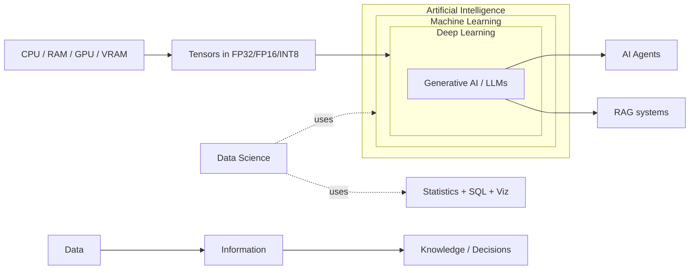

# Module 1 — AI, Data Science and Your Development Environment
### मॉड्यूल 1 — AI, Data Science और आपका Development Environment

> **Phase 1 · Foundations** · Python 3.10+ · CPU is enough · GPU optional (free Colab works)
> Verified with: Python 3.13, NumPy 2.5, pandas 3.0, PyTorch 2.x CPU build (GPU code paths are guarded and marked).

---

## 0. Module map / मॉड्यूल का नक्शा

| # | Lesson | Outcome (you will be able to…) |
|---|--------|-------------------------------|
| 1.1 | Data vs information; AI vs ML vs DL vs Data Science | Place any AI product on the map and explain it to a non-technical manager |
| 1.2 | Traditional programming vs ML; training vs inference; datasets, features, labels; parameters vs hyperparameters | Read any ML problem and name its X, y, model, algorithm, parameters and hyperparameters |
| 1.3 | How computers run AI: CPU, RAM, GPU, VRAM, SSD, CUDA, tensors | Estimate whether a model fits on your machine |
| 1.4 | Number formats (FP32/FP16/BF16/INT8/INT4) and small-VRAM tactics | Calculate model memory and pick a tactic for a 4 GB GPU |
| 1.5 | Python, venv, pip, VS Code, Jupyter, Git, requirements.txt, Colab | Set up a clean, reproducible project in 10 minutes |
| 1.6 | Generative AI, LLMs, agents, and the AI career map | Explain the difference between an LLM, a RAG system and an agent |
| ★ | Mini-project: **AI Environment Diagnostic Tool** | Ship a script that reports your Python, packages, CPU/RAM/GPU and a matmul benchmark |

**Prerequisites:** basic computer use. No math or coding needed yet.
**ज़रूरी पहले से:** बस computer चलाना आना चाहिए। Math या coding अभी ज़रूरी नहीं।



### Setup cell (run first in every notebook)

```python
# Locate the bundled datasets folder no matter where you start Python from.
from pathlib import Path

def find_data() -> Path:
    for p in [Path.cwd(), *Path.cwd().parents]:
        for c in (p / "datasets", p / "tutorials" / "data-science-ai" / "datasets"):
            if (c / "titanic.csv").exists():
                return c
    raise FileNotFoundError("Run from inside tutorials/data-science-ai, or set DATA = Path('<path>/datasets').")

DATA = find_data()
print("Datasets:", sorted(f.name for f in DATA.glob("*.csv")))
```

*Hindi summary:* यह cell `datasets` folder ढूँढता है, ताकि आप कहीं से भी notebook चलाएँ, data मिल जाए। Colab पर पहले `!git clone https://github.com/Rockskp/Rockskp` चलाएँ और फिर `%cd Rockskp/tutorials/data-science-ai`।

---

## Lesson 1.1 — Data vs Information, and the AI map
### पाठ 1.1 — Data बनाम Information, और AI का नक्शा

**a. Concept (English).**
*Data* is raw recorded facts: `22, male, 3rd class, 7.25`. *Information* is data given context and structure so it answers a question: "third-class male passengers had a 13.5% survival rate". *Knowledge* is information you can act on: "allocate lifeboats by deck, not by ticket class".

- **AI** — any technique that makes machines do tasks we'd call intelligent (rules, search, ML…).
- **Machine Learning (ML)** — a subset of AI where behaviour is *learned from data* instead of hand-coded.
- **Deep Learning (DL)** — ML using multi-layer neural networks that learn their own features (images, text, audio).
- **Generative AI** — DL models that *produce* new content (text, images, code). LLMs are the text branch.
- **Data Science** — the discipline of turning data into decisions. It uses statistics, SQL, visualisation and ML, but also business framing and communication. It overlaps AI but is not inside it.

**a. Concept (हिन्दी).**
*Data* मतलब कच्चे तथ्य — जैसे `22, male, 3rd class`। जब इन्हें context मिलता है और ये किसी सवाल का जवाब देते हैं, तब ये *information* बनते हैं — "3rd class के पुरुषों में सिर्फ़ 13.5% बचे"। और जब उस information से कोई action लिया जाए, वो *knowledge* है।
AI सबसे बड़ा घेरा है, उसके अंदर ML (data से सीखना), उसके अंदर Deep Learning (neural networks), और उसके अंदर Generative AI/LLMs। Data Science अलग discipline है जो ML, statistics, SQL सब इस्तेमाल करती है ताकि business decision लिया जा सके।

**b. Intuition / analogy.** Think of a *kirana* store notebook. Each line "Ramesh, 2 kg atta, ₹90" is **data**. "Atta sales double before Diwali" is **information**. "Order 3× atta stock in October" is **knowledge**. An ML model is the experienced shopkeeper who has *learned* this pattern from years of notebooks rather than being told the rule.
*कि़राना दुकान की कॉपी = data, "दीवाली से पहले आटा दोगुना बिकता है" = information, "अक्टूबर में 3 गुना stock मँगाओ" = knowledge।*

**c. Math (just enough).** Survival rate of a group = (survivors in group) / (people in group). Worked on Titanic: 3rd-class males → 47 survived / 347 total = **0.135**. That single division turns 347 rows of data into one piece of information.

**d. Code.**

```python
import csv

with open(DATA / "titanic.csv", newline="") as f:
    rows = list(csv.DictReader(f))          # raw DATA: 891 dict rows

print("Raw data, first row:", rows[0])
group = [r for r in rows if r["pclass"] == "3" and r["sex"] == "male"]
survived = sum(int(r["survived"]) for r in group)
print(f"INFORMATION: 3rd-class males survival = {survived}/{len(group)} = {survived/len(group):.3f}")
```

*Hindi summary:* हमने 891 कच्ची rows (data) पढ़ीं और एक सवाल पूछकर उन्हें एक number (information) में बदल दिया।

**e. Common mistakes & interview traps.**
- "AI = ML" — wrong; rule-based expert systems and search (chess engines) are AI without learning.
- "Data Science is a subset of AI" — it overlaps; a dashboard + A/B test is data science with zero ML.
- Trap: *"Is ChatGPT deep learning?"* Yes — a Transformer neural network (DL) that is generative (GenAI), trained with ML methods, inside the AI umbrella.

**f. Memory aids.**
- Mnemonic: **"A-M-D-G" — Aam Mein Doodh Gira** → AI ⊃ ML ⊃ DL ⊃ GenAI.
- **याद रखो:** *"Data कच्चा आटा है, information रोटी है, knowledge भूख मिटाना है।"*

| # | Q (EN / HI) | A |
|---|---|---|
| 1 | Data vs information? / Data और information में फ़र्क? | Information = data + context that answers a question |
| 2 | Is every AI system ML? / क्या हर AI, ML है? | No — rules/search are AI without learning |
| 3 | What makes DL "deep"? / DL "deep" क्यों? | Many stacked neural-network layers that learn features |
| 4 | Where do LLMs sit? / LLM कहाँ आते हैं? | GenAI ⊂ DL ⊂ ML ⊂ AI |
| 5 | Data Science's end product? / Data Science का final output? | A decision or action, not a model |

**g. Practice.**
1. *(Easy)* Compute the survival rate of 1st-class females.
2. *(Medium)* Classify each as AI-not-ML / ML-not-DL / DL / GenAI: Excel IF-rules for loan approval, a spam filter using word counts, a face-unlock camera, an image generator.
3. *(Hard)* Write a function `rate(rows, **filters)` returning the survival rate for any combination of column filters.

<details><summary>Solutions / हल</summary>

```python
g = [r for r in rows if r["pclass"] == "1" and r["sex"] == "female"]
print("1st-class female survival:", round(sum(int(r["survived"]) for r in g) / len(g), 3))

# 2: IF-rules = AI-not-ML; word-count spam filter (naive Bayes) = ML-not-DL;
#    face unlock = DL (CNN); image generator = GenAI (diffusion model).

def rate(rows, **filters):
    g = [r for r in rows if all(r[k] == str(v) for k, v in filters.items())]
    return round(sum(int(r["survived"]) for r in g) / len(g), 3) if g else None

print(rate(rows, pclass=3, sex="male"), rate(rows, embarked="C"))
```
</details>

**h. Quiz.**
1. Which is *information*? (a) `7.25` (b) "Average 3rd-class fare was £13.7" (c) a CSV file
2. A chess engine using brute-force search is: (a) ML (b) AI but not ML (c) DL
3. Which statement is true? (a) DL ⊃ ML (b) ML ⊃ DL (c) they are disjoint
4. Data Science requires ML. (True/False)
5. An LLM is an example of: (a) GenAI (b) rule-based AI (c) a database

<details><summary>Answers</summary>

1-(b) context + aggregate answers a question. 2-(b) no learning from data. 3-(b) DL is a kind of ML. 4-False, many DS projects are SQL + stats + viz. 5-(a).
</details>

---

## Lesson 1.2 — How ML differs: training, inference, features, labels, parameters
### पाठ 1.2 — ML कैसे अलग है: training, inference, features, labels, parameters

**a. Concept (English).**
- **Traditional programming:** `rules + data → answers`. A human writes the rules.
- **Machine learning:** `data + answers → rules`. The algorithm *finds* the rules (the model).
- **Dataset** = table of examples. Each column used as input is a **feature** (X); the column we want to predict is the **label/target** (y). One row = one **sample**.
- **Algorithm** = the learning recipe (e.g. "gradient descent on logistic loss"). **Model** = the learned artifact the recipe produced (the specific weights). Same algorithm + different data → different model.
- **Training** = fitting the model on labelled data (expensive, done occasionally). **Inference** = using the trained model to predict new rows (cheap, done millions of times; this is what latency SLOs are about).
- **Parameters** = values *learned* during training (weights, biases, tree split thresholds). **Hyperparameters** = values *you choose before* training (learning rate, tree depth, number of layers, batch size).

**a. Concept (हिन्दी).**
Normal programming में इंसान rules लिखता है। ML में हम data और सही जवाब देते हैं, और algorithm खुद rules (model) ढूँढता है। Table का हर input column एक *feature* है, जिसे predict करना है वो *label*। *Algorithm* तरीका है, *model* उस तरीके से बना नतीजा। *Training* = सीखना (महँगा, कभी-कभी), *inference* = सीखे हुए model से नया जवाब देना (सस्ता, बार-बार)। *Parameters* model खुद सीखता है; *hyperparameters* हम पहले से तय करते हैं।

**b. Intuition.** Cooking: the **algorithm** is "taste, adjust salt, repeat"; the **model** is your mother's final dal recipe; **parameters** are the exact grams of salt she converged on; **hyperparameters** are choices made before cooking — which pot, how many tasting rounds; **training** is the years of practice; **inference** is cooking tonight's dal in 20 minutes.

**c. Math.** A one-feature linear model: ŷ = w·x + b. Parameters: *w, b*. Training finds *w, b* minimising mean squared error  MSE = (1/n) Σ (yᵢ − ŷᵢ)². Worked example (penguins): predict body mass (g) from flipper length (mm). Least squares gives **w ≈ 50.2 g/mm, b ≈ −5872 g** (on the 333 complete rows); so a 200 mm flipper → 50.2·200 − 5872 ≈ **4159 g**. (We verify these numbers in code.)

**d. Code.**

```python
import numpy as np, pandas as pd

peng = pd.read_csv(DATA / "penguins.csv").dropna()
X = peng["flipper_length_mm"].to_numpy(float)   # feature
y = peng["body_mass_g"].to_numpy(float)          # label

# TRAINING: the algorithm (closed-form least squares) learns the PARAMETERS w, b
w, b = np.polyfit(X, y, deg=1)
print(f"learned parameters: w={w:.1f} g/mm, b={b:.0f} g")

# INFERENCE: use the model on a new penguin
def predict(flipper_mm: float) -> float:
    return w * flipper_mm + b
print(f"200 mm flipper -> {predict(200):.0f} g")

# Traditional programming for contrast: a human-written rule
rule = lambda f: 5000 if f > 205 else 3700
print("rule-based guess:", rule(200), "| MSE model:", round(np.mean((y - predict(X))**2)),
      "| MSE rule:", round(np.mean((y - np.vectorize(rule)(X))**2)))
```

*Hindi summary:* `polyfit` (algorithm) ने data से `w, b` (parameters) सीखे = training। `predict()` नया penguin देखकर वज़न बताता है = inference। इंसानी rule का error (MSE) ज़्यादा आता है।

**e. Mistakes & traps.**
- Calling the learning rate a "parameter" — it is a **hyperparameter**.
- Using the label (or something derived from it) as a feature → *target leakage* (Module 5).
- Trap: *"Why is inference cost often bigger than training cost in production?"* Because inference runs on every request forever; a 10 ms model at 1 000 RPS = 86 M calls/day.

**f. Memory aids.**
- Mnemonic: **"Rules-in vs Rules-out"** — traditional code puts rules *in*, ML gets rules *out*.
- **याद रखो:** *"Parameter model सीखता है, hyperparameter हम चुनते हैं।"*

| # | Q | A |
|---|---|---|
| 1 | Features vs label? / features और label? | Inputs X vs target y |
| 2 | Model vs algorithm? | Learned artifact vs recipe that learns it |
| 3 | Is tree max_depth a parameter? | No — hyperparameter |
| 4 | Training vs inference? / सीखना बनाम उपयोग | Fit on labelled data vs predict new rows |
| 5 | ML's formula? | data + answers → rules |

**g. Practice.**
1. *(Easy)* In Titanic, name the label and three features.
2. *(Medium)* Fit `body_mass_g` from `bill_length_mm` and compare MSE with the flipper model. Which feature is more informative?
3. *(Hard)* List the parameters and hyperparameters of a neural network with 2 hidden layers of 64 units trained with Adam at lr=1e-3 for 20 epochs.

<details><summary>Solutions / हल</summary>

```python
# 1: label = survived; features e.g. pclass, sex, age, fare
Xb = peng["bill_length_mm"].to_numpy(float)
wb, bb = np.polyfit(Xb, y, 1)
mse_bill = np.mean((y - (wb * Xb + bb))**2)
mse_flip = np.mean((y - predict(X))**2)
print(f"MSE bill={mse_bill:.0f}  MSE flipper={mse_flip:.0f}  -> flipper is more informative")
# 3: parameters = all weight matrices and bias vectors of the 3 layers.
#    hyperparameters = #layers (2), width (64), optimizer (Adam), lr (1e-3), epochs (20), batch size, activation.
```
</details>

**h. Quiz.**
1. In ML, what does the human mainly supply? (a) rules (b) examples with answers (c) weights
2. Batch size is a: (a) parameter (b) hyperparameter (c) label
3. Which is usually done once per week, not per request? (a) training (b) inference
4. Same algorithm, two datasets → (a) same model (b) different models
5. A feature that is computed from the label is: (a) great (b) leakage

<details><summary>Answers</summary>1-b, 2-b, 3-a, 4-b, 5-b (it won't exist at prediction time).</details>

---

## Lesson 1.3 — How computers run AI: CPU, RAM, GPU, VRAM, CUDA, tensors
### पाठ 1.3 — Computer AI कैसे चलाता है

**a. Concept (English).**
- **CPU**: a few (4–32) powerful cores, great at branching, sequential logic. **GPU**: thousands of simple cores doing the *same* operation on many numbers at once (SIMT). Neural networks are mostly matrix multiplications → embarrassingly parallel → GPUs win 10–100×.
- **RAM** holds data for the CPU; **VRAM** is the GPU's own memory. A model must fit (weights + activations + optimizer state) in VRAM to train on GPU. **SSD** stores datasets/checkpoints; slow disks starve the GPU (data-loader bottleneck).
- **CUDA** is NVIDIA's platform for running general code on its GPUs; PyTorch calls CUDA libraries (cuBLAS, cuDNN). Driver version must support the CUDA version your PyTorch wheel was built with. Apple Silicon uses **MPS** instead.
- **Tensor** = n-dimensional array with a dtype and a device: scalar (0-D), vector (1-D), matrix (2-D), a batch of RGB images (4-D: N×C×H×W).

**a. Concept (हिन्दी).**
CPU में कुछ ही पर बहुत तेज़ cores होते हैं — जैसे कुछ expert chef। GPU में हज़ारों छोटे cores होते हैं जो एक साथ एक ही काम करते हैं — जैसे हज़ार लोग एक साथ प्याज़ काट रहे हों। Neural network ज़्यादातर matrix multiplication है, इसलिए GPU बहुत तेज़। Model को train करने के लिए weights + activations + optimizer state सब VRAM में आने चाहिए। CUDA NVIDIA का software है जिससे PyTorch GPU इस्तेमाल करता है। Tensor = कई dimension वाला array।

**b. Intuition.** CPU = 8 senior chefs who can cook any dish; GPU = 3 000 helpers who can only chop, but all at once. Making 10 000 rotis (matrix multiply) → hire the helpers. VRAM = the counter space next to the helpers; if ingredients (weights) don't fit on the counter, they must keep walking to the store (RAM/SSD) and everything slows down.

**c. Math.** Multiplying an (m×k) by a (k×n) matrix costs ≈ **2·m·k·n FLOPs**. For 1024×1024 @ 1024×1024: 2·1024³ ≈ **2.1 GFLOP**. A laptop CPU doing ~100 GFLOP/s needs ~20 ms; an RTX 3050 (~9 TFLOP/s FP32 peak) ~0.25 ms in theory. Memory of a tensor = elements × bytes per element: a 1024×1024 FP32 matrix = 1 048 576 × 4 B = **4 MiB**.

**d. Code.**

```python
import time, importlib.util
import numpy as np

a = np.random.default_rng(0).standard_normal((1024, 1024), dtype=np.float32)
t0 = time.perf_counter(); _ = a @ a; dt = time.perf_counter() - t0
flops = 2 * 1024**3
print(f"CPU matmul: {dt*1e3:.1f} ms  ->  {flops/dt/1e9:.1f} GFLOP/s")
print(f"Tensor memory: {a.nbytes/2**20:.1f} MiB, shape={a.shape}, dtype={a.dtype}")

if importlib.util.find_spec("torch"):
    import torch
    dev = "cuda" if torch.cuda.is_available() else ("mps" if torch.backends.mps.is_available() else "cpu")
    t = torch.from_numpy(a).to(dev)
    print("torch device:", dev, "| tensor dims:", t.ndim, "| batch of images shape example:", tuple(torch.zeros(8, 3, 32, 32).shape))
    if dev == "cuda":
        print("GPU:", torch.cuda.get_device_name(0),
              f"VRAM total {torch.cuda.get_device_properties(0).total_memory/2**30:.1f} GiB")
else:
    print("PyTorch not installed - fine for now (install in Lesson 1.5).")
```

*Hindi summary:* हमने CPU पर 1024×1024 matrix multiply करके speed (GFLOP/s) नापी और tensor की memory निकाली। अगर PyTorch है तो देखते हैं कि GPU (cuda/mps) मिला या नहीं।

**e. Mistakes & traps.**
- Installing the CPU-only PyTorch wheel and wondering why `cuda.is_available()` is False — pick the CUDA wheel from pytorch.org's selector.
- Thinking "more VRAM = faster". VRAM decides *what fits*; compute and memory bandwidth decide *speed*.
- Moving tensors CPU↔GPU inside the training loop every step (PCIe transfer kills throughput).
- Trap: *"Why does a GPU sit at 30% utilisation?"* Usually the input pipeline (disk, decoding, too few `num_workers`) — not the model.

**f. Memory aids.**
- Mnemonic: **"CPU = Captain, GPU = Ganga of workers."**
- **याद रखो:** *"VRAM तय करता है क्या फ़िट होगा, compute तय करता है कितना तेज़ चलेगा।"*

| # | Q | A |
|---|---|---|
| 1 | Why are GPUs fast for DL? | Thousands of cores run identical matmul ops in parallel |
| 2 | FLOPs for (m×k)@(k×n)? | ≈ 2mkn |
| 3 | What is CUDA? | NVIDIA's GPU computing platform used by PyTorch |
| 4 | Image batch tensor shape? | N×C×H×W |
| 5 | Low GPU utilisation usual cause? | Data loading bottleneck |

**g. Practice.**
1. *(Easy)* How many MiB is a 4096×4096 FP32 matrix?
2. *(Medium)* Time matmul for sizes 256, 512, 1024, 2048 and show time grows ≈ n³.
3. *(Hard)* Estimate the memory of a batch of 32 RGB images 224×224 in FP32 and in FP16.

<details><summary>Solutions / हल</summary>

```python
print("1:", 4096*4096*4/2**20, "MiB")
for n in (256, 512, 1024, 2048):
    m = np.ones((n, n), np.float32); t0 = time.perf_counter(); m @ m
    print(f"n={n:5d}  {1e3*(time.perf_counter()-t0):8.2f} ms")
elems = 32*3*224*224
print(f"3: FP32 {elems*4/2**20:.1f} MiB, FP16 {elems*2/2**20:.1f} MiB")
```
</details>

**h. Quiz.**
1. Main reason GPUs speed up neural nets? (a) bigger cache (b) massive parallelism (c) higher clock
2. A 1000×1000 FP32 matrix is about: (a) 4 MB (b) 40 MB (c) 0.4 MB
3. Apple-Silicon equivalent of CUDA in PyTorch: (a) ROCm (b) MPS (c) TPU
4. A 4-D tensor of images is ordered in PyTorch as: (a) N,H,W,C (b) N,C,H,W
5. VRAM mostly limits: (a) model/batch size that fits (b) clock speed

<details><summary>Answers</summary>1-b, 2-a (10⁶×4 B), 3-b, 4-b (PyTorch default "channels first"), 5-a.</details>

---

## Lesson 1.4 — Number formats and 4 GB-VRAM survival tactics
### पाठ 1.4 — Number formats और कम VRAM में काम कैसे चलाएँ

**a. Concept (English).**

| Format | Bytes | Range / precision | Typical use |
|---|---|---|---|
| FP32 | 4 | ~7 decimal digits, huge range | default training, master weights |
| FP16 | 2 | ~3 digits, max ≈ 65 504 (overflow risk) | mixed-precision training with loss scaling |
| BF16 | 2 | ~2–3 digits, *same range as FP32* | modern training (Ampere+ GPUs, TPUs) |
| INT8 | 1 | 256 levels + scale | inference quantization |
| INT4 / NF4 | 0.5 | 16 levels + scale | LLM inference, QLoRA |

**Training memory rule of thumb (Adam, FP32):** weights 4 B + gradients 4 B + Adam m and v 8 B = **16 bytes per parameter**, plus activations. Inference needs only weights (+ KV cache for LLMs).

Tactics for a 4 GB GPU (e.g. laptop RTX 3050):
1. **Smaller batch + gradient accumulation** — run 4 micro-batches of 8, sum gradients, step once = effective batch 32.
2. **Mixed precision (AMP)** — compute in FP16/BF16, keep FP32 master weights; ~½ activation memory, faster on Tensor Cores.
3. **Lower input resolution / sequence length** — activation memory scales with H×W (or tokens²for attention).
4. **Quantization** — load weights in INT8/4-bit for inference or QLoRA fine-tuning.
5. **Offloading** — keep some layers/optimizer state in CPU RAM (slower, but fits).
6. **Gradient checkpointing** — recompute activations in backward instead of storing them.
7. Free the cache: `del` big tensors, `torch.cuda.empty_cache()` (returns cached blocks to the driver; does *not* free memory still referenced).

**a. Concept (हिन्दी).**
हर number कितनी जगह लेता है, ये format तय करता है: FP32 = 4 byte, FP16/BF16 = 2 byte, INT8 = 1 byte, INT4 = आधा byte। Adam से training में हर parameter को लगभग 16 byte चाहिए। 4 GB GPU पर काम चलाने के तरीके: छोटा batch + gradient accumulation, mixed precision (FP16/BF16), छोटी image size, quantization, offloading, gradient checkpointing। BF16 की range FP32 जितनी है, इसलिए overflow कम होता है।

**b. Intuition.** Formats are like measuring rice: FP32 = a jeweller's scale (precise, heavy), BF16 = a kitchen scale with the same max weight but fewer decimals, INT4 = counting in fistfuls. Gradient accumulation = carrying 32 bricks in 4 trips of 8 when your hands can't hold 32 at once — same total work, smaller peak load.

**c. Math.** Worked example — can a 1.1 B-parameter LLM run on 4 GB?
- FP32 weights: 1.1e9 × 4 B = 4.4 GB ✗
- FP16: 2.2 GB ✓ (tight with KV cache)
- INT4: 0.55 GB ✓✓
- Full FP32 Adam training: 1.1e9 × 16 B = 17.6 GB ✗✗ → this is why LoRA/QLoRA exist (Module 14).

FP16 overflow: 300² = 90 000 > 65 504 → `inf` in FP16, fine in BF16.

**d. Code.**

```python
import numpy as np

def model_memory_gb(n_params: float, bytes_per_param: float) -> float:
    return n_params * bytes_per_param / 1e9

for name, b in {"FP32": 4, "FP16/BF16": 2, "INT8": 1, "INT4": 0.5, "Adam-train FP32": 16}.items():
    print(f"{name:16s} 1.1B params -> {model_memory_gb(1.1e9, b):5.2f} GB")

# Precision demo: FP16 overflow and rounding
with np.errstate(over="ignore"):
    print("FP16 300*300 =", np.float16(300) * np.float16(300))   # inf: exceeds 65 504
print("FP32 0.1+0.2 =", np.float32(0.1) + np.float32(0.2), "| FP16:", np.float16(0.1) + np.float16(0.2))

# Simple symmetric INT8 quantization of a weight vector
w = np.random.default_rng(1).standard_normal(1000).astype(np.float32)
scale = np.abs(w).max() / 127
q = np.round(w / scale).astype(np.int8)             # stored: 1 byte each
w_hat = q.astype(np.float32) * scale                # dequantized
print(f"INT8 size {q.nbytes} B vs FP32 {w.nbytes} B, mean abs error {np.abs(w - w_hat).mean():.4f}")
```

```python
# Gradient accumulation + mixed precision pattern (runs on CPU; uses AMP only if CUDA exists)
import importlib.util
if importlib.util.find_spec("torch"):
    import torch, torch.nn as nn
    torch.manual_seed(0)
    dev = "cuda" if torch.cuda.is_available() else "cpu"
    model = nn.Sequential(nn.Linear(20, 64), nn.ReLU(), nn.Linear(64, 1)).to(dev)
    opt = torch.optim.AdamW(model.parameters(), lr=1e-2)
    X, y = torch.randn(256, 20, device=dev), torch.randn(256, 1, device=dev)
    accum, micro = 4, 16                                   # effective batch = 64
    scaler = torch.amp.GradScaler("cuda", enabled=(dev == "cuda"))
    for step in range(0, 256, micro):
        xb, yb = X[step:step+micro], y[step:step+micro]
        with torch.autocast(device_type=dev, dtype=torch.float16 if dev == "cuda" else torch.bfloat16, enabled=(dev=="cuda")):
            loss = nn.functional.mse_loss(model(xb), yb) / accum   # divide so the sum equals the big-batch mean
        scaler.scale(loss).backward()
        if (step // micro + 1) % accum == 0:
            scaler.step(opt); scaler.update(); opt.zero_grad(set_to_none=True)
    print("accumulation loop finished, last micro-loss:", round(loss.item() * accum, 4))
```

*Hindi summary:* पहला block बताता है कि 1.1B model किस format में कितनी GB लेगा, FP16 overflow दिखाता है, और INT8 quantization से 4× कम memory। दूसरा block gradient accumulation का असली pattern है — loss को `accum` से divide करना मत भूलना।

**e. Mistakes & traps.**
- Forgetting to divide the loss by `accum` → effective learning rate ×4.
- Using FP16 without a `GradScaler` → small gradients underflow to 0.
- Expecting BatchNorm to behave the same with micro-batches — it sees only the micro-batch (use GroupNorm/LayerNorm or larger micro-batches).
- Trap: *"FP16 vs BF16?"* Same size; BF16 keeps FP32's 8 exponent bits (range), FP16 has more mantissa bits (precision) but overflows at 65 504.

**f. Memory aids.**
- Mnemonic: **"4-2-1-½"** bytes for FP32-FP16-INT8-INT4, and **"Adam eats 16"**.
- **याद रखो:** *"Batch छोटा करो, steps जोड़ो — accumulation से बड़ा batch बिना बड़ी VRAM।"*

| # | Q | A |
|---|---|---|
| 1 | Bytes/param for Adam FP32 training? | ~16 |
| 2 | BF16's advantage over FP16? | FP32-like range, fewer overflows |
| 3 | What does gradient accumulation trade? | More steps (time) for less peak memory |
| 4 | INT4 7B model weight size? | ~3.5 GB |
| 5 | Does `empty_cache()` free live tensors? | No |

**g. Practice.**
1. *(Easy)* Weight size of a 7 B model in FP16 and INT4?
2. *(Medium)* Quantize the vector `w` above to INT4 (levels −7..7) and compare error with INT8.
3. *(Hard)* You need effective batch 128 but only 16 fit. Write the accumulation constant and the loss scaling factor.

<details><summary>Solutions / हल</summary>

```python
print("1:", model_memory_gb(7e9, 2), "GB FP16;", model_memory_gb(7e9, 0.5), "GB INT4")
s4 = np.abs(w).max() / 7
w4 = np.clip(np.round(w / s4), -7, 7) * s4
print(f"2: INT4 error {np.abs(w-w4).mean():.4f} vs INT8 {np.abs(w-w_hat).mean():.4f}")
print("3: accum =", 128 // 16, "-> loss = loss / 8")
```
</details>

**h. Quiz.**
1. FP16 max value ≈ (a) 3.4e38 (b) 65 504 (c) 255
2. Mixed precision keeps master weights in: (a) FP32 (b) INT8
3. 4 micro-batches of 8 with accumulation ≈ batch of: (a) 8 (b) 32
4. Which reduces memory but costs extra compute? (a) gradient checkpointing (b) bigger batch
5. INT8 quantization stores a weight in: (a) 1 byte + shared scale (b) 4 bytes

<details><summary>Answers</summary>1-b, 2-a, 3-b, 4-a (recompute activations), 5-a.</details>

---

## Lesson 1.5 — Python, virtual environments, VS Code, Jupyter, Git and Colab
### पाठ 1.5 — Python, venv, VS Code, Jupyter, Git और Colab

**a. Concept (English).**
A reproducible AI project = **pinned interpreter + isolated environment + pinned dependencies + version-controlled code**.
- `python -m venv .venv` creates an isolated environment so project A's `numpy 1.x` never breaks project B's `numpy 2.x`.
- `pip install -r requirements.txt` installs exact versions; `pip freeze > requirements.txt` records them.
- **VS Code** + Python and Jupyter extensions: select the `.venv` interpreter (Ctrl+Shift+P → *Python: Select Interpreter*).
- **Jupyter** is for exploration; move stable code into `.py` modules and tests.
- **Git** tracks history; **GitHub** hosts it. Never commit `.venv/`, data dumps, or secrets — use `.gitignore`.
- **Colab**: free GPU (usually a T4 with ~15 GB VRAM, subject to availability and quotas): *Runtime → Change runtime type → GPU*.

**a. Concept (हिन्दी).**
Reproducible project का मतलब: कोई भी दूसरा इंसान, किसी दूसरे laptop पर, वही result पाए। इसके लिए हर project का अलग `venv`, exact versions वाली `requirements.txt`, और Git में code चाहिए। VS Code में सही interpreter (.venv) चुनना ज़रूरी है। Notebook explore करने के लिए है, पक्का code `.py` file में रखें। GPU नहीं है? Colab पर मुफ़्त GPU मिलता है।

**b. Intuition.** A venv is a *tiffin box per project*: dal doesn't leak into the kheer. `requirements.txt` is the recipe card with exact quantities. Git is the photo album of every version of the dish.

**c. Math.** None needed. One useful number: dependency conflicts grow roughly with the number of *shared* packages across projects — isolation reduces that to zero.

**d. Code / commands.** (Shell commands are for your terminal, so they're marked `norun`.)

```python
# norun
# Windows (PowerShell)                         # macOS / Linux
# py -3.12 -m venv .venv                       python3 -m venv .venv
# .venv\Scripts\Activate.ps1                   source .venv/bin/activate
python -m pip install --upgrade pip
pip install -r tutorials/data-science-ai/requirements.txt
# GPU PyTorch: copy the exact command from https://pytorch.org/get-started/locally/
pip freeze > requirements.lock.txt
git init && git add . && git commit -m "Initial project"
```

```python
# Check that you're inside a virtual environment and which packages are present
import sys, importlib.metadata as md
in_venv = sys.prefix != getattr(sys, "base_prefix", sys.prefix)
print("Python", sys.version.split()[0], "| in venv:", in_venv, "| exe:", sys.executable)
for pkg in ["numpy", "pandas", "scikit-learn", "matplotlib", "torch", "jupyter"]:
    try:
        print(f"  {pkg:13s} {md.version(pkg)}")
    except md.PackageNotFoundError:
        print(f"  {pkg:13s} NOT INSTALLED")
```

Recommended `.gitignore` lines: `.venv/`, `__pycache__/`, `.ipynb_checkpoints/`, `*.pt`, `data/raw/`, `.env`.

*Hindi summary:* पहले venv बनाओ और activate करो, फिर requirements install करो। ऊपर वाला code बताता है कि आप venv के अंदर हो या नहीं और कौन से packages install हैं।

**e. Mistakes & traps.**
- `pip install` into the global Python, then Jupyter uses a different kernel → "ModuleNotFoundError". Fix: `python -m pip …` with the same interpreter, or `%pip install` inside the notebook.
- Committing an API key. Rotate it immediately — deleting the commit is not enough.
- `requirements.txt` with no versions → "works on my machine" bugs months later.
- Trap: *"pip vs conda vs uv?"* pip = standard installer; conda also manages non-Python binaries (CUDA libs); uv = very fast pip-compatible resolver. Any is fine if versions are pinned.

**f. Memory aids.**
- Mnemonic: **"V-R-G" — Venv, Requirements, Git** — every project, day one.
- **याद रखो:** *"हर project का अपना tiffin (venv), अपनी recipe (requirements), अपना album (Git)।"*

| # | Q | A |
|---|---|---|
| 1 | Why venv? | Isolate dependencies per project |
| 2 | Record exact versions? | `pip freeze > requirements.txt` |
| 3 | Notebook says module missing but pip says installed? | Different interpreter/kernel |
| 4 | Leaked a key in Git? | Rotate the key, then purge history |
| 5 | Free GPU option? | Google Colab |

**g. Practice.**
1. *(Easy)* Create a venv named `.venv`, activate it, and print `sys.prefix`.
2. *(Medium)* Write a `.gitignore` for an ML project with data, checkpoints and secrets.
3. *(Hard)* Write a function that compares installed versions against a requirements file and lists mismatches.

<details><summary>Solutions / हल</summary>

```python
import re
print("1:", sys.prefix)
gitignore = ".venv/\n__pycache__/\n.ipynb_checkpoints/\ndata/raw/\n*.pt\n*.ckpt\nmlruns/\n.env\n"
print("2:\n" + gitignore)

def check_requirements(lines: list[str]) -> list[str]:
    problems = []
    for line in lines:
        m = re.match(r"^([A-Za-z0-9_.\-]+)\s*[>=]=\s*([\w.]+)", line.strip())
        if not m:
            continue
        name, want = m.groups()
        try:
            have = md.version(name)
            if line.count("==") and have != want:
                problems.append(f"{name}: want {want}, have {have}")
        except md.PackageNotFoundError:
            problems.append(f"{name}: missing")
    return problems

print("3:", check_requirements(["numpy==0.0.1", "pandas>=2.0", "not-a-real-pkg==1.0"]))
```
</details>

**h. Quiz.**
1. Activating a venv changes: (a) which `python`/`pip` run (b) your OS
2. Best place for an API key: (a) code (b) environment variable / secret manager
3. `pip freeze` outputs: (a) installed packages with versions (b) a lockfile for conda
4. In VS Code you pick the environment via: (a) *Python: Select Interpreter* (b) Settings → Theme
5. A Colab GPU session is: (a) permanent (b) temporary, files vanish on disconnect

<details><summary>Answers</summary>1-a, 2-b, 3-a, 4-a, 5-b (save to Drive/GitHub).</details>

---

## Lesson 1.6 — Generative AI, LLMs, agents, and AI careers
### पाठ 1.6 — Generative AI, LLMs, Agents और AI careers

**a. Concept (English).**
- **LLM**: a Transformer trained to predict the next *token* on huge text corpora, then instruction-tuned and aligned (RLHF/DPO) to follow prompts. It knows only what's in its weights + the prompt (context window).
- **RAG** (Retrieval-Augmented Generation): retrieve relevant documents, put them in the prompt, generate a grounded, citable answer. Fixes stale/private knowledge without retraining.
- **Agent**: an LLM in a loop that can *call tools* (search, code, APIs), observe results, and decide the next step toward a goal. Needs guardrails: allow-listed tools, step/time/cost limits, human approval for risky actions.
- **Careers**: Data Analyst (SQL, BI) → Data Scientist (stats, ML, experiments) → ML Engineer (training + serving + MLOps) → AI/LLM Engineer (RAG, agents, eval) → Research Scientist / Applied Scientist → AI Architect (systems, governance, cost). Data Engineers build the pipelines all of them depend on.

**a. Concept (हिन्दी).**
LLM अगला token predict करना सीखता है, बहुत सारे text पर। उसे सिर्फ़ वही पता है जो उसके weights और prompt में है। RAG में हम पहले सही documents ढूँढकर prompt में डालते हैं, ताकि जवाब सही और citation के साथ हो। Agent एक LLM है जो loop में tools चलाता है — search, code, API — और अगला कदम खुद तय करता है; इसलिए उसे limits और human approval चाहिए। Career ladder: Analyst → Data Scientist → ML Engineer → AI Engineer → Architect/Researcher।

**b. Intuition.** LLM = a very well-read friend with no internet. RAG = the same friend allowed to open your company's files before answering. Agent = that friend given a phone, a laptop and a to-do list — powerful, so you set rules on what they can do without asking.

**c. Math.** Next-token prediction: the model outputs probabilities P(token | previous tokens). Training minimises cross-entropy = −log P(correct token). If the model gives the right token probability 0.25, loss = −ln 0.25 ≈ **1.386**; at 0.9, loss ≈ **0.105**. (Full treatment in Modules 3, 12, 13.)

**d. Code.** A 20-line "bigram language model" on Titanic passenger *embark towns* shows next-token prediction without any library magic, then a toy tool-using "agent" loop with a step limit.

```python
import math, random
from collections import Counter, defaultdict

text = " ".join(r["embark_town"] for r in rows if r["embark_town"]).lower()
pairs = Counter(zip(text, text[1:]))
nxt = defaultdict(Counter)
for (a, b), c in pairs.items():
    nxt[a][b] = c

def p_next(ch):
    total = sum(nxt[ch].values())
    return {k: v / total for k, v in nxt[ch].most_common(3)}

print("P(next | 'q') =", p_next("q"))          # 'q' -> 'u' in Queenstown
print("loss if p=0.25:", round(-math.log(0.25), 3), "| p=0.9:", round(-math.log(0.9), 3))

# Toy agent: picks a tool, observes, stops within a step budget (guardrail)
TOOLS = {"count": lambda town: sum(r["embark_town"] == town for r in rows),
         "survival": lambda town: round(sum(int(r["survived"]) for r in rows if r["embark_town"] == town)
                                        / max(1, sum(r["embark_town"] == town for r in rows)), 3)}
plan = [("count", "Cherbourg"), ("survival", "Cherbourg"), ("survival", "Southampton")]
for step, (tool, arg) in enumerate(plan, 1):
    if step > 5 or tool not in TOOLS:          # step limit + allow-list
        break
    print(f"step {step}: {tool}({arg}) -> {TOOLS[tool](arg)}")
```

*Hindi summary:* पहला हिस्सा दिखाता है कि language model का असली काम "अगला अक्षर/token कौन सा आएगा" की probability देना है। दूसरा हिस्सा एक छोटा agent loop है — allow-list वाले tools और step limit के साथ।

**e. Mistakes & traps.**
- "Bigger context window means no need for RAG" — long contexts cost more, are slower, and models still miss details buried in the middle; retrieval stays useful.
- Letting an agent run tools without limits → runaway cost or destructive actions.
- Treating LLM output as fact without grounding/citations.
- Trap: *"Fine-tuning vs RAG?"* Fine-tune to change *behaviour/style/format*; RAG to add *knowledge that changes*.

**f. Memory aids.**
- Mnemonic: **"Know-Look-Do"** → LLM knows, RAG looks up, Agent does.
- **याद रखो:** *"LLM जानता है, RAG ढूँढता है, Agent करता है — और Agent पर लगाम ज़रूरी है।"*

| # | Q | A |
|---|---|---|
| 1 | LLM training objective? | Next-token prediction (cross-entropy) |
| 2 | Why RAG? | Fresh/private knowledge + citations without retraining |
| 3 | What makes an agent? | LLM + tools + loop + goal |
| 4 | Agent guardrails? | Allow-list, step/cost limits, human approval |
| 5 | Fine-tune or RAG for new policy docs? | RAG |

**g. Practice.**
1. *(Easy)* Print the 3 most likely characters after `"s"` in the bigram model.
2. *(Medium)* Generate 30 characters by sampling from the bigram model starting at `"c"`.
3. *(Hard)* Add a third tool `avg_fare(town)` to the agent and a guard that refuses unknown tools with a message.

<details><summary>Solutions / हल</summary>

```python
print("1:", p_next("s"))
random.seed(0)
ch, out = "c", "c"
for _ in range(29):
    opts = nxt[ch]
    ch = random.choices(list(opts), weights=opts.values())[0] if opts else " "
    out += ch
print("2:", out)

TOOLS["avg_fare"] = lambda town: round(sum(float(r["fare"]) for r in rows if r["embark_town"] == town)
                                       / max(1, sum(r["embark_town"] == town for r in rows)), 2)
for tool, arg in [("avg_fare", "Queenstown"), ("delete_db", "all")]:
    print("3:", TOOLS[tool](arg) if tool in TOOLS else f"refused: '{tool}' is not allow-listed")
```
</details>

**h. Quiz.**
1. An LLM's knowledge cutoff is fixed by: (a) its training data (b) the prompt
2. RAG adds knowledge by: (a) changing weights (b) adding retrieved text to the prompt
3. The key difference between a chatbot and an agent: (a) font (b) tool use in a loop
4. Cross-entropy when p(correct)=1: (a) 0 (b) 1
5. Role that owns training pipelines + serving + monitoring: (a) ML Engineer (b) Data Analyst

<details><summary>Answers</summary>1-a, 2-b, 3-b, 4-a (−log 1 = 0), 5-a.</details>

---

## ★ Mini-project — AI Environment Diagnostic Tool
### ★ Mini-project — AI Environment Diagnostic Tool (अपने machine की जाँच)

**Goal:** one script that answers "can this machine do the course?" — Python version, venv, key packages, CPU cores, RAM, GPU/VRAM, a matmul benchmark, and a recommendation. Save as `env_doctor.py` and run `python env_doctor.py`.

```python
"""env_doctor.py - AI Environment Diagnostic Tool (CPU-safe, no extra dependencies required)."""
from __future__ import annotations
import importlib.metadata as md, importlib.util, json, os, platform, sys, time
import numpy as np

def ram_gb() -> float | None:
    try:                                             # Linux/macOS
        return os.sysconf("SC_PAGE_SIZE") * os.sysconf("SC_PHYS_PAGES") / 1e9
    except (ValueError, OSError, AttributeError):
        try:                                         # Windows
            import ctypes
            class MS(ctypes.Structure):
                _fields_ = [("dwLength", ctypes.c_ulong), ("dwMemoryLoad", ctypes.c_ulong),
                            ("ullTotalPhys", ctypes.c_ulonglong)] + [(f"x{i}", ctypes.c_ulonglong) for i in range(6)]
            s = MS(); s.dwLength = ctypes.sizeof(MS)
            ctypes.windll.kernel32.GlobalMemoryStatusEx(ctypes.byref(s))
            return s.ullTotalPhys / 1e9
        except Exception:
            return None

def gpu_info() -> dict:
    if not importlib.util.find_spec("torch"):
        return {"torch": None, "device": "cpu"}
    import torch
    info = {"torch": torch.__version__, "cuda_build": torch.version.cuda, "device": "cpu"}
    if torch.cuda.is_available():
        p = torch.cuda.get_device_properties(0)
        info |= {"device": "cuda", "name": p.name, "vram_gb": round(p.total_memory / 1e9, 2),
                 "bf16": torch.cuda.is_bf16_supported()}
    elif torch.backends.mps.is_available():
        info["device"] = "mps"
    return info

def bench(n: int = 1024, reps: int = 3) -> float:
    a = np.random.default_rng(0).standard_normal((n, n), dtype=np.float32)
    times = []
    for _ in range(reps):
        t0 = time.perf_counter(); a @ a; times.append(time.perf_counter() - t0)
    return 2 * n**3 / min(times) / 1e9

def pkg(name: str) -> str | None:
    try:
        return md.version(name)
    except md.PackageNotFoundError:
        return None

def diagnose() -> dict:
    r = {"python": sys.version.split()[0], "python_ok": sys.version_info >= (3, 10),
         "in_venv": sys.prefix != sys.base_prefix, "os": f"{platform.system()} {platform.release()}",
         "cpu_cores": os.cpu_count(), "ram_gb": round(ram_gb() or 0, 1),
         "packages": {p: pkg(p) for p in ["numpy", "pandas", "scikit-learn", "matplotlib", "torch", "jupyter"]},
         "gpu": gpu_info(), "cpu_gflops": round(bench(), 1)}
    tips = []
    if not r["python_ok"]: tips.append("Upgrade to Python 3.10+.")
    if not r["in_venv"]: tips.append("Create and activate a virtual environment (.venv).")
    missing = [k for k, v in r["packages"].items() if v is None]
    if missing: tips.append(f"pip install {' '.join(missing)}")
    vram = r["gpu"].get("vram_gb", 0)
    if r["gpu"]["device"] == "cpu": tips.append("No GPU: Modules 1-9 are fine on CPU; use Colab for 10-16.")
    elif vram and vram < 6: tips.append("Small VRAM: use AMP, batch<=16 + gradient accumulation, 4-bit for LLMs.")
    r["recommendations"] = tips or ["All good - you're ready."]
    return r

if __name__ == "__main__":
    print(json.dumps(diagnose(), indent=2))
```

*Hindi summary:* यह tool आपके computer की पूरी "health report" JSON में देता है — Python, venv, packages, RAM, GPU, VRAM, और matmul speed — और साथ में सुझाव भी: GPU नहीं है तो Colab, VRAM कम है तो AMP + accumulation.

**Extensions:** add disk free space (`shutil.disk_usage`), an FP16 GPU benchmark, and save the report as `env_report.json` in CI to catch environment drift.

---

## Module 1 cheat sheet / एक पेज में सब

| Idea | One line (EN) | एक लाइन (HI) |
|---|---|---|
| Data → Info → Knowledge | Raw facts → answer to a question → action | कच्चा तथ्य → जवाब → फ़ैसला |
| AI ⊃ ML ⊃ DL ⊃ GenAI | Nested circles; DS overlaps | घेरे के अंदर घेरा |
| ML vs code | data + answers → rules | rules हम नहीं, data बनाता है |
| X / y | features / label | input / जवाब |
| Parameters / hyperparameters | learned / chosen | सीखे गए / चुने गए |
| Training / inference | fit once / predict always | सीखना / इस्तेमाल |
| GPU | parallel matmul | हज़ारों छोटे workers |
| Memory | elements × bytes; Adam ≈ 16 B/param | 4-2-1-½ bytes |
| 4 GB tactics | small batch + accumulation, AMP, lower res, quantize, offload, checkpointing | छोटा batch, steps जोड़ो |
| Reproducibility | venv + pinned requirements + Git | tiffin, recipe, album |
| LLM / RAG / Agent | knows / looks up / does | जानता / ढूँढता / करता |

## Spaced repetition plan / दोहराने का schedule

Start date = the day you finish this module (Day 0).

| Review | What to do (≈15 min) |
|---|---|
| Day 1 | Re-answer all 30 flashcards from memory; redo Lesson 1.4 math by hand |
| Day 3 | Run `env_doctor.py`; explain AI/ML/DL/GenAI map aloud in Hindi and English |
| Day 7 | Retake all six quizzes without notes; aim for ≥ 90% |
| Day 21 | Do every *Hard* exercise again from a blank file |
| Day 60 | Teach Lesson 1.2 to a friend in 5 minutes (Feynman test) |

## Sources (official docs and primary references)

- Python venv: https://docs.python.org/3/library/venv.html · pip requirement files: https://pip.pypa.io/en/stable/user_guide/
- PyTorch install selector: https://pytorch.org/get-started/locally/ · CUDA semantics: https://docs.pytorch.org/docs/stable/notes/cuda.html · AMP: https://docs.pytorch.org/docs/stable/amp.html
- NVIDIA CUDA programming guide: https://docs.nvidia.com/cuda/cuda-c-programming-guide/
- Mixed precision training — Micikevicius et al., 2018: https://arxiv.org/abs/1710.03740
- VS Code Python + Jupyter: https://code.visualstudio.com/docs/python/python-tutorial
- Google Colab FAQ (GPU availability and limits): https://research.google.com/colaboratory/faq.html
- Dataset: seaborn-data (BSD-3): https://github.com/mwaskom/seaborn-data

**Fact vs assumption:** hardware throughput numbers (RTX 3050 ≈ 9 TFLOP/s FP32, Colab T4 ≈ 15 GB) are approximate public specs and change with model/driver/quotas; your measured numbers from `env_doctor.py` are the ones to trust.
