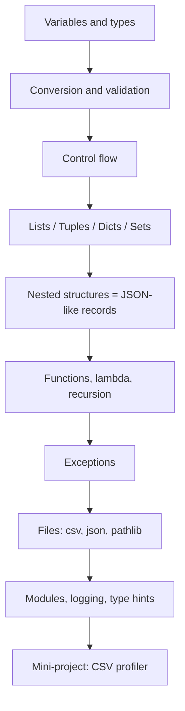

# Module 2 — Python Programming for AI
### मॉड्यूल 2 — AI के लिए Python Programming

> **Phase 1 · Foundations** · Pure Python 3.10+ standard library only (no NumPy/pandas yet) · Real data: all 891 Titanic rows.
> Why pure Python first? pandas hides loops; if you can do it by hand, you understand what pandas does for you.

---

## 0. Module map

| # | Lesson | Outcome |
|---|--------|---------|
| 2.1 | Syntax, variables, numbers/strings/booleans, type conversion, input | Parse messy CSV strings into correct types safely |
| 2.2 | Operators, if/elif/else, for/while, range, break/continue, enumerate/zip | Write readable control flow over every row of a file |
| 2.3 | Lists, tuples, dicts, sets, nested structures | Pick the right container and get O(1) lookups |
| 2.4 | Functions, arguments, scope, lambda, recursion | Turn copy-pasted code into tested, reusable functions |
| 2.5 | Exceptions, files, csv, json, pathlib | Read real files with blanks without crashing |
| 2.6 | Modules/packages/imports, logging, type hints | Structure code like a professional project |
| ★ | Mini-project: **Titanic data-quality report CLI** | A typed, logged, tested script that profiles any CSV |

**Prerequisites:** Module 1 (venv set up). **ज़रूरी:** Module 1 का environment।



```python
from pathlib import Path
import csv

def find_data() -> Path:
    for p in [Path.cwd(), *Path.cwd().parents]:
        for c in (p / "datasets", p / "tutorials" / "data-science-ai" / "datasets"):
            if (c / "titanic.csv").exists():
                return c
    raise FileNotFoundError("Set DATA = Path('<path>/datasets')")

DATA = find_data()
with open(DATA / "titanic.csv", newline="", encoding="utf-8") as f:
    rows = list(csv.DictReader(f))
print(len(rows), "rows; columns:", list(rows[0]))
```

---

## Lesson 2.1 — Syntax, variables, types, conversion and input
### पाठ 2.1 — Syntax, variables, types, type conversion और input

**a. Concept (English).**
Python variables are *names bound to objects*; the object has the type, not the name (`x = 3` then `x = "three"` is legal). Core scalar types: `int` (arbitrary precision), `float` (IEEE-754 double, 64-bit), `str` (immutable Unicode), `bool` (subclass of int: `True == 1`), and `None`. A CSV gives you **only strings** — every number must be converted, and blanks (`""`) must be handled. Conversion functions: `int()`, `float()`, `str()`, `bool()` — but `bool("False")` is `True` (non-empty string!). Comments: `#`; docstrings: `"""..."""`. Indentation (4 spaces) *is* syntax.

**a. Concept (हिन्दी).**
Python में variable सिर्फ़ एक नाम है जो किसी object की तरफ़ इशारा करता है — type object का होता है, नाम का नहीं। CSV से हर चीज़ *string* बनकर आती है, इसलिए `"22.0"` को `float` में बदलना पड़ता है, और खाली `""` को अलग से संभालना पड़ता है। ध्यान दो: `bool("False")` भी `True` देता है, क्योंकि string खाली नहीं है! Indentation Python का हिस्सा है, सिर्फ़ सजावट नहीं।

**b. Intuition.** A variable is a *sticky note* with a name, stuck on a box. Move the note to another box any time. CSV values are all *photocopies* (strings) — you must re-type them into the right form (number, yes/no) before calculating.

**c. Math.** Floats are binary fractions: 0.1 has no exact binary form, so `0.1 + 0.2 == 0.30000000000000004`. Compare floats with a tolerance: |a − b| ≤ 1e-9. Integer division: `7 // 2 = 3`, modulo `7 % 2 = 1`, and `a == (a // b) * b + a % b`.

**d. Code.**

```python
first = rows[0]
print({k: (v, type(v).__name__) for k, v in list(first.items())[:4]})   # all str!

age_raw = first["age"]
age = float(age_raw) if age_raw else None          # blank-safe conversion
print("age:", age, type(age).__name__)

# The bool trap
print('bool("False") =', bool("False"), '| correct parse:', first["alone"] == "True")

def to_bool(s: str) -> bool | None:
    return {"true": True, "false": False}.get(s.strip().lower())

# Simulated user input (in a script use: raw = input("Passenger age? "))
raw = " 29 "
try:
    user_age = int(raw.strip())
    print("parsed input:", user_age, "| is adult:", user_age >= 18)
except ValueError:
    print("Please type a whole number")

print(0.1 + 0.2 == 0.3, abs((0.1 + 0.2) - 0.3) < 1e-9)
missing_age = sum(1 for r in rows if r["age"] == "")
print(f"blank ages: {missing_age}/{len(rows)} ({missing_age/len(rows):.1%})")
```

*Hindi summary:* CSV की हर value string है। `float(x) if x else None` से खाली values सुरक्षित तरीके से संभालो। `bool("False")` के जाल से बचो — string को compare करके parse करो। Titanic में 177 ages खाली हैं।

**e. Mistakes & traps.**
- `float("")` raises `ValueError` — the #1 crash on real files.
- `int("22.0")` fails — use `int(float("22.0"))`.
- Comparing floats with `==`.
- Mutable default thinking: `a = b = []` binds *both* names to the same list.
- Trap: *"Is Python pass-by-value or by-reference?"* Neither — *pass by object reference* (call-by-sharing): mutating the object is visible to the caller; rebinding the name isn't.

**f. Memory aids.**
- Mnemonic: **"CSV speaks only String."**
- **याद रखो:** *"CSV से आया हर माल string है — पहले बदलो, फिर गिनो।"*

| # | Q | A |
|---|---|---|
| 1 | Type of every value from csv.DictReader? | `str` |
| 2 | `bool("False")`? | `True` |
| 3 | Safe float of possibly blank s? | `float(s) if s else None` |
| 4 | `int("22.0")`? | ValueError → use `int(float(...))` |
| 5 | Compare floats how? | With tolerance (`math.isclose`) |

**g. Practice.**
1. *(Easy)* Convert every `fare` to float and print the max.
2. *(Medium)* Write `to_int(s, default=None)` that handles `""`, `"22"`, `"22.0"`, `" 7 "` and garbage.
3. *(Hard)* Count how many values in *each* column are blank.

<details><summary>Solutions / हल</summary>

```python
print("1:", max(float(r["fare"]) for r in rows))

def to_int(s: str, default=None):
    try:
        return int(float(s.strip()))
    except (ValueError, AttributeError):
        return default
print("2:", [to_int(x) for x in ["", "22", "22.0", " 7 ", "abc"]])

blanks = {col: sum(r[col] == "" for r in rows) for col in rows[0]}
print("3:", {k: v for k, v in blanks.items() if v})
```
</details>

**h. Quiz.**
1. `type(True + True)`? (a) bool (b) int (c) error
2. `7 // -2`? (a) -3 (b) -4
3. Which raises? (a) `float("3.5")` (b) `float("")`
4. `x = "5"; x * 3` = (a) 15 (b) "555"
5. Python variables store: (a) object references (b) fixed-type memory cells

<details><summary>Answers</summary>1-b (bool subclasses int → 2). 2-b (floor division rounds toward −∞). 3-b. 4-b. 5-a.</details>

---

## Lesson 2.2 — Operators and control flow
### पाठ 2.2 — Operators और control flow

**a. Concept (English).**
- Arithmetic `+ - * / // % **`; comparison `== != < <= > >=` (chainable: `18 <= age < 60`); logical `and or not` (short-circuit, return operands); identity `is` (use only for `None`); membership `in`.
- `if / elif / else` picks the first true branch; keep nesting shallow with **guard clauses** (`if bad: continue`).
- `for x in iterable` (preferred) vs `while condition` (when count unknown). `range(start, stop, step)` excludes `stop`.
- `break` exits the loop; `continue` skips to the next item; `for…else` runs `else` if no `break` happened.
- `enumerate(seq, start=1)` gives index + item; `zip(a, b)` walks lists in parallel (stops at the shortest; `strict=True` in 3.10+ raises on mismatch).

**a. Concept (हिन्दी).**
Operators से गणना और तुलना होती है; `18 <= age < 60` जैसा chain Python में चलता है। `and/or` short-circuit करते हैं — पहली ही बात से जवाब मिल जाए तो आगे नहीं देखते। `if/elif/else` पहली सही शर्त चुनता है। `for` loop हर item पर चलता है, `while` तब तक जब तक शर्त सही है। `break` = loop से बाहर, `continue` = यह item छोड़ो, अगला लो। `enumerate` से index मिलता है, `zip` से दो list साथ-साथ चलती हैं।

**b. Intuition.** A ticket checker on a train walks every coach (`for`). Passenger with no ticket? Skip the chat, write a fine, move on (`continue`). Finds the emergency? Stop the walk (`break`). `elif` is the checker's ordered rule card: first matching rule wins.

**c. Math.** Age banding is a piecewise function: band(a) = child if a < 13; teen if 13 ≤ a < 18; adult if 18 ≤ a < 60; senior otherwise. Survival rate per band = Σ survivedᵢ / nᵦ for rows in band b. Expected answer on Titanic: children survive far more (~0.58) than adults (~0.39).

**d. Code.**

```python
def band(age: float | None) -> str:
    if age is None:
        return "unknown"
    elif age < 13:
        return "child"
    elif age < 18:
        return "teen"
    elif age < 60:
        return "adult"
    return "senior"

counts, survived = {}, {}
for r in rows:
    b = band(float(r["age"]) if r["age"] else None)
    counts[b] = counts.get(b, 0) + 1
    survived[b] = survived.get(b, 0) + int(r["survived"])
for b in ["child", "teen", "adult", "senior", "unknown"]:
    print(f"{b:8s} n={counts[b]:3d}  survival={survived[b]/counts[b]:.2f}")

# break / continue / enumerate / for-else: find the first passenger who paid > 500
for i, r in enumerate(rows, start=1):
    if not r["fare"]:
        continue
    if float(r["fare"]) > 500:
        print(f"row {i}: fare {r['fare']} class {r['class']}")
        break
else:
    print("nobody paid > 500")

# zip: walk two columns in parallel
ages = [r["age"] for r in rows[:5]]; sexes = [r["sex"] for r in rows[:5]]
for a, s in zip(ages, sexes, strict=True):
    print(s, a or "?", end=" | ")
print()

# while: how many rows until we've seen 100 survivors?
i = seen = 0
while seen < 100:
    seen += int(rows[i]["survived"]); i += 1
print("rows needed for 100 survivors:", i)
```

*Hindi summary:* `band()` में `if/elif` से उम्र का group बनाया और हर group की survival rate निकाली — बच्चों की सबसे ज़्यादा। `for…else`, `enumerate`, `zip(strict=True)` और `while` के असली उपयोग देखे।

**e. Mistakes & traps.**
- `if age == None` → use `is None`. `if x == True` → just `if x`.
- `if age < 13: ... if age < 18: ...` (two `if`s) instead of `elif` → a child gets counted twice.
- Modifying a list while iterating over it.
- Off-by-one with `range(1, 10)` (stops at 9).
- Trap: *"What does `0 or 'default'` return?"* `'default'` — `or` returns the first truthy operand, which bites you when 0 is a valid value.

**f. Memory aids.**
- Mnemonic: **"Break = Bahar, Continue = Chhodo."**
- **याद रखो:** *"elif सीढ़ी है — पहली सही सीढ़ी पर रुक जाओ।"*

| # | Q | A |
|---|---|---|
| 1 | `range(2, 10, 3)`? | 2, 5, 8 |
| 2 | When does `for…else` run else? | Loop finished without `break` |
| 3 | Compare to None how? | `is None` |
| 4 | `zip` with unequal lengths? | Stops at shortest (`strict=True` raises) |
| 5 | `and`/`or` return? | One of the operands (short-circuit) |

**g. Practice.**
1. *(Easy)* Count passengers who are female *and* in 1st class.
2. *(Medium)* Using `enumerate`, print the row numbers of the first 5 passengers with a blank age.
3. *(Hard)* FizzBuzz for data: for passenger index 1..30, print "Kid" if age<13, "Rich" if fare>100, "KidRich" if both, else nothing.

<details><summary>Solutions / हल</summary>

```python
print("1:", sum(1 for r in rows if r["sex"] == "female" and r["pclass"] == "1"))
found = []
for i, r in enumerate(rows, 1):
    if r["age"] == "":
        found.append(i)
    if len(found) == 5:
        break
print("2:", found)
for i, r in enumerate(rows[:30], 1):
    age = float(r["age"]) if r["age"] else 99
    tag = ("Kid" if age < 13 else "") + ("Rich" if float(r["fare"]) > 100 else "")
    if tag:
        print("3:", i, tag)
```
</details>

**h. Quiz.**
1. `18 <= 25 < 60`? (a) True (b) SyntaxError
2. `[] or [0]`? (a) [] (b) [0]
3. Output of `for i in range(3): pass` then `print(i)`? (a) 2 (b) NameError
4. `continue` inside a `for`: (a) exits loop (b) skips to next iteration
5. Best loop when number of iterations is unknown: (a) for (b) while

<details><summary>Answers</summary>1-a. 2-b ([] is falsy). 3-a (loop variable leaks). 4-b. 5-b.</details>

---

## Lesson 2.3 — Lists, tuples, dicts, sets and nested structures
### पाठ 2.3 — Lists, tuples, dicts, sets और nested structures

**a. Concept (English).**

| Type | Ordered | Mutable | Duplicates | Lookup | Use for |
|---|---|---|---|---|---|
| `list` | ✓ | ✓ | ✓ | O(n) by value, O(1) by index | sequences, rows |
| `tuple` | ✓ | ✗ | ✓ | O(n) | fixed records, dict keys |
| `dict` | ✓ (insertion, 3.7+) | ✓ | keys unique | **O(1)** avg by key | lookup tables, records |
| `set` | ✗ | ✓ | ✗ | **O(1)** membership | unique values, set algebra |

Comprehensions build them concisely: `[f(x) for x in xs if cond]`, `{k: v for ...}`, `{x for ...}`. **Nested structures** (list of dicts, dict of lists) are exactly JSON — the shape of API responses, LLM tool calls and documents in RAG.

**a. Concept (हिन्दी).**
List = क्रम वाली, बदलने लायक; tuple = क्रम वाली पर बदल नहीं सकते (इसलिए dict की key बन सकती है); dict = key से तुरंत (O(1)) value; set = सिर्फ़ unique चीज़ें, membership check तुरंत। Comprehension एक लाइन में list/dict/set बनाने का तरीका है। List-of-dicts बिल्कुल JSON जैसा है — API, LLM tool calls, RAG documents सब इसी shape में आते हैं।

**b. Intuition.** List = a queue at the ration shop (order matters, same name can appear twice). Tuple = your Aadhaar details (fixed). Dict = the phone contacts app (search by name instantly). Set = the guest list stamp — each guest once, "are you on the list?" answered instantly.

**c. Math.** Set algebra = Venn diagrams: A ∪ B (union), A ∩ B (intersection), A − B (difference). Jaccard similarity J(A,B) = |A ∩ B| / |A ∪ B| — used later for deduplicating documents and comparing recommendation lists. Membership in a list of n items costs n comparisons; in a set ≈ 1 hash lookup → for 1 M lookups over 891 items: 891 M vs 1 M operations.

**d. Code.**

```python
import timeit

fares = [float(r["fare"]) for r in rows]                       # list
print("top 3 fares:", sorted(fares, reverse=True)[:3], "| median:", sorted(fares)[len(fares)//2])

record = (rows[1]["sex"], rows[1]["pclass"], rows[1]["survived"])   # tuple = fixed record
by_group: dict[tuple[str, str], list[int]] = {}                # dict with tuple keys
for r in rows:
    by_group.setdefault((r["sex"], r["pclass"]), []).append(int(r["survived"]))
for key in sorted(by_group):
    v = by_group[key]; print(key, f"{sum(v)/len(v):.2f}")

towns = {r["embark_town"] for r in rows if r["embark_town"]}    # set
decks_1st = {r["deck"] for r in rows if r["deck"] and r["pclass"] == "1"}
decks_3rd = {r["deck"] for r in rows if r["deck"] and r["pclass"] == "3"}
print("towns:", towns)
print("1st-class decks:", sorted(decks_1st), "| 3rd-class decks:", sorted(decks_3rd))
print("shared:", decks_1st & decks_3rd, "| only 1st:", sorted(decks_1st - decks_3rd))
print("Jaccard(1st, 3rd decks):", round(len(decks_1st & decks_3rd) / len(decks_1st | decks_3rd), 2))

# O(n) vs O(1)
ids_list = list(range(891)); ids_set = set(ids_list)
print("list lookup:", round(timeit.timeit(lambda: 890 in ids_list, number=20000), 4), "s",
      "| set lookup:", round(timeit.timeit(lambda: 890 in ids_set, number=20000), 4), "s")

# Nested structure = JSON-like document
summary = {"dataset": "titanic", "n": len(rows),
           "by_class": {c: {"n": sum(r["class"] == c for r in rows),
                            "survived": sum(r["class"] == c and r["survived"] == "1" for r in rows)}
                        for c in ["First", "Second", "Third"]}}
print(summary["by_class"]["Third"])
```

*Hindi summary:* list से top fares, tuple keys वाले dict से (sex, class) group की survival, set से unique towns और 1st बनाम 3rd class के decks की तुलना (सिर्फ़ deck E साझा), और timing से दिखा कि set lookup list से बहुत तेज़ है। अंत में nested dict — बिल्कुल JSON जैसा।

**e. Mistakes & traps.**
- `d[key]` on a missing key → `KeyError`; use `d.get(key, default)` or `setdefault`/`collections.defaultdict`.
- Using a list as a dict key → `TypeError: unhashable type`. Use a tuple.
- `matrix = [[0]*3]*3` creates three references to the *same* row.
- Shallow vs deep copy of nested structures (`copy.deepcopy`).
- Trap: *"Why are dict lookups O(1)?"* Hash table: hash(key) → bucket index; average constant time, worst case O(n) with many collisions.

**f. Memory aids.**
- Mnemonic: **"L-T-D-S = Line, Tijori (locked), Diary, Stamp."**
- **याद रखो:** *"ढूँढना है तो dict/set, क्रम चाहिए तो list, बदलना नहीं तो tuple।"*

| # | Q | A |
|---|---|---|
| 1 | Which can be a dict key: list or tuple? | tuple (hashable) |
| 2 | Membership cost in set? | O(1) average |
| 3 | Unique values of a column? | `{r[col] for r in rows}` |
| 4 | Missing-key-safe access? | `d.get(k, default)` |
| 5 | Jaccard formula? | |A∩B| / |A∪B| |

**g. Practice.**
1. *(Easy)* List the unique values of `who`.
2. *(Medium)* Build `{embark_town: average_fare}` with a dict comprehension.
3. *(Hard)* Build a nested dict `{class: {sex: survival_rate}}` and print it as indented JSON.

<details><summary>Solutions / हल</summary>

```python
import json
print("1:", {r["who"] for r in rows})
avg = {t: round(sum(float(r["fare"]) for r in rows if r["embark_town"] == t)
                / sum(r["embark_town"] == t for r in rows), 2) for t in towns}
print("2:", avg)
nested = {c: {s: round(sum(r["survived"] == "1" for r in rows if r["class"] == c and r["sex"] == s)
                       / sum(r["class"] == c and r["sex"] == s for r in rows), 3)
              for s in ("male", "female")} for c in ("First", "Second", "Third")}
print("3:", json.dumps(nested, indent=2))
```
</details>

**h. Quiz.**
1. Which preserves insertion order since 3.7? (a) dict (b) set
2. `{1, 2} & {2, 3}`? (a) {2} (b) {1,2,3}
3. `t = (1,); type(t)`? (a) int (b) tuple
4. `[[0]*2]*2`, then `m[0][0]=9` gives (a) [[9,0],[0,0]] (b) [[9,0],[9,0]]
5. JSON objects map to Python: (a) dict (b) set

<details><summary>Answers</summary>1-a. 2-a. 3-b (the comma makes the tuple). 4-b (same inner list twice). 5-a.</details>

---

## Lesson 2.4 — Functions, scope, lambda and recursion
### पाठ 2.4 — Functions, scope, lambda और recursion

**a. Concept (English).**
- A function packages logic behind a name: `def f(pos, /, normal, *args, kw_only, **kwargs) -> ReturnType:`.
- Arguments: positional, keyword, defaults, `*args` (extra positional tuple), `**kwargs` (extra keyword dict). **Never use a mutable default** (`def f(x=[])`) — it's created once and shared.
- **Scope (LEGB):** Local → Enclosing → Global → Built-in. Assigning inside a function creates a local unless declared `global`/`nonlocal`.
- **Pure functions** (output depends only on inputs, no side effects) are easy to test and parallelise — the style of NumPy, pandas `.apply`, and JAX.
- **lambda**: a one-expression anonymous function, ideal as `key=` for `sorted`, `max`, `min`.
- **Recursion**: a function calling itself with a smaller problem + a base case. Python's default limit is ~1000 frames; prefer iteration for deep data. Recursion is natural for trees (JSON, decision trees in Module 7).

**a. Concept (हिन्दी).**
Function कोड को एक नाम के पीछे पैक करता है ताकि बार-बार copy-paste न करना पड़े। Default में कभी mutable चीज़ (जैसे `[]`) मत रखो — वो सब calls में share हो जाती है। Scope का नियम LEGB: पहले Local, फिर Enclosing, फिर Global, फिर Built-in। Pure function (बिना side-effect) test करना आसान है। `lambda` एक लाइन का बिना-नाम function है, `sorted(key=...)` में काम आता है। Recursion = function खुद को छोटे सवाल पर बुलाए, और base case पर रुके — tree structures (JSON, decision tree) के लिए natural है।

**b. Intuition.** A function is a *pressure cooker*: put ingredients in (arguments), get dal out (return), without caring what happens inside. Recursion is *Russian dolls* (matryoshka): open one, find a smaller one, until the smallest (base case).

**c. Math.** Recursion mirrors mathematical induction. Sum of a nested list: S(x) = x if x is a number; S([x₁…xₙ]) = Σ S(xᵢ). Depth of a nested structure: D(atom) = 0; D(container) = 1 + max D(children). Factorial n! = n·(n−1)!, 0! = 1.

**d. Code.**

```python
from statistics import mean

def survival_rate(data: list[dict], **filters: str) -> float | None:
    """Survival rate for rows matching all filters, e.g. survival_rate(rows, sex='female')."""
    group = [r for r in data if all(r[k] == v for k, v in filters.items())]
    return round(mean(int(r["survived"]) for r in group), 3) if group else None

print(survival_rate(rows, sex="female", pclass="3"), survival_rate(rows, embark_town="Cherbourg"))

# The mutable default bug, and the fix
def add_bad(x, bucket=[]):
    bucket.append(x); return bucket
def add_good(x, bucket=None):
    bucket = [] if bucket is None else bucket
    bucket.append(x); return bucket
print(add_bad(1), add_bad(2), "| fixed:", add_good(1), add_good(2))

# lambda as a sort key: 3 most expensive tickets with passenger info
top = sorted(rows, key=lambda r: float(r["fare"]), reverse=True)[:3]
print([(r["fare"], r["class"], r["sex"]) for r in top])

# Recursion on a nested structure
def depth(obj) -> int:
    if isinstance(obj, dict):
        return 1 + max((depth(v) for v in obj.values()), default=0)
    if isinstance(obj, list):
        return 1 + max((depth(v) for v in obj), default=0)
    return 0

def total(obj) -> float:
    if isinstance(obj, (int, float)):
        return obj
    items = obj.values() if isinstance(obj, dict) else obj
    return sum(total(v) for v in items)

doc = {"class": {"First": {"n": 216}, "Second": {"n": 184}, "Third": {"n": 491}}}
print("depth:", depth(doc), "| total passengers:", total(doc))

# Closure (Enclosing scope): a configurable filter factory
def fare_above(threshold: float):
    return lambda r: float(r["fare"]) > threshold
rich = fare_above(100)
print("fare > 100:", sum(map(rich, rows)))
```

*Hindi summary:* `survival_rate(**filters)` किसी भी combination का जवाब देता है। Mutable default का bug और fix देखा। `lambda` से sorting, recursion से nested dict की depth और total, और closure से configurable filter बनाया।

**e. Mistakes & traps.**
- Mutable defaults (shown above).
- Forgetting `return` → function returns `None`.
- Huge functions doing load + clean + model + plot. One function, one job.
- Recursion without a base case → `RecursionError`.
- Trap: *"What does `late binding` in closures mean?"* `[lambda: i for i in range(3)]` all return 2 — variables are looked up when called. Fix with `lambda i=i: i`.

**f. Memory aids.**
- Mnemonic: **LEGB = "Local Egg, Global Bread"** (look locally first).
- **याद रखो:** *"Default में list नहीं, None रखो।"*

| # | Q | A |
|---|---|---|
| 1 | Scope lookup order? | Local, Enclosing, Global, Built-in |
| 2 | Why avoid `def f(x=[])`? | Default created once, shared across calls |
| 3 | `*args` / `**kwargs` types? | tuple / dict |
| 4 | Two parts of every recursion? | Base case + smaller recursive step |
| 5 | Best use of lambda? | Short key/transform functions |

**g. Practice.**
1. *(Easy)* Write `avg_fare(data, pclass)`.
2. *(Medium)* Sort passengers by (class ascending, fare descending) using one `key=` lambda; show first 3.
3. *(Hard)* Write a recursive `flatten(obj, prefix="")` that turns the nested `doc` into `{"class.First.n": 216, ...}`.

<details><summary>Solutions / हल</summary>

```python
def avg_fare(data, pclass):
    v = [float(r["fare"]) for r in data if r["pclass"] == str(pclass)]
    return round(sum(v) / len(v), 2)
print("1:", avg_fare(rows, 1), avg_fare(rows, 3))

s = sorted(rows, key=lambda r: (int(r["pclass"]), -float(r["fare"])))
print("2:", [(r["pclass"], r["fare"]) for r in s[:3]])

def flatten(obj, prefix=""):
    if not isinstance(obj, dict):
        return {prefix: obj}
    out = {}
    for k, v in obj.items():
        out |= flatten(v, f"{prefix}.{k}" if prefix else k)
    return out
print("3:", flatten(doc))
```
</details>

**h. Quiz.**
1. `def f(): x = 1` then `print(x)` outside → (a) 1 (b) NameError
2. `sorted(xs, key=len)` sorts by: (a) value (b) length
3. Recursion in Python is limited to about: (a) 1 000 frames (b) unlimited
4. A pure function: (a) may print and write files (b) returns output only from inputs
5. `def f(*, k)` means `k` must be: (a) positional (b) keyword-only

<details><summary>Answers</summary>1-b. 2-b. 3-a (`sys.getrecursionlimit()`). 4-b. 5-b.</details>

---

## Lesson 2.5 — Exceptions, files, csv, json and pathlib
### पाठ 2.5 — Exceptions, files, csv, json और pathlib

**a. Concept (English).**
- `try / except SpecificError / else / finally`. Catch the **narrowest** exception you can handle; let the rest crash loudly. `else` runs when no exception; `finally` always runs (cleanup).
- `raise ValueError("clear message")` for bad input; custom exceptions subclass `Exception`.
- **EAFP** ("easier to ask forgiveness than permission") is idiomatic Python: try the conversion, handle failure.
- **Files:** always `with open(path, encoding="utf-8") as f:` — the context manager closes the file even on error. CSV: `csv.DictReader`/`DictWriter` with `newline=""`. JSON: `json.load/dump` (dicts, lists, str, numbers, bool, null).
- **pathlib:** `Path("data") / "raw" / "file.csv"` works on Windows and Linux; `.exists()`, `.glob("*.csv")`, `.read_text()`, `.mkdir(parents=True, exist_ok=True)`.

**a. Concept (हिन्दी).**
Real data में खाली या गलत values होती हैं, इसलिए `try/except` से सिर्फ़ वही error पकड़ो जो आप संभाल सकते हो — बाकी को crash होने दो ताकि bug छिपे नहीं। File हमेशा `with open(...)` से खोलो, ताकि अपने-आप बंद हो। CSV के लिए `csv` module, JSON के लिए `json` module, और paths के लिए `pathlib` — जो Windows और Linux दोनों पर चलता है।

**b. Intuition.** `try/except` is a *helmet*: you still ride (run the code), but a specific fall (ValueError) doesn't kill the trip. Catching *every* exception with a bare `except:` is like wearing a blindfold instead — you'll never see the pothole.

**c. Math.** Data-quality rate = valid / total. For the age column: valid = 891 − 177 = 714 → 80.1% complete. A pipeline SLO might be "≥ 99% of rows parse"; your exception counts are the measurement.

**d. Code.**

```python
import json, tempfile
from collections import Counter

class DataQualityError(Exception):
    """Raised when too many rows fail validation."""

def parse_row(r: dict) -> dict:
    out = {"survived": int(r["survived"]), "pclass": int(r["pclass"]), "sex": r["sex"]}
    out["age"] = float(r["age"])          # raises ValueError on "" -> handled by caller
    out["fare"] = float(r["fare"])
    return out

errors: Counter[str] = Counter()
clean = []
for i, r in enumerate(rows):
    try:
        rec = parse_row(r)
    except ValueError as exc:
        errors[str(exc).split(":")[0]] += 1
    else:
        clean.append(rec)
    finally:
        pass                                # cleanup would go here

print(f"parsed {len(clean)}/{len(rows)} ({len(clean)/len(rows):.1%}); errors: {dict(errors)}")
try:
    if len(clean) / len(rows) < 0.9:
        raise DataQualityError(f"only {len(clean)/len(rows):.1%} rows valid (< 90% SLO)")
except DataQualityError as e:
    print("ALERT:", e)

# Write CSV + JSON with pathlib, then read them back
out_dir = Path(tempfile.mkdtemp()) / "reports"
out_dir.mkdir(parents=True, exist_ok=True)
with open(out_dir / "clean.csv", "w", newline="", encoding="utf-8") as f:
    w = csv.DictWriter(f, fieldnames=list(clean[0])); w.writeheader(); w.writerows(clean)
(out_dir / "summary.json").write_text(json.dumps({"rows": len(clean), "errors": dict(errors)}, indent=2), encoding="utf-8")

print([p.name for p in out_dir.glob("*")], json.loads((out_dir / "summary.json").read_text())["rows"])
```

*Hindi summary:* हर row को parse किया; जहाँ age खाली थी वहाँ `ValueError` पकड़ा और गिना। 90% से कम valid rows पर custom `DataQualityError`। फिर `pathlib` से clean CSV और JSON summary लिखी और वापस पढ़ी।

**e. Mistakes & traps.**
- Bare `except:` (also catches `KeyboardInterrupt`) or `except Exception: pass` — silent data corruption.
- Opening files without `encoding="utf-8"` → Windows uses cp1252 by default and breaks on Hindi/emoji.
- Building paths with string `+ "/"` → breaks on Windows. Use `pathlib`.
- `json.dump` of a NumPy number or `datetime` → `TypeError` (convert with `float()`/`.isoformat()`).
- Trap: *"`else` vs code after try?"* `else` runs only if no exception, and exceptions raised inside it are *not* caught by that try's excepts.

**f. Memory aids.**
- Mnemonic: **"T-E-E-F: Try, Except, Else, Finally"** — "*Tea, Elaichi, Extra, Finish*".
- **याद रखो:** *"वही error पकड़ो जिसे संभाल सको; बाकी को चिल्लाने दो।"*

| # | Q | A |
|---|---|---|
| 1 | When does `finally` run? | Always |
| 2 | Why `with open(...)`? | Auto-closes file even on error |
| 3 | Cross-platform path join? | `Path(a) / b` |
| 4 | csv writing on Windows needs? | `newline=""` |
| 5 | EAFP means? | Try it, handle the exception |

**g. Practice.**
1. *(Easy)* Count rows whose `embark_town` is blank using `try/except` *or* a check — explain which is better here.
2. *(Medium)* Write `safe_float(s)` returning `None` on failure and use it to compute mean age of non-blank rows.
3. *(Hard)* Write `load_json_or_default(path, default)` that handles a missing file *and* invalid JSON separately, with different messages.

<details><summary>Solutions / हल</summary>

```python
print("1:", sum(r["embark_town"] == "" for r in rows), "- a simple check is clearer; no exception is involved")
def safe_float(s):
    try:
        return float(s)
    except (TypeError, ValueError):
        return None
ages_ok = [a for a in (safe_float(r["age"]) for r in rows) if a is not None]
print("2: mean age", round(sum(ages_ok) / len(ages_ok), 2))

def load_json_or_default(path: Path, default):
    try:
        return json.loads(Path(path).read_text(encoding="utf-8"))
    except FileNotFoundError:
        print("  missing file, using default"); return default
    except json.JSONDecodeError as e:
        print(f"  invalid JSON at line {e.lineno}, using default"); return default
bad = out_dir / "bad.json"; bad.write_text("{oops", encoding="utf-8")
print("3:", load_json_or_default(out_dir / "nope.json", {}), load_json_or_default(bad, {"x": 0}))
```
</details>

**h. Quiz.**
1. `int("abc")` raises: (a) TypeError (b) ValueError
2. Which is safest? (a) `except:` (b) `except ValueError:`
3. `Path("a") / "b.csv"` returns: (a) str (b) Path
4. JSON `null` becomes: (a) None (b) "null"
5. Code in `else` of try runs when: (a) an exception occurred (b) none occurred

<details><summary>Answers</summary>1-b. 2-b. 3-b. 4-a. 5-b.</details>

---

## Lesson 2.6 — Modules, packages, imports, logging and type hints
### पाठ 2.6 — Modules, packages, imports, logging और type hints

**a. Concept (English).**
- A **module** is a `.py` file; a **package** is a folder of modules (with `__init__.py`). `import x`, `from x import y`, `import numpy as np`. Avoid `from x import *` (namespace pollution).
- `if __name__ == "__main__":` lets a file be both importable and runnable.
- Imports are cached in `sys.modules`; the search path is `sys.path` (script dir first — which is why a local file named `json.py` or `random.py` breaks the standard library!).
- **logging** beats `print` in real systems: levels (DEBUG < INFO < WARNING < ERROR < CRITICAL), timestamps, module names, and handlers (console, file, JSON for log platforms). Use `logger = logging.getLogger(__name__)`; configure once at the entry point.
- **Type hints** (`def f(x: float) -> str`) don't change runtime behaviour; tools like **mypy/pyright** and IDEs use them to catch bugs. Modern syntax: `list[int]`, `dict[str, float]`, `int | None` (3.10+), `TypedDict`, `dataclass`.

**a. Concept (हिन्दी).**
Module = एक `.py` file, package = modules का folder। `if __name__ == "__main__":` से file import भी हो सकती है और चल भी सकती है। अपनी file का नाम कभी `json.py` या `random.py` मत रखो — वो असली library को छिपा देगी। `print` की जगह `logging` इस्तेमाल करो — levels, time और module name के साथ, production में यही काम आता है। Type hints runtime पर कुछ नहीं बदलते, पर mypy और VS Code उनसे bug पकड़ लेते हैं।

**b. Intuition.** Modules are *dabbas* in a kitchen shelf, labelled. `import` = taking the right dabba. Logging is the *CCTV* of your program (time-stamped, searchable), while `print` is shouting in the kitchen.

**c. Math.** Log-level filtering is a threshold: emit if level ≥ configured level (DEBUG=10, INFO=20, WARNING=30, ERROR=40, CRITICAL=50). At 10 k req/s, DEBUG logging of 1 KB/request = 10 MB/s ≈ 864 GB/day — why production runs at INFO/WARNING.

**d. Code.**

```python
import logging, sys, types
from dataclasses import dataclass, asdict
from typing import TypedDict

logging.basicConfig(level=logging.INFO, format="%(asctime)s %(levelname)s %(name)s | %(message)s",
                    stream=sys.stdout, force=True)
log = logging.getLogger("titanic.loader")

class RawRow(TypedDict):
    survived: str
    age: str

@dataclass(frozen=True)
class Passenger:
    survived: bool
    pclass: int
    sex: str
    age: float | None
    fare: float

def to_passenger(r: dict[str, str]) -> Passenger:
    return Passenger(r["survived"] == "1", int(r["pclass"]), r["sex"],
                     float(r["age"]) if r["age"] else None, float(r["fare"]))

people = [to_passenger(r) for r in rows]
n_missing = sum(p.age is None for p in people)
log.info("loaded %d passengers", len(people))
if n_missing:
    log.warning("%d passengers have no age (%.1f%%)", n_missing, 100 * n_missing / len(people))
log.debug("this DEBUG line is hidden at INFO level")
print(asdict(people[0]))

# Build a tiny module in memory to show how imports + __name__ work
src = "def greet(name):\n    return f'Namaste, {name}!'\nprint('module __name__ =', __name__)\n"
mod = types.ModuleType("helpers"); exec(src, mod.__dict__)
sys.modules["helpers"] = mod
from helpers import greet
print(greet("SKP"), "| module in sys.modules:", "helpers" in sys.modules)
```

*Hindi summary:* `logging` से time-stamp और level वाले messages लिखे — DEBUG छिप गया क्योंकि level INFO है। `dataclass` और type hints से साफ़ `Passenger` record बनाया। आखिर में दिखाया कि module import होकर `sys.modules` में cache होता है।

Recommended project layout (used again in Module 17):

```text
my_project/
├─ pyproject.toml          # dependencies + tool config
├─ src/titanic/__init__.py
├─ src/titanic/loader.py   # pure functions, logging, type hints
├─ src/titanic/cli.py      # if __name__ == "__main__": entry point
└─ tests/test_loader.py    # pytest
```

**e. Mistakes & traps.**
- Naming your file `pandas.py` / `random.py` → circular or shadowed import.
- Calling `logging.basicConfig` inside a library module (only the application should configure logging).
- f-strings in log calls (`log.info(f"...{x}")`) — formatting happens even when the level is disabled; prefer `log.info("... %s", x)`.
- Believing type hints are enforced at runtime (they aren't; use pydantic for runtime validation — Module 17).
- Trap: *"What does `__init__.py` do?"* Marks a regular package and runs on import; can expose a public API (`from .loader import load`).

**f. Memory aids.**
- Mnemonic: **"Don't Insult Wise Elders Ceremonially"** → DEBUG, INFO, WARNING, ERROR, CRITICAL.
- **याद रखो:** *"print बच्चों के लिए, logging production के लिए।"*

| # | Q | A |
|---|---|---|
| 1 | What does `if __name__ == "__main__"` enable? | File runnable *and* importable |
| 2 | Log levels in order? | DEBUG, INFO, WARNING, ERROR, CRITICAL |
| 3 | Are type hints enforced at runtime? | No |
| 4 | Why not name a file `json.py`? | Shadows the stdlib module |
| 5 | Who configures logging? | The application entry point, once |

**g. Practice.**
1. *(Easy)* Log an ERROR if any fare is negative (there are none — verify).
2. *(Medium)* Write a typed function `rate_by(people: list[Passenger], attr: str) -> dict[str, float]`.
3. *(Hard)* Add a `logging.FileHandler` writing to a temp file and confirm the WARNING appears in it.

<details><summary>Solutions / हल</summary>

```python
neg = [p for p in people if p.fare < 0]
(log.error if neg else log.info)("negative fares: %d", len(neg))

def rate_by(people: list[Passenger], attr: str) -> dict[str, float]:
    groups: dict[str, list[bool]] = {}
    for p in people:
        groups.setdefault(str(getattr(p, attr)), []).append(p.survived)
    return {k: round(sum(v) / len(v), 3) for k, v in sorted(groups.items())}
print("2:", rate_by(people, "sex"), rate_by(people, "pclass"))

logfile = Path(tempfile.mkdtemp()) / "run.log"
fh = logging.FileHandler(logfile, encoding="utf-8"); log.addHandler(fh)
log.warning("test warning to file")
fh.close(); log.removeHandler(fh)
print("3:", "test warning to file" in logfile.read_text(encoding="utf-8"))
```
</details>

**h. Quiz.**
1. Default root logging level: (a) WARNING (b) DEBUG
2. `from math import *` is discouraged because: (a) slower (b) pollutes namespace
3. `x: int = "a"` at runtime: (a) TypeError (b) runs fine
4. `@dataclass(frozen=True)` makes instances: (a) immutable (b) faster to import
5. Package marker file: (a) `__init__.py` (b) `setup.cfg`

<details><summary>Answers</summary>1-a. 2-b. 3-b (hints are not enforced; mypy would flag it). 4-a. 5-a.</details>

---

## ★ Mini-project — CSV Data-Quality Report CLI
### ★ Mini-project — किसी भी CSV की quality report

**Goal:** `python profile_csv.py datasets/titanic.csv --out report.json` prints and saves, for every column: inferred type, % blank, unique count, min/max/mean for numbers, top-3 values for text — with logging, type hints, exceptions and tests. Pure standard library.

```python
"""profile_csv.py - data-quality profiler (stdlib only)."""
from __future__ import annotations
import argparse, csv, json, logging, statistics
from collections import Counter
from pathlib import Path

log = logging.getLogger("profile_csv")

def infer_type(values: list[str]) -> str:
    non_blank = [v for v in values if v != ""]
    if not non_blank:
        return "empty"
    for caster, name in ((int, "int"), (float, "float")):
        try:
            for v in non_blank:
                caster(v)
            return name
        except ValueError:
            continue
    if {v.lower() for v in non_blank} <= {"true", "false"}:
        return "bool"
    return "text"

def profile_column(values: list[str]) -> dict:
    n = len(values); blanks = sum(v == "" for v in values)
    kind = infer_type(values)
    out = {"type": kind, "blank_pct": round(100 * blanks / n, 2), "unique": len(set(values) - {""})}
    if kind in ("int", "float"):
        nums = [float(v) for v in values if v != ""]
        out |= {"min": min(nums), "max": max(nums), "mean": round(statistics.fmean(nums), 3),
                "median": statistics.median(nums)}
    else:
        out["top3"] = Counter(v for v in values if v != "").most_common(3)
    return out

def profile_csv(path: Path) -> dict:
    if not path.exists():
        raise FileNotFoundError(path)
    with open(path, newline="", encoding="utf-8") as f:
        reader = csv.DictReader(f)
        data = list(reader)
    if not data:
        raise ValueError(f"{path} has no rows")
    log.info("profiling %s: %d rows x %d cols", path.name, len(data), len(data[0]))
    cols = {c: profile_column([r[c] for r in data]) for c in data[0]}
    for c, p in cols.items():
        if p["blank_pct"] > 50:
            log.warning("column %s is %.1f%% blank", c, p["blank_pct"])
    return {"file": path.name, "rows": len(data), "columns": cols}

def main(argv: list[str] | None = None) -> int:
    ap = argparse.ArgumentParser(description=__doc__)
    ap.add_argument("csv", type=Path); ap.add_argument("--out", type=Path)
    args = ap.parse_args(argv)
    try:
        report = profile_csv(args.csv)
    except (FileNotFoundError, ValueError) as e:
        log.error("cannot profile: %s", e); return 2
    if args.out:
        args.out.write_text(json.dumps(report, indent=2), encoding="utf-8")
    for c, p in report["columns"].items():
        print(f"{c:12s} {p['type']:6s} blank={p['blank_pct']:5.1f}% unique={p['unique']}")
    return 0

# --- tiny tests (run with pytest, or directly here) ---
def test_infer_type():
    assert infer_type(["1", "2", ""]) == "int"
    assert infer_type(["1.5", "2"]) == "float"
    assert infer_type(["True", "false"]) == "bool"
    assert infer_type(["a", "1"]) == "text"

test_infer_type()
exit_code = main([str(DATA / "titanic.csv")])          # in a terminal: python profile_csv.py datasets/titanic.csv
print("exit code:", exit_code, "| missing file ->", main([str(DATA / "nope.csv")]))
```

*Hindi summary:* यह CLI हर column का type, खाली %, unique values, और numbers के min/max/mean बताता है; 50% से ज़्यादा खाली column पर WARNING देता है (Titanic में `deck` 77% खाली है)। Exceptions से गलत file पर साफ़ error और exit code 2।

**Extensions:** detect outliers with the IQR rule (Module 3), add `--format markdown`, and run it in CI on every new data drop.

---

## Module 2 cheat sheet

| Topic | Remember | याद रखो |
|---|---|---|
| Types | CSV gives `str`; `bool("False")` is True | पहले convert, फिर calculate |
| Floats | compare with tolerance | `==` से नहीं |
| Control flow | guard clauses, `elif` ladder, `for…else` | Break = बाहर, Continue = छोड़ो |
| Containers | list order, tuple fixed, dict/set O(1) | ढूँढना = dict/set |
| Comprehensions | `[f(x) for x in xs if c]` | एक लाइन में list |
| Functions | one job, pure, no mutable defaults, LEGB | default में None |
| Recursion | base case + smaller step | matryoshka doll |
| Exceptions | catch narrow, `else`, `finally` | helmet, blindfold नहीं |
| Files | `with open(..., encoding="utf-8")`, `pathlib` | `/` से path जोड़ो |
| Logging | `getLogger(__name__)`, lazy `%s` | print नहीं, CCTV |
| Type hints | for tools, not runtime | mypy पकड़ेगा |

## Spaced repetition plan

| Review | Task |
|---|---|
| Day 1 | 30 flashcards; rewrite `survival_rate(**filters)` from memory |
| Day 3 | Redo Lesson 2.3 Hard exercise without looking |
| Day 7 | All quizzes; explain LEGB and mutable defaults aloud in Hindi |
| Day 21 | Re-build the CSV profiler from a blank file in < 45 min, run it on `penguins.csv` |
| Day 60 | Add the IQR outlier extension and a pytest file |

## Sources

- Python tutorial: https://docs.python.org/3/tutorial/ · Data model: https://docs.python.org/3/reference/datamodel.html
- csv: https://docs.python.org/3/library/csv.html · json: https://docs.python.org/3/library/json.html · pathlib: https://docs.python.org/3/library/pathlib.html
- Errors and exceptions: https://docs.python.org/3/tutorial/errors.html
- Logging HOWTO: https://docs.python.org/3/howto/logging.html
- typing: https://docs.python.org/3/library/typing.html · dataclasses: https://docs.python.org/3/library/dataclasses.html
- Floating point issues: https://docs.python.org/3/tutorial/floatingpoint.html
- Time complexity of built-ins: https://wiki.python.org/moin/TimeComplexity
