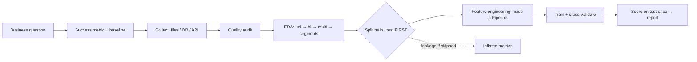

# Module 5 — The Data Science Workflow and Feature Engineering
### मॉड्यूल 5 — Data Science Workflow और Feature Engineering

> **Phase 1 · Foundations** · pandas + scikit-learn 1.4+ (`TargetEncoder`, `set_output`) · Data: Titanic, Tips, Penguins.
> "Better features beat a better algorithm" — and *leak-free* features beat both.

## 0. Module map

| # | Lesson | Outcome |
|---|---|---|
| 5.1 | Business understanding, success metrics, data collection (files, databases, APIs) | Turn a vague ask into a measurable ML problem |
| 5.2 | Data-quality audit and EDA: univariate, bivariate, multivariate, segmentation | Find the 5 facts that matter before modelling |
| 5.3 | Numerical and date features; interactions, polynomials, binning | Create features that encode domain knowledge |
| 5.4 | Categorical and text features; one-hot, ordinal, target encoding | Encode any column without leaking |
| 5.5 | Scaling: normalization vs standardization vs robust | Know which models need scaling and why |
| 5.6 | Data leakage and scikit-learn Pipelines / ColumnTransformer | Ship one object that does all preprocessing safely |
| ★ | **End-to-end case study** — frame, explore, engineer, pipeline, train, score, report | A cross-validated Titanic model with an honest report |



```python
from pathlib import Path
import json, sqlite3, numpy as np, pandas as pd
import matplotlib.pyplot as plt
from sklearn import set_config
set_config(transform_output="pandas")      # transformers return DataFrames with column names

def find_data() -> Path:
    for p in [Path.cwd(), *Path.cwd().parents]:
        for c in (p / "datasets", p / "tutorials" / "data-science-ai" / "datasets"):
            if (c / "titanic.csv").exists():
                return c
    raise FileNotFoundError("Set DATA = Path('<path>/datasets')")

DATA = find_data(); rng = np.random.default_rng(5)
t = pd.read_csv(DATA / "titanic.csv"); tips = pd.read_csv(DATA / "tips.csv")
import sklearn; print("scikit-learn", sklearn.__version__)
```

---

## Lesson 5.1 — Business understanding, metrics and data collection
### पाठ 5.1 — Business समझना, success metrics और data collection

**a. Concept (EN).** Start from the **decision**, not the data: *who* acts on the prediction, *what* they do differently, and *what* a mistake costs. Frame the ML task (classification / regression / ranking / forecasting), the **unit of prediction** (passenger, order, day), the **prediction time** (what is known *then*), and the **metric** that mirrors business cost (recall for fraud, MAE for demand, precision@k for recommendations). Always define a **baseline** (majority class, last value, simple rule) — a model is only useful if it beats it. Data comes from three source types: **files** (CSV, Parquet, Excel), **databases** (SQL), and **APIs** (JSON over HTTP — handle auth, pagination, rate limits, retries with backoff, and timeouts).

**a. Concept (HI).** Data से नहीं, *decision* से शुरू करो: prediction पर कौन क्या करेगा, और गलती की कीमत क्या है। फिर तय करो — classification है या regression, एक row किसकी है, prediction किस समय होगा (उस समय क्या पता होता है), और कौन सा metric business cost जैसा है। हमेशा एक baseline रखो — model उससे बेहतर नहीं तो बेकार। Data तीन जगह से आता है: files, databases, और APIs (auth, pagination, retries, timeout संभालो)।

**b. Analogy.** A doctor doesn't order every test; she first asks "what am I deciding — admit or send home?" The metric is the cost of being wrong: missing a heart attack (false negative) is far worse than an extra night in hospital (false positive).

**c. Math.** Expected cost of a classifier = FN·c_FN + FP·c_FP. With c_FN = 10·c_FP, a model with 5 FN and 40 FP (cost 90) beats one with 10 FN and 5 FP (cost 105) despite having far more errors. Baseline accuracy for Titanic = majority class rate = 549/891 = **61.6%**.

```python
baseline_acc = 1 - t.survived.mean()
print(f"Majority-class baseline accuracy: {baseline_acc:.3f} (predict 'died' for everyone)")
cost = lambda fn, fp, c_fn=10, c_fp=1: fn * c_fn + fp * c_fp
print("cost model A (5 FN, 40 FP):", cost(5, 40), "| model B (10 FN, 5 FP):", cost(10, 5))

# Three sources into one frame: file + database + API (API simulated with a JSON payload)
con = sqlite3.connect(":memory:")
pd.DataFrame({"pclass": [1, 2, 3], "lifeboat_access": [0.9, 0.6, 0.3]}).to_sql("decks", con, index=False)
db = pd.read_sql_query("SELECT * FROM decks", con)
api_payload = json.loads('{"data": [{"embark_town": "Southampton", "port_country": "England"},'
                         '{"embark_town": "Cherbourg", "port_country": "France"},'
                         '{"embark_town": "Queenstown", "port_country": "Ireland"}], "next_page": null}')
api = pd.json_normalize(api_payload["data"])
frame = (t.merge(db, on="pclass", how="left", validate="many_to_one")
          .merge(api, on="embark_town", how="left", validate="many_to_one"))
print(frame[["pclass", "embark_town", "lifeboat_access", "port_country"]].head(3))
```

```python
# norun — a production-grade API fetch: timeout, bounded retries with exponential backoff + jitter, pagination
import random, time, requests
def fetch_all(url, token, max_retries=4):
    rows, params = [], {"page": 1}
    while True:
        for attempt in range(max_retries):
            try:
                r = requests.get(url, params=params, headers={"Authorization": f"Bearer {token}"}, timeout=10)
                if r.status_code == 429 or r.status_code >= 500:
                    raise requests.HTTPError(r.status_code)
                r.raise_for_status(); break
            except (requests.ConnectionError, requests.Timeout, requests.HTTPError):
                time.sleep(min(30, 2 ** attempt) + random.random())
        else:
            raise RuntimeError("API failed after retries")
        body = r.json(); rows += body["data"]
        if not body.get("next_page"):
            return rows
        params["page"] = body["next_page"]
```

*Hindi summary:* Baseline 61.6% है — हर किसी को "मरा" बोल दो तो भी इतनी accuracy। Cost formula से दिखा कि कम गलतियाँ हमेशा बेहतर नहीं, गलती की *कीमत* देखो। File, database और API — तीनों sources को validate करके join किया। असली API code में timeout, retries + backoff और pagination ज़रूरी।

**e. Traps.** Optimising accuracy on imbalanced data (fraud 0.1% → 99.9% accuracy by predicting "no fraud"). Using features unavailable at prediction time. No baseline. Unbounded API retries hammering a failing service. Interview: *"How do you pick a metric?"* Map errors to business cost; choose a metric (and threshold) that ranks models the way the business would.

**f. Memory.** Mnemonic **"D-U-T-M-B: Decision, Unit, Time, Metric, Baseline."** **याद रखो:** *"Baseline नहीं हराया तो model नहीं, खिलौना है।"*

| Q | A |
|---|---|
| First question in a DS project? | What decision will this change? |
| Baseline for classification? | Majority class (or a simple rule) |
| Why "prediction time"? | Features must exist when predicting |
| API resilience basics? | Timeout, bounded retries + backoff + jitter, pagination |
| Fraud metric? | Recall/precision at a cost-based threshold, PR-AUC |

**g. Practice.** (1) Frame a tips-prediction task: unit, target, metric, baseline. (2) Compute the baseline MAE for predicting `tip` with the mean. (3) A rule "women and children survive": compute its accuracy — does it beat the baseline?

<details><summary>Solutions / हल</summary>

```python
print("1: unit = one bill; target = tip; metric = MAE in $; baseline = mean tip")
print("2: baseline MAE =", round((tips.tip - tips.tip.mean()).abs().mean(), 3))
rule = ((t.sex == "female") | (t.age < 13)).astype(int)
print("3: rule accuracy =", round((rule == t.survived).mean(), 3), "vs baseline", round(baseline_acc, 3))
```
</details>

**h. Quiz.** 1) Predicting "no fraud" always gives 99.9% accuracy — good model? 2) Best demand-forecast metric in units? 3) What's a leaky feature for churn prediction? 4) HTTP 429 means? 5) Baseline for time series?

<details><summary>Answers</summary>1) No — zero recall. 2) MAE (or WAPE). 3) "account_closed_date". 4) Too many requests → back off. 5) Last value / seasonal naive.</details>

---

## Lesson 5.2 — Data-quality audit and exploratory data analysis
### पाठ 5.2 — Data quality audit और EDA

**a. Concept (EN).** **Audit** first: shape, dtypes, missing %, duplicates (on a key), invalid values (negative prices, impossible ages), cardinality, and target balance. Then **EDA** in a ladder: **univariate** (distribution, skew, outliers via IQR: below Q1−1.5·IQR or above Q3+1.5·IQR) → **bivariate** (feature vs target: rates by category, box plots, correlations) → **multivariate** (interactions, e.g., sex × class) → **segmentation** (who behaves differently?). Write each finding as a sentence with a number. EDA *generates hypotheses*; it doesn't prove them.

**a. Concept (HI).** पहले audit: shape, dtypes, कितना missing, duplicates, गलत values, unique values कितनी, target कितना balanced। फिर EDA की सीढ़ी: एक column (univariate) → column बनाम target (bivariate) → कई columns साथ (multivariate) → segments। हर finding को एक number वाले वाक्य में लिखो। EDA सवाल पैदा करता है, सबूत नहीं देता।

**b. Analogy.** A new doctor reads your file before treatment: vitals (audit), each test separately (univariate), test vs symptoms (bivariate), combinations (diabetes *and* high BP), and which patient group you belong to (segmentation).

**c. Math.** IQR rule on Titanic fare: Q1 = 7.91, Q3 = 31.0 → IQR = 23.09 → upper fence = 31.0 + 34.6 = **65.6** → ~116 fares are "outliers" — but they're real first-class tickets, not errors. Outlier ≠ wrong.

```python
def audit(df: pd.DataFrame, target: str) -> pd.DataFrame:
    rep = pd.DataFrame({"dtype": df.dtypes.astype(str), "missing_%": (df.isna().mean() * 100).round(1),
                        "unique": df.nunique(), "example": df.iloc[0]})
    print(f"shape={df.shape}  dup_rows={df.duplicated().sum()}  target balance={df[target].value_counts(normalize=True).round(3).to_dict()}")
    return rep.sort_values("missing_%", ascending=False)
print(audit(t, "survived").head(6))

q1, q3 = t.fare.quantile([0.25, 0.75]); fence = q3 + 1.5 * (q3 - q1)
print(f"IQR upper fence {fence:.1f}; outliers {(t.fare > fence).sum()} — mostly class:", t[t.fare > fence].pclass.mode()[0])
print("skew fare:", round(t.fare.skew(), 2), "| skew log1p(fare):", round(np.log1p(t.fare).skew(), 2))

# Bivariate: target rate by each categorical, and numeric relation
for col in ["sex", "pclass", "embark_town", "alone"]:
    print(col, t.groupby(col).survived.mean().round(2).to_dict())
print("survivor vs non-survivor median fare:", t.groupby("survived").fare.median().to_dict())

# Multivariate + segmentation
print(t.pivot_table(index="sex", columns="pclass", values="survived", aggfunc="mean").round(2))
t["segment"] = np.select([t.age < 13, t.sex == "female"], ["child", "woman"], "man")
seg = t.groupby(["segment", "pclass"]).survived.agg(["size", "mean"]).round(2)
print(seg[seg["size"] >= 10])
print("missing age survival:", round(t[t.age.isna()].survived.mean(), 3), "vs known:", round(t[t.age.notna()].survived.mean(), 3))
```

*Hindi summary:* `audit()` एक नज़र में dtype, missing %, unique और target balance दिखाता है। Fare के "outliers" असल में 1st-class tickets हैं — outlier का मतलब गलत नहीं। Bivariate में sex और class सबसे बड़े signals; multivariate में 3rd-class महिलाओं की survival सिर्फ़ 50%। जिनकी age missing है उनकी survival कम — missingness खुद signal है।

**e. Traps.** Deleting outliers that are real. EDA on the full dataset, then "discovering" patterns you test on the same data (do heavy EDA on train only for serious work). Reading correlation as causation. Ignoring tiny segments' noisy rates (always show n). Interview: *"What do you check first in a new dataset?"* Grain/unit, key uniqueness, target definition and balance, missingness, time coverage.

**f. Memory.** Mnemonic **"A-U-B-M-S: Audit, Uni, Bi, Multi, Segments."** **याद रखो:** *"हर rate के साथ n लिखो — छोटा n, बड़ा धोखा।"*

| Q | A |
|---|---|
| IQR outlier fences? | Q1−1.5·IQR, Q3+1.5·IQR |
| Outlier means error? | No — investigate |
| Bivariate for categorical feature vs binary target? | Target rate per category |
| Why show segment sizes? | Small n → unreliable rates |
| Skewed positive variable fix? | log1p |

**g. Practice.** (1) Audit `tips` and report the target balance of `smoker`. (2) IQR outliers in `tips.total_bill`. (3) Find the segment (day × time) with the highest average tip percentage (n ≥ 10).

<details><summary>Solutions / हल</summary>

```python
print(audit(tips, "smoker").head(3))
q1, q3 = tips.total_bill.quantile([.25, .75]); print("2:", int((tips.total_bill > q3 + 1.5 * (q3 - q1)).sum()), "outliers")
tips["tip_pct"] = tips.tip / tips.total_bill
g = tips.groupby(["day", "time"]).tip_pct.agg(["size", "mean"]); print("3:\n", g[g["size"] >= 10].sort_values("mean").tail(1).round(3))
```
</details>

**h. Quiz.** 1) Order of the EDA ladder? 2) What does `nunique` reveal? 3) Is a 1st-class £512 fare an error? 4) What does a pivot of sex × class show? 5) EDA proves causes — true?

<details><summary>Answers</summary>1) Uni → bi → multi → segments. 2) Cardinality (ID-like vs categorical). 3) No — real luxury tickets. 4) Interaction effects. 5) False.</details>

---

## Lesson 5.3 — Numerical and date features; interactions, polynomials, binning
### पाठ 5.3 — Numerical और date features; interactions, polynomials, binning

**a. Concept (EN).** Feature engineering injects knowledge the model can't easily discover. **Numerical**: ratios (fare per person), differences, log transforms for skew, clipping/winsorising extremes, counts (family size = sibsp + parch + 1). **Dates**: year, month, day-of-week, is_weekend, days since an event, and **cyclical** encoding (sin/cos of month so Dec is next to Jan). **Interactions**: products/combos (sex × class) let linear models represent "it depends". **Polynomials** (x², x·y) capture curvature — but explode feature count (d features, degree 2 → d(d+3)/2) and overfit. **Binning** (`KBinsDiscretizer`, `pd.cut`) trades precision for robustness and non-linearity in linear models. Tree models learn interactions/non-linearity themselves; linear models need them engineered.

**a. Concept (HI).** Feature engineering में हम अपना domain ज्ञान model में डालते हैं: ratios (प्रति व्यक्ति fare), family size, skew के लिए log, dates से month/weekday, और महीने का sin/cos ताकि December और January पास दिखें। Interaction (sex × class) से linear model "निर्भर करता है" वाली बात सीखता है। Polynomial से curve आती है पर features बहुत बढ़ते हैं और overfit का ख़तरा। Binning से non-linearity आसान होती है। Tree models ये खुद सीख लेते हैं, linear models को हमें देना पड़ता है।

**b. Analogy.** A property dealer doesn't price a flat by area alone: *price per sq ft* (ratio), *age of building* (date difference), *sea-facing × floor* (interaction). Binning = "1BHK / 2BHK / 3BHK" instead of exact square feet.

**c. Math.** Cyclical month: (sin(2πm/12), cos(2πm/12)). Dec (12) → (0, 1), Jan (1) → (0.5, 0.866): Euclidean distance 0.52, while as plain numbers |12 − 1| = 11. Polynomial degree-2 features for d = 10 → 10 + 10 + 45 = 65 features.

```python
from sklearn.preprocessing import PolynomialFeatures, KBinsDiscretizer
fe = t.copy()
fe["family_size"] = fe.sibsp + fe.parch + 1
fe["fare_per_person"] = fe.fare / fe.family_size
fe["log_fare"] = np.log1p(fe.fare)
fe["is_alone"] = (fe.family_size == 1).astype(int)
fe["age_x_class"] = fe.age * fe.pclass                       # interaction: old + low class
print(fe.groupby("family_size").survived.agg(["size", "mean"]).round(2).T)

# Dates: a synthetic booking date per passenger (Titanic sailed 1912-04-10)
fe["booking_date"] = pd.Timestamp("1912-04-10") - pd.to_timedelta(rng.integers(1, 120, len(fe)), unit="D")
fe["days_before_sailing"] = (pd.Timestamp("1912-04-10") - fe.booking_date).dt.days
fe["book_month"] = fe.booking_date.dt.month
fe["book_dow"] = fe.booking_date.dt.dayofweek
fe["month_sin"], fe["month_cos"] = np.sin(2 * np.pi * fe.book_month / 12), np.cos(2 * np.pi * fe.book_month / 12)
dist = lambda m1, m2: np.hypot(np.sin(2*np.pi*m1/12) - np.sin(2*np.pi*m2/12), np.cos(2*np.pi*m1/12) - np.cos(2*np.pi*m2/12))
print("cyclic distance Dec–Jan:", round(dist(12, 1), 2), "| Jun–Jan:", round(dist(6, 1), 2))

# Polynomials and binning
poly = PolynomialFeatures(degree=2, include_bias=False)
P = poly.fit_transform(fe[["age", "fare"]].fillna(0)); print("poly features:", list(P.columns))
print("degree-2 features for d=10:", PolynomialFeatures(2, include_bias=False).fit(np.zeros((1, 10))).n_output_features_)
fe["age_band"] = pd.cut(fe.age, [0, 12, 18, 35, 60, 100], labels=["child", "teen", "young", "middle", "senior"])
print(fe.groupby("age_band", observed=True).survived.mean().round(2).to_dict())
kb = KBinsDiscretizer(n_bins=4, encode="ordinal", strategy="quantile", quantile_method="averaged_inverted_cdf")
fe["fare_q"] = kb.fit_transform(fe[["fare"]])["fare"]
print("fare quartile survival:", fe.groupby("fare_q").survived.mean().round(2).to_dict())
```

*Hindi summary:* family size, प्रति व्यक्ति fare, log fare, और age × class interaction बनाए — 2–4 लोगों वाले परिवारों की survival सबसे ज़्यादा। Dates से days-before, month, weekday और cyclic sin/cos (Dec–Jan पास)। Polynomial features कितनी तेज़ी से बढ़ते हैं, और binning से age bands और fare quartiles।

**e. Traps.** Ratios with zero denominators. Creating features from the target (e.g., "group survival rate" computed on all rows including the row itself). Polynomial explosion without regularisation. Binning edges chosen by looking at the test set. Interview: *"Do tree models need feature engineering?"* Less for monotone transforms (logs don't matter to trees), but ratios, aggregates, and domain features still help a lot.

**f. Memory.** Mnemonic **"R-L-D-I-P-B: Ratio, Log, Date, Interaction, Polynomial, Bin."** **याद रखो:** *"महीना गोल है — sin/cos से घुमाओ।"*

| Q | A |
|---|---|
| Family size formula? | sibsp + parch + 1 |
| Why sin/cos for month? | Make it cyclic (Dec near Jan) |
| Degree-2 poly features for d? | d(d+3)/2 (no bias) |
| Do trees care about log transforms? | No (order-preserving) |
| Binning helps which models most? | Linear models |

**g. Practice.** (1) In `tips`, create `bill_per_person` and see whether tip % rises or falls with it (correlation). (2) Encode `day` cyclically (Thu..Sun as 3..6 of a 7-day week). (3) Bin `total_bill` into quintiles and show mean tip % per bin.

<details><summary>Solutions / हल</summary>

```python
tips["bill_per_person"] = tips.total_bill / tips["size"]
print("1: corr", round(tips[["bill_per_person", "tip_pct"]].corr().iloc[0, 1], 3))
dmap = {"Thur": 3, "Fri": 4, "Sat": 5, "Sun": 6}
tips["day_sin"] = np.sin(2 * np.pi * tips.day.map(dmap) / 7); print("2:", tips.day_sin.round(2).unique())
print("3:", tips.groupby(pd.qcut(tips.total_bill, 5), observed=True).tip_pct.mean().round(3).tolist())
```
</details>

**h. Quiz.** 1) Why log a skewed fare for linear models? 2) What's an interaction feature? 3) Risk of degree-5 polynomials? 4) Quantile vs uniform bins? 5) Is "days since signup" a good churn feature?

<details><summary>Answers</summary>1) Reduces skew/outlier leverage, closer-to-linear relation. 2) A combination (product/cross) of two features. 3) Huge feature count + overfitting. 4) Equal counts vs equal widths. 5) Yes, if computed at prediction time.</details>

---

## Lesson 5.4 — Categorical and text features: one-hot, ordinal, target encoding
### पाठ 5.4 — Categorical और text features: one-hot, ordinal, target encoding

**a. Concept (EN).** Models need numbers. **One-hot** (`OneHotEncoder(handle_unknown="ignore")`): one 0/1 column per category — safe, no fake order, but wide for high cardinality. **Ordinal** (`OrdinalEncoder`): integers — correct only when the order is real (S < M < L, 1st < 2nd < 3rd); fine for trees in general. **Target encoding** (`TargetEncoder`): replace a category with a *smoothed* mean of the target, computed with **internal cross-fitting** so a row never sees its own label — powerful for high cardinality (zip codes, product IDs), but leaks badly if done naively. **Rare-category grouping** (`min_frequency`) and an explicit "missing" category. **Text**: length/word-count features, keyword flags, `CountVectorizer`/`TfidfVectorizer` bag-of-words (Module 12 goes deep), regex extraction (titles from names, deck from cabin).

**a. Concept (HI).** Model को numbers चाहिए। One-hot: हर category का अलग 0/1 column — सुरक्षित, पर ज़्यादा categories में बहुत चौड़ा। Ordinal: integers — तभी सही जब असली क्रम हो (S < M < L)। Target encoding: category को target के smoothed औसत से बदलो — बहुत categories के लिए बढ़िया, पर cross-fitting के बिना leakage! दुर्लभ categories को मिलाओ, missing की अलग category रखो। Text से length, keywords, और TF-IDF features।

**b. Analogy.** One-hot = separate tick-boxes on a form ("Hindu / Muslim / Sikh / Christian / Other") — no order implied. Ordinal = T-shirt sizes. Target encoding = replacing each school's name with its average board result — useful, but if you include *your own* marks in your school's average, you've cheated.

**c. Math.** Smoothed target mean: enc(c) = (n_c·ȳ_c + m·ȳ) / (n_c + m), where m is the smoothing strength. A category with 2 rows, both positive (ȳ_c = 1), overall ȳ = 0.38, m = 10 → (2 + 3.8)/12 = **0.48**, not 1.0. One-hot width = Σ (cardinality − 1 if `drop="first"`).

```python
from sklearn.preprocessing import OneHotEncoder, OrdinalEncoder, TargetEncoder
from sklearn.feature_extraction.text import CountVectorizer

ohe = OneHotEncoder(handle_unknown="ignore", sparse_output=False, min_frequency=20)
O = ohe.fit_transform(t[["embark_town", "who"]].fillna("missing")); print("one-hot cols:", list(O.columns))
print("unseen category →", ohe.transform(pd.DataFrame({"embark_town": ["Mars"], "who": ["man"]})).values)

ordn = OrdinalEncoder(categories=[["Third", "Second", "First"]])
print("ordinal class:", ordn.fit_transform(t[["class"]])["class"].unique())

# Target encoding: naive (leaky) vs cross-fitted, on a high-cardinality synthetic "ticket_office" feature
t["ticket_office"] = rng.integers(0, 300, len(t)).astype(str)            # pure noise, ~3 rows per value
naive = t.groupby("ticket_office").survived.transform("mean")
print("NAIVE target-encoding corr with label:", round(np.corrcoef(naive, t.survived)[0, 1], 3), "← leakage on pure noise!")
te = TargetEncoder(target_type="binary")
cf = te.fit_transform(t[["ticket_office"]], t.survived)["ticket_office"]
print("CROSS-FITTED corr:", round(np.corrcoef(cf, t.survived)[0, 1], 3), "(≈ 0, as it should be)")
smooth = lambda n, yc, y, m=10: (n * yc + m * y) / (n + m)
print("smoothed mean (n=2, ȳc=1):", round(smooth(2, 1, t.survived.mean()), 3))

# Text-ish features: synthetic passenger notes
notes = pd.Series(["VIP traveller with family", "crew member", "family of five, third class", "solo traveller", "VIP"])
print(pd.DataFrame({"len": notes.str.len(), "words": notes.str.split().str.len(), "has_vip": notes.str.contains("VIP").astype(int)}))
cv = CountVectorizer(); bow = cv.fit_transform(notes)
print("bag-of-words vocab:", cv.get_feature_names_out()[:8], "| matrix", bow.shape)
```

*Hindi summary:* One-hot (दुर्लभ categories मिलाकर, अनजानी category पर zeros), ordinal (असली क्रम के साथ)। सबसे ज़रूरी demo: एक पूरी तरह random "ticket_office" column पर naive target encoding ने label से correlation दिखाया — यानी leakage! Cross-fitted `TargetEncoder` ने ≈ 0 दिया। Text से length, word count, keyword flag और bag-of-words।

**e. Traps.** `pd.get_dummies` on train and test separately → mismatched columns (use a fitted `OneHotEncoder`). Ordinal-encoding nominal categories for linear models (implies 3 = 3 × 1). Naive target encoding. Forgetting unseen categories at inference. Interview: *"How do you encode a 50 000-level categorical?"* Target encoding with cross-fitting + smoothing, hashing, or learned embeddings; group rare levels.

**f. Memory.** Mnemonic **"One-hot = No order, Ordinal = Real order, Target = Cross-fit or Cheat."** **याद रखो:** *"अपना ही label अपनी feature में — यही leakage है।"*

| Q | A |
|---|---|
| Encoder for nominal, low cardinality? | One-hot |
| Handle unseen categories? | `handle_unknown="ignore"` |
| Target encoding leak fix? | Cross-fitting + smoothing |
| Ordinal OK for? | True order, or tree models |
| Simple text features? | length, word count, keyword flags, TF-IDF |

**g. Practice.** (1) One-hot encode `tips.day` and `tips.time`; how many columns? (2) Target-encode `tips.day` for `tip_pct > 0.16` and print the mapping. (3) Extract the first word of each note as a category and one-hot it.

<details><summary>Solutions / हल</summary>

```python
print("1:", OneHotEncoder(sparse_output=False).fit_transform(tips[["day", "time"]]).shape[1], "columns")
y_hi = (tips.tip_pct > 0.16).astype(int)
te2 = TargetEncoder(target_type="binary").fit(tips[["day"]], y_hi)
print("2:", {k: round(float(v), 3) for k, v in zip(te2.categories_[0], te2.encodings_[0])})
first = notes.str.split().str[0].to_frame("first")
print("3:", list(OneHotEncoder(sparse_output=False).fit_transform(first).columns))
```
</details>

**h. Quiz.** 1) Why `drop="first"` sometimes? 2) Is pclass better one-hot or ordinal for logistic regression? 3) Target encoding on a random ID — expected true signal? 4) What does `min_frequency` do? 5) Bag-of-words ignores?

<details><summary>Answers</summary>1) Avoid perfect collinearity in unregularised linear models. 2) Either can work; one-hot avoids assuming equal steps. 3) None — any apparent signal is leakage. 4) Groups rare categories into "infrequent". 5) Word order.</details>

---

## Lesson 5.5 — Scaling: normalization vs standardization vs robust
### पाठ 5.5 — Scaling: normalization बनाम standardization बनाम robust

**a. Concept (EN).** **Standardization** (`StandardScaler`): z = (x − μ)/σ → mean 0, sd 1. **Normalization / min-max** (`MinMaxScaler`): (x − min)/(max − min) → [0,1]; sensitive to outliers. **Robust** (`RobustScaler`): (x − median)/IQR — outlier-resistant. **Power/Quantile** transforms (Yeo-Johnson, quantile-to-normal) fix skew. Who needs scaling? Anything distance- or gradient-based: kNN, k-means, SVM, PCA, linear/logistic regression with regularisation, neural networks. Trees and tree ensembles don't. **Fit the scaler on training data only**, then transform test data with the same μ, σ.

**a. Concept (HI).** Standardization: mean 0, sd 1। Min-max: 0 से 1 के बीच, पर outlier से बिगड़ जाता है। Robust: median और IQR से — outlier पर स्थिर। Distance या gradient वाले models (kNN, SVM, PCA, regularised regression, neural nets) को scaling चाहिए, trees को नहीं। Scaler सिर्फ़ train data पर fit करो, test पर वही transform लगाओ।

**b. Analogy.** Comparing a cricketer's runs (thousands) and wickets (tens) without scaling is like adding rupees and kilograms. Standardising expresses both as "how many SDs above average".

**c. Math, worked.** Fares [7, 8, 9, 512]: min-max of 9 = (9−7)/505 = 0.004 — everything squashed near 0 by one outlier. Robust: median 8.5, IQR = Q3 − Q1 = 134.75 − 7.75 = 127 → (9 − 8.5)/127 = 0.004, and the outlier lands at ≈ 4 instead of defining the whole scale; standard z of 9 ≈ −0.57. kNN distance with unscaled (age, fare) is dominated by fare.

```python
from sklearn.preprocessing import StandardScaler, MinMaxScaler, RobustScaler, PowerTransformer
from sklearn.neighbors import KNeighborsClassifier
from sklearn.model_selection import train_test_split, cross_val_score
from sklearn.pipeline import make_pipeline

x = pd.DataFrame({"fare": [7.0, 8.0, 9.0, 512.0]})
for sc in (StandardScaler(), MinMaxScaler(), RobustScaler()):
    print(f"{type(sc).__name__:15s}", sc.fit_transform(x)["fare"].round(3).tolist())
print("Yeo-Johnson skew:", round(t.fare.skew(), 2), "→",
      round(PowerTransformer().fit_transform(t[["fare"]])["fare"].skew(), 2))

# Scaling matters for kNN, not for trees
from sklearn.ensemble import RandomForestClassifier
Xn = t[["age", "fare", "pclass", "sibsp", "parch"]].fillna(t[["age"]].median()); yn = t.survived
for name, model in [("kNN raw", KNeighborsClassifier(15)),
                    ("kNN scaled", make_pipeline(StandardScaler(), KNeighborsClassifier(15))),
                    ("Forest raw", RandomForestClassifier(200, random_state=0)),
                    ("Forest scaled", make_pipeline(StandardScaler(), RandomForestClassifier(200, random_state=0)))]:
    print(f"{name:13s} CV accuracy {cross_val_score(model, Xn, yn, cv=5).mean():.3f}")

# Fit on train only
Xtr, Xte = train_test_split(Xn, test_size=0.25, random_state=0)
sc = StandardScaler().fit(Xtr)
print("train mean after scaling ≈0:", sc.transform(Xtr).mean().abs().max().round(6),
      "| test mean (not exactly 0, correct!):", sc.transform(Xte).mean().round(3).tolist()[:2])
```

*Hindi summary:* एक outlier (512) ने min-max को बिगाड़ दिया; robust scaler बेहतर। Yeo-Johnson से skew कम। kNN scaling के बाद बेहतर हुआ, random forest पर कोई फ़र्क नहीं। Scaler को सिर्फ़ train पर fit किया — इसलिए test का mean ठीक 0 नहीं, और यही सही है।

**e. Traps.** Fitting the scaler on all data before splitting (leakage). Scaling one-hot columns (usually unnecessary; harmless for trees, debated for linear). Forgetting to save and reuse the fitted scaler at inference. Interview: *"Standardization vs normalization?"* z-score (unbounded, robust-ish to scale) vs min-max (bounded, outlier-sensitive); choose by model and outliers.

**f. Memory.** Mnemonic **"Distance & Gradient Demand Scaling; Trees Don't."** **याद रखो:** *"Scaler train पर सीखे, test पर सिर्फ़ लगे।"*

| Q | A |
|---|---|
| z-score formula? | (x − μ)/σ |
| Outlier-robust scaler? | RobustScaler |
| Need scaling: kNN or random forest? | kNN |
| Where do μ, σ come from? | Training data only |
| Fix heavy skew? | Log / Yeo-Johnson / quantile transform |

**g. Practice.** (1) Scale tips' `total_bill` and `size` with StandardScaler and show means/sd. (2) Compare kNN on penguins (predict species) with and without scaling. (3) Show min-max output for a test value larger than the training max.

<details><summary>Solutions / हल</summary>

```python
s = StandardScaler().fit_transform(tips[["total_bill", "size"]]); print("1:", s.mean().round(3).tolist(), s.std(ddof=0).round(3).tolist())
pg = pd.read_csv(DATA / "penguins.csv").dropna(); Xp = pg[["bill_length_mm", "bill_depth_mm", "flipper_length_mm", "body_mass_g"]]
for nm, m in [("raw", KNeighborsClassifier(5)), ("scaled", make_pipeline(StandardScaler(), KNeighborsClassifier(5)))]:
    print("2:", nm, round(cross_val_score(m, Xp, pg.species, cv=5).mean(), 3))
mm = MinMaxScaler().fit(pd.DataFrame({"v": [0, 10]})); print("3:", mm.transform(pd.DataFrame({"v": [15]})).values, "(>1 — unbounded at test time)")
```
</details>

**h. Quiz.** 1) Does scaling change a decision tree's splits' quality? 2) Min-max range on training data? 3) Standardised feature's sd? 4) Why fit on train only? 5) Best scaler with heavy outliers?

<details><summary>Answers</summary>1) No. 2) [0, 1]. 3) 1. 4) Test data must stay unseen → no leakage. 5) RobustScaler (or log/quantile first).</details>

---

## Lesson 5.6 — Data leakage and scikit-learn Pipelines
### पाठ 5.6 — Data leakage और scikit-learn Pipelines

**a. Concept (EN).** **Leakage** = information at training time that won't exist at prediction time, producing great offline scores and failing in production. Types: **target leakage** (feature derived from/after the label: "refund_issued" for fraud), **train–test contamination** (fitting imputers/scalers/encoders/feature selection on all data), **temporal leakage** (random split on time-ordered data; using future aggregates), **group leakage** (same patient/customer in train and test → use `GroupKFold`). The cure is structural: split first, and put *every* learned transformation inside a **`Pipeline`**, with **`ColumnTransformer`** routing numeric vs categorical columns. Then `cross_val_score(pipeline, X, y)` refits preprocessing within each fold automatically. One fitted object = preprocessing + model → serialise with `joblib` and serve it (Module 17).

**a. Concept (HI).** Leakage = training में ऐसी जानकारी जो prediction के समय नहीं होगी — offline score शानदार, production में फ़ेल। प्रकार: target leakage (label के बाद बनी feature), contamination (पूरे data पर scaler/imputer fit करना), temporal (भविष्य की जानकारी), group (एक ही ग्राहक train और test दोनों में)। इलाज: पहले split करो, और हर सीखने वाला step `Pipeline` के अंदर रखो; `ColumnTransformer` से numeric और categorical अलग-अलग। फिर cross-validation हर fold में सब कुछ फिर से fit करता है।

**b. Analogy.** Leakage = a student who saw the answer key before the exam; the score is real, the knowledge isn't. A Pipeline is a *sealed tiffin service*: the same kitchen steps happen in the same order for every customer, and nobody can peek at tomorrow's menu.

**c. Math.** Feature selection leakage, classic demo: n = 100 rows, p = 5 000 random features, random labels. Selecting the top-20 features by correlation *on all data*, then cross-validating, gives accuracy ≫ 50% — on pure noise. Inside a pipeline it falls back to ≈ 50%.

```python
from sklearn.compose import ColumnTransformer
from sklearn.impute import SimpleImputer
from sklearn.linear_model import LogisticRegression
from sklearn.feature_selection import SelectKBest, f_classif
from sklearn.model_selection import StratifiedKFold

# 1) Leakage demo on pure noise
Xr = rng.standard_normal((100, 5000)); yr = rng.integers(0, 2, 100)
cv = StratifiedKFold(5, shuffle=True, random_state=0)
top = SelectKBest(f_classif, k=20).fit(Xr, yr).get_support()                  # WRONG: selection on all data
leaky = cross_val_score(LogisticRegression(max_iter=1000), Xr[:, top], yr, cv=cv).mean()
safe = cross_val_score(make_pipeline(SelectKBest(f_classif, k=20), LogisticRegression(max_iter=1000)), Xr, yr, cv=cv).mean()
print(f"noise data — leaky CV accuracy {leaky:.2f} vs pipeline CV accuracy {safe:.2f}")

# 2) Target leakage: 'alive' is the label in disguise
print("corr(alive=='yes', survived) =", np.corrcoef(t.alive == "yes", t.survived)[0, 1])

# 3) A proper ColumnTransformer pipeline
num = ["age", "fare", "sibsp", "parch"]; cat = ["sex", "embark_town", "pclass"]
pre = ColumnTransformer([
    ("num", make_pipeline(SimpleImputer(strategy="median", add_indicator=True), StandardScaler()), num),
    ("cat", make_pipeline(SimpleImputer(strategy="most_frequent"), OneHotEncoder(handle_unknown="ignore", sparse_output=False)), cat)])
pipe = make_pipeline(pre, LogisticRegression(max_iter=1000))
X, y = t[num + cat], t.survived
scores = cross_val_score(pipe, X, y, cv=StratifiedKFold(5, shuffle=True, random_state=0))
print(f"pipeline CV accuracy {scores.mean():.3f} ± {scores.std():.3f}")
print("output features:", list(pipe.fit(X, y)[0].get_feature_names_out())[:7], "...")
```

*Hindi summary:* पूरी तरह random data पर भी, पूरे data पर feature selection करके CV accuracy 50% से बहुत ऊपर — यही leakage। Pipeline के अंदर वही ≈ 50% पर लौट आया। `alive` column असल में label ही है (correlation 1)। फिर ColumnTransformer + Pipeline से सही model, CV ≈ 0.80।

**e. Traps.** `fit_transform` on the whole dataset "just for EDA" and reusing it. Random splits on time series (use `TimeSeriesSplit`). Duplicate rows across train/test. Tuning hyperparameters on the test set (use nested CV or a validation set). Interview: *"Your model got 99% AUC offline and 60% in production — what happened?"* Suspect leakage first: feature availability timing, preprocessing fit on all data, duplicates/groups across splits, label definition drift.

**f. Memory.** Mnemonic **"T-C-T-G: Target, Contamination, Temporal, Group"** — the four leaks. **याद रखो:** *"पहले split, फिर सब कुछ Pipeline में।"*

| Q | A |
|---|---|
| Target leakage example? | Feature created after the outcome |
| Prevent preprocessing leakage? | Put it inside a Pipeline |
| Route columns to transformers? | ColumnTransformer |
| Same customer in train and test? | GroupKFold |
| Time-ordered data CV? | TimeSeriesSplit |

**g. Practice.** (1) Add `alive` to the features and show the "perfect" CV score. (2) Replace LogisticRegression with RandomForest in the pipeline and compare. (3) Use `GroupKFold` with a synthetic `family_id` (rows with same `fare` and `embark_town`) — does the score drop?

<details><summary>Solutions / हल</summary>

```python
from sklearn.model_selection import GroupKFold
leak_pre = ColumnTransformer(pre.transformers + [("leak", OneHotEncoder(sparse_output=False), ["alive"])])
print("1: with 'alive':", cross_val_score(make_pipeline(leak_pre, LogisticRegression(max_iter=1000)), t[num + cat + ["alive"]], y, cv=5).mean().round(3))
rf = make_pipeline(pre, RandomForestClassifier(300, min_samples_leaf=3, random_state=0))
print("2: forest:", cross_val_score(rf, X, y, cv=5).mean().round(3))
fam = t.fare.astype(str) + t.embark_town.fillna("missing")
print("3: GroupKFold:", cross_val_score(pipe, X, y, cv=GroupKFold(5), groups=fam).mean().round(3), "vs shuffled", scores.mean().round(3))
```
</details>

**h. Quiz.** 1) Is fitting an imputer on all data leakage? 2) What does `add_indicator=True` add? 3) Why is test accuracy computed once, at the end? 4) Leakage in time series random split? 5) What does a Pipeline guarantee during CV?

<details><summary>Answers</summary>1) Yes (mild but real). 2) "was missing" flag columns. 3) Repeated peeking turns it into a validation set → optimistic estimate. 4) Training on the future to predict the past. 5) Each fold's preprocessing is fit only on that fold's training part.</details>

---

## ★ End-to-end case study — Titanic, done properly
### ★ End-to-end case study — Titanic, सही तरीके से

**Frame:** *Decision*: a (historical) lifeboat-priority simulation; *unit*: passenger; *target*: survived; *metric*: ROC-AUC (ranking) + accuracy; *baseline*: majority 61.6% and the "women & children" rule. **Steps:** split → engineer (custom transformer) → pipeline → CV-compare models → test once → report.

```python
from sklearn.base import BaseEstimator, TransformerMixin
from sklearn.ensemble import HistGradientBoostingClassifier
from sklearn.metrics import roc_auc_score, accuracy_score, classification_report
import joblib, tempfile

class TitanicFeatures(BaseEstimator, TransformerMixin):
    """Stateless domain features — safe because nothing is learned from the data."""
    def fit(self, X, y=None):
        return self
    def transform(self, X):
        X = X.copy()
        X["family_size"] = X.sibsp + X.parch + 1
        X["is_alone"] = (X.family_size == 1).astype(int)
        X["log_fare_pp"] = np.log1p(X.fare / X.family_size)
        X["is_child"] = (X.age < 13).astype(float).where(X.age.notna())
        return X

raw_cols = ["pclass", "sex", "age", "sibsp", "parch", "fare", "embark_town", "who"]
X, y = t[raw_cols], t.survived
X_tr, X_te, y_tr, y_te = train_test_split(X, y, test_size=0.2, stratify=y, random_state=42)   # split FIRST

num = ["age", "fare", "sibsp", "parch", "family_size", "log_fare_pp", "is_child", "is_alone"]
cat = ["pclass", "sex", "embark_town", "who"]
pre = ColumnTransformer([
    ("num", make_pipeline(SimpleImputer(strategy="median", add_indicator=True), StandardScaler()), num),
    ("cat", make_pipeline(SimpleImputer(strategy="most_frequent"), OneHotEncoder(handle_unknown="ignore", sparse_output=False)), cat)])

models = {"logreg": LogisticRegression(max_iter=2000, C=0.5),
          "forest": RandomForestClassifier(400, min_samples_leaf=3, random_state=0),
          "hgb": HistGradientBoostingClassifier(max_depth=3, learning_rate=0.05, max_iter=300, random_state=0)}
cvk = StratifiedKFold(5, shuffle=True, random_state=0); results = {}
for name, est in models.items():
    p = make_pipeline(TitanicFeatures(), pre, est)
    results[name] = cross_val_score(p, X_tr, y_tr, cv=cvk, scoring="roc_auc")
    print(f"{name:7s} CV ROC-AUC {results[name].mean():.3f} ± {results[name].std():.3f}")

best = max(results, key=lambda k: results[k].mean())
final = make_pipeline(TitanicFeatures(), pre, models[best]).fit(X_tr, y_tr)
proba = final.predict_proba(X_te)[:, 1]; pred = (proba >= 0.5).astype(int)
rule = ((X_te.sex == "female") | (X_te.age < 13)).astype(int)
print(f"\nTEST (touched once) — {best}: ROC-AUC {roc_auc_score(y_te, proba):.3f}, accuracy {accuracy_score(y_te, pred):.3f}")
print(f"baselines: majority {1 - y_te.mean():.3f}, women-and-children rule {accuracy_score(y_te, rule):.3f}")
print(classification_report(y_te, pred, target_names=["died", "survived"], digits=3))

path = Path(tempfile.mkdtemp()) / "titanic_pipeline.joblib"; joblib.dump(final, path)
reloaded = joblib.load(path)
new = pd.DataFrame([{"pclass": 3, "sex": "male", "age": 28, "sibsp": 0, "parch": 0, "fare": 8.05, "embark_town": "Southampton", "who": "man"},
                    {"pclass": 1, "sex": "female", "age": None, "sibsp": 1, "parch": 2, "fare": 120, "embark_town": "Cherbourg", "who": "woman"}])
print("saved + reloaded pipeline predictions:", reloaded.predict_proba(new)[:, 1].round(3))
```

**Report (template — fill from the printed numbers):**
1. *Problem & metric:* survival ranking, ROC-AUC; baseline accuracy 61.6%.
2. *Data quality:* age 19.9% missing (imputed with median + missing flag), deck dropped (77% missing), `alive` excluded (label leakage).
3. *Features:* family size, alone flag, log fare per person, child flag, one-hot class/sex/port/who.
4. *Model selection:* 5-fold stratified CV on train only; best model chosen by mean AUC (± sd reported).
5. *Test result:* one evaluation on the held-out 20%; compare against both baselines.
   *Honest finding on our run:* the boosted model's test accuracy (0.78) only **ties** the women-and-children rule — its real gain is ranking (AUC) and per-passenger probabilities. Reporting that is the job; hiding it is how trust is lost.
6. *Limits:* small data (891 rows) → ±3% swings between seeds; historical, not a deployable decision system.

*Hindi summary:* सबसे पहले split, फिर custom `TitanicFeatures` transformer + ColumnTransformer + model को एक pipeline में रखा। तीन models को सिर्फ़ train data पर CV से compare किया, सबसे अच्छा चुना, और test पर *एक बार* score किया — baseline और "women-and-children" rule दोनों से तुलना की। पूरी pipeline joblib में save करके दोबारा load की और नए passengers पर prediction दी।

---

## Module 5 cheat sheet

| Step | Do | Don't |
|---|---|---|
| Frame | decision, unit, prediction time, metric, baseline | start from "let's try XGBoost" |
| Audit | dtypes, missing, key-dupes, invalid, target balance | dedupe without a key |
| EDA | uni → bi → multi → segments, always with n | delete real outliers |
| Features | ratios, logs, dates (cyclic), interactions, bins | build features from the label |
| Encode | one-hot (nominal), ordinal (real order), target (cross-fit) | `get_dummies` separately on test |
| Scale | Standard/Robust for distance & gradient models | fit on all data |
| Leakage | split first; Pipeline + ColumnTransformer; Group/TimeSeries CV | tune on test |

**याद रखो:** *Decision से शुरू · Baseline हराओ · पहले split · सब कुछ Pipeline में · Test सिर्फ़ एक बार।*

## Spaced repetition plan

| Review | Task |
|---|---|
| Day 1 | Flashcards; list the 4 leakage types with one example each |
| Day 3 | Re-run the noise leakage demo and explain it in Hindi |
| Day 7 | All quizzes; rebuild the ColumnTransformer from memory |
| Day 21 | Repeat the case study on `penguins.csv` (predict species) |
| Day 60 | Write a one-page report for a real dataset of your choice using the report template |

## Sources

- scikit-learn User Guide — Pipelines & composite estimators: https://scikit-learn.org/stable/modules/compose.html
- Preprocessing (scalers, encoders): https://scikit-learn.org/stable/modules/preprocessing.html · TargetEncoder: https://scikit-learn.org/stable/modules/preprocessing.html#target-encoder
- Common pitfalls (data leakage): https://scikit-learn.org/stable/common_pitfalls.html
- Cross-validation (Group, TimeSeries): https://scikit-learn.org/stable/modules/cross_validation.html
- Kaufman et al., *Leakage in Data Mining*, ACM TKDD 2012: https://doi.org/10.1145/2382577.2382579
- Micci-Barreca, *A preprocessing scheme for high-cardinality categorical attributes*, SIGKDD Explorations 2001: https://doi.org/10.1145/507533.507538
- CRISP-DM overview (business understanding → deployment): https://www.datascience-pm.com/crisp-dm-2/
- Requests timeouts/retries: https://requests.readthedocs.io/en/latest/user/advanced/#timeouts
